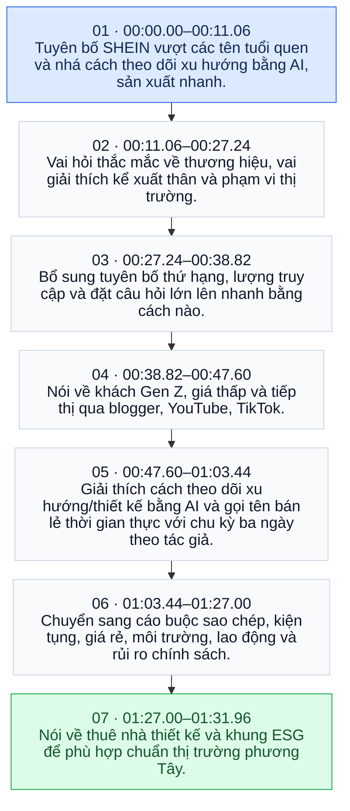

# SHEIN: kể tăng trưởng qua giá, tốc độ và mặt trái

[Video gốc — @sitcomtaichinh](https://www.tiktok.com/@sitcomtaichinh/video/7319879610357878023) · ID `7319879610357878023`

**Tóm tắt cách kể:** Kết quả vượt thương hiệu quen → nhá nguyên nhân → đối thoại hỏi lại → khách hàng và tiếp thị → công nghệ/tốc độ → mặt trái → phản ứng. Khung kể này nối thành công với chi phí của mô hình thay vì đóng ở thành tích; không chứng minh những luận điểm kinh doanh đều đúng.

[Sơ đồ diễn biến](#mindmap) · [Diễn biến](#dien-bien) · [Nhịp cảm xúc](#cam-xuc) · [Cách áp dụng](#ap-dung)

## Sơ đồ diễn biến

Đọc từ trên xuống: mỗi hộp là một nhịp theo mốc ASR hoặc khung hình được ghi trong phân tích. Xanh dương là mở đầu, xanh lá là nhịp cuối. Chi tiết và giới hạn nằm trong phân tích bên dưới.

[Mã Mermaid riêng](../mindmaps/7319879610357878023.mmd)

## Dữ liệu và nguồn

**Cách thể hiện:** Tiểu phẩm đối thoại

**Phạm vi học:** Xem phạm vi kiểm và giới hạn từng ca.

**Ngữ cảnh thương mại:** Chưa xác nhận hợp tác thương mại; xem các đoạn tự quảng bá/giới hạn được ghi riêng.

- Đăng: 2024-01-03T14:31:27+00:00. Metadata lấy: 2026-11-15T04:03:47.045619+00:00.
- **1,400,000 view**; thích 83,900; bình luận 840; chia sẻ 735; lưu 4,719. Dấu phẩy tách hàng nghìn.
- Thời lượng media: 92.09s.
- **42.42× P50** 33,000 của 149 bài đủ 48h trong snapshot kênh. Clip có trong cửa sổ baseline. Không phải thống kê toàn bộ kênh.

## Phạm vi kiểm

Đã tải media, xem khung chọn lọc và đọc ASR có mốc lưu lúc 2026-11-15T04:05:06.178181+00:00. Đối chiếu cùng ID và thời lượng, lệch 0.026s. **Chưa nghe toàn âm hoặc xem chuyển động liên tục; chưa xác nhận toàn văn ASR hay mọi dữ kiện trong clip.**

Media SHA256: `dc68837eff789bf2d94e8474fd5aad50590a86585ddafa8849a2fcc27ba7a820`. [Metadata và các hash khác](../videos.json). Video/ASR đầy đủ giữ ở bộ nghiên cứu cục bộ; bản chia sẻ giữ link gốc, trích ngắn và phân tích riêng.

## Lời hứa và câu hỏi trung tâm

**Lời hứa:** Giải thích vì sao một thương hiệu thời trang có thể phát triển nhanh và những vấn đề đi cùng mô hình đó.

**Câu hỏi:** Trong câu chuyện của tác giả, giá, tiếp thị và tốc độ vận hành đóng vai gì trong tăng trưởng SHEIN?

## Mở đầu: lời và hình

ASR mở bằng tuyên bố quy mô lớn và đặt SHEIN cạnh Nike, Adidas, Zara, sau đó nhá AI và tốc độ sản xuất trước khi vào hỏi–đáp. Khung 0–3 giây cho thấy người dẫn áo đỏ và phụ đề vàng nêu tên SHEIN cùng thứ hạng. Nhãn lớn nhất là tuyên bố trong clip, chưa được phân tích này xác nhận theo thời điểm hoặc thước đo.

> Cien chính thức trở thành nhà bán lẻ thời trang lớn nhất thế giới

Trích ASR ngắn từ segment 00:00.00–00:02.54. Trích ASR chưa nghe đối chiếu; dữ kiện thuộc lời người đăng, chưa xác thực. Xem giới hạn từng ca. Dấu … nghĩa là bỏ bớt, không khẳng định toàn câu vừa ba giây.

| Mốc khung đã xem | Điều quan sát được |
|---|---|
| 00:00.00 | Người dẫn áo đỏ, kính, micro cài áo trước nền văn phòng; phụ đề ghi rõ SHEIN. |
| 00:02.00 | Cùng cảnh áo đỏ, phụ đề nêu tuyên bố lớn nhất thế giới. |
| 00:13.81 | Người dẫn chuyển sang áo xanh, nhìn sang bên; phụ đề hỏi về Zara và H&M, hỗ trợ việc tách hai vai đối thoại. |
| 00:27.63 | Vai áo đỏ trở lại với phụ đề mở phần quy mô hiện tại theo lời tác giả. |
| 00:41.44 | Footage hai người trong ô tô thay cảnh người dẫn ở đoạn nói về giá rẻ/khách hàng. |
| 00:55.25 | Đồ họa khối công nghệ và các bảng dữ liệu, minh họa đoạn giải thích AI. |
| 01:09.07 | Ảnh xếp cạnh thiết kế trang phục và sản phẩm trên SHEIN; đây là hình phục vụ luận điểm sao chép của tác giả. |
| 01:22.88 | Footage rác trên mặt nước ở đoạn ASR nêu vấn đề môi trường; hình này tự thân không chứng minh nguồn gây ô nhiễm. |
| 01:31.09 | Vai áo đỏ trở lại ở phần nói về điều chỉnh theo tiêu chuẩn, đóng đoạn giải thích. |

Không suy chuyển động giữa các khung từ ảnh tĩnh.

## Diễn biến và nhiệm vụ từng beat

| Mốc ASR | Diễn giải riêng | Vai trò |
|---|---|---|
| 00:00.00–00:11.06 | Tuyên bố SHEIN vượt các tên tuổi quen và nhá cách theo dõi xu hướng bằng AI, sản xuất nhanh. | Đưa kết quả gây bất ngờ và một phần lời giải trước câu chuyện. |
| 00:11.06–00:27.24 | Vai hỏi thắc mắc về thương hiệu, vai giải thích kể xuất thân và phạm vi thị trường. | Dựng điểm xuất phát để người mới theo được chủ đề. |
| 00:27.24–00:38.82 | Bổ sung tuyên bố thứ hạng, lượng truy cập và đặt câu hỏi lớn lên nhanh bằng cách nào. | Chuyển từ quy mô sang nguyên nhân thay vì chỉ tiếp tục kể thành tích. |
| 00:38.82–00:47.60 | Nói về khách Gen Z, giá thấp và tiếp thị qua blogger, YouTube, TikTok. | Đặt phần người mua và phân phối trước phần công nghệ. |
| 00:47.60–01:03.44 | Giải thích cách theo dõi xu hướng/thiết kế bằng AI và gọi tên bán lẻ thời gian thực với chu kỳ ba ngày theo tác giả. | Gói một chuỗi vận hành trong một nhãn và con số tốc độ. |
| 01:03.44–01:27.00 | Chuyển sang cáo buộc sao chép, kiện tụng, giá rẻ, môi trường, lao động và rủi ro chính sách. | Thêm mặt trái để lời giải tăng trưởng không chỉ là ca thành công. |
| 01:27.00–01:31.96 | Nói về thuê nhà thiết kế và khung ESG để phù hợp chuẩn thị trường phương Tây. | Đóng bằng phản ứng của doanh nghiệp trước những vấn đề vừa nêu. |

## Nhịp cảm xúc — giả thuyết biên tập

Các trạng thái dưới đây là cách đọc câu chuyện từ bằng chứng, không phải cảm xúc người xem đã đo hoặc biểu đồ retention.

| Mốc | Cảm xúc có thể gợi | Bằng chứng | Cách diễn giải |
|---|---|---|---|
| 00:00.00–00:11.06 | Ngạc nhiên vì quy mô | Đặt SHEIN cạnh các thương hiệu người xem có thể quen rồi nhá AI. | Tạo khoảng cách giữa nhận biết thương hiệu và kết quả được tuyên bố. |
| 00:11.06–00:38.82 | Muốn biết thương hiệu này làm gì | Vai hỏi nêu Zara/H&M rồi phần giải thích thêm gốc tích và tầm hoạt động. | Đối thoại đại diện cho câu hỏi của người chưa biết. |
| 00:38.82–01:03.44 | Có cơ chế để hình dung | Giá thấp, người ảnh hưởng, AI và chu kỳ ngắn được nối nhau. | Từ kết quả chuyển sang một chuỗi hoạt động; cảm giác hiểu là giả thuyết. |
| 01:03.44–01:27.00 | Lưỡng lự trước mặt trái | Phần sau đưa kiện tụng, môi trường và lao động. | Đổi sắc thái từ thán phục sang xem xét đánh đổi. |
| 01:27.00–01:31.96 | Kết có điều kiện | Nêu nhà thiết kế và ESG sau tranh cãi. | Cho biết có phản ứng nhưng không xác lập rằng vấn đề đã xong. |

## Cách phân phối thông tin

| Mốc | Động tác viết | Vì sao đáng chú ý |
|---|---|---|
| 00:00.00–00:11.06 | Cho kết quả và nhá một phần nguyên nhân. | Người xem biết bài sẽ giải thích sự tăng trưởng, không chỉ định nghĩa thương hiệu. |
| 00:11.06–00:38.82 | Dùng vai hỏi để đặt lại bối cảnh. | Tạo chỗ cho thông tin nhập môn mà vẫn có câu hỏi dẫn. |
| 00:38.82–01:03.44 | Tách nhu cầu/tiếp thị khỏi vận hành công nghệ. | Tránh chỉ có một nguyên nhân AI cho toàn câu chuyện, dù cần nguồn và độ chính xác hơn. |
| 01:03.44–01:27.00 | Đặt mặt trái sau khi cơ chế đã hiện. | Cho khán giả cân nhắc đánh đổi của chính mô hình vừa giải thích. |
| 01:27.00–01:31.96 | Kết bằng phản ứng thay vì phán quyết tuyệt đối. | Giữ một diễn biến tiếp nối, chưa chứng minh phản ứng có hiệu quả. |

## Giải đáp và cách kết

Kết bằng mô tả phản ứng của doanh nghiệp: nhà thiết kế và ESG, không có phần chứng minh các vấn đề đã được giải quyết. Câu hỏi tăng trưởng có lời giải theo tác giả, còn hiệu quả điều chỉnh để mở.

## Điểm mạnh có dẫn chứng

- **Có câu hỏi chuyển từ cái gì sang vì sao** — 37,58–38,82 giây hỏi cách thương hiệu lớn lên nhanh sau phần quy mô.

- **Hình thay đúng nhóm ý** — 55,25 giây đồ họa công nghệ; 69,07 giây ảnh thiết kế đối chiếu; 82,88 giây footage môi trường.

- **Vai hỏi có phân biệt thị giác** — 13,81 giây áo xanh nhìn sang bên đối chiếu với vai áo đỏ mở bài.

- **Không chỉ ca ngợi tăng trưởng** — 63,44–87 giây dành một phần đáng kể cho rủi ro và tranh cãi.

## Điểm yếu và điều không nên bắt chước

- **Siêu hạng không có định nghĩa trong bằng chứng đang xem** — 0–5,74 giây nêu vị trí lớn nhất và vượt nhiều thương hiệu nhưng chưa thấy chỉ tiêu.

- **Nhá lời giải rồi quay lại từ đầu có thể trùng ý** — 0–11,06 giây đã nói AI/tốc độ, 47,6–63,44 giây mới triển khai lại.

- **AI được kể quá gọn thành nguyên nhân** — 47,6–58,82 giây nói không có nhà thiết kế, trong khi 87–91,96 giây lại nhắc thuê nhà thiết kế.

- **Footage tranh cãi dễ bị đọc như chứng cứ** — Ảnh so thiết kế và rác chỉ cho thấy cách minh họa; chưa đủ nguồn để kết luận từng cáo buộc.

## Khả năng được chia sẻ — chưa kiểm chứng

Không có dữ liệu phân phối/retention để kết luận vì sao viral. Các ý sau chỉ là giả thuyết để thử:

- So với các thương hiệu quen có thể tạo cuộc bàn luận về vì sao một tên ít được biết lại tăng trưởng; chưa có dữ liệu chia sẻ để xác nhận.

- Mặt trái của giá rẻ có thể khiến clip được gửi cho người mua thời trang, nhưng không suy ra phản ứng thực tế từ lượt xem.

## Chuyển cơ chế sang bài mới

Học cách đi từ một kết quả đáng chú ý đến hai hoặc ba tầng nguyên nhân, rồi kiểm tra cái giá phải trả. Đối thoại có thể đóng vai người chưa hiểu hỏi đúng câu chuyển đoạn; phải định nghĩa thứ hạng và kiểm chứng từng mốc thay vì dùng siêu hạng chung.

- Định nghĩa thứ hạng bằng chỉ tiêu, thị trường và thời điểm có nguồn.

- Cho vai hỏi nêu điều còn thiếu, tránh nhắc lại nguyên cả lời mở.

- Mỗi tầng nguyên nhân cần một nguồn và giới hạn, không coi AI là lời giải duy nhất.

- Gắn nhãn cáo buộc và nguồn liên quan; hình minh họa không thay kiểm chứng.

- Kết về phản ứng cần phân biệt cam kết doanh nghiệp với hiệu quả đã đo.

Không dùng bài chuyển thể chưa được người dùng duyệt làm mẫu giọng lâu dài.

## Giới hạn còn lại

- Đã đọc toàn bộ ASR có timestamp và xem 12 khung trích của bản tải mới; chưa nghe toàn âm hoặc xem video liên tục.

- Mốc nhịp dựa trên ASR; không dùng bản chép tự động làm trích dẫn nguyên văn.

- Không có retention hay thử nghiệm nhân quả; số lượt xem không chứng minh hook tạo ra kết quả.

- ASR nhận tên SHEIN thành Cien ở nhiều đoạn; tên đã đối chiếu chữ SHEIN trong khung 0 giây, không trích nguyên văn ASR lỗi.

- Thứ hạng lớn nhất, lượng truy cập, số thị trường và chu kỳ ba ngày chưa được xác minh độc lập theo ngày và chỉ tiêu.

- Cách nói về AI/không có nhà thiết kế trong phần giữa là cách đơn giản hóa của tác giả, chưa đủ mô tả toàn hệ thống; cuối clip lại nhắc thuê nhà thiết kế.

- Cáo buộc sao chép, lao động, môi trường và kiện tụng là nội dung được clip nêu; không coi ảnh minh họa là bằng chứng xác thực từng cáo buộc.

- Phần ESG là mô tả phản ứng theo tác giả, không xác nhận đã khắc phục tác động.
