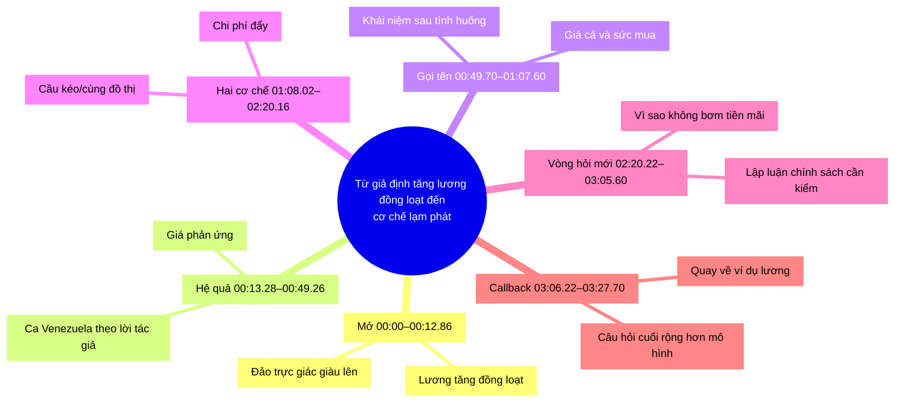

# Từ giả định tăng lương đồng loạt đến cơ chế lạm phát

[Video gốc — @tinhbao.thitruong](https://www.tiktok.com/@tinhbao.thitruong/video/7359542441285930247) · ID `7359542441285930247`

**Tóm tắt cách kể:** Lợi ích trực tiếp có vẻ hiển nhiên → phản ứng dây chuyền làm đảo kết quả → gọi tên khái niệm → so hai trường hợp bằng một ngôn ngữ hình → quay về giả định đầu. Cơ chế này rút từ vị trí các đoạn lời và khung đã kiểm, chưa phải bằng chứng tạo ra retention hay lượt xem.

[Mindmap](#mindmap) · [Diễn biến](#dien-bien) · [Nhịp cảm xúc](#cam-xuc) · [Cách áp dụng](#ap-dung)

## Dữ liệu và nguồn

- Đăng: 2024-04-19T11:43:28+00:00. Metadata lấy: 2026-11-15T03:29:57.348342+00:00.
- **7,600,000 view**; thích 368,100; bình luận 2,918; chia sẻ 8,264; lưu 23,135. Dấu phẩy tách hàng nghìn.
- Thời lượng media: 208.77s.
- **10.95× P50** 693,950 của 150 bài đủ 48h trong snapshot kênh. Clip có trong cửa sổ baseline. Không phải thống kê toàn bộ kênh.

## Phạm vi kiểm

Đã tải lại media, xem khung chọn lọc và đọc ASR có mốc lưu lúc 2026-11-05T12:29:03.478217+00:00. Đối chiếu cùng ID và thời lượng, lệch 0.0466s. **Chưa nghe toàn âm hoặc xem chuyển động liên tục; chưa xác nhận toàn văn ASR hay mọi dữ kiện kinh tế trong clip.**

Media SHA256: `b2a7a152bd1a55b34aacbe4bef065272178efb8f282c41559af57e8b22bc7baa`. [Metadata và các hash khác](../videos.json). Video/ASR đầy đủ giữ ở bộ nghiên cứu cục bộ; bản chia sẻ giữ link gốc, trích ngắn và phân tích riêng.

## Lời hứa và câu hỏi trung tâm

**Lời hứa:** Giải thích vì sao thêm tiền không mặc nhiên làm đời sống khá hơn và giới thiệu cơ chế giá tăng.

**Câu hỏi:** Điều gì xảy ra với giá và sức mua khi các bên cùng phản ứng với tiền tăng?

## Mở đầu: lời và hình

Lời chép máy mở bằng một giả định hấp dẫn trực tiếp với người nhận lương, rồi đưa người xem vào trải nghiệm nhận thêm tiền. Đến 9,38–12,86 giây mới xuất hiện nhịp đảo kỳ vọng: số tiền tăng chưa bảo đảm cuộc sống khá hơn. Đây là một chuỗi mở khoảng 28 giây trước khi tác giả nối sang ca nước ngoài; không thể thu toàn bộ cơ chế thành một câu hỏi ba giây.

> Hãy tưởng tượng một ngày nào đó, Việt Nam ra quyết định sẽ tăng gấp đôi lương cho tất cả mọi người.

Trích ASR ngắn từ segment 00:00.00–00:04.66. Đoạn ASR ngắn, chưa đối chiếu toàn bộ âm; xem giới hạn từng ca. Dấu … nghĩa là bỏ bớt, không khẳng định toàn câu vừa ba giây.

| Mốc khung đã xem | Điều quan sát được |
|---|---|
| 00:00.00 | Khung trích là bản đồ khu vực châu Á, chưa có bảng định nghĩa hay người dẫn xuất hiện. |
| 00:02.00 | Việt Nam được viền nổi trên bản đồ; đối tượng địa lý trùng phạm vi của giả định trong lời. |
| 00:03.00 | Biểu tượng tiền và các đường nối nằm trên vùng Việt Nam. |
| 00:05.00 | Biểu tượng người màu trắng đặt trước bản đồ và mạng đường tiền; thay vấn đề vĩ mô bằng một người nhận cụ thể. |
| 01:33.95 | Khung trích hiển thị đồ thị hai đường cắt nhau, trục giá và sản lượng; phần giải thích dùng hình sơ đồ thay cho lời thuần. |
| 02:36.58 | Đồ thị có hai vị trí giao, đường đứt chỉ thay đổi giá/sản lượng và chú giải cung/cầu. |
| 03:07.89 | Khung trích quay về bản đồ Việt Nam và biểu tượng tiền, gần đoạn lời quay lại giả định mở. |

Không suy chuyển động giữa các khung từ ảnh tĩnh.

## Diễn biến và nhiệm vụ từng beat

| Mốc ASR | Diễn giải riêng | Vai trò |
|---|---|---|
| 00:00.00–00:12.86 | Đặt tình huống mọi người nhận mức lương cao hơn và gọi người xem vào trải nghiệm ấy, sau đó phủ định suy nghĩ giàu lên ngay. | Gợi lợi ích cá nhân rồi tạo chỗ thiếu trong trực giác. |
| 00:13.28–00:28.14 | Kể tiếp phản ứng tăng giá của các bên bán và sức ép người mua phải chấp nhận giá mới trong tình huống tác giả dựng. | Cho thấy hệ quả đối nghịch thay vì trả lời bằng định nghĩa. |
| 00:28.40–00:49.26 | Chuyển từ giả định sang câu chuyện Venezuela và hình ảnh đồng tiền mất sức mua. | Tăng mức độ hệ quả; số liệu và quan hệ nhân quả là khẳng định của tác giả, chưa được xác minh ở lượt này. |
| 00:49.70–01:07.60 | Đặt câu hỏi trung tâm và giải thích lạm phát qua giá cả, sức mua. | Gọi tên khái niệm sau khi người xem đã có tình huống để bám. |
| 01:08.02–01:52.20 | Tách nguyên nhân chi phí đẩy, kể ca vận tải rồi diễn giải trên đường cung/cầu. | Một trường hợp cụ thể được nối với mô hình để giải thích. |
| 01:52.62–02:20.16 | Đưa giá khẩu trang trong dịch vào nhánh cầu kéo và biểu diễn sự dịch chuyển đường cầu. | Đổi ví dụ nhưng giữ cùng ngôn ngữ đồ thị, giúp so hai cơ chế. |
| 02:20.22–03:05.60 | Mở rộng sang chính sách trong dịch và câu hỏi vì sao không bơm tiền liên tục. | Tạo vòng câu hỏi thứ hai từ lời giải trước; cần kiểm độc lập các khẳng định vĩ mô. |
| 03:06.22–03:27.70 | Quay lại giả định đầu và kết bằng câu hỏi đánh giá việc tăng cung tiền. | Đóng vòng về hình và ý mở, đồng thời mời người xem phản hồi. |

## Nhịp cảm xúc — giả thuyết biên tập

Các trạng thái dưới đây là cách đọc câu chuyện từ bằng chứng, không phải cảm xúc người xem đã đo hoặc biểu đồ retention.

| Mốc | Cảm xúc có thể gợi | Bằng chứng | Cách diễn giải |
|---|---|---|---|
| 00:00.00–00:12.86 | Mừng rồi nghi ngờ | Giả định thu nhập tăng được nối ngay với câu đảo kỳ vọng. | Người xem được mời thử một lợi ích cá nhân trước khi thấy mặt khác. |
| 00:13.28–00:49.26 | Bất lợi lớn dần | Hàng thiết yếu tăng giá rồi tới ca Venezuela theo lời tác giả. | Tăng mức hệ quả trước định nghĩa. |
| 00:49.70–01:07.60 | Có tên cho hiện tượng | Giá và sức mua được giải thích. | Cảm giác được gọi tên sau tình huống có thể giảm độ khô của khái niệm. |
| 01:08.02–02:20.16 | Theo dõi hai cơ chế | Chi phí đẩy và cầu kéo dùng hai ví dụ nhưng cùng đồ thị. | Mỗi nhánh mới vẫn có ngôn ngữ hình nhất quán. |
| 02:20.22–03:05.60 | Câu hỏi chính sách mở rộng | Bài hỏi vì sao không liên tục bơm tiền rồi kể hệ quả. | Một vòng hỏi mới tạo tầng giải thích rộng hơn, cũng thêm tải khái niệm. |
| 03:06.22–03:27.70 | Quay về và tự đánh giá | Giả định tiền đầu bài được nhắc lại và kết bằng câu hỏi. | Callback có thể giúp người xem nối phần lý thuyết với trực giác ban đầu. |

## Cách phân phối thông tin

| Mốc | Động tác viết | Vì sao đáng chú ý |
|---|---|---|
| 00:00.00–00:28.14 | Trải nghiệm trước định nghĩa | Để người xem thấy sức mua bị đổi trước khi gọi tên. |
| 00:28.40–01:07.60 | Ca hệ quả rồi nhãn khái niệm | Tăng stakes, sau đó có câu định nghĩa để gom điều đã thấy. |
| 01:08.02–02:20.16 | Hai ví dụ, một ngôn ngữ đồ thị | Giảm nhu cầu học lại cách đọc hình ở nhánh thứ hai. |
| 02:20.22–03:27.70 | Mở vòng chính sách rồi callback | Quay về câu đầu tạo cấu trúc khép, dù kết luận rộng cần thêm điều kiện. |

## Giải đáp và cách kết

Kết có quay lại giả định ban đầu, nhưng câu cuối là một câu hỏi mang tính đánh giá rộng. Clip đã giải thích sức mua và hai cơ chế được tác giả chọn, song kết luận về việc in tiền có xu hướng đơn giản hóa hơn phần điều kiện cần có của vấn đề.

## Điểm mạnh có dẫn chứng

- **Tình huống đầu có phản ứng dây chuyền** — 13,28–28,14 giây không dừng ở lương tăng mà kể người bán đổi giá.

- **Hai nhánh giải thích có hình chung** — Đồ thị xuất hiện trong phần 68,02–140,16 giây.

- **Có callback nhận diện được** — 186,22 giây chủ động quay về ví dụ đầu.

## Điểm yếu và điều không nên bắt chước

- **Tên khái niệm tới muộn nếu cần bài ngắn** — 49,7 giây mới nêu câu hỏi định nghĩa tường minh.

- **Tuyến vĩ mô được đơn giản hóa mạnh** — Các đoạn 28,4–49,26 và 140,22–207,7 giây cần kiểm điều kiện và số liệu riêng.

- **Kết câu hỏi có thể dẫn người xem về kết luận quá rộng** — 203,66–207,7 giây gộp một vấn đề chính sách nhiều điều kiện.

## Khả năng được chia sẻ — chưa kiểm chứng

Không có dữ liệu phân phối/retention để kết luận vì sao viral. Các ý sau chỉ là giả thuyết để thử:

- Mối quan tâm tiền lương có thể khiến chủ đề vĩ mô liên quan hơn với người đi làm.

- Việc quay lại giả định đầu có thể giúp người xem kể lại một chuỗi nguyên nhân, nhưng không phải dữ liệu nhớ hay chia sẻ đã đo.

## Chuyển cơ chế sang bài mới

Học cách bắt đầu bằng một thay đổi người xem thực sự quan tâm, để hệ quả làm lộ câu hỏi, rồi mới đưa định nghĩa và mô hình. Khi chuyển thể, giữ rõ nhãn giả định và điều kiện; không chuyển kết luận rộng trong clip thành chân lý chỉ vì clip nhiều lượt xem.

- Giữ nhãn giả định và nói rõ phạm vi mô hình.

- Cho ví dụ trước định nghĩa khi nó giảm độ khó, không cố trì hoãn đến mốc cố định.

- Tái dùng ngôn ngữ hình giữa các nhánh có cùng mô hình.

- Không sao chép kết luận vĩ mô từ video nhiều view thay cho kiểm nguồn.

Không dùng bài chuyển thể chưa được người dùng duyệt làm mẫu giọng lâu dài.

## Mindmap

[Mã Mermaid riêng](../mindmaps/7359542441285930247.mmd)

## Giới hạn còn lại

- Đã đọc segments ASR và xem contact sheet mới trích từ bản tải hiện tại; không nghe âm trực tiếp hoặc xem chuyển động liên tục.

- ASR có lỗi từ; thời gian là mốc chép máy, không phải mốc đã căn chỉnh bằng tai.

- Chưa xác minh số liệu Venezuela, chính sách tiền tệ, nguyên nhân giá tăng hoặc các dẫn chứng kinh tế; phân tích này chỉ nhận diện cách lập luận và cách dựng.

- Ảnh bài báo/đồ thị trong clip cho thấy tác giả trình bày bằng chứng, không đồng nghĩa nguồn đó đã được lượt phân tích này kiểm chứng.

- Không có retention, thử đối chứng hoặc dữ liệu để kết luận vì sao video lan truyền.
