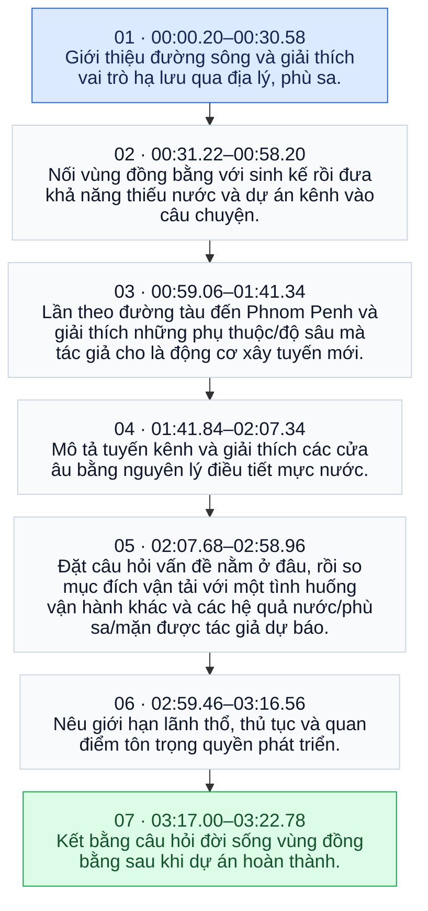

# Từ dòng Mekong đến lợi ích và rủi ro của một tuyến kênh

[Video gốc — @tinhbao.thitruong](https://www.tiktok.com/@tinhbao.thitruong/video/7366583144767606023) · ID `7366583144767606023`

**Tóm tắt cách kể:** Một hệ thống quen tên nhưng khó hình dung → bản đồ làm rõ quan hệ → sinh kế khiến quan hệ đáng quan tâm → một dự án thay đổi hệ thống → giải thích động cơ hai phía và cơ chế → câu hỏi hệ quả tương lai. Hook ở ca này là phần thiết lập không gian và mức cược, không phải câu phủ định hay câu hỏi giật gân đầu tiên.

[Sơ đồ diễn biến](#mindmap) · [Diễn biến](#dien-bien) · [Nhịp cảm xúc](#cam-xuc) · [Cách áp dụng](#ap-dung)

## Sơ đồ diễn biến

Đọc từ trên xuống: mỗi hộp là một nhịp theo mốc ASR hoặc khung hình được ghi trong phân tích. Xanh dương là mở đầu, xanh lá là nhịp cuối. Chi tiết và giới hạn nằm trong phân tích bên dưới.

[Mã Mermaid riêng](../mindmaps/7366583144767606023.mmd)

## Dữ liệu và nguồn

**Cách thể hiện:** Người dẫn và hình minh họa

**Phạm vi học:** Xem phạm vi kiểm và giới hạn từng ca.

**Ngữ cảnh thương mại:** Chưa xác nhận hợp tác thương mại; xem các đoạn tự quảng bá/giới hạn được ghi riêng.

- Đăng: 2024-05-08T11:05:00+00:00. Metadata lấy: 2026-11-15T03:30:14.609026+00:00.
- **6,800,000 view**; thích 217,200; bình luận 3,823; chia sẻ 10,400; lưu 15,765. Dấu phẩy tách hàng nghìn.
- Thời lượng media: 203.99s.
- **9.80× P50** 693,950 của 150 bài đủ 48h trong snapshot kênh. Clip có trong cửa sổ baseline. Không phải thống kê toàn bộ kênh.

## Phạm vi kiểm

Đã tải media, xem khung chọn lọc và đọc ASR có mốc lưu lúc 2026-11-05T12:30:30.276844+00:00. Đối chiếu cùng ID và thời lượng, lệch 0.0502s. **Chưa nghe toàn âm hoặc xem chuyển động liên tục; chưa xác nhận toàn văn ASR hay mọi dữ kiện trong clip.**

Media SHA256: `0766649cab98dd62876c50f9d328c47627ba21d397e0f9a3c470c91d488fe89e`. [Metadata và các hash khác](../videos.json). Video/ASR đầy đủ giữ ở bộ nghiên cứu cục bộ; bản chia sẻ giữ link gốc, trích ngắn và phân tích riêng.

## Lời hứa và câu hỏi trung tâm

**Lời hứa:** Làm rõ vì sao một dự án giao thông bên kia biên giới có thể liên quan dòng nước và sinh kế vùng hạ lưu Việt Nam, theo chuỗi lập luận của tác giả.

**Câu hỏi:** Một thay đổi ở hệ thống sông được nối tới đời sống hạ lưu qua những mắt xích vật lý và lợi ích nào?

## Mở đầu: lời và hình

Khác kiểu hứa lợi ích tức thì, lời mở giới thiệu một con sông và lần theo các quốc gia tới đồng bằng Việt Nam. Đến 31,22–52,62 giây, tác giả gắn địa lý với nông nghiệp, thu nhập và đời sống; dự án kênh chỉ được đưa vào như tác nhân có thể làm đổi trạng thái ở 52,96–58,20 giây. Như vậy clip xây bản đồ và mức độ liên quan trước, rồi mới đặt xung đột chính.

> Đây là sông Mekong, con sông dài hơn 4.800 km, với các nhánh chính chảy qua 6 quốc gia

Trích ASR ngắn từ segment 00:00.20–00:07.02. Đoạn ASR ngắn, chưa đối chiếu toàn bộ âm; xem giới hạn từng ca. Dấu … nghĩa là bỏ bớt, không khẳng định toàn câu vừa ba giây.

| Mốc khung đã xem | Điều quan sát được |
|---|---|
| 00:01.00 | Khung trích có đường sông phát sáng màu xanh, nhãn tên sông và viền Việt Nam nổi bật. |
| 00:03.00 | Khung trích thêm thông tin chiều dài chạy theo đường sông. |
| 00:11.00 | Grid đầu có nhiều tên quốc gia quanh đường Mekong; người xem nhận quan hệ thượng/hạ lưu từ vị trí bản đồ. |
| 00:30.60 | Khung trích dùng ảnh bài báo/phỏng vấn với đoạn được nhấn màu, thay nền bản đồ bằng nguồn tư liệu. |
| 01:31.80 | Khung trích cho thấy sơ đồ các tuyến sông và một đoạn tuyến nổi màu, hỗ trợ giải thích đường tàu đi. |
| 02:02.39 | Các biểu tượng tàu xếp theo những cao độ khác nhau trên nền tối, nằm trong đoạn giải thích cách âu tàu hoạt động. |
| 02:32.99 | Khung trích hiển thị một trang văn bản có dòng số liệu được tô màu; bằng chứng đang được trình bày chứ chưa được lượt phân tích này xác nhận. |
| 03:03.59 | Bản đồ khu vực Phnom Penh và tuyến nối ra phía biển xuất hiện ở phần bàn phạm vi dự án. |
| 03:22.99 | Khung gần cuối là hình thành phố và đường nét chồng hình; phần lời kết trở lại câu hỏi tác động đời sống. |

Không suy chuyển động giữa các khung từ ảnh tĩnh.

## Diễn biến và nhiệm vụ từng beat

| Mốc ASR | Diễn giải riêng | Vai trò |
|---|---|---|
| 00:00.20–00:30.58 | Giới thiệu đường sông và giải thích vai trò hạ lưu qua địa lý, phù sa. | Đặt mô hình không gian chung để các hệ quả tiếp theo có nơi bám. |
| 00:31.22–00:58.20 | Nối vùng đồng bằng với sinh kế rồi đưa khả năng thiếu nước và dự án kênh vào câu chuyện. | Chuyển từ thông tin địa lý sang mức cược đối với khán giả Việt Nam; tác nhân xung đột xuất hiện sau nền tảng. |
| 00:59.06–01:41.34 | Lần theo đường tàu đến Phnom Penh và giải thích những phụ thuộc/độ sâu mà tác giả cho là động cơ xây tuyến mới. | Đổi sang góc nhìn lợi ích của bên xây dự án, giúp xung đột có hai phía. |
| 01:41.84–02:07.34 | Mô tả tuyến kênh và giải thích các cửa âu bằng nguyên lý điều tiết mực nước. | Cho người xem một cơ chế vật lý trước khi nêu rủi ro của cơ chế đó. |
| 02:07.68–02:58.96 | Đặt câu hỏi vấn đề nằm ở đâu, rồi so mục đích vận tải với một tình huống vận hành khác và các hệ quả nước/phù sa/mặn được tác giả dự báo. | Câu hỏi giữa bài nâng từ cấu tạo sang điều kiện làm đổi tác động; số dự báo chưa được kiểm ở lượt này. |
| 02:59.46–03:16.56 | Nêu giới hạn lãnh thổ, thủ tục và quan điểm tôn trọng quyền phát triển. | Thêm ràng buộc, tránh kể xung đột chỉ như một quyết định đơn giản của một phía. |
| 03:17.00–03:22.78 | Kết bằng câu hỏi đời sống vùng đồng bằng sau khi dự án hoàn thành. | Quay lại người chịu hệ quả; để ngỏ tương lai thay vì đưa kết luận đo lường chắc chắn. |

## Nhịp cảm xúc — giả thuyết biên tập

Các trạng thái dưới đây là cách đọc câu chuyện từ bằng chứng, không phải cảm xúc người xem đã đo hoặc biểu đồ retention.

| Mốc | Cảm xúc có thể gợi | Bằng chứng | Cách diễn giải |
|---|---|---|---|
| 00:00.20–00:30.58 | Định hướng không gian | Lời lần theo con sông và vai trò hạ lưu; bản đồ làm nổi tuyến ở khung 1–5 giây. | Tò mò bắt đầu từ hiểu một hệ thống, chưa từ một biến cố giật gân. |
| 00:31.22–00:58.20 | Nhận mức liên quan và lo ngại | Nông nghiệp, thu nhập và sinh kế được nối với khả năng thiếu nước trước khi đưa dự án vào. | Hệ thống trở nên đáng quan tâm khi có người chịu hệ quả. |
| 00:59.06–02:07.34 | Hiểu động cơ hai phía | Clip đi theo đường tàu rồi giải thích cửa âu và độ sâu. | Một cơ chế cụ thể có thể giữ câu chuyện khỏi chỉ là khẩu hiệu đe dọa. |
| 02:07.68–02:58.96 | Bất an có điều kiện | Tác giả đổi từ mục đích vận tải sang tình huống vận hành khác và hệ quả được dự báo. | Lo ngại được tăng bằng việc thay điều kiện của cơ chế, nhưng số dự báo chưa được lượt này kiểm. |
| 02:59.46–03:22.78 | Nhận giới hạn và còn câu hỏi | Phần cuối nêu ràng buộc lãnh thổ/quy trình rồi hỏi đời sống tương lai. | Không đưa cảm giác đã có lời giải dễ; đồng thời chưa đóng một đáp án xác định. |

## Cách phân phối thông tin

| Mốc | Động tác viết | Vì sao đáng chú ý |
|---|---|---|
| 00:00.20–00:30.58 | Dựng bản đồ quan hệ | Các khúc sông và thượng/hạ lưu là tiền đề để người xem theo hệ quả. |
| 00:31.22–00:58.20 | Đặt mức cược trước tác nhân xung đột | Sinh kế xuất hiện trước dự án để giải thích vì sao dự án đáng bàn. |
| 00:59.06–02:07.34 | Cho thấy lợi ích của bên xây và cơ chế vật lý | Không chỉ giữ một góc nhìn chịu thiệt; đường đi tàu và âu tàu tạo nền cho phần rủi ro. |
| 02:07.68–02:58.96 | Thử đổi điều kiện vận hành | Cùng công trình nhưng cách dùng khác tạo giả thuyết tác động khác. |
| 02:59.46–03:22.78 | Nêu giới hạn giải quyết | Ràng buộc pháp lý/chính sách theo lời tác giả làm bài không khép bằng lời kêu gọi đơn giản. |

## Giải đáp và cách kết

Đoạn cuối mở câu hỏi về tương lai đời sống vùng đồng bằng; clip đã đưa một chuỗi rủi ro do tác giả diễn giải nhưng chưa khép lời hứa bằng một đáp án xác định. Đây là cách kết để thảo luận, không phải một mẫu hoàn trả lời hứa trọn vẹn để áp cho mọi bài giải thích.

## Điểm mạnh có dẫn chứng

- **Hình có nhiệm vụ giải thích quan hệ.** — Khung 1–5 giây là tuyến sông, 91,8 giây là đường đi, 122,39 giây minh họa âu tàu.

- **Mức cược được đưa về người Việt Nam.** — 31,22–52,62 giây nối đồng bằng với việc làm/thu nhập và đời sống.

- **Có góc nhìn động cơ của phía khác.** — 59,06–101,34 giây giải thích nhu cầu vận tải thay vì chỉ kể nguy cơ.

## Điểm yếu và điều không nên bắt chước

- **Xung đột trung tâm xuất hiện tương đối muộn.** — Dự án mới vào ở 52,96–58,2 giây, sau phần nền dài.

- **Kết mở không trả một câu trả lời đo lường trọn vẹn.** — 197–202,78 giây hỏi tương lai vùng đồng bằng thay vì xác lập một dự báo được kiểm.

- **Số và thuật ngữ có nguy cơ làm người xem quá tải.** — 127,68–178,96 giây đi qua nhiều lưu lượng/tỷ lệ và nhiều hệ quả cùng lúc.

## Khả năng được chia sẻ — chưa kiểm chứng

Không có dữ liệu phân phối/retention để kết luận vì sao viral. Các ý sau chỉ là giả thuyết để thử:

- Bản đồ và tác động sinh kế trong nước có thể tạo lý do giải thích lại cho người khác; chưa có dữ liệu kiểm động cơ chia sẻ.

- Tính thời sự và xung đột lợi ích có thể cùng góp vào chú ý; không tách được tác dụng của riêng hook.

## Chuyển cơ chế sang bài mới

Học cách làm khán giả hiểu quan hệ bằng bản đồ trước khi phân tích sự cố/dự án; nêu lợi ích của các bên rồi chỉ rõ điều kiện khiến tác động khác nhau. Khi dùng cho bài mới, phải tự kiểm nguồn về pháp lý, môi trường và số dự báo; không kéo dài phần nền quá mức nếu khán giả đã biết địa lý.

- Cho khán giả mô hình quan hệ đủ dùng trước khi nêu hệ quả.

- Đưa người chịu tác động vào trước khi tăng số liệu.

- Khi giả định cách vận hành khác, ghi rõ điều kiện và mức bất định.

- Nếu bài ngắn hoặc người xem đã biết địa lý, rút nền để xung đột đến sớm hơn.

Không dùng bài chuyển thể chưa được người dùng duyệt làm mẫu giọng lâu dài.

## Giới hạn còn lại

- Đã xem contact sheet mới và grid đầu có timestamp; không nghe trực tiếp hoặc xem video liên tục.

- ASR có lỗi nhận diện tên tuyến sông/kênh và đơn vị; các mốc là mốc chép máy.

- Chưa xác minh số liệu dòng chảy, nông nghiệp, đánh giá môi trường, thủ tục hoặc quan điểm chính thức; không trình bày luận điểm của video như kết luận chuyên môn đã xác nhận.

- Bản đồ và ảnh tài liệu trong clip chỉ chứng minh cách tác giả trình bày lập luận, không xác nhận tính chính xác địa lý của mọi chi tiết.

- Không có biểu đồ giữ chân hay đối chứng; không quy lượt xem cho bản đồ hoặc cách mở cụ thể.
