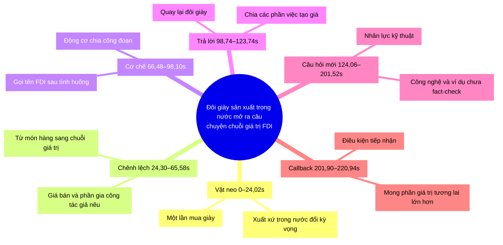

# Đôi giày sản xuất trong nước mở ra câu chuyện chuỗi giá trị FDI

[Video gốc — @tinhbao.thitruong](https://www.tiktok.com/@tinhbao.thitruong/video/7368451977803484423) · ID `7368451977803484423`

**Tóm tắt cách kể:** Vật thể tiêu dùng quen thuộc → chi tiết nguồn gốc bất ngờ → chênh lệch giá/giá trị → đi ngược chuỗi sản xuất → gọi tên khái niệm → quay lại vật thể với cách nhìn mới. Phần giữ nhịp nằm ở các câu hỏi nối từ nguyên nhân sang khả năng cải thiện, không chỉ ở câu mở.

[Mindmap](#mindmap) · [Diễn biến](#dien-bien) · [Nhịp cảm xúc](#cam-xuc) · [Cách áp dụng](#ap-dung)

## Dữ liệu và nguồn

- Đăng: 2024-05-13T11:57:02+00:00. Metadata lấy: 2026-11-15T03:30:10.176740+00:00.
- **7,200,000 view**; thích 303,000; bình luận 4,595; chia sẻ 12,700; lưu 17,089. Dấu phẩy tách hàng nghìn.
- Thời lượng media: 221.94s.
- **10.38× P50** 693,950 của 150 bài đủ 48h trong snapshot kênh. Clip có trong cửa sổ baseline. Không phải thống kê toàn bộ kênh.

## Phạm vi kiểm

Đã tải lại media, xem khung chọn lọc và đọc ASR có mốc lưu lúc 2026-11-05T12:29:48.869741+00:00. Đối chiếu cùng ID và thời lượng, lệch 0.0464s. **Chưa nghe toàn âm hoặc xem chuyển động liên tục; chưa xác nhận toàn văn ASR hay mọi dữ kiện kinh tế trong clip.**

Media SHA256: `818d7d9cc0f1f8460c033b8594bf7b38f2dc737c0c9483af5bd3a278cde5b090`. [Metadata và các hash khác](../videos.json). Video/ASR đầy đủ giữ ở bộ nghiên cứu cục bộ; bản chia sẻ giữ link gốc, trích ngắn và phân tích riêng.

## Lời hứa và câu hỏi trung tâm

**Lời hứa:** Giải thích chênh lệch giữa nơi sản xuất, giá mua và phần giá trị nhận được qua hành trình một vật tiêu dùng.

**Câu hỏi:** Vì sao một món được sản xuất trong nước lại quay về với giá và giá trị phân chia khác xa phần gia công tác giả nêu?

## Mở đầu: lời và hình

Lời chép máy đặt người xem Việt Nam vào một hành trình tích cóp để mua sản phẩm thương hiệu quốc tế. Đến 8,32–24,02 giây, nguồn gốc sản xuất trong nước được đặt đối diện với giá và thời gian chờ; 24,30–36,22 giây thêm một mức đối chiếu về phần nhận của nơi gia công. Vật thể quen thuộc tạo chỗ bám cho câu hỏi về giá trị trong chuỗi sản xuất trước khi tác giả gọi tên FDI ở khoảng 95,90 giây.

> Hãy tưởng tượng bạn ở Việt Nam và đang háo hức order một đôi giày Nike sau vài tháng tích cóp.

Trích ASR ngắn từ segment 00:00.00–00:05.74. Đoạn ASR ngắn, chưa đối chiếu toàn bộ âm; xem giới hạn từng ca. Dấu … nghĩa là bỏ bớt, không khẳng định toàn câu vừa ba giây.

| Mốc khung đã xem | Điều quan sát được |
|---|---|
| 00:01.00 | Khung trích hiển thị Việt Nam trên nền bản đồ vệ tinh. |
| 00:02.00 | Một biểu tượng người nằm trong vùng địa phương được khoanh trắng trên bản đồ. |
| 00:05.00 | Biểu tượng thương hiệu Nike xuất hiện ngoài Việt Nam, nối với một đường cong trên bản đồ. |
| 00:13.00 | Grid cache khung 13 giây cho thấy cận cảnh nhãn trong giày với dòng nơi sản xuất; chi tiết được dùng làm điểm đổi kỳ vọng trong lời. |
| 00:33.29 | Đôi giày và các đường chỉ nằm trên bản đồ Việt Nam, cùng phạm vi đoạn so phần gia công. |
| 01:36.00 | Grid cache hiển thị ảnh một trang giải thích FDI, sau các ảnh bài báo về đầu tư/sản xuất. |
| 01:44.00 | Grid cache có đôi giày, mức giá và lời nhấn về nhiều loại chi phí, phù hợp đoạn tách cấu phần giá bán. |
| 02:46.45 | Khung mới trích có nhãn về nhân lực kỹ thuật cao và ảnh bài báo làm ví dụ. |
| 03:40.94 | Khung cuối được lấy là một bài báo về vai trò Việt Nam trong chuỗi cung ứng, không phải thẻ CTA riêng. |

Không suy chuyển động giữa các khung từ ảnh tĩnh.

## Diễn biến và nhiệm vụ từng beat

| Mốc ASR | Diễn giải riêng | Vai trò |
|---|---|---|
| 00:00.00–00:24.02 | Dựng hành trình mua giày, tiền phải bỏ ra, thời gian chờ và chi tiết sản xuất trong nước. | Tạo sự bất cân xứng giữa cảm nhận sản phẩm quốc tế và nơi làm ra nó. |
| 00:24.30–01:05.58 | Đẩy chênh lệch sang phần nơi gia công nhận được, mở rộng đến các sản phẩm khác rồi đặt câu hỏi về hành trình và chi phí. | Tăng mức quan tâm từ chuyện mua sắm cá nhân sang câu hỏi chuỗi giá trị. |
| 01:06.48–01:38.10 | Giải thích động cơ đặt công đoạn ở nhiều quốc gia và sau đó gọi tên FDI. | Trả câu hỏi đầu bằng cơ chế phân bổ sản xuất; định nghĩa đến sau tình huống. |
| 01:38.74–02:03.74 | Quay lại đôi giày và tách các khâu thiết kế, sản xuất, vận chuyển, bán hàng. | Đóng vòng vật thể mở đầu; phân bổ giá bán giúp hình dung phần giá trị khác nhau. |
| 02:04.06–02:24.76 | Chuyển câu hỏi từ vì sao phần nhận nhỏ sang làm sao nhận được nhiều lợi ích hơn; tách hai vấn đề nhân lực và công nghệ. | Mở câu hỏi tiếp từ chính lời giải trước để chuyện không dừng ở định nghĩa. |
| 02:24.98–03:21.52 | Dùng ví dụ về lực lượng kỹ thuật, thương hiệu giày trong nước và việc tiếp nhận công nghệ. | Cụ thể hóa hai nhánh giải thích bằng ca/ảnh tư liệu; các khẳng định riêng cần kiểm nguồn. |
| 03:21.90–03:40.94 | Thừa nhận điều kiện tiếp nhận công nghệ rồi kết bằng mong muốn phần giá trị của Việt Nam lớn hơn trong sản phẩm mở đầu. | Đóng câu chuyện bằng cùng vật thể và đổi góc nhìn từ giá mua sang giá trị tạo ra. |

## Nhịp cảm xúc — giả thuyết biên tập

Các trạng thái dưới đây là cách đọc câu chuyện từ bằng chứng, không phải cảm xúc người xem đã đo hoặc biểu đồ retention.

| Mốc | Cảm xúc có thể gợi | Bằng chứng | Cách diễn giải |
|---|---|---|---|
| 00:00.00–00:24.02 | Mong mua rồi ngạc nhiên nguồn gốc | Hành trình tích cóp/order và chi tiết xuất xứ đặt cạnh nhau. | Một vật thể quen giúp câu hỏi quốc tế gần với quyết định tiêu dùng. |
| 00:24.30–01:05.58 | Thấy chênh lệch đáng hỏi | Tác giả đặt phần gia công cạnh giá cuối, mở rộng tới các sản phẩm khác. | Tăng stakes từ một lần mua tới vị trí trong chuỗi giá trị. |
| 01:06.48–01:38.10 | Giải mã động cơ | Phân bố công đoạn được kể trước tên khái niệm. | Khái niệm đến để đóng một hiện tượng đã được hình dung. |
| 01:38.74–02:03.74 | Đổi cách nhìn giá món hàng | Giá giày được tách thành nhiều phần việc. | Câu hỏi ban đầu có đáp án ở cấu phần, không chỉ nhãn xuất xứ. |
| 02:04.06–03:21.52 | Muốn có con đường cải thiện | Nhân lực và công nghệ tạo câu hỏi thứ hai cùng ví dụ. | Giữ chuyện tiến bằng điều có thể thay đổi thay vì tiếp tục than chênh lệch. |
| 03:21.90–03:40.94 | Kỳ vọng có điều kiện | Kết quay lại phần giá trị trong đôi giày sau này. | Một callback hướng tương lai, chưa phải lộ trình đã kiểm nghiệm. |

## Cách phân phối thông tin

| Mốc | Động tác viết | Vì sao đáng chú ý |
|---|---|---|
| 00:00.00–00:36.22 | Dùng nguồn gốc vật thể làm chi tiết lật kỳ vọng | Nhãn trong giày và chênh giá trị hỗ trợ câu hỏi chứ không bắt đầu bằng định nghĩa FDI. |
| 00:36.74–01:05.58 | Mở rộng từ một món tới nhiều ngành | Cho thấy câu hỏi không chỉ là giá một sản phẩm, nhưng các tỷ lệ cần kiểm. |
| 01:06.48–01:38.10 | Giải cơ chế trước gọi tên | Tác giả kể động cơ phân công rồi mới dùng thuật ngữ. |
| 01:38.74–02:03.74 | Quay về món hàng và chia cấu phần | Giữ vật neo để người xem theo một khái niệm lớn hơn. |
| 02:04.06–03:40.94 | Câu hỏi cải thiện chia hai nhánh rồi callback | Nhân lực/công nghệ tổ chức phần sau; kỳ vọng cuối gắn vật thể đầu. |

## Giải đáp và cách kết

Kết quay lại đôi giày và mong muốn cải thiện phần giá trị trong tương lai. Nó giải đáp cơ chế chung của chênh lệch giá trị, nhưng không cung cấp một lộ trình được kiểm nghiệm để đạt kết quả đó; đoạn cuối là kỳ vọng của tác giả.

## Điểm mạnh có dẫn chứng

- **Một vật thể làm neo xuyên suốt** — Mở 0–24,02, quay lại 98,74–123,74 và kết 213,06–220,94 giây đều liên hệ đôi giày.

- **Định nghĩa phục vụ hiện tượng đã đặt** — FDI được gọi tên ở 95,90–98,10 giây sau tuyến phân công sản xuất.

- **Câu hỏi tiếp phát sinh từ lời giải** — 124,06–144,76 giây hỏi cách nhận thêm giá trị rồi chia hai vấn đề.

## Điểm yếu và điều không nên bắt chước

- **Con số gia công và giá bán có thể không cùng cơ sở** — 24,30–36,22 và 98,74–123,74 giây phải kiểm đơn vị/phạm vi trước khi tái dùng.

- **Tên thương hiệu/công nghệ ASR có lỗi** — 167,46–190,86 giây không thể dùng như trích dẫn chuẩn hoặc xác nhận chuyển giao.

- **Từ giải thích sang mong muốn cải thiện chưa thành lộ trình kiểm nghiệm** — 124,06–220,94 giây đưa ví dụ và kỳ vọng, không chứng minh kết quả sẽ đạt.

## Khả năng được chia sẻ — chưa kiểm chứng

Không có dữ liệu phân phối/retention để kết luận vì sao viral. Các ý sau chỉ là giả thuyết để thử:

- Chi tiết món hàng nổi tiếng mang xuất xứ trong nước có thể gây bất ngờ hoặc liên hệ bản sắc; chưa có dữ liệu động cơ chia sẻ.

- Lần ngược giá qua các phần việc có thể giúp người xem nhìn lại vật quen; chưa kiểm mức hiểu hoặc ghi nhớ.

## Chuyển cơ chế sang bài mới

Học cách chọn một vật mà khán giả đã nhìn, mua hoặc dùng; lần ngược từ mức giá cuối đến các phần việc để giải thích khái niệm trừu tượng. Mẫu chỉ hữu ích khi bài mới có dữ liệu đủ so các cấu phần cùng cơ sở; không lấy con số gia công/giá bán trong clip làm dữ kiện sẵn để dùng lại.

- Chọn vật cụ thể liên quan khán giả rồi chỉ ra chi tiết quan sát được.

- Kiểm cơ sở so sánh trước khi dùng chênh lệch con số để gây chú ý.

- Thuật ngữ nên giúp gọi tên cơ chế đã giải, không tự làm bằng chứng.

- Kết có thể đổi cách nhìn vật thể, nhưng phải phân biệt lời giải với kỳ vọng.

Không dùng bài chuyển thể chưa được người dùng duyệt làm mẫu giọng lâu dài.

## Mindmap

[Mã Mermaid riêng](../mindmaps/7368451977803484423.mmd)

## Giới hạn còn lại

- Đã xem contact sheet mới và ba grid cache ở đầu, giữa, cuối phần hình; chưa nghe trực tiếp hay xem toàn bộ chuyển động.

- Mốc nhóm nội dung dựa ASR; tên riêng và thuật ngữ có lỗi chép máy.

- Chưa kiểm các tỷ lệ sản xuất, chi phí gia công, dữ kiện thương hiệu hoặc khẳng định chuyển giao công nghệ; không coi video là tài liệu xác nhận kiến thức.

- Mô tả kỹ thuật kể không đồng nghĩa khẳng định số liệu so sánh trong video có cùng đơn vị/phạm vi.

- Không có dữ liệu retention hoặc đối chứng để kết luận cách mở gây ra mức lan truyền.
