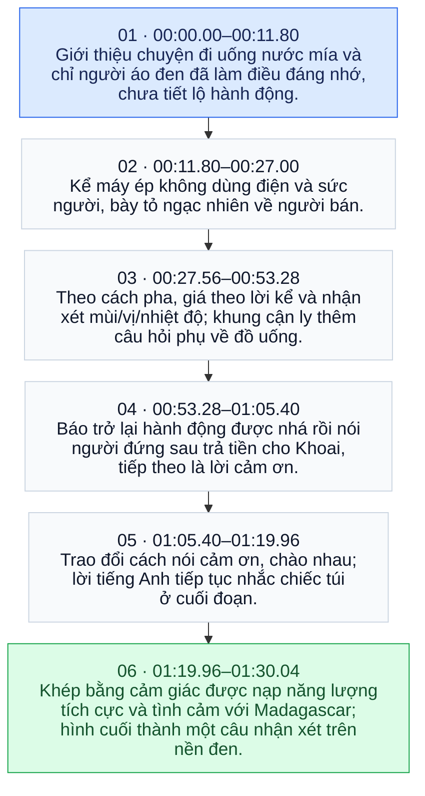

# Người lạ ở Madagascar: giấu một hành động tử tế trong trải nghiệm nước mía

[Video gốc — @khoailangthang](https://www.tiktok.com/@khoailangthang/video/7429725622441659649) · ID `7429725622441659649`

**Tóm tắt cách kể:** Chỉ nhân vật ngay trong cảnh → giấu việc họ đã làm → dùng quá trình mua nước tạo bối cảnh và phần thưởng phụ → tiết lộ sự tử tế → đáp lại bằng giao tiếp → gọi tên cảm xúc. Sức nặng của lời giải đến từ sự kiện và tương tác, không phải câu chữ cường điệu riêng lẻ.

[Sơ đồ diễn biến](#mindmap) · [Diễn biến](#dien-bien) · [Nhịp cảm xúc](#cam-xuc) · [Cách áp dụng](#ap-dung)

## Sơ đồ diễn biến

Đọc từ trên xuống: mỗi hộp là một nhịp theo mốc ASR hoặc khung hình được ghi trong phân tích. Xanh dương là mở đầu, xanh lá là nhịp cuối. Chi tiết và giới hạn nằm trong phân tích bên dưới.

[Mã Mermaid riêng](../mindmaps/7429725622441659649.mmd)

## Dữ liệu và nguồn

**Cách thể hiện:** Kể chuyện tại hiện trường

**Phạm vi học:** Học cách chia thông tin theo hình và ASR, giữ giới hạn từng ca.

**Ngữ cảnh thương mại:** Chưa xác nhận tài trợ; nhận diện thương hiệu/quảng bá quan sát được nằm trong phân tích.

- Đăng: 2024-10-25T14:50:14+00:00. Metadata lấy: 2026-11-15T04:33:50.275930+00:00.
- **8,800,000 view**; thích 662,900; bình luận 4,483; chia sẻ 7,296; lưu 19,966. Dấu phẩy tách hàng nghìn.
- Thời lượng media: 90.11s.
- **3.67× P50** 2,400,000 của 148 bài đủ 48h trong snapshot kênh. Clip có trong cửa sổ baseline. Không phải thống kê toàn bộ kênh.

## Phạm vi kiểm

Đã tải media, xem khung chọn lọc và đọc ASR có mốc lưu lúc 2026-11-15T04:34:49.359932+00:00. Đối chiếu cùng ID và thời lượng, lệch 0.008s. **Chưa nghe toàn âm hoặc xem chuyển động liên tục; chưa xác nhận toàn văn ASR hay mọi dữ kiện trong clip.**

Media SHA256: `2553e52d85ef55c847ee03ecc39d8025e5ba504be5eb9e1151159336113c30c4`. [Metadata và các hash khác](../videos.json). Video/ASR đầy đủ giữ ở bộ nghiên cứu cục bộ; bản chia sẻ giữ link gốc, trích ngắn và phân tích riêng.

## Lời hứa và câu hỏi trung tâm

**Lời hứa:** Kể điều một người lạ làm khiến Khoai nhớ sau một lần mua nước mía.

**Câu hỏi:** Người áo đen trong cảnh đã làm điều gì cho Khoai?

## Mở đầu: lời và hình

0–3,24 giây ASR mới mời nghe chuyện và nói đi uống nước mía; khung mở là Khoai đi tới xe trên phố. Móc câu cụ thể nằm ở4,12–11,8 giây: chỉ người áo đen ở cạnh xe, kể rằng anh làm điều khiến Khoai nhớ. Hành động chưa được nói ra; người được nhắc đã có trong cảnh nên đây là một câu hỏi gắn với con người nhìn thấy, không chỉ một lời hứa mơ hồ.

## Nghiên cứu phần mở

Diễn giải từ bằng chứng đã lưu; lý do gây chú ý là giả thuyết biên tập, chưa đo retention.

**Cửa sổ quan sát:** 00:00.00–00:11.80

| Lớp | Quan sát/diễn giải |
|---|---|
| Lời | 0–3,24s giới thiệu chuyện;4,12–11,8s chỉ người áo đen và nhá việc anh làm đáng nhớ. |
| Hình | Khoai tiến tới xe; người áo đen đã có trong khung1–5s. |
| Chữ trên hình | Không thấy lời nhá dạng tiêu đề lớn trong khung0–5s; sự nhận diện người dựa vào lời và cảnh. |

**Động tác gây chú ý:** Câu chuyện hồi tưởng có một con người trong cảnh nhưng thiếu hành động then chốt.

**Vì sao có thể muốn dừng lại:** Giả thuyết biên tập: người xem muốn tìm hiểu vì sao người đang đứng cạnh xe lại trở thành ký ức đáng kể.

**Điều còn muốn biết:** Anh áo đen đã làm gì cho Khoai?

**Thông tin chưa cho biết:** Việc người lạ trả tiền, chỉ được nói ở61,32s.

**Nhịp nối có gì mới:** Quá trình ép nước bằng tay, pha/nếm và cuộc gặp đang diễn ra cung cấp những quan sát nhỏ trước lời giải; không có dữ liệu chứng minh cầu nối giữ được người xem.

**Mốc trả/giới hạn giải đáp:** 00:53.28–01:05.40 — Báo trở lại câu hỏi rồi nói người lạ trả tiền; có phản ứng cảm ơn. Lời giải dựaASR, không có khung trao tiền trong contact.

**Tóm cấu trúc bằng hai câu:** Cho thấy một người cụ thể rồi báo rằng hành động của họ đã thay đổi cách người kể nhớ cuộc gặp. Đi qua những quan sát thật của tình huống trước khi tiết lộ hành động và cho thấy cách người kể đáp lại.

**Chuyển sang ngách khác:** Có thể chuyển quan hệ người → hành động bị giấu → ý nghĩa đổi sang một ca quyết định tài chính có tài liệu. Nó mất sức nặng nếu người và hậu quả bị bịa, hoặc nếu phần giữa chỉ là thuật ngữ không có quan sát để xem.

**Điều không chuyển theo:**

- Không chép lời nhá mơ hồ mà bỏ người thật và hành động trả được.
- Không mặc định trì hoãn hơn50s phù hợp video tài chính ngắn.

**Phạm vi:** ToànASR mới và12 khung timestamp; không nghe toàn âm/xem liên tục; diễn giải tâm lý là giả thuyết.

> Để Khoai kể mọi người nghe câu chuyện nha

Trích ASR ngắn từ segment 00:00.00–00:01.76. Trích ASR ngắn chưa nghe so khớp toàn âm; không khẳng định cả segment là ba giây. Xem phạm vi/giới hạn từng ca. Dấu … nghĩa là bỏ bớt, không khẳng định toàn câu vừa ba giây.

| Mốc khung đã xem | Điều quan sát được |
|---|---|
| 00:00.00 | Khoai đeo ba lô đi về xe nước mía trên phố; không có tiêu đề lớn che cảnh. |
| 00:01.00 | Khoai quay mặt về máy; người áo đen đã đứng cạnh xe phía sau. |
| 00:03.00 | Khoai tới xe, người áo đen cầm đồ uống phía bên kia. |
| 00:05.00 | Khoai cúi về xe và người bán; hiện trường cho thấy các nhân vật của câu chuyện. |
| 00:13.52 | Cận máy ép nước mía với đoạn mía đang ở trong; hình chuyển sang thao tác bán hàng. |
| 00:27.03 | Cận bàn tay và vòi ép, có ly được đưa vào hứng nước. |
| 00:40.55 | Ly nước được cầm gần máy; chữ hỏi nó ra sao chuyển chú ý sang trải nghiệm uống. |
| 00:54.07 | Khoai uống cạnh người áo đen, đưa nhân vật được nhá trở lại cùng cảnh. |
| 01:07.58 | Khoai và người áo đen trò chuyện; phụ đề hỏi cách nói cảm ơn bằng tiếng của bạn. |
| 01:21.10 | Hai người đứng gần nhau, phụ đề nói xung quanh nhiều móc túi. |
| 01:29.11 | Màn đen có dòng nhận xét thiệt là dễ thương, đóng bằng cảm xúc. |

Không suy chuyển động giữa các khung từ ảnh tĩnh.

## Diễn biến và nhiệm vụ từng beat

| Mốc ASR | Diễn giải riêng | Vai trò |
|---|---|---|
| 00:00.00–00:11.80 | Giới thiệu chuyện đi uống nước mía và chỉ người áo đen đã làm điều đáng nhớ, chưa tiết lộ hành động. | Gắn vòng hỏi với một người cụ thể ngay trong hình. |
| 00:11.80–00:27.00 | Kể máy ép không dùng điện và sức người, bày tỏ ngạc nhiên về người bán. | Cho hiện trường một điều lạ để xem trong lúc câu hỏi người lạ còn mở. |
| 00:27.56–00:53.28 | Theo cách pha, giá theo lời kể và nhận xét mùi/vị/nhiệt độ; khung cận ly thêm câu hỏi phụ về đồ uống. | Đưa phần thưởng nhỏ của trải nghiệm thay vì chỉ trì hoãn lời giải chính. |
| 00:53.28–01:05.40 | Báo trở lại hành động được nhá rồi nói người đứng sau trả tiền cho Khoai, tiếp theo là lời cảm ơn. | Trả câu hỏi người lạ đã làm gì bằng một hành động cụ thể. |
| 01:05.40–01:19.96 | Trao đổi cách nói cảm ơn, chào nhau; lời tiếng Anh tiếp tục nhắc chiếc túi ở cuối đoạn. | Kéo dài cuộc gặp bằng sự đáp lại và thêm chi tiết chăm sóc. |
| 01:19.96–01:30.04 | Khép bằng cảm giác được nạp năng lượng tích cực và tình cảm với Madagascar; hình cuối thành một câu nhận xét trên nền đen. | Nâng sự việc nhỏ thành ý nghĩa của chuyến đi, không mở cliffhanger mới. |

## Nhịp cảm xúc — giả thuyết biên tập

Các trạng thái dưới đây là cách đọc câu chuyện từ bằng chứng, không phải cảm xúc người xem đã đo hoặc biểu đồ retention.

| Mốc | Cảm xúc có thể gợi | Bằng chứng | Cách diễn giải |
|---|---|---|---|
| 00:00.00–00:11.80 | Tò mò về con người nhìn thấy | Người áo đen được chỉ cụ thể nhưng hành động bị giữ lại. | Giả thuyết: lời kể khiến ánh nhìn tìm đúng người trong khung. |
| 00:11.80–00:53.28 | Quan sát và muốn nếm thử | Máy quay tay, pha gừng/chanh và ly nước được đưa vào cận. | Cho sự chờ có hoạt động đời sống thay vì chỉ lặp bí mật. |
| 00:53.28–01:05.40 | Bất ngờ ấm áp | ASR nói người lạ trả tiền rồi cảm ơn. | Một khoản trả hộ nhỏ đổi nghĩa của nhân vật. |
| 01:05.40–01:30.04 | Thân thiện và được quan tâm | Hai người dạy lời cảm ơn; phần cuối nhắc túi và cảm xúc tích cực. | Bổ sung sự qua lại sau lời giải; chưa đo cảm xúc thực tế của khán giả. |

## Cách phân phối thông tin

| Mốc | Động tác viết | Vì sao đáng chú ý |
|---|---|---|
| 00:00.00–00:11.80 | Cố định ai trước khi giấu làm gì. | Người xem có điểm nhìn cụ thể cho câu hỏi. |
| 00:11.80–00:53.28 | Chèn quá trình mua đồ uống có quan sát riêng. | Bối cảnh giúp sự việc đời thường có chất liệu, nhưng khoảng chờ cần đủ hấp dẫn. |
| 00:53.28–01:05.40 | Báo hiệu quay lại câu hỏi rồi trả lời. | Lời nhắc hành động nối lại vòng thông tin đầu. |
| 01:05.40–01:30.04 | Cho phản ứng và ý nghĩa sau sự kiện. | Không chấm dứt ngay ở cú tiết lộ; khép quan hệ con người. |

## Giải đáp và cách kết

Hành động trả tiền đã được ASR nói ở61,32–62,28 giây; phần sau còn trao đổi lời cảm ơn và cảnh báo chiếc túi. Đoạn cuối không cần bí mật mới, mà khép bằng đánh giá tích cực về cuộc gặp và nơi chốn.

## Điểm mạnh có dẫn chứng

- **Nhân vật của bí mật đã nằm trong hình** — Khung1–5 giây có người áo đen; ASR4,12–6,48 giây chỉ đúng anh ấy.

- **Có phần thưởng phụ nhìn được** — 13,52 và27,03 giây là máy ép và nước chảy;40,55 giây là ly cận.

- **Lời giải cụ thể, tương xứng câu hỏi** — 61,32–62,28 giây nêu anh trả tiền, rồi cuộc cảm ơn tiếp diễn.

## Điểm yếu và điều không nên bắt chước

- **Người chỉ xem3 giây đầu chưa gặp câu hỏi chính** — ASR0–3,24 giây mới giới thiệu chuyện uống nước mía.

- **Khoảng chờ dài nếu bối cảnh không có giá trị với người xem** — Hành động được giữ từ7,76 giây tới61,32 giây, giữa là phần mua và uống.

- **Một số ý không thể kiểm bằngkhung chọn mẫu** — Không có khung đúng thời điểm trao tiền; lời giải hiện dựa trênASR và tương tác sau đó.

## Khả năng được chia sẻ — chưa kiểm chứng

Không có dữ liệu phân phối/retention để kết luận vì sao viral. Các ý sau chỉ là giả thuyết để thử:

- Sự tử tế giữa người lạ có thể thúc đẩy gửi cho bạn cùng xem một câu chuyện tích cực; chưa có số liệu lý do chia sẻ.

- Trao đổi lời cảm ơn và nhắc túi tạo nhiều chi tiết đời sống có thể được nhắc lại trong bình luận, không chỉ cú tiết lộ.

## Chuyển cơ chế sang bài mới

Có thể học quan hệ một hành động nhỏ làm đổi cách hiểu về một con người. Khi chuyển sang finance, chỉ dùng tình huống/hồ sơ thật có thể cho xem; một đoạn quy trình hoặc chi tiết vật thể cần tự có giá trị, không dùng để kéo dài trước một đáp án yếu.

- Chỉ giấu một hành động có thật và có giá trị khi được tiết lộ.

- Cho nhân vật xuất hiện trước lời nhá để câu hỏi có đối tượng.

- Trong lúc giữ chi tiết, cung cấp quan sát hữu ích hoặc trải nghiệm cụ thể.

- Không bịa người lạ hay giao dịch thiện chí cho hook tài chính.

- Không biến một sự tử tế thành bằng chứng chung về cả quốc gia.

Không dùng bài chuyển thể chưa được người dùng duyệt làm mẫu giọng lâu dài.

## Giới hạn còn lại

- Đã đọc toàn bộ ASR có timestamp và xem 12 khung trích của bản tải mới; chưa nghe toàn âm hoặc xem video liên tục.

- Mốc nhịp dựa trên ASR; không dùng bản chép tự động làm trích dẫn nguyên văn.

- Không có retention hay thử nghiệm nhân quả; số lượt xem không chứng minh hook tạo ra kết quả.

- Chỉ đọc ASR và12 khung trích, chưa xác minh độc lập sự kiện trả tiền hoặc ý nghĩa toàn bộ trao đổi ngôn ngữ.

- Giá và nhiệt độ theo lời kể, không phải dữ liệu du lịch đã kiểm.

- ASR có những khoảng không có lời và phiên âm tiếng địa phương chưa chắc đúng; không trích các câu đó như bản chép chuẩn.

- Đây là câu chuyện hiện trường với quan hệ con người; không suy mức chờ đợi của người xem từ lượt xem.
