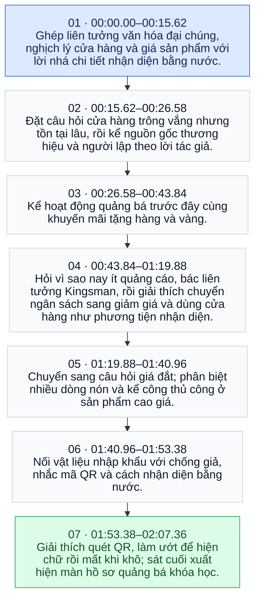

# Nón Sơn: từ câu hỏi cửa hàng vắng đến lời giải mô hình bán lẻ

[Video gốc — @sitcomtaichinh](https://www.tiktok.com/@sitcomtaichinh/video/7447850753626082567) · ID `7447850753626082567`

**Tóm tắt cách kể:** Liên tưởng gây bất ngờ → bộ điểm lạ → câu hỏi đối thoại → lời giải thay thế → câu hỏi giá → chi tiết kiểm tra sản phẩm → CTA. Mô hình đáng học là lấy một quan sát phổ biến làm câu hỏi, rồi dùng nhiều nhánh trả lời; không sao chép ám chỉ thiếu chứng cứ làm hook.

[Sơ đồ diễn biến](#mindmap) · [Diễn biến](#dien-bien) · [Nhịp cảm xúc](#cam-xuc) · [Cách áp dụng](#ap-dung)

## Sơ đồ diễn biến

Đọc từ trên xuống: mỗi hộp là một nhịp theo mốc ASR hoặc khung hình được ghi trong phân tích. Xanh dương là mở đầu, xanh lá là nhịp cuối. Chi tiết và giới hạn nằm trong phân tích bên dưới.

[Mã Mermaid riêng](../mindmaps/7447850753626082567.mmd)

## Dữ liệu và nguồn

**Cách thể hiện:** Tiểu phẩm đối thoại

**Phạm vi học:** Xem phạm vi kiểm và giới hạn từng ca.

**Ngữ cảnh thương mại:** Chưa xác nhận hợp tác thương mại; xem các đoạn tự quảng bá/giới hạn được ghi riêng.

- Đăng: 2024-12-13T11:04:50+00:00. Metadata lấy: 2026-11-15T04:03:43.376962+00:00.
- **4,000,000 view**; thích 159,600; bình luận 1,088; chia sẻ 5,962; lưu 6,061. Dấu phẩy tách hàng nghìn.
- Thời lượng media: 128.34s.
- **121.21× P50** 33,000 của 149 bài đủ 48h trong snapshot kênh. Clip có trong cửa sổ baseline. Không phải thống kê toàn bộ kênh.

## Phạm vi kiểm

Đã tải media, xem khung chọn lọc và đọc ASR có mốc lưu lúc 2026-11-15T04:04:54.260586+00:00. Đối chiếu cùng ID và thời lượng, lệch 0.0s. **Chưa nghe toàn âm hoặc xem chuyển động liên tục; chưa xác nhận toàn văn ASR hay mọi dữ kiện trong clip.**

Media SHA256: `452655cbe028472b89a4962e67c2d51d7cb1bf079cd89f89ca6ccbafae8db38d`. [Metadata và các hash khác](../videos.json). Video/ASR đầy đủ giữ ở bộ nghiên cứu cục bộ; bản chia sẻ giữ link gốc, trích ngắn và phân tích riêng.

## Lời hứa và câu hỏi trung tâm

**Lời hứa:** Giải thích nghịch lý bề ngoài của chuỗi cửa hàng và vài chi tiết sản phẩm khiến thương hiệu được chú ý.

**Câu hỏi:** Theo cách giải thích của tác giả, cửa hàng trông vắng có nhất thiết đồng nghĩa mô hình không thể sống?

## Mở đầu: lời và hình

ASR mở bằng liên tưởng Kingsman rồi xếp nhiều điều lạ: địa điểm đẹp, sản phẩm đắt và chi tiết chống giả. Khung 0–3 giây đặt logo Nón Sơn ngay trên đầu người dẫn, phụ đề gọi rõ thương hiệu. Đến 15,62 giây mới chuyển sang câu hỏi vì sao cửa hàng trông vắng vẫn tồn tại; khoảng 52,66–53,74 giây tác giả trực tiếp bác liên tưởng Kingsman. Phân tích này chỉ ghi cách tạo tò mò, không xác nhận bất kỳ ám chỉ hoạt động bất hợp pháp nào.

> Nón sơn chính là tổ chức Kingsman của Việt Nam

Trích ASR ngắn từ segment 00:00.00–00:02.08. Trích ASR chưa nghe đối chiếu; dữ kiện thuộc lời người đăng, chưa xác thực. Xem giới hạn từng ca. Dấu … nghĩa là bỏ bớt, không khẳng định toàn câu vừa ba giây.

| Mốc khung đã xem | Điều quan sát được |
|---|---|
| 00:00.00 | Người dẫn đeo kính, mặc áo khoác tối trước nền gỗ; ô logo Nón Sơn đặt trên đầu. |
| 00:02.00 | Logo và phụ đề liên tưởng Kingsman cùng hiện, thương hiệu được nhận diện rõ. |
| 00:19.25 | Trở về người dẫn với phụ đề năm 2006, mở đoạn lịch sử theo lời tác giả. |
| 00:38.50 | Khung nền tối với logo và chữ giá 80.000 đồng minh họa chương trình khuyến mãi. |
| 00:57.75 | Footage mặt tiền màu hồng có chữ tặng/mua một, tương ứng đoạn chuyển ngân sách sang ưu đãi. |
| 01:17.00 | Hình trong cửa hàng với nhiều nón trưng bày và người ở quầy, khác cảnh người dẫn. |
| 01:36.25 | Cận tay đang đan chất liệu màu đỏ, minh họa công việc thủ công. |
| 01:55.51 | Hộp hàng có mã QR được chèn giữa khung, trên nền người dẫn. |
| 02:07.34 | Màn hồ sơ Sitcom Tài Chính với mũi tên chỉ liên kết và dòng mời học chứng khoán miễn phí; đây là CTA ngoài phần ASR kể sản phẩm. |

Không suy chuyển động giữa các khung từ ảnh tĩnh.

## Diễn biến và nhiệm vụ từng beat

| Mốc ASR | Diễn giải riêng | Vai trò |
|---|---|---|
| 00:00.00–00:15.62 | Ghép liên tưởng văn hóa đại chúng, nghịch lý cửa hàng và giá sản phẩm với lời nhá chi tiết nhận diện bằng nước. | Cho một loạt điểm lạ và cho thấy trước phần thưởng cuối. |
| 00:15.62–00:26.58 | Đặt câu hỏi cửa hàng trông vắng nhưng tồn tại lâu, rồi kể nguồn gốc thương hiệu và người lập theo lời tác giả. | Chuyển đoạn nhá mở thành cuộc hỏi–đáp có vấn đề trung tâm. |
| 00:26.58–00:43.84 | Kể hoạt động quảng bá trước đây cùng khuyến mãi tặng hàng và vàng. | Tạo một quá khứ được mô tả là ồn ào để đối chiếu hiện tại. |
| 00:43.84–01:19.88 | Hỏi vì sao nay ít quảng cáo, bác liên tưởng Kingsman, rồi giải thích chuyển ngân sách sang giảm giá và dùng cửa hàng như phương tiện nhận diện. | Thay suy đoán ban đầu bằng lời giải kinh doanh của tác giả. |
| 01:19.88–01:40.96 | Chuyển sang câu hỏi giá đắt; phân biệt nhiều dòng nón và kể công thủ công ở sản phẩm cao giá. | Tách một ấn tượng chung thành các phân khúc cụ thể. |
| 01:40.96–01:53.38 | Nối vật liệu nhập khẩu với chống giả, nhắc mã QR và cách nhận diện bằng nước. | Dựng câu hỏi thao tác để chuẩn bị một kết quả có thể nhìn. |
| 01:53.38–02:07.36 | Giải thích quét QR, làm ướt để hiện chữ rồi mất khi khô; sát cuối xuất hiện màn hồ sơ quảng bá khóa học. | Trả chi tiết đã nhá đầu bài rồi chuyển sang CTA thương hiệu kênh. |

## Nhịp cảm xúc — giả thuyết biên tập

Các trạng thái dưới đây là cách đọc câu chuyện từ bằng chứng, không phải cảm xúc người xem đã đo hoặc biểu đồ retention.

| Mốc | Cảm xúc có thể gợi | Bằng chứng | Cách diễn giải |
|---|---|---|---|
| 00:00.00–00:15.62 | Ngạc nhiên vì liên tưởng và giá | Mở bằng Kingsman, vị trí đẹp, sản phẩm cao giá và chi tiết nước. | Nhiều điều chưa giải tạo động lực hỏi tiếp; đây là giả thuyết về thiết kế. |
| 00:15.62–00:43.84 | Tò mò tìm nền tảng | Câu hỏi tồn tại được đưa về lịch sử và hoạt động quảng bá. | Đổi tò mò giật gân thành chờ lời giải cụ thể. |
| 00:43.84–01:19.88 | Có một cách hiểu thay thế | Tác giả bác liên tưởng rồi nói về giảm giá, mặt bằng, nhận diện. | Sửa khung suy đoán trước bằng luận điểm kinh doanh. |
| 01:19.88–01:53.38 | Tò mò về đồ vật | Giá đắt dẫn sang thủ công và chống giả. | Thu chủ đề từ cả chuỗi bán lẻ vào một sản phẩm. |
| 01:53.38–02:07.36 | Chờ kiểm tra chi tiết đã nhá | QR và hiện chữ bằng nước quay lại. | Một chi tiết nhỏ làm điểm đóng vòng; chưa có dữ liệu đo mức thỏa mãn. |

## Cách phân phối thông tin

| Mốc | Động tác viết | Vì sao đáng chú ý |
|---|---|---|
| 00:00.00–00:15.62 | Nhá nhiều câu trả lời trước phần đối thoại. | Cho người xem thấy chủ đề sẽ có cả kinh doanh lẫn sản phẩm. |
| 00:15.62–00:43.84 | Đi từ quan sát hiện tại về lịch sử. | Tìm nguyên nhân thay vì chỉ lặp điều lạ. |
| 00:43.84–01:19.88 | Bác giả thuyết rồi đưa mô hình chi phí/nhận diện. | Cần một đáp án thay thế sau khi bác liên tưởng. |
| 01:19.88–01:40.96 | Dùng câu hỏi giá để mở tiểu mục. | Phân biệt hàng phổ thông với hàng thủ công. |
| 01:40.96–02:07.36 | Quay về chi tiết vật thể đã báo trước. | Tạo điểm kết cụ thể hơn một nhận định thương hiệu chung. |

## Giải đáp và cách kết

ASR khép vòng chi tiết chống giả bằng nước đã nhá từ đầu. Khung 127,34 giây cho thấy thêm trang hồ sơ và lời mời học chứng khoán miễn phí. Vì vậy có hai lớp kết: giải thích sản phẩm và chuyển đổi cho kênh; không gộp CTA thành bằng chứng cho luận điểm kinh doanh.

## Điểm mạnh có dẫn chứng

- **Câu hỏi chính có đối tượng rõ** — 15,62–18,6 giây hỏi về khả năng tồn tại của cửa hàng.

- **Hình minh họa đổi theo nhóm luận điểm** — 57,75 giây mặt tiền giảm giá; 77 giây trong cửa hàng; 96,25 giây cận đan tay.

- **Chi tiết cuối có chuẩn bị** — Nước/nhận diện được nhá ở 10,4–15,62 rồi giải ở 119,9–127,36 giây.

- **Có bác liên tưởng gây hiểu lầm** — 52,66–53,74 giây phủ định cách diễn giải Kingsman.

## Điểm yếu và điều không nên bắt chước

- **Hook có nguy cơ để lại ám chỉ không có căn cứ** — Liên tưởng xuất hiện ngay 0–2,08 giây nhưng lời bác ở hơn 52 giây.

- **Thông tin lịch sử chưa ổn định** — ASR vừa nói 2006 vừa nhắc quảng bá năm 1999; cần kiểm nguồn trước dùng lại.

- **Nhiều số liệu được kể mà chưa thấy nguồn trong khung mẫu** — Đoạn 53,74–79,88 giây nêu ngân sách, số cửa hàng và diện tích.

- **CTA khác chủ đề sản phẩm** — Khung 127,34 giây mời học chứng khoán, khác câu hỏi kinh doanh thương hiệu vừa kết.

## Khả năng được chia sẻ — chưa kiểm chứng

Không có dữ liệu phân phối/retention để kết luận vì sao viral. Các ý sau chỉ là giả thuyết để thử:

- Một thương hiệu thường gặp ngoài phố có thể khiến người xem muốn gửi clip để cùng giải thích quan sát; chưa xác nhận bằng dữ liệu chia sẻ.

- Chi tiết nhận diện bằng nước có thể kích thích muốn kiểm tra, chỉ nên tái dùng khi có sản phẩm và nguồn xác nhận.

## Chuyển cơ chế sang bài mới

Có thể dùng câu hỏi “vì sao nhìn có vẻ X mà vẫn Y” khi quan sát được mô tả đúng phạm vi, rồi trả bằng mô hình vận hành và một chi tiết vật thể. Học cách gọi lại chi tiết đã nhá; bỏ ngụ ý giật gân chưa có nguồn và tách hình minh họa khỏi bằng chứng xác nhận.

- Giữ quan sát ở mức trông vắng, không suy ra doanh thu hay hoạt động trái pháp luật.

- Không mở bằng cáo buộc rồi trông chờ lời bác ở cuối sửa mọi hiểu lầm.

- Nguồn hóa lịch sử, ngân sách và cửa hàng trước khi đưa vào mẫu kịch bản.

- Khi hứa biểu diễn vật thể, quay đủ thao tác và kết quả thực tế.

- Học nhịp hỏi–đáp và callback; không sao chép toàn lời kể hoặc khẳng định thương hiệu.

Không dùng bài chuyển thể chưa được người dùng duyệt làm mẫu giọng lâu dài.

## Giới hạn còn lại

- Đã đọc toàn bộ ASR có timestamp và xem 12 khung trích của bản tải mới; chưa nghe toàn âm hoặc xem video liên tục.

- Mốc nhịp dựa trên ASR; không dùng bản chép tự động làm trích dẫn nguyên văn.

- Không có retention hay thử nghiệm nhân quả; số lượt xem không chứng minh hook tạo ra kết quả.

- Số cửa hàng, chi phí, ngân sách marketing, giá và cách chống giả là lời tác giả, chưa được kiểm chứng độc lập.

- ASR nêu năm 2006 rồi nhắc hoạt động năm 1999; chưa đủ cơ sở sửa lịch sử hoặc dùng chuỗi năm đó làm dữ kiện.

- Liên tưởng Kingsman là thủ pháp mở và bị chính tác giả bác; không phải chứng cứ cho bất kỳ cáo buộc thương hiệu nào.

- Khung chọn mẫu chưa đủ xác nhận đã thấy trọn thao tác làm ướt và khô; phần ấy hiện được mô tả dựa trên ASR.

- Không xác định tài trợ hay quan hệ thương mại với thương hiệu; không suy ra có tài trợ chỉ từ nội dung thuận lợi.
