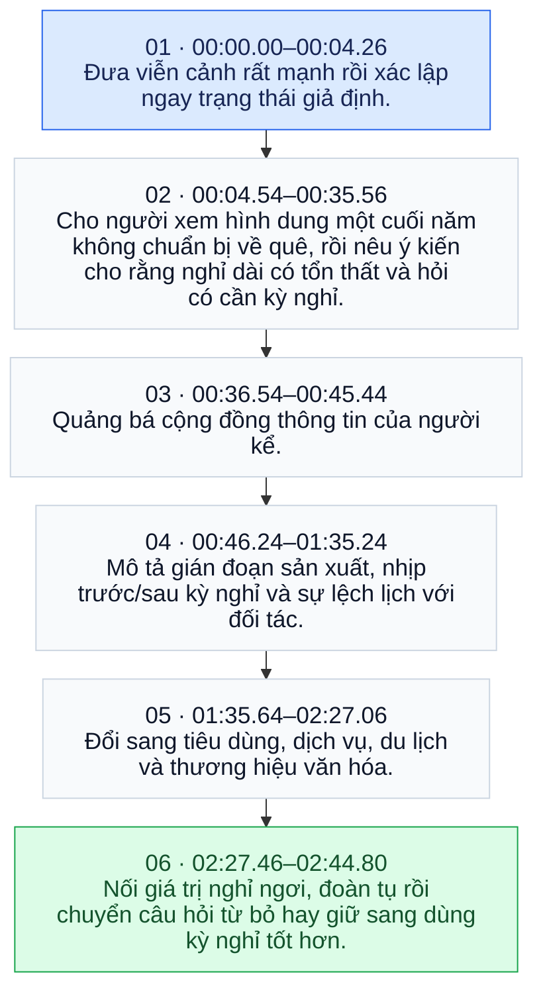

# Một giả định bỏ nghỉ Tết và phép cân hai loại giá trị

[Video gốc — @tinhbao.thitruong](https://www.tiktok.com/@tinhbao.thitruong/video/7467146855508479250) · ID `7467146855508479250`

**Tóm tắt cách kể:** Giả định gây giật mình được đính chính ngay → cảnh đời sống bị thay đổi → cân hai hệ giá trị → đổi câu hỏi ở cuối.

[Sơ đồ diễn biến](#mindmap) · [Diễn biến](#dien-bien) · [Nhịp cảm xúc](#cam-xuc) · [Cách áp dụng](#ap-dung)

## Sơ đồ diễn biến

Đọc từ trên xuống: mỗi hộp là một nhịp theo mốc ASR hoặc khung hình được ghi trong phân tích. Xanh dương là mở đầu, xanh lá là nhịp cuối. Chi tiết và giới hạn nằm trong phân tích bên dưới.

[Mã Mermaid riêng](../mindmaps/7467146855508479250.mmd)

## Dữ liệu và nguồn

**Cách thể hiện:** Người dẫn và hình minh họa

**Ngữ cảnh thương mại:** Chưa xác nhận hợp tác thương mại; xem các đoạn tự quảng bá/giới hạn được ghi riêng.

- Đăng: 2025-02-03T11:03:35+00:00. Metadata lấy: 2026-11-15T03:46:06.674656+00:00.
- **4,800,000 view**; thích 156,400; bình luận 3,342; chia sẻ 14,500; lưu 6,740. Dấu phẩy tách hàng nghìn.
- Thời lượng media: 166.01s.
- **6.92× P50** 693,950 của 150 bài đủ 48h trong snapshot kênh. Clip có trong cửa sổ baseline. Không phải thống kê toàn bộ kênh.

## Phạm vi kiểm

Đã tải media, xem khung chọn lọc và đọc ASR có mốc lưu lúc 2026-11-05T12:32:18.771222+00:00. Đối chiếu cùng ID và thời lượng, lệch 0.0322s. **Chưa nghe toàn âm hoặc xem chuyển động liên tục; chưa xác nhận toàn văn ASR hay mọi dữ kiện kinh tế trong clip.**

Media SHA256: `57c4ea455dff40c65f5fe9f98e452df4d064275da8e6c82b3a13bcc7ca3e47eb`. [Metadata và các hash khác](../videos.json). Video/ASR đầy đủ giữ ở bộ nghiên cứu cục bộ; bản chia sẻ giữ link gốc, trích ngắn và phân tích riêng.

## Lời hứa và câu hỏi trung tâm

**Lời hứa:** Giúp người xem cân được vì sao kỳ nghỉ Tết bị xem là chi phí và điều gì bị bỏ sót nếu chỉ tính phần sản xuất ngừng lại.

**Câu hỏi:** Bài toán nghỉ Tết nên được nhìn như tổn thất sản lượng, hoạt động kinh tế dịch chuyển hay một tổ hợp giá trị?

## Mở đầu: lời và hình

ASR 0–2,88 giây nêu một viễn cảnh bỏ nghỉ Tết như tin lớn; ngay 3,32–4,26 giây đính chính đó là tưởng tượng. Hai nhịp phải được đọc cùng nhau. Hình 1 giây làm nổi năm và bản đồ Việt Nam; khung 3–5 giây mở rộng sang các nước có Tết Nguyên Đán. Sau cú đổi trạng thái này, lời dựng cảnh cuối năm không về quê rồi mới đặt bài toán lợi ích kinh tế so với giá trị của kỳ nghỉ.

> Vào 2026, Việt Nam sẽ không còn nghỉ Tết nữa. Đó chỉ là tưởng tượng.

Trích ASR ngắn từ segment 00:00.00–00:04.26. Giữ cả lời giả định đính chính ngay sau câu gây sốc, không tách thành tin thật; ASR chưa nghe toàn âm. Dấu … nghĩa là bỏ bớt, không khẳng định toàn câu vừa ba giây.

| Mốc khung đã xem | Điều quan sát được |
|---|---|
| 00:01.00 | Bản đồ Việt Nam kèm năm được đặt rất lớn, tạo cảm giác mốc chính sách ở đầu. |
| 00:03.00 | Bản đồ khu vực Đông Á có nhiều đường biên và tiêu đề các nước có Tết Nguyên Đán. |
| 00:24.90 | Khung trích hiển thị một trang bài viết có con số GDP và lập luận của chuyên gia. |
| 00:49.80 | Chữ lớn về thiệt hại kinh tế do ngày nghỉ kéo dài mở phần lập luận thứ nhất. |
| 01:39.60 | Bài báo với tiêu đề về giá trị riêng của Tết xuất hiện đúng nhịp đổi góc nhìn. |
| 02:29.41 | Khung tư liệu về giá trị của Tết dùng hình người gói bánh và gia đình, thay cho bảng sản lượng. |

Không suy chuyển động giữa các khung từ ảnh tĩnh.

## Diễn biến và nhiệm vụ từng beat

| Mốc ASR | Diễn giải riêng | Vai trò |
|---|---|---|
| 00:00.00–00:04.26 | Đưa viễn cảnh rất mạnh rồi xác lập ngay trạng thái giả định. | Ngắt kỳ vọng; phần đính chính là điều kiện để hiểu đúng lời mở. |
| 00:04.54–00:35.56 | Cho người xem hình dung một cuối năm không chuẩn bị về quê, rồi nêu ý kiến cho rằng nghỉ dài có tổn thất và hỏi có cần kỳ nghỉ. | Biến tuyên bố thành một bài toán có hai phía và gắn với thói quen Việt Nam. |
| 00:36.54–00:45.44 | Quảng bá cộng đồng thông tin của người kể. | Ngắt tuyến nội dung để đặt CTA tự quảng bá; không phải bước chứng minh lập luận. |
| 00:46.24–01:35.24 | Mô tả gián đoạn sản xuất, nhịp trước/sau kỳ nghỉ và sự lệch lịch với đối tác. | Dựng phần bất lợi kinh tế trước để câu hỏi không chỉ là thói quen văn hóa. |
| 01:35.64–02:27.06 | Đổi sang tiêu dùng, dịch vụ, du lịch và thương hiệu văn hóa. | Đảo tiêu chí: ngừng sản xuất không đồng nghĩa toàn bộ hoạt động kinh tế biến mất. |
| 02:27.46–02:44.80 | Nối giá trị nghỉ ngơi, đoàn tụ rồi chuyển câu hỏi từ bỏ hay giữ sang dùng kỳ nghỉ tốt hơn. | Giải quyết tranh luận bằng cách tái đặt vấn đề thay vì chọn cực đoan ban đầu. |

## Nhịp cảm xúc — giả thuyết biên tập

Các trạng thái dưới đây là cách đọc câu chuyện từ bằng chứng, không phải cảm xúc người xem đã đo hoặc biểu đồ retention.

| Mốc | Cảm xúc có thể gợi | Bằng chứng | Cách diễn giải |
|---|---|---|---|
| 00:00.00–00:04.26 | Giật mình rồi hạ cảnh giác | Viễn cảnh bỏ kỳ nghỉ được đảo thành giả định ngay nhịp tiếp. | Khán giả có thể bị dừng lại nhưng cần thấy nhãn giả định để không hiểu thành thông báo thật. |
| 00:04.54–00:21.96 | Lạ lẫm và mất mát | Những việc chuẩn bị về quê, sắm sửa và chúc Tết bị rút khỏi cảnh cuối năm. | Các hành vi gần gũi làm cái giá của thay đổi có hình dạng trước khi nói GDP. |
| 00:22.28–01:35.24 | Cân nhắc áp lực kinh tế | Clip đặt tổn thất và lịch kinh doanh làm một phía của phép cân. | Lập luận trái thói quen tạo lý do tiếp tục nghe thay vì chỉ phản ứng cảm xúc. |
| 01:35.64–02:27.06 | Mở lại góc nhìn | Lời đổi sang tiêu dùng, dịch vụ và văn hóa; khung 99,6 giây là tư liệu về giá trị riêng của Tết. | Nhịp xoay có thể tạo cảm giác một đáp án đơn giản ban đầu chưa đủ. |
| 02:27.46–02:44.80 | Đồng thuận và gần gũi | Đoàn tụ, nghỉ ngơi được nối vào câu hỏi sử dụng kỳ nghỉ. | Kết giữ một giá trị người xem dễ đồng cảm mà không tiếp tục cực đoan hóa tranh luận. |

## Cách phân phối thông tin

| Mốc | Động tác viết | Vì sao đáng chú ý |
|---|---|---|
| 00:00.00–00:04.26 | Đặt giả định rồi khóa trạng thái thông tin | Phần đính chính phải đi cùng lời mở; không dùng cú gây sốc độc lập. |
| 00:04.54–00:35.56 | Đi từ một cảnh sinh hoạt tới câu hỏi chính | Hành động cuối năm làm vấn đề có người chịu tác động. |
| 00:46.24–01:35.24 | Trình bày chi phí trước lợi ích | Cho nửa sau một điều cụ thể để phản biện, thay vì chỉ ca ngợi văn hóa. |
| 01:35.64–02:27.06 | Đổi đơn vị giá trị | Từ sản lượng mất đi sang chi tiêu/dịch vụ/văn hóa giúp tạo phép cân. |
| 02:27.46–02:44.80 | Tái đặt câu hỏi | Kết không chỉ lặp một đáp án có/không, mà cho thấy tiền đề ban đầu quá hẹp. |

## Giải đáp và cách kết

Kết không xác nhận viễn cảnh bỏ Tết ở mở đầu; tác giả chuyển từ lựa chọn bỏ/giữ sang tận dụng thời gian nghỉ. Đây là một kết đổi khung câu hỏi sau hai nửa lập luận.

## Điểm mạnh có dẫn chứng

- **Chủ đề tranh luận được cụ thể hóa bằng đời sống.** — 4,54–21,96 giây dựng những việc cuối năm thay vì chỉ đọc con số.

- **Có một điểm xoay rõ để bài dài không đứng yên.** — 95,64 giây bắt đầu chuyển từ chi phí sang giá trị bị bỏ quên.

- **Kết phản hồi được tranh luận đầu.** — 158,98–164,8 giây đổi câu hỏi sang cách sử dụng kỳ nghỉ.

## Điểm yếu và điều không nên bắt chước

- **Câu đầu có nguy cơ bị cắt khỏi ngữ cảnh thành tin giả.** — Đính chính chỉ xuất hiện ở 3,32–4,26 giây, sau tuyên bố mạnh.

- **CTA cắt trước phần giải thích.** — 36,54–45,44 giây rời câu hỏi chính để quảng bá cộng đồng.

- **Lập luận dùng nhiều số và đánh giá chưa được lượt này xác minh.** — 22,28–29,5 giây nêu tổn thất GDP; các số tiêu dùng đến ở nửa sau.

## Khả năng được chia sẻ — chưa kiểm chứng

Không có dữ liệu phân phối/retention để kết luận vì sao viral. Các ý sau chỉ là giả thuyết để thử:

- Có thể gợi tranh luận vì kỳ nghỉ gắn trải nghiệm gia đình lẫn công việc; chưa có dữ liệu chia sẻ theo đoạn để kiểm.

- Cách đặt hai hệ giá trị có thể tạo chất liệu bình luận nhiều phía, nhưng không đồng nghĩa chính cú mở gây lượng view.

## Chuyển cơ chế sang bài mới

Có thể học cách đưa một thay đổi giả định vào những hành vi khán giả nhìn thấy, rồi thử nó dưới hai góc. Khi chuyển thể, phải ghi rõ giả định ngay trong cùng khung mở, không tách tuyên bố đầu thành tin chính sách; không lấy con số tổn thất trong clip làm dữ kiện đã kiểm.

- Luôn khóa rõ trạng thái giả định ngay khung đầu; không tái dùng tuyên bố chính sách chưa có thật.

- Thử thay đổi bằng hành vi đời sống trước khi đưa thước đo lớn.

- Hai phía của phép cân phải có bằng chứng riêng và kết phải cho thấy điều đã đổi trong cách hiểu.

- Đừng mặc định chèn CTA trước phần giải thích chỉ vì ca nguồn có làm.

Không dùng bài chuyển thể chưa được người dùng duyệt làm mẫu giọng lâu dài.

## Giới hạn còn lại

- Đã đọc ASR có mốc và xem contact sheet mới gồm các khung chọn lọc; chưa nghe toàn âm hoặc xem chuyển động liên tục.

- Nhịp cảm xúc, lý do chú ý và khả năng chia sẻ dưới đây là giả thuyết biên tập, không phải dữ liệu retention hay kết quả thử nghiệm.

- Lượt phân tích này chưa kiểm số liệu GDP, tiêu dùng hoặc phát biểu chuyên gia mà video dẫn.

- ASR có lỗi từ và một khoảng thiếu ở gần 149–152 giây; không tự bổ sung câu thiếu.

- Có CTA quảng bá cộng đồng của tác giả ở 36,54–45,44 giây; chưa có bằng chứng riêng để xác định tài trợ.

- Đoạn tự quảng bá cộng đồng 00:36.54–00:45.44 theo ASR; chưa đủ xác định tài trợ bên thứ ba. Không coi đoạn này là mẹo giữ chân mặc định.
