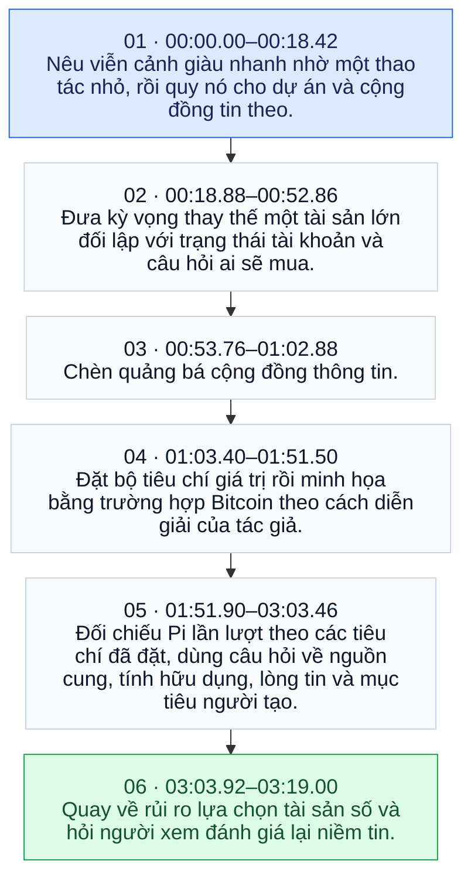

# Lời hứa làm giàu nhẹ công và quá trình chất vấn Pi

[Video gốc — @tinhbao.thitruong](https://www.tiktok.com/@tinhbao.thitruong/video/7473118765144755464) · ID `7473118765144755464`

**Tóm tắt cách kể:** Phần thưởng lớn với công sức nhỏ → quy lời hứa cho một đối tượng cụ thể → đặt vấn đề giá trị thật → dựng tiêu chí → đối chiếu → trả quyền đánh giá cho khán giả.

[Sơ đồ diễn biến](#mindmap) · [Diễn biến](#dien-bien) · [Nhịp cảm xúc](#cam-xuc) · [Cách áp dụng](#ap-dung)

## Sơ đồ diễn biến

Đọc từ trên xuống: mỗi hộp là một nhịp theo mốc ASR hoặc khung hình được ghi trong phân tích. Xanh dương là mở đầu, xanh lá là nhịp cuối. Chi tiết và giới hạn nằm trong phân tích bên dưới.

[Mã Mermaid riêng](../mindmaps/7473118765144755464.mmd)

## Dữ liệu và nguồn

**Cách thể hiện:** Người dẫn và hình minh họa

**Ngữ cảnh thương mại:** Chưa xác nhận hợp tác thương mại; xem các đoạn tự quảng bá/giới hạn được ghi riêng.

- Đăng: 2025-02-19T13:17:36+00:00. Metadata lấy: 2026-11-15T03:46:14.353031+00:00.
- **4,100,000 view**; thích 129,900; bình luận 3,314; chia sẻ 14,300; lưu 6,744. Dấu phẩy tách hàng nghìn.
- Thời lượng media: 200.07s.
- **5.91× P50** 693,950 của 150 bài đủ 48h trong snapshot kênh. Clip có trong cửa sổ baseline. Không phải thống kê toàn bộ kênh.

## Phạm vi kiểm

Đã tải media, xem khung chọn lọc và đọc ASR có mốc lưu lúc 2026-11-05T12:34:11.905725+00:00. Đối chiếu cùng ID và thời lượng, lệch 0.0319s. **Chưa nghe toàn âm hoặc xem chuyển động liên tục; chưa xác nhận toàn văn ASR hay mọi dữ kiện kinh tế trong clip.**

Media SHA256: `bdebac515f12c5f3edc08a6a68c6efc2679499664e4f5bad2f2dcb79d0d7e58d`. [Metadata và các hash khác](../videos.json). Video/ASR đầy đủ giữ ở bộ nghiên cứu cục bộ; bản chia sẻ giữ link gốc, trích ngắn và phân tích riêng.

## Lời hứa và câu hỏi trung tâm

**Lời hứa:** Thử chất vấn nguồn gốc giá trị và khả năng hiện thực hóa lời hứa giàu nhanh mà dự án được mô tả là đưa ra.

**Câu hỏi:** Nếu một lợi ích lớn chỉ đòi một thao tác nhỏ, giá trị trao đổi cuối cùng đến từ ai và từ đâu?

## Mở đầu: lời và hình

ASR mở bằng một viễn cảnh lợi ích lớn với hành động cực nhỏ; 7,34–18,42 giây mới quy viễn cảnh ấy cho dự án và những người tin vào nó. Các khung mở dùng bản đồ, biểu tượng người và điện thoại, khiến lời hứa có vật thể để bám. Phần đầu sau đó chuyển từ mong ước sang câu hỏi ai mua và giá trị đến từ đâu; không nên trích lời hứa đầu như lời khuyên của bộ này.

> Hãy tưởng tượng bạn có thể trở thành tỷ phú chỉ bằng việc nằm nhà cả ngày

Trích ASR ngắn từ segment 00:00.00–00:03.80. Đoạn ASR ngắn, chưa đối chiếu toàn bộ âm; xem giới hạn từng ca. Dấu … nghĩa là bỏ bớt, không khẳng định toàn câu vừa ba giây.

| Mốc khung đã xem | Điều quan sát được |
|---|---|
| 00:02.00 | Biểu tượng người cùng chữ lớn về khả năng làm giàu được đặt trên bản đồ. |
| 00:05.00 | Điện thoại có giao diện liên quan Pi xuất hiện trên nền được làm mờ. |
| 00:30.01 | Biểu đồ tròn và con số tài khoản bị bỏ không trực quan hóa phần chất vấn quy mô cộng đồng. |
| 01:30.03 | Sơ đồ người gửi/nhận cùng tư liệu giao dịch được đặt vào phần giải thích Bitcoin. |
| 02:00.04 | Khung so nguồn cung dùng thẻ thông tin và chữ nhấn việc không hiếm. |
| 03:00.06 | Biểu tượng hai dự án blockchain và dấu hỏi đi cùng phần hỏi về mục tiêu đội ngũ. |

Không suy chuyển động giữa các khung từ ảnh tĩnh.

## Diễn biến và nhiệm vụ từng beat

| Mốc ASR | Diễn giải riêng | Vai trò |
|---|---|---|
| 00:00.00–00:18.42 | Nêu viễn cảnh giàu nhanh nhờ một thao tác nhỏ, rồi quy nó cho dự án và cộng đồng tin theo. | Đặt khoảng cách giữa phần thưởng và công sức, đồng thời tạo đối tượng để chất vấn. |
| 00:18.88–00:52.86 | Đưa kỳ vọng thay thế một tài sản lớn đối lập với trạng thái tài khoản và câu hỏi ai sẽ mua. | Lật từ mong ước cá nhân sang vấn đề thanh khoản/giá trị mà bài sẽ thử trả lời. |
| 00:53.76–01:02.88 | Chèn quảng bá cộng đồng thông tin. | CTA tự quảng bá ngắt trước khung tiêu chí. |
| 01:03.40–01:51.50 | Đặt bộ tiêu chí giá trị rồi minh họa bằng trường hợp Bitcoin theo cách diễn giải của tác giả. | Cung cấp một thước kiểm trước khi đánh giá đối tượng bị chất vấn. |
| 01:51.90–03:03.46 | Đối chiếu Pi lần lượt theo các tiêu chí đã đặt, dùng câu hỏi về nguồn cung, tính hữu dụng, lòng tin và mục tiêu người tạo. | Cho người xem một chuỗi kiểm tra thay vì chỉ nhắc lại sự nghi ngờ. |
| 03:03.92–03:19.00 | Quay về rủi ro lựa chọn tài sản số và hỏi người xem đánh giá lại niềm tin. | Kết đưa phán đoán trở lại khán giả sau một chiều lập luận nghi ngờ. |

## Nhịp cảm xúc — giả thuyết biên tập

Các trạng thái dưới đây là cách đọc câu chuyện từ bằng chứng, không phải cảm xúc người xem đã đo hoặc biểu đồ retention.

| Mốc | Cảm xúc có thể gợi | Bằng chứng | Cách diễn giải |
|---|---|---|---|
| 00:00.00–00:06.88 | Bị hấp dẫn bởi bất cân xứng | Phần thưởng rất lớn được đặt cạnh hành động nhỏ trên điện thoại. | Đây có thể là cửa vào dễ nhận ra, nhưng cần khung thuật lại để không thành quảng bá lời hứa. |
| 00:07.34–00:37.18 | Từ tin tưởng sang hoài nghi | Tác giả quy viễn cảnh cho dự án rồi đặt số cộng đồng cạnh trạng thái tài khoản. | Đổi hướng cảm xúc bằng một sự chênh giữa quy mô được kể và khả năng sử dụng. |
| 00:37.64–00:52.86 | Chờ một phép giải thích | Lời đặt liên tiếp vấn đề người mua, giá trị và tính khả thi. | Ba câu hỏi thu hẹp điều người xem cần chờ, dù phần mở khá dài. |
| 01:03.40–01:51.50 | Có khung để đánh giá | Clip đặt tiêu chí rồi đi qua một đối tượng so sánh. | Một bộ tiêu chí có thể giảm cảm giác ý kiến chủ quan nếu các tiêu chí được biện minh tốt. |
| 01:51.90–03:03.46 | Nghi ngờ tăng theo từng mục | Từng tiêu chí trở thành một lần chất vấn đối tượng. | Các mục tạo nhịp tích lũy; không có dữ liệu để xác nhận chúng giữ người xem. |
| 03:03.92–03:19.00 | Tự kiểm lại quyết định | Kết quay về cơ hội/rủi ro và câu hỏi lòng tin. | Người xem được đặt vào vai người phán đoán sau chuỗi luận điểm định hướng. |

## Cách phân phối thông tin

| Mốc | Động tác viết | Vì sao đáng chú ý |
|---|---|---|
| 00:00.00–00:18.42 | Lời hứa trước, nguồn hứa ngay sau | Giữ rõ đây là điều dự án được mô tả là vẽ ra, không phải lời hứa của người biên soạn. |
| 00:18.88–00:52.86 | Dịch từ ham muốn sang câu hỏi thị trường | Một viễn cảnh giàu cần người mua và giá trị trao đổi, chứ không chỉ lượng người tham gia. |
| 01:03.40–01:51.50 | Dựng thước kiểm trước khi chấm | Giúp khán giả thấy chuỗi so sánh có trật tự; tiêu chí vẫn cần kiểm riêng. |
| 01:51.90–03:03.46 | Dùng lại cùng bộ tiêu chí | Mỗi mục trở thành một bước đối chiếu có thể theo dõi. |
| 03:03.92–03:19.00 | Khép ở quyết định của người xem | Câu hỏi cuối gắn lại với niềm tin đặt ra đầu bài, thay vì mở một chủ đề hoàn toàn mới. |

## Giải đáp và cách kết

Kết bằng một câu hỏi đánh giá niềm tin sau chuỗi phản biện. Đây không phải một phân tích định giá được xác nhận; các dữ kiện, tiêu chí và kết luận trong video cần kiểm độc lập trước khi dùng cho nội dung tài chính mới.

## Điểm mạnh có dẫn chứng

- **Có một phép đối chiếu xuyên bài.** — 63,4–183,46 giây đi từ tiêu chí tới đánh giá đối tượng.

- **Biểu đồ và tư liệu giúp các luận điểm có dạng nhìn được.** — Khung 30,01 giây là biểu đồ; 90,03 giây có sơ đồ/tư liệu; 120,04 giây là thẻ nguồn cung.

- **Từ lời hứa đến câu hỏi giá trị là một chuyển hướng rõ.** — 37,64–52,86 giây đặt vấn đề ai mua và khả năng hiện thực hóa.

## Điểm yếu và điều không nên bắt chước

- **Phần mở kéo dài rồi bị ngắt bởi tự quảng bá.** — Thước kiểm chỉ bắt đầu ở 63,4 giây sau đoạn CTA 53,76–62,88.

- **Khung tiêu chí có thể bị cảm nhận như được đặt để phục vụ kết luận.** — 63,4–111,5 giây dựng tiêu chí qua một đối tượng ưa thích rồi 111,9 giây chuyển sang đối tượng bị phản biện; lượt này chưa kiểm tính nhất quán chuyên môn.

- **Một số luận điểm cần ngày và nguồn pháp lý/kỹ thuật rõ.** — Phần so sánh nói tới quy chế tiền tệ, tính công nhận và công nghệ ở 76,94–181,14 giây.

## Khả năng được chia sẻ — chưa kiểm chứng

Không có dữ liệu phân phối/retention để kết luận vì sao viral. Các ý sau chỉ là giả thuyết để thử:

- Chủ đề có thể chạm hai nhóm đã tin và đang nghi ngờ, tạo động cơ bình luận; chưa có dữ liệu để quy hiệu quả cho tranh cãi.

- Một chuỗi tiêu chí có thể được người xem dùng để giải thích lại cho người thân, nhưng khả năng chia sẻ chưa được đo riêng.

## Chuyển cơ chế sang bài mới

Có thể học cách đưa một lời hứa hấp dẫn vào phép kiểm có tiêu chí, thay vì tự phát lại lời hứa. Phải thể hiện rõ đang thuật lại điều dự án/người khác hứa và kiểm dữ kiện của cả đối tượng lẫn tiêu chí; không dùng giấc mơ làm giàu làm câu khẳng định của người kể mới.

- Thuật lại rõ nguồn của lời hứa, không để câu mở thành cam kết lợi nhuận của chính mình.

- Nêu tiêu chí có thể kiểm và áp nhất quán cho các đối tượng được so.

- Phân biệt dữ kiện lịch sử tại thời điểm clip với điều đúng hiện tại.

- Giữ kết nối giữa câu hỏi mở và phép kiểm, không dùng nhãn tiêu cực thay bằng chứng.

Không dùng bài chuyển thể chưa được người dùng duyệt làm mẫu giọng lâu dài.

## Giới hạn còn lại

- Đã đọc ASR có mốc và xem contact sheet mới gồm các khung chọn lọc; chưa nghe toàn âm hoặc xem chuyển động liên tục.

- Nhịp cảm xúc, lý do chú ý và khả năng chia sẻ dưới đây là giả thuyết biên tập, không phải dữ liệu retention hay kết quả thử nghiệm.

- Mọi số lượng tài khoản, nguồn cung, ứng dụng và mô tả pháp lý trong video chưa được lượt này kiểm độc lập; không dùng làm khuyến nghị đầu tư.

- ASR nhận sai tên Pi và một số từ chuyên môn; không coi toàn văn là nguyên văn đã đối chiếu âm.

- Có CTA quảng bá cộng đồng tác giả ở 53,76–62,88 giây; chưa đủ bằng chứng xác định tài trợ.

- Đoạn tự quảng bá cộng đồng 00:53.76–01:02.88 theo ASR; chưa đủ xác định tài trợ bên thứ ba. Không coi đoạn này là mẹo giữ chân mặc định.
