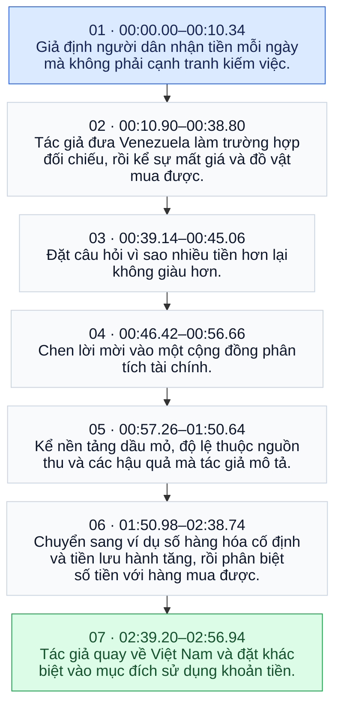

# Lời hứa nhận tiền dễ dàng được thử bằng câu chuyện lạm phát Venezuela

[Video gốc — @tinhbao.thitruong](https://www.tiktok.com/@tinhbao.thitruong/video/7481278109644246290) · ID `7481278109644246290`

**Tóm tắt cách kể:** Phần thưởng giả định ai cũng muốn → đối chứng làm kết quả đảo nghĩa → câu hỏi số tiền/sức mua → mô hình hàng hóa cố định → quay về điều kiện trong nước.

[Sơ đồ diễn biến](#mindmap) · [Diễn biến](#dien-bien) · [Nhịp cảm xúc](#cam-xuc) · [Cách áp dụng](#ap-dung)

## Sơ đồ diễn biến

Đọc từ trên xuống: mỗi hộp là một nhịp theo mốc ASR hoặc khung hình được ghi trong phân tích. Xanh dương là mở đầu, xanh lá là nhịp cuối. Chi tiết và giới hạn nằm trong phân tích bên dưới.

[Mã Mermaid riêng](../mindmaps/7481278109644246290.mmd)

## Dữ liệu và nguồn

**Cách thể hiện:** Người dẫn và hình minh họa

**Phạm vi học:** Xem phạm vi kiểm và giới hạn từng ca.

**Ngữ cảnh thương mại:** Chưa xác nhận hợp tác thương mại; xem các đoạn tự quảng bá/giới hạn được ghi riêng.

- Đăng: 2025-03-13T13:00:02+00:00. Metadata lấy: 2026-11-15T03:46:23.460068+00:00.
- **4,200,000 view**; thích 148,500; bình luận 583; chia sẻ 3,714; lưu 5,489. Dấu phẩy tách hàng nghìn.
- Thời lượng media: 178.29s.
- **6.05× P50** 693,950 của 150 bài đủ 48h trong snapshot kênh. Clip có trong cửa sổ baseline. Không phải thống kê toàn bộ kênh.

## Phạm vi kiểm

Đã tải media, xem khung chọn lọc và đọc ASR có mốc lưu lúc 2026-11-05T12:33:33.023942+00:00. Đối chiếu cùng ID và thời lượng, lệch 0.0267s. **Chưa nghe toàn âm hoặc xem chuyển động liên tục; chưa xác nhận toàn văn ASR hay mọi dữ kiện trong clip.**

Media SHA256: `617119f0db9a0d831fbfb2226af95a3a09672c5fde4e06bd8ed2dc4ff68ee5b8`. [Metadata và các hash khác](../videos.json). Video/ASR đầy đủ giữ ở bộ nghiên cứu cục bộ; bản chia sẻ giữ link gốc, trích ngắn và phân tích riêng.

## Lời hứa và câu hỏi trung tâm

**Lời hứa:** Kiểm một phần thưởng nhận tiền dễ dàng bằng chênh lệch giữa tiền danh nghĩa và lượng hàng thực mua, sau đó liên hệ mục đích sử dụng tiền.

**Câu hỏi:** Tại sao có nhiều đơn vị tiền hơn chưa chắc làm xã hội có nhiều của cải hơn?

## Mở đầu: lời và hình

Tác giả mở bằng giả định ai cũng nhận tiền mà không phải làm, tạo một lợi ích tưởng hấp dẫn rồi sớm đổi sang một quốc gia được kể là đã trả giá. Khung 0–5 giây dùng bản đồ và nhóm người với nhãn tiền, sau đó 26,74 giây đưa đường giá trị tiền giảm; lời và hình đều chuyển từ nhận nhiều sang mua được ít.

> Hãy thử tưởng tượng, nếu như tất cả mọi người chỉ cần ở nhà mà vẫn được nhà nước tinh tinh 200.000 …

Trích ASR ngắn từ segment 00:00.00–00:05.62. Đoạn ASR ngắn, chưa đối chiếu toàn bộ âm; xem giới hạn từng ca. Dấu … nghĩa là bỏ bớt, không khẳng định toàn câu vừa ba giây.

| Mốc khung đã xem | Điều quan sát được |
|---|---|
| 00:00.00 | Bản đồ Đông Nam Á mở đầu, chưa có quốc gia Venezuela. |
| 00:05.00 | Nhóm biểu tượng người trong khu vực Việt Nam đi cùng nhãn nhận một khoản tiền. |
| 00:26.74 | Đồ thị giảm của đồng tiền được đặt cạnh hình tiền, hỗ trợ phần đảo hệ quả. |
| 00:53.49 | Người dẫn cầm thiết bị có trang cộng đồng và liên kết, đúng đoạn tự quảng bá được ASR ghi. |
| 01:20.23 | Ảnh bài báo về khủng hoảng Venezuela làm tư liệu trong tuyến nguyên nhân. |
| 02:13.71 | Sơ đồ số đùi gà giữ nguyên trong khi số đồng tiền tăng, phục vụ ví dụ mô hình hóa. |
| 02:40.46 | Ảnh bài báo liên quan khoản tiền đưa vào nền kinh tế Việt Nam xuất hiện khi tác giả chuyển địa bàn. |
| 02:57.29 | Ảnh thành phố/hạ tầng ở khung cuối, tương ứng phần tác giả nói về đầu tư. |

Không suy chuyển động giữa các khung từ ảnh tĩnh.

## Diễn biến và nhiệm vụ từng beat

| Mốc ASR | Diễn giải riêng | Vai trò |
|---|---|---|
| 00:00.00–00:10.34 | Giả định người dân nhận tiền mỗi ngày mà không phải cạnh tranh kiếm việc. | Dựng phần thưởng trực tiếp cho khán giả trước khi thử mặt trái. |
| 00:10.90–00:38.80 | Tác giả đưa Venezuela làm trường hợp đối chiếu, rồi kể sự mất giá và đồ vật mua được. | Đảo phần thưởng từ nhiều tiền thành sức mua giảm. |
| 00:39.14–00:45.06 | Đặt câu hỏi vì sao nhiều tiền hơn lại không giàu hơn. | Chốt nghịch lý cần giải. |
| 00:46.42–00:56.66 | Chen lời mời vào một cộng đồng phân tích tài chính. | Đoạn quảng bá riêng cắt giữa câu hỏi và câu trả lời, không coi là một bước giải thích. |
| 00:57.26–01:50.64 | Kể nền tảng dầu mỏ, độ lệ thuộc nguồn thu và các hậu quả mà tác giả mô tả. | Cấp tuyến nguyên nhân lịch sử sau nghịch lý; các số/sự kiện cần fact-check. |
| 01:50.98–02:38.74 | Chuyển sang ví dụ số hàng hóa cố định và tiền lưu hành tăng, rồi phân biệt số tiền với hàng mua được. | Cụ thể hóa cơ chế bằng mô hình rất đơn giản. |
| 02:39.20–02:56.94 | Tác giả quay về Việt Nam và đặt khác biệt vào mục đích sử dụng khoản tiền. | Kết nối câu chuyện nước ngoài với câu hỏi trong nước, chưa phải bằng chứng dự báo lạm phát. |

## Nhịp cảm xúc — giả thuyết biên tập

Các trạng thái dưới đây là cách đọc câu chuyện từ bằng chứng, không phải cảm xúc người xem đã đo hoặc biểu đồ retention.

| Mốc | Cảm xúc có thể gợi | Bằng chứng | Cách diễn giải |
|---|---|---|---|
| 00:00.00–00:10.34 | Hấp dẫn bởi lợi ích | Giả định tiền tới mà không cần làm đặt người xem vào vị thế được lợi. | Có thể tạo mong muốn thử tưởng tượng; không có bằng chứng cảm xúc người xem. |
| 00:10.90–00:38.80 | Kỳ vọng bị lật | Tác giả kể mất sức mua qua đồ vật mua được. | Đổi thước đo từ tiền sang hàng tạo nghịch lý dễ hình dung. |
| 00:39.14–00:56.66 | Chờ giải rồi bị ngắt | Câu hỏi được đặt ở 39,14–45,06 giây, tiếp theo là quảng bá cộng đồng. | Ngắt lời giải là điểm yếu biên tập cần ghi, không suy đó là cách giữ chân. |
| 00:57.26–01:50.64 | Căng theo chuỗi hậu quả | Tuyến lịch sử và các mức hậu quả xuất hiện liên tiếp. | Tăng mức độ nghiêm trọng, nhưng số liệu chưa được kiểm. |
| 01:50.98–02:38.74 | Được thu nhỏ về mô hình | Một lượng hàng cố định được đặt cạnh lượng tiền tăng. | Mô hình đơn giản có thể tạo điểm hiểu ra nhưng cũng dễ bị hiểu quá tổng quát. |
| 02:39.20–02:56.94 | Liên hệ với bối cảnh gần | Tác giả chuyển về Việt Nam và mục đích dùng tiền. | Đưa người xem về câu hỏi nội địa, không khép bằng dự báo được chứng minh. |

## Cách phân phối thông tin

| Mốc | Động tác viết | Vì sao đáng chú ý |
|---|---|---|
| 00:00.00–00:38.80 | Đảo nghĩa một phần thưởng | Giữ cùng câu chuyện nhận tiền nhưng đổi biến được quan tâm thành sức mua. |
| 00:39.14–00:56.66 | Đặt câu hỏi rồi chen quảng bá | Đây là sự gián đoạn thật của cấu trúc, cần ghi riêng thay vì tô đẹp mọi nhịp của clip viral. |
| 00:57.26–01:50.64 | Dùng lịch sử làm tuyến nguyên nhân | Tác giả đặt nguồn thu và lựa chọn chính sách trước hậu quả; cần kiểm dữ kiện gốc. |
| 01:50.98–02:38.74 | Đổi từ quốc gia phức tạp sang mô hình hai đại lượng | Hàng và tiền trở thành phép so nhìn được ở khung 133,71 giây. |
| 02:39.20–02:56.94 | Kết bằng một khác biệt điều kiện | Tác giả nêu mục đích sử dụng tiền để tránh chỉ đồng nhất hai bối cảnh, nhưng mức phân biệt còn đơn giản. |

## Giải đáp và cách kết

Kết chuyển từ Venezuela sang cách khoản tiền được dùng ở Việt Nam. Nó mở một điều kiện so sánh, không đủ để xác nhận hai nền kinh tế tương đồng hay kết luận tác động của một chính sách thực tế.

## Điểm mạnh có dẫn chứng

- **Giả định mở có phần thưởng cụ thể và đổi thước đo rõ** — 0–38,80 giây đi từ nhận tiền tới hàng hóa mua được.

- **Có một mô hình hình ảnh thay cho chỉ kể khái niệm** — 110,98–158,74 giây và khung 133,71 giây.

- **Liên hệ trong nước xuất phát từ câu hỏi đã kể** — 159,20–176,94 giây quay lại mục đích sử dụng tiền.

## Điểm yếu và điều không nên bắt chước

- **Quảng bá chen trước lời giải** — 46,42–56,66 giây nằm ngay sau câu hỏi chính.

- **Chi tiết ASR sai có thể khiến người đọc học nhầm dữ kiện** — Tên tiền tệ và số liệu ở 25,32–38,80 và 87,10–110,64 giây cần đối chiếu.

- **Giải thích có nguy cơ biến mô hình đơn giản thành nguyên nhân duy nhất** — Ví dụ hàng/tiền 118,50–140,10 giây và liên hệ Việt Nam cuối clip chưa đủ làm kết luận vĩ mô.

## Khả năng được chia sẻ — chưa kiểm chứng

Không có dữ liệu phân phối/retention để kết luận vì sao viral. Các ý sau chỉ là giả thuyết để thử:

- Sự đảo giữa nhận thêm tiền và mua ít hơn có thể dễ được kể lại như nghịch lý; chưa có dữ liệu chứng minh vì sao người xem chia sẻ.

- Mô hình hàng hóa cụ thể có thể giúp người xem bàn luận; không có kiểm tra mức hiểu sau xem.

## Chuyển cơ chế sang bài mới

Học cách thử một lợi ích tưởng rõ bằng câu hỏi nó đổi gì trong các điều kiện khác. Phải ghi đây là giả định và giữ đủ điều kiện mô hình; không học ngôn ngữ khẳng định quá mức hay chèn quảng bá trước lời giải.

- Gắn nhãn giả định trước khi dùng lợi ích lớn làm mở đầu.

- Đáp án nên tới ngay sau câu hỏi; không mặc định học đoạn quảng bá chen ngang.

- Mô hình đơn giản phải nêu biến giữ nguyên và giới hạn.

- Liên hệ giữa hai quốc gia cần nguồn và điều kiện riêng, không sao chép kết luận tác giả.

Không dùng bài chuyển thể chưa được người dùng duyệt làm mẫu giọng lâu dài.

## Giới hạn còn lại

- Bằng chứng gồm ASR có mốc và các khung chọn lọc đã xem; chưa nghe trực tiếp toàn âm hoặc xem chuyển động liên tục.

- Phân tích cách kể không xác nhận dữ kiện lịch sử, kinh tế hoặc thống kê trong clip. Không có retention/A-B để khẳng định cơ chế gây viral.

- Có đoạn tự quảng bá cộng đồng FinPath ở 46,42–56,66 giây; không xác nhận tài trợ thương mại bên ngoài, nhưng cần gắn nhãn promotional-segment.

- ASR có lỗi tên tiền tệ, con số và cụm từ; chỉ dùng trình tự nội dung để phân tích, không lấy làm dữ liệu lịch sử.

- Ví dụ số hàng hóa/tiền là mô hình tác giả dựng, không xác nhận mô hình đó đủ giải thích toàn bộ lạm phát.

- Đoạn tự quảng bá cộng đồng 00:46.42–00:56.66 theo ASR; chưa đủ xác định tài trợ bên thứ ba. Không coi đoạn này là mẹo giữ chân mặc định.
