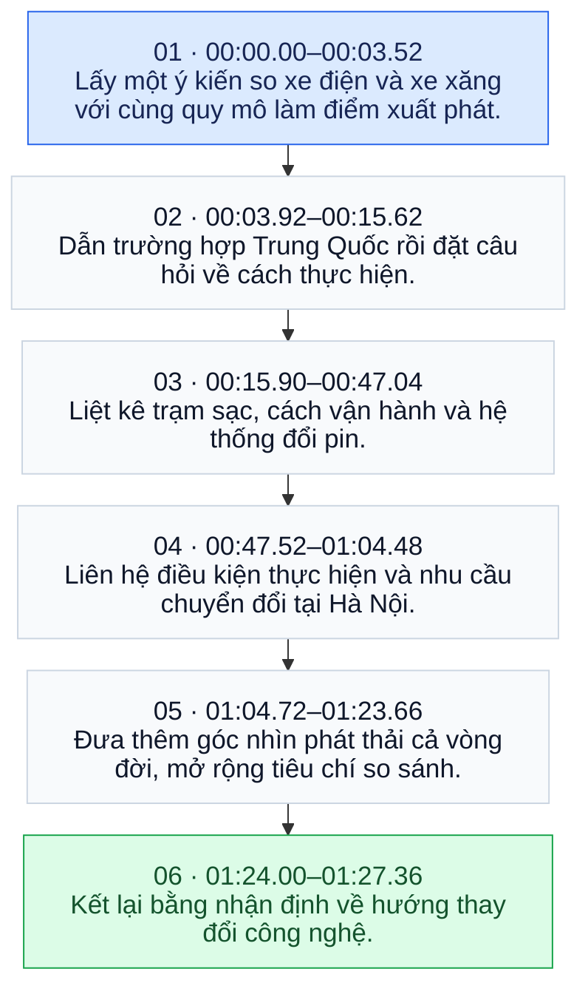

# Xe điện, xe xăng và điều kiện để chuyển đổi

[Video gốc — @longkhongphainong](https://www.tiktok.com/@longkhongphainong/video/7529438894845218064) · ID `7529438894845218064`

**Tóm tắt cách kể:** Mượn một tranh luận sẵn có → đưa cách vận hành → thêm điều kiện làm phép so đổi nghĩa.

[Sơ đồ diễn biến](#mindmap) · [Diễn biến](#dien-bien) · [Nhịp cảm xúc](#cam-xuc) · [Cách áp dụng](#ap-dung)

## Sơ đồ diễn biến

Đọc từ trên xuống: mỗi hộp là một nhịp theo mốc ASR hoặc khung hình được ghi trong phân tích. Xanh dương là mở đầu, xanh lá là nhịp cuối. Chi tiết và giới hạn nằm trong phân tích bên dưới.

[Mã Mermaid riêng](../mindmaps/7529438894845218064.mmd)

## Dữ liệu và nguồn

**Cách thể hiện:** Hoạt hình bình luận

**Phạm vi học:** Xem phạm vi kiểm và giới hạn từng ca.

**Ngữ cảnh thương mại:** Chưa xác nhận hợp tác thương mại; xem các đoạn tự quảng bá/giới hạn được ghi riêng.

- Đăng: 2025-07-21T13:30:00+00:00. Metadata lấy: 2026-11-15T03:30:32.298408+00:00.
- **916,000 view**; thích 24,900; bình luận 711; chia sẻ 755; lưu 760. Dấu phẩy tách hàng nghìn.
- Thời lượng media: 87.59s.
- **50.89× P50** 18,000 của 150 bài đủ 48h trong snapshot kênh. Clip có trong cửa sổ baseline. Không phải thống kê toàn bộ kênh.

## Phạm vi kiểm

Đã tải media, xem khung chọn lọc và đọc ASR có mốc lưu lúc 2026-11-05T13:02:21.624779+00:00. Đối chiếu cùng ID và thời lượng, lệch 0.0s. **Chưa nghe toàn âm hoặc xem chuyển động liên tục; chưa xác nhận toàn văn ASR hay mọi dữ kiện trong clip.**

Media SHA256: `70039ac6d08779392f5af5916229224b89892a0f6f3db8ff2177d66426e802ff`. [Metadata và các hash khác](../videos.json). Video/ASR đầy đủ giữ ở bộ nghiên cứu cục bộ; bản chia sẻ giữ link gốc, trích ngắn và phân tích riêng.

## Lời hứa và câu hỏi trung tâm

**Lời hứa:** Thử giải thích điều kiện thực hiện phép so giữa hai lựa chọn giao thông và bổ sung một tiêu chí đánh giá bị thiếu.

**Câu hỏi:** Hai phương án cùng quy mô có còn so sánh đơn giản khi tính hạ tầng thực hiện và vòng đời sử dụng?

## Mở đầu: lời và hình

Người kể lấy một ý kiến có sẵn về hai lượng xe bằng nhau để đặt ra đối chiếu; tranh luận đã tồn tại trước lúc giải thích.

> Ý kiến này cho rằng là 1 triệu xe điện ra đường thì vẫn ổn hơn là 1 triệu xe xăng.

Trích ASR ngắn từ segment 00:00.00–00:03.52. Đoạn ASR ngắn, chưa đối chiếu toàn bộ âm; xem giới hạn từng ca. Dấu … nghĩa là bỏ bớt, không khẳng định toàn câu vừa ba giây.

| Mốc khung đã xem | Điều quan sát được |
|---|---|
| 00:01.00 | Hai xe máy được đặt đối xứng cùng nhãn số lượng, tiêu đề hai loại xe và nhân vật rồng cầm đồ uống. |
| 00:26.28 | Khung hình dùng ảnh khu sạc có người điều phối để cụ thể hóa hạ tầng. |
| 01:18.83 | Hai thanh màu thể hiện so sánh giai đoạn phát thải, thay cho chỉ nêu loại động cơ. |

Không suy chuyển động giữa các khung từ ảnh tĩnh.

## Diễn biến và nhiệm vụ từng beat

| Mốc ASR | Diễn giải riêng | Vai trò |
|---|---|---|
| 00:00.00–00:03.52 | Lấy một ý kiến so xe điện và xe xăng với cùng quy mô làm điểm xuất phát. | Đặt hai lựa chọn đã có tranh luận, không giảng định nghĩa. |
| 00:03.92–00:15.62 | Dẫn trường hợp Trung Quốc rồi đặt câu hỏi về cách thực hiện. | Chuyển tranh luận nên/không nên sang vấn đề triển khai. |
| 00:15.90–00:47.04 | Liệt kê trạm sạc, cách vận hành và hệ thống đổi pin. | Cung cấp các bộ phận cụ thể cho phương án ban đầu. |
| 00:47.52–01:04.48 | Liên hệ điều kiện thực hiện và nhu cầu chuyển đổi tại Hà Nội. | Đưa ví dụ nước ngoài trở về mối quan tâm trong nước. |
| 01:04.72–01:23.66 | Đưa thêm góc nhìn phát thải cả vòng đời, mở rộng tiêu chí so sánh. | Nhịp đổi chiều tránh để phép so chỉ có một mặt. |
| 01:24.00–01:27.36 | Kết lại bằng nhận định về hướng thay đổi công nghệ. | Chốt xu hướng thay vì tính đủ một kết quả định lượng cho hai lượng xe. |

## Nhịp cảm xúc — giả thuyết biên tập

Các trạng thái dưới đây là cách đọc câu chuyện từ bằng chứng, không phải cảm xúc người xem đã đo hoặc biểu đồ retention.

| Mốc | Cảm xúc có thể gợi | Bằng chứng | Cách diễn giải |
|---|---|---|---|
| 00:00.00–00:03.52 | Nhận một tranh luận quen | Lời mở thuật lại ý kiến so cùng lượng xe, hình đặt hai xe đối xứng. | Người xem có thể nhập cuộc từ bất đồng sẵn có thay vì học thuật ngữ mới. |
| 00:03.92–00:47.04 | Từ nghi ngại sang hình dung khả thi | Clip đặt câu hỏi cách thực hiện rồi đi qua trạm sạc và đổi pin. | Các thao tác cụ thể có thể làm phương án bớt trừu tượng. |
| 00:47.52–01:04.48 | Liên hệ và thúc đẩy | Tác giả nối việc đã làm ở ngoài với nhu cầu trong nước. | Mạch lập luận có khuynh hướng nghiêng về một phía ở giai đoạn này. |
| 01:04.72–01:23.66 | Cân lại tiêu chí | Một góc nhìn về phát thải vòng đời xuất hiện, hình dùng hai thanh so ở 78,83 giây. | Nhịp sau có thể khiến người xem thấy phép so chưa đủ một tiêu chí ban đầu. |
| 01:24.00–01:27.36 | Chấp nhận hướng chuyển đổi | Câu cuối chốt một nhận định xu hướng. | Kết không phải đáp án tính toán cho toàn bộ phép so mở. |

## Cách phân phối thông tin

| Mốc | Động tác viết | Vì sao đáng chú ý |
|---|---|---|
| 00:00.00–00:15.62 | Từ ý kiến sang câu hỏi triển khai | Không tiếp tục tranh cãi thuần quan điểm mà hỏi cách làm. |
| 00:15.90–00:47.04 | Liệt kê các bộ phận vận hành | Sạc, điều phối và đổi pin tạo một danh sách việc có hình. |
| 00:47.52–01:04.48 | Đưa trường hợp ngoài về nhu cầu trong nước | Khán giả biết vì sao phần ví dụ liên quan mình. |
| 01:04.72–01:23.66 | Thay tiêu chí giữa bài | Vòng đời bổ sung cho tiêu chí phương tiện đơn thuần. |
| 01:24.00–01:27.36 | Chốt hướng, không chốt phép tính | Phải đọc kết đúng phạm vi xu hướng tác giả nêu. |

## Giải đáp và cách kết

Chốt hướng chuyển đổi, không đưa một kết quả vòng đời được tính toán đầy đủ cho hai đội xe ở mở đầu.

## Điểm mạnh có dẫn chứng

- **Có phép đối chiếu nhìn được ngay.** — Khung 1–3 giây đặt hai xe và số lượng ở cùng một hàng.

- **Phần triển khai cụ thể hơn một lời ủng hộ.** — 15,9–47,04 giây mô tả nơi sạc, cách sạc và đổi pin.

- **Có nhịp bổ sung điều kiện sau khi đã nghiêng một phía.** — 64,72–83,66 giây chuyển qua tiêu chí vòng đời.

## Điểm yếu và điều không nên bắt chước

- **Ý kiến đầu được thuật lại nhưng chưa kiểm chủ thể/nguồn.** — 0–3,52 giây nêu một ý kiến; không coi đó là quan điểm đại diện xã hội.

- **Dễ nghe như phép so đã được giải xong trong khi chưa tính đủ.** — 84–87,36 giây chỉ chốt xu hướng, không có mô hình lượng hóa hai đội xe.

- **Ví dụ nước ngoài không tự chứng minh điều kiện áp dụng Việt Nam.** — 3,92–47,04 giây chủ yếu kể hệ thống ở Trung Quốc.

## Khả năng được chia sẻ — chưa kiểm chứng

Không có dữ liệu phân phối/retention để kết luận vì sao viral. Các ý sau chỉ là giả thuyết để thử:

- Một tranh luận công nghệ có thể gợi người xem chia sẻ về phe đang quan tâm; chưa có đối chứng để quy hiệu quả cho đối chiếu mở.

- Danh sách hạ tầng cụ thể có thể hữu ích cho thảo luận giải pháp, nhưng chưa có số liệu hành vi theo đoạn.

## Chuyển cơ chế sang bài mới

Học cửa vào từ một ý kiến thực có và thay đổi tiêu chí so sánh ở nhịp sau; cần giữ điều kiện áp dụng khi chuyển sang chủ đề mới.

- Dùng ý kiến có thật và dẫn nguồn nếu khẳng định là ý kiến công chúng.

- Nối tranh luận với điều kiện vận hành nhìn được.

- Khi thêm tiêu chí vòng đời, cho thấy nó thay đổi phép so ra sao chứ không chỉ nhắc tên.

- Không bê dữ kiện nước ngoài sang bài mới nếu chưa kiểm phạm vi và điều kiện.

Không dùng bài chuyển thể chưa được người dùng duyệt làm mẫu giọng lâu dài.

## Giới hạn còn lại

- Chỉ đọc ASR và xem khung trích; chưa nghe lại toàn bộ âm hoặc kiểm chuyển động liên tục.

- Số liệu phương tiện và phát thải là nội dung tác giả nêu, chưa kiểm bằng nguồn ngành.

- Không suy rằng đoạn đổi chiều tạo retention từ số view.
