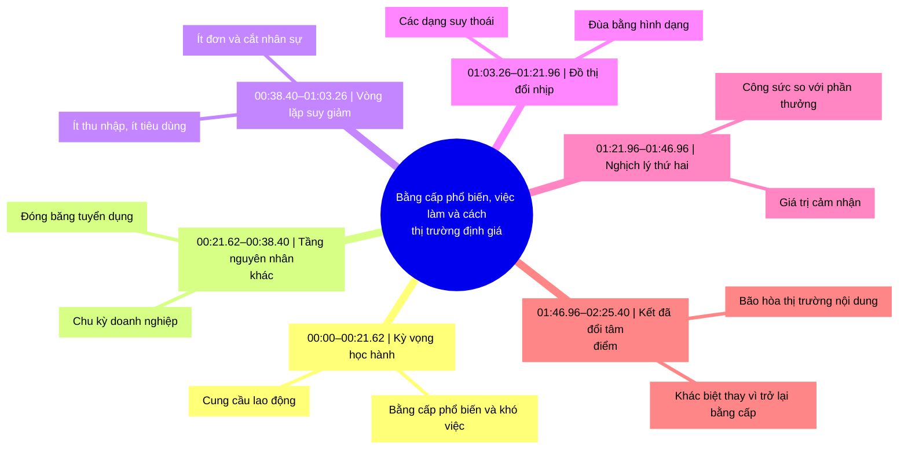

# Bằng cấp phổ biến, việc làm và cách thị trường định giá

[Video gốc — @longkhongphainong](https://www.tiktok.com/@longkhongphainong/video/7540936784776023312) · ID `7540936784776023312`

**Tóm tắt cách kể:** Nêu một kỳ vọng xã hội đang mất hiệu lực → tăng mâu thuẫn → giải thích cơ chế bằng chuỗi đời thường.

[Mindmap](#mindmap) · [Diễn biến](#dien-bien) · [Nhịp cảm xúc](#cam-xuc) · [Cách áp dụng](#ap-dung)

## Dữ liệu và nguồn

- Đăng: 2025-08-21T13:30:00+00:00. Metadata lấy: 2026-11-15T03:30:38.219687+00:00.
- **607,800 view**; thích 31,100; bình luận 349; chia sẻ 3,229; lưu 3,269. Dấu phẩy tách hàng nghìn.
- Thời lượng media: 149.97s.
- **33.77× P50** 18,000 của 150 bài đủ 48h trong snapshot kênh. Clip có trong cửa sổ baseline. Không phải thống kê toàn bộ kênh.

## Phạm vi kiểm

Đã tải lại media, xem khung chọn lọc và đọc ASR có mốc lưu lúc 2026-11-05T13:02:47.804775+00:00. Đối chiếu cùng ID và thời lượng, lệch 0.061s. **Chưa nghe toàn âm hoặc xem chuyển động liên tục; chưa xác nhận toàn văn ASR hay mọi dữ kiện kinh tế trong clip.**

Media SHA256: `0cf67c23a6f2b2718ad7cb949dfde47d040c5916733632cfeb42995fd460f826`. [Metadata và các hash khác](../videos.json). Video/ASR đầy đủ giữ ở bộ nghiên cứu cục bộ; bản chia sẻ giữ link gốc, trích ngắn và phân tích riêng.

## Lời hứa và câu hỏi trung tâm

**Lời hứa:** Giải thích cảm giác bằng cấp nhiều hơn nhưng cơ hội việc làm không dễ hơn, rồi đặt nó vào logic cung cầu và giá trị cảm nhận theo cách tác giả kể.

**Câu hỏi:** Vì sao tăng kỹ năng/bằng cấp chưa tự chuyển thành kết quả thu nhập hay việc làm như kỳ vọng?

## Mở đầu: lời và hình

Bắt đầu từ cảm giác quen thuộc về bằng đại học, rồi tăng độ nghịch lý bằng giỏi mà vẫn thất nghiệp; vấn đề gắn trực tiếp với người trẻ.

> Có một thực trạng là bằng đại học bây giờ khá là phổ thông ấy

Trích ASR ngắn từ segment 00:00.00–00:02.42. Đoạn ASR ngắn, chưa đối chiếu toàn bộ âm; xem giới hạn từng ca. Dấu … nghĩa là bỏ bớt, không khẳng định toàn câu vừa ba giây.

| Mốc khung đã xem | Điều quan sát được |
|---|---|
| 00:01.00 | Tiêu đề thất nghiệp, mẩu báo nguồn VTC News và nhân vật rồng đặt vấn đề ở khung đầu. |
| 00:44.99 | Minh họa nhà hàng, xe vận chuyển gắn phần thu nhập giảm với việc hàng quán ít đơn. |
| 01:07.49 | Đồ thị chữ V xuất hiện khi lời chuyển sang các hình dạng suy thoái. |
| 01:29.98 | Hai nhân vật và hai lượng thời gian lao động được đặt cạnh nhau để tạo một đối chiếu mới. |

Không suy chuyển động giữa các khung từ ảnh tĩnh.

## Diễn biến và nhiệm vụ từng beat

| Mốc ASR | Diễn giải riêng | Vai trò |
|---|---|---|
| 00:00.00–00:11.18 | Nêu độ phổ biến của bằng cấp, trạng thái thất nghiệp và áp lực phải học cao hơn. | Tăng mâu thuẫn từ kỳ vọng học giỏi sẽ dễ có việc. |
| 00:11.18–00:21.62 | Giải thích theo chênh lệch cung cầu lao động và việc làm dưới trình độ. | Đưa cơ chế đầu tiên cho vấn đề mở. |
| 00:21.62–00:38.40 | Nối sang chu kỳ kinh tế, doanh nghiệp cắt chi phí và đóng băng tuyển dụng. | Mở thêm tầng nguyên nhân ngoài bằng cấp. |
| 00:38.40–01:03.26 | Dẫn chuỗi thất nghiệp, giảm chi tiêu, giảm đơn hàng rồi cắt nhân sự tiếp. | Kể phản ứng dây chuyền bằng hành vi thường ngày. |
| 01:03.26–01:21.96 | Đi qua các dạng suy thoái bằng ký hiệu hình học và câu đùa. | Đổi cách diễn đạt để tiếp tục tuyến giải thích, nhưng tạo thêm nhiều khái niệm. |
| 01:21.96–01:46.96 | Chuyển từ bằng cấp sang đối chiếu công sức và giá trị người mua cảm nhận. | Đặt một nghịch lý mới khi câu chuyện dài đã đi xa mở đầu. |
| 01:46.96–02:25.40 | Dùng thị trường nội dung để giải thích bão hòa và nhu cầu khác biệt. | Chốt trên định giá kỹ năng trong cạnh tranh. |

## Nhịp cảm xúc — giả thuyết biên tập

Các trạng thái dưới đây là cách đọc câu chuyện từ bằng chứng, không phải cảm xúc người xem đã đo hoặc biểu đồ retention.

| Mốc | Cảm xúc có thể gợi | Bằng chứng | Cách diễn giải |
|---|---|---|---|
| 00:00.00–00:11.18 | Được gọi trúng lo âu | Lời đặt bằng cấp phổ biến cạnh thất nghiệp và cạnh tranh; hình là tiêu đề thất nghiệp, báo và nhân vật. | Có thể tạo cảm giác vấn đề này liên quan người trẻ trước khi nói kinh tế. |
| 00:11.18–00:38.40 | Có lời giải đầu nhưng áp lực tăng | Cung cầu lao động được nối thêm chu kỳ tuyển dụng. | Giải thích mở rộng nguyên nhân ngoài lỗi cá nhân. |
| 00:38.40–01:03.26 | Thấy vòng lặp khó thoát | Giảm chi tiêu kéo hàng quán, nhập hàng rồi nhân sự cùng chịu tác động. | Chuỗi đời thường khiến suy thoái có thể được hình dung bằng hành động. |
| 01:03.26–01:21.96 | Đổi nhịp bằng hình và đùa | Clip chuyển qua các dạng đồ thị và câu đùa hình học. | Có thể giảm nặng thông tin nhưng cũng làm bài rẽ sang một danh sách mới. |
| 01:21.96–02:25.40 | Bất công rồi tái đánh giá giá trị | Đối chiếu công sức/thưởng, sau đó nói giá trị cảm nhận và khác biệt nội dung. | Nghịch lý mới tạo năng lượng tiếp nhưng kéo bài xa bằng đại học. |

## Cách phân phối thông tin

| Mốc | Động tác viết | Vì sao đáng chú ý |
|---|---|---|
| 00:00.00–00:21.62 | Lo âu trước, nhãn cơ chế sau | Đặt kỳ vọng học hành rồi dùng cung cầu để giải thích. |
| 00:21.62–01:03.26 | Đi từ cá nhân đến vòng lặp hệ thống | Những khoản cắt chi thường ngày là mắt xích dẫn tới sản xuất/tuyển dụng. |
| 01:03.26–01:21.96 | Đổi mã giải thích sang đồ thị | Chữ V/U/W/L là các nhãn mới cần cân nhắc độ quá tải. |
| 01:21.96–01:46.96 | Tạo nghịch lý thứ hai | Từ học giỏi/thất nghiệp chuyển sang công sức/thu nhập rồi gọi tên giá trị cảm nhận. |
| 01:46.96–02:25.40 | Đổi bối cảnh để chốt khái niệm | Thị trường nội dung minh họa bão hòa, nhưng làm tâm điểm khác mở đầu. |

## Giải đáp và cách kết

Kết vào sự khác biệt và giá trị cảm nhận của kỹ năng, không quay lại riêng lời hứa về bằng đại học. Đây là ví dụ có độ trôi chủ đề cần nhận diện.

## Điểm mạnh có dẫn chứng

- **Mở bám một kỳ vọng xã hội có thể nhận ra.** — 0–11,18 giây nối bằng cấp, tốt nghiệp giỏi và thất nghiệp.

- **Chuỗi kinh tế dùng hành vi dễ tưởng tượng.** — 38,4–56,78 giây từ cắt chi tiêu tới hàng quán và nhân sự.

- **Hình đổi theo đơn vị giải thích.** — 44,99 giây có nhà hàng/vận chuyển, 67,49 giây là đồ thị, 89,98 giây là hai thời lượng lao động.

## Điểm yếu và điều không nên bắt chước

- **Nhiều khái niệm làm một bài chuyển trục liên tiếp.** — Từ cung cầu qua chu kỳ, dạng suy thoái, giá trị cảm nhận rồi bão hòa trong 145 giây.

- **Đoạn kết không trở về nguyên nhân cụ thể của bằng cấp/việc làm.** — 106,96–145,4 giây tập trung vào thị trường nội dung và sự khác biệt.

- **Một phép so công sức với thu nhập có thể bị hiểu như phán xét nghề.** — 84,96–106,96 giây cần giữ rõ đó là ví dụ tu từ tác giả dùng, chưa phải mô hình đo công bằng.

## Khả năng được chia sẻ — chưa kiểm chứng

Không có dữ liệu phân phối/retention để kết luận vì sao viral. Các ý sau chỉ là giả thuyết để thử:

- Vấn đề học hành và việc làm có thể khiến khán giả kể trải nghiệm bản thân; chưa kiểm bình luận hay retention.

- Những phép so nghề/công sức có thể tạo tranh luận, nhưng không đủ để kết luận tranh luận là nguyên nhân video nổi bật.

## Chuyển cơ chế sang bài mới

Học cách chuyển một lo âu thực thành câu hỏi cung cầu và chuỗi hệ quả; khi viết bài ngắn nên giữ một tuyến thay vì chuyển qua quá nhiều thuật ngữ.

- Giữ nỗi lo cụ thể làm trục và chọn một cơ chế giải thích chính.

- Dùng chuỗi hành động kinh tế thay vì chỉ xếp định nghĩa.

- Nếu đổi sang nghịch lý thứ hai, phải cho thấy nó trả câu hỏi đầu thế nào.

- Không dùng sự đổi nhịp để che việc bài đang trôi chủ đề.

Không dùng bài chuyển thể chưa được người dùng duyệt làm mẫu giọng lâu dài.

## Mindmap

[Mã Mermaid riêng](../mindmaps/7540936784776023312.mmd)

## Giới hạn còn lại

- Không dùng video để khẳng định số liệu thất nghiệp hoặc quy luật về mọi bằng cấp.

- ASR có lỗi từ và phần cuối văn bản kết thúc trước thời lượng media vài giây; không giả có thêm lời.

- Có hình trích tại các mốc, chưa xem chuyển động hoặc nghe toàn âm.
