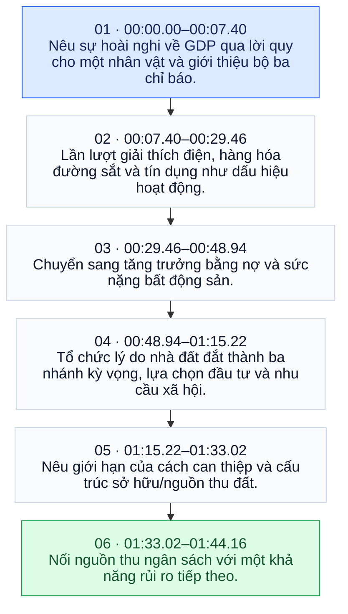

# Từ nghi vấn về GDP sang vấn đề nhà đất Trung Quốc

[Video gốc — @longkhongphainong](https://www.tiktok.com/@longkhongphainong/video/7584790091629907217) · ID `7584790091629907217`

**Tóm tắt cách kể:** Nghi vấn thước đo quen thuộc qua nguồn được quy thẩm quyền → trả một danh sách thay thế có trật tự.

[Sơ đồ diễn biến](#mindmap) · [Diễn biến](#dien-bien) · [Nhịp cảm xúc](#cam-xuc) · [Cách áp dụng](#ap-dung)

## Sơ đồ diễn biến

Đọc từ trên xuống: mỗi hộp là một nhịp theo mốc ASR hoặc khung hình được ghi trong phân tích. Xanh dương là mở đầu, xanh lá là nhịp cuối. Chi tiết và giới hạn nằm trong phân tích bên dưới.

[Mã Mermaid riêng](../mindmaps/7584790091629907217.mmd)

## Dữ liệu và nguồn

**Cách thể hiện:** Hoạt hình bình luận

**Phạm vi học:** Xem phạm vi kiểm và giới hạn từng ca.

**Ngữ cảnh thương mại:** Chưa xác nhận hợp tác thương mại; xem các đoạn tự quảng bá/giới hạn được ghi riêng.

- Đăng: 2025-12-17T13:30:00+00:00. Metadata lấy: 2026-11-15T03:30:40.965054+00:00.
- **389,600 view**; thích 9,818; bình luận 90; chia sẻ 371; lưu 1,283. Dấu phẩy tách hàng nghìn.
- Thời lượng media: 104.37s.
- **21.64× P50** 18,000 của 150 bài đủ 48h trong snapshot kênh. Clip có trong cửa sổ baseline. Không phải thống kê toàn bộ kênh.

## Phạm vi kiểm

Đã tải media, xem khung chọn lọc và đọc ASR có mốc lưu lúc 2026-11-05T13:03:57.558311+00:00. Đối chiếu cùng ID và thời lượng, lệch 0.0s. **Chưa nghe toàn âm hoặc xem chuyển động liên tục; chưa xác nhận toàn văn ASR hay mọi dữ kiện trong clip.**

Media SHA256: `97eefcf94ddc98de032dd62770c2d2c39bd41a85be26c096728e1bec302e7d4c`. [Metadata và các hash khác](../videos.json). Video/ASR đầy đủ giữ ở bộ nghiên cứu cục bộ; bản chia sẻ giữ link gốc, trích ngắn và phân tích riêng.

## Lời hứa và câu hỏi trung tâm

**Lời hứa:** Đưa một bộ ba dấu hiệu vận hành thay cho việc chỉ nhìn một chỉ số tổng hợp, rồi nối chúng với câu chuyện nhà đất/nợ theo lập luận tác giả.

**Câu hỏi:** Khi nghi vấn một thước đo tổng hợp, có thể nhìn vào dấu hiệu hoạt động nào và chúng dẫn tới vấn đề nền tảng gì?

## Mở đầu: lời và hình

Dẫn phát biểu gắn với một nhân vật có thẩm quyền để nghi vấn thước đo quen thuộc, sau đó hứa cung cấp ba chỉ báo thay thế.

> Lý Khắc Cường từng nói rằng là nhìn vào GDP Trung Quốc thì khó mà tin tưởng tuyệt đối được

Trích ASR ngắn từ segment 00:00.00–00:03.84. Đoạn ASR ngắn, chưa đối chiếu toàn bộ âm; xem giới hạn từng ca. Dấu … nghĩa là bỏ bớt, không khẳng định toàn câu vừa ba giây.

| Mốc khung đã xem | Điều quan sát được |
|---|---|
| 00:01.00 | Ảnh Lý Khắc Cường đặt giữa khung cùng tiêu đề chủ đề Trung Quốc. |
| 00:15.66 | Biểu tượng điện, đường sắt và nhà máy minh họa ba dấu hiệu vận hành. |
| 00:46.97 | Ảnh đô thị/nhà ở khi mạch giải thích chuyển sang bất động sản. |
| 01:33.94 | Sơ đồ cơ quan và nhà đất đi cùng một con số doanh thu trong phần giải thích ngân sách. |

Không suy chuyển động giữa các khung từ ảnh tĩnh.

## Diễn biến và nhiệm vụ từng beat

| Mốc ASR | Diễn giải riêng | Vai trò |
|---|---|---|
| 00:00.00–00:07.40 | Nêu sự hoài nghi về GDP qua lời quy cho một nhân vật và giới thiệu bộ ba chỉ báo. | Thách thức thước đo quen thuộc bằng một lời dẫn có thẩm quyền. |
| 00:07.40–00:29.46 | Lần lượt giải thích điện, hàng hóa đường sắt và tín dụng như dấu hiệu hoạt động. | Trả lời danh sách đã hứa trước khi mở rộng. |
| 00:29.46–00:48.94 | Chuyển sang tăng trưởng bằng nợ và sức nặng bất động sản. | Đổi từ cách đo sang nguyên nhân rủi ro. |
| 00:48.94–01:15.22 | Tổ chức lý do nhà đất đắt thành ba nhánh kỳ vọng, lựa chọn đầu tư và nhu cầu xã hội. | Dùng một danh sách thứ hai để duy trì trật tự giải thích. |
| 01:15.22–01:33.02 | Nêu giới hạn của cách can thiệp và cấu trúc sở hữu/nguồn thu đất. | Bổ sung tầng cơ chế chính sách. |
| 01:33.02–01:44.16 | Nối nguồn thu ngân sách với một khả năng rủi ro tiếp theo. | Kết bằng cảnh báo mở thay vì đóng toàn bộ lập luận. |

## Nhịp cảm xúc — giả thuyết biên tập

Các trạng thái dưới đây là cách đọc câu chuyện từ bằng chứng, không phải cảm xúc người xem đã đo hoặc biểu đồ retention.

| Mốc | Cảm xúc có thể gợi | Bằng chứng | Cách diễn giải |
|---|---|---|---|
| 00:00.00–00:07.40 | Nghi ngờ điều quen và chờ tiêu chí | Một phát biểu được quy cho nhân vật có thẩm quyền đặt nghi vấn GDP và hứa ba thứ khác. | Tên người + số lượng tiêu chí tạo một lời hứa rõ nhưng cần kiểm nguồn gán lời. |
| 00:07.40–00:29.46 | Cảm giác hiểu cách kiểm | Điện, đường sắt và tín dụng được gắn với hoạt động cụ thể. | Thước đo trở nên nhìn được thay vì chỉ là thuật ngữ. |
| 00:29.46–00:48.94 | Lo ngại hệ thống | Bài chuyển từ cách đo tới tăng trưởng bằng nợ và bất động sản. | Mở thêm quy mô rủi ro sau khi lời hứa đầu đã được trả. |
| 00:48.94–01:15.22 | Tìm nguyên nhân có trật tự | Ba nhánh giải thích nhà đất đắt được đặt thành danh sách thứ hai. | Sự lặp cấu trúc danh sách có thể giúp theo dõi một bài nhiều tầng. |
| 01:15.22–01:44.16 | Chưa có lối ra đơn giản | Can thiệp, hệ quả và nguồn thu đất dẫn tới khả năng rủi ro tiếp theo. | Kết giữ cảm giác hệ thống bị ràng buộc, nhưng không đưa lời giải chắc chắn. |

## Cách phân phối thông tin

| Mốc | Động tác viết | Vì sao đáng chú ý |
|---|---|---|
| 00:00.00–00:07.40 | Đặt nghi vấn và đếm lời hứa | Bộ ba tạo khung để người xem biết khi nào phần mở đã được trả. |
| 00:07.40–00:29.46 | Gắn từng chỉ báo với hành động | Tiêu thụ điện với nhà máy, vận tải với hàng hóa, tín dụng với vốn làm ví dụ cụ thể. |
| 00:29.46–00:48.94 | Nối phép đo sang rủi ro nền | Đây là tuyến mới, cần cầu nối rõ để không thành đổi chủ đề đột ngột. |
| 00:48.94–01:15.22 | Lặp cấu trúc ba nhánh | Trật tự danh sách giúp phân biệt các động lực trong một thị trường. |
| 01:15.22–01:44.16 | Thêm ràng buộc và hệ quả ngoài ý muốn | Không để khán giả nghĩ thay một chính sách sẽ giải được mọi thứ. |

## Giải đáp và cách kết

Lời hứa ba chỉ báo được trả trong 7,4–29,46 giây; phần cuối mở ra rủi ro nhà đất và ngân sách.

## Điểm mạnh có dẫn chứng

- **Lời hứa đầu có hình dạng hữu hạn và được trả sớm.** — 7,4–29,46 giây lần lượt đi qua ba dấu hiệu đã nêu.

- **Các đại lượng được nối với vật thể/hoạt động.** — Khung 15,66 giây đặt điện, đường sắt và nhà máy bên nhau.

- **Có tổ chức thứ tự ở hai tầng giải thích.** — 3,84–29,46 giây là bộ ba chỉ báo; 48,94–75,22 giây là ba động lực nhà đất.

## Điểm yếu và điều không nên bắt chước

- **Thẩm quyền dẫn lời có thể thay bằng chứng nếu không kiểm nguồn.** — 0–7,4 giây dựa phát biểu gán cho nhân vật.

- **Từ GDP sang nhà đất làm phạm vi lời hứa mở rộng.** — 29,46 giây bắt đầu tuyến nợ/bất động sản và kết ở rủi ro nguồn thu.

- **Các số và mô tả chính sách mang tính thời điểm.** — 93,02–104,16 giây nêu quy mô thu đất và khả năng can thiệp; chưa được lượt này xác nhận.

## Khả năng được chia sẻ — chưa kiểm chứng

Không có dữ liệu phân phối/retention để kết luận vì sao viral. Các ý sau chỉ là giả thuyết để thử:

- Một bộ tiêu chí ngắn có thể được người xem lưu hoặc kể lại vì tạo cảm giác có cách kiểm tình hình; chưa đo hành vi này.

- Chủ đề nhà đất/nợ có thể mang mức quan tâm riêng ngoài kỹ thuật mở, nên không gán view cho cấu trúc ba mục.

## Chuyển cơ chế sang bài mới

Có thể học cách hứa một số lượng tiêu chí cụ thể rồi giải thích từng tiêu chí bằng hành động nhìn thấy; phát biểu gán cho nhân vật phải được kiểm nguồn riêng trước khi dùng lại.

- Lời dẫn gán cho người thật phải có nguồn và bối cảnh trước khi viết mới.

- Nếu hứa số lượng tiêu chí, trả đủ bằng hoạt động cụ thể trước khi mở tuyến khác.

- Chuyển sang tầng vấn đề mới bằng một quan hệ giải thích rõ, không chỉ nối bằng cảm xúc rủi ro.

- Tách cơ chế kể khỏi việc xác nhận đúng sai của số và chính sách nguồn.

Không dùng bài chuyển thể chưa được người dùng duyệt làm mẫu giọng lâu dài.

## Giới hạn còn lại

- Phát biểu, số ngân sách và mô tả chính sách trong clip chưa được kiểm với tài liệu gốc.

- Đây là video tiếng Việt từ kênh Việt về chủ đề Trung Quốc, không phải dữ liệu chỉ về kinh tế trong nước.

- ASR + khung trích đã kiểm, chưa nghe toàn âm hay xem liên tục.
