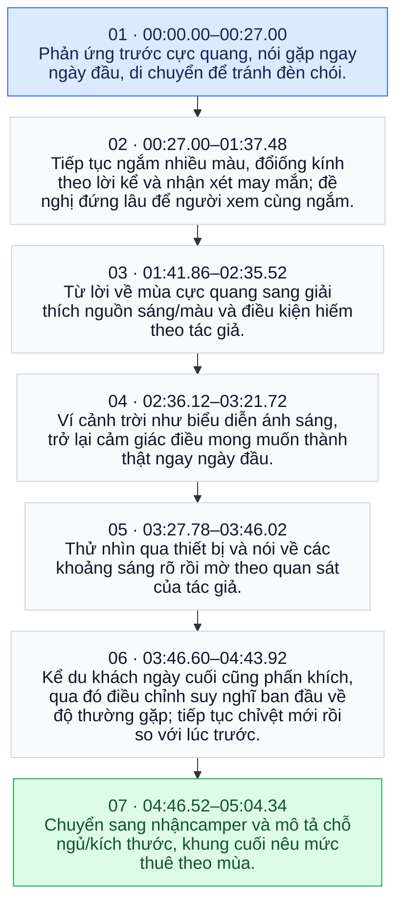

# Cực quang Iceland: phần thưởng thị giác xuất hiện trước lời giải

[Video gốc — @khoailangthang](https://www.tiktok.com/@khoailangthang/video/7593064718789512456) · ID `7593064718789512456`

**Tóm tắt cách kể:** Cho cảnh hiếm ngay → cùng điều chỉnh cách nhìn → hình thay đổi tiếp tục thưởng → thêm giải thích và ý nghĩa cá nhân → quan sát người khác → về hoạt động du lịch. Đây là mẫu nội dung có giá trị thị giác tự thân; không thể rút gọn thành “giấu điều hay nhất” rồi áp cho mọi chủ đề.

[Sơ đồ diễn biến](#mindmap) · [Diễn biến](#dien-bien) · [Nhịp cảm xúc](#cam-xuc) · [Cách áp dụng](#ap-dung)

## Sơ đồ diễn biến

Đọc từ trên xuống: mỗi hộp là một nhịp theo mốc ASR hoặc khung hình được ghi trong phân tích. Xanh dương là mở đầu, xanh lá là nhịp cuối. Chi tiết và giới hạn nằm trong phân tích bên dưới.

[Mã Mermaid riêng](../mindmaps/7593064718789512456.mmd)

## Dữ liệu và nguồn

**Cách thể hiện:** Kể chuyện tại hiện trường

**Phạm vi học:** Học cách chia thông tin theo hình và ASR, giữ giới hạn từng ca.

**Ngữ cảnh thương mại:** Có tín hiệu hợp tác/tài trợ trong metadata; không suy lượt xem tự nhiên.

- Đăng: 2026-01-08T18:49:09+00:00. Metadata lấy: 2026-11-15T04:33:50.115652+00:00.
- **11,300,000 view**; thích 1,100,000; bình luận 7,435; chia sẻ 139,200; lưu 62,262. Dấu phẩy tách hàng nghìn.
- Thời lượng media: 304.34s.
- **4.71× P50** 2,400,000 của 148 bài đủ 48h trong snapshot kênh. Clip có trong cửa sổ baseline. Không phải thống kê toàn bộ kênh.

## Phạm vi kiểm

Đã tải media, xem khung chọn lọc và đọc ASR có mốc lưu lúc 2026-11-15T04:35:29.685256+00:00. Đối chiếu cùng ID và thời lượng, lệch 0.005s. **Chưa nghe toàn âm hoặc xem chuyển động liên tục; chưa xác nhận toàn văn ASR hay mọi dữ kiện trong clip.**

Media SHA256: `0ad8944f4923da5bd2e22c96bae29de2a1cb744f71d4b003af37cd50cdc5cc0f`. [Metadata và các hash khác](../videos.json). Video/ASR đầy đủ giữ ở bộ nghiên cứu cục bộ; bản chia sẻ giữ link gốc, trích ngắn và phân tích riêng.

## Lời hứa và câu hỏi trung tâm

**Lời hứa:** Cho người xem cùngngắm cực quang nhiều màu và nghe trải nghiệm gặp ngay ngày đầu tới Iceland.

**Câu hỏi:** Cảnh trời này đang hiệnra thế nào, và vì sao tác giả xem lần gặp ấy là may mắn?

## Mở đầu: lời và hình

Khung0 giây đã cho thấy vệt cực quang xanh và Khoai dưới bãi xe;ASR0–2 giây là phản ứng ngạc nhiên.1–3 giây người di chuyển trong cảnh,5 giây lại có bầu trời sáng rõ. Hook không giấu sự tồn tại của cực quang: cảnh hiếm là phần thưởng ngay, còn lời ở8–11 giây thêm tình huống vừa tới Iceland ngày đầu. Dòng mô tả ngoài video nhá rằng đầu chưa đẹp nhất;không coi mô tả ấy là chữ hiện trên khung mở.

## Nghiên cứu phần mở

Diễn giải từ bằng chứng đã lưu; lý do gây chú ý là giả thuyết biên tập, chưa đo retention.

**Cửa sổ quan sát:** 00:00.00–00:11.00

| Lớp | Quan sát/diễn giải |
|---|---|
| Lời | 0–2s phảnứng ngạc nhiên;8–11s nói gặp cựcquang ngay ngày đầu ởIceland,không gộp khoảngim thành lời liên tục. |
| Hình | 0s và5s đã có vệt xanh trên bãi xe;1–3s thấy người di chuyển trong cảnh tối. |
| Chữ trên hình | Không thấy dòng hứa lớn ởkhung0–5s;ý đầu chưa đẹpnhất nằm trong mô tả nguồn,không phải bằngchứng chữ mởvideo. |

**Động tác gây chú ý:** Phần thưởng thịgiác cóngay,đi cùng phảnứng tại chỗ vàtình huống maymắn.

**Vì sao có thể muốn dừng lại:** Giảthuyết: hình trời khác thường làmngười xem muốn ởlại ngắm,còn phảnứng củangười nhỏdưới bãi xe cho mốctỷlệ vàcảmgiác cómặt.

**Điều còn muốn biết:** Cảnh sẽ rõ/nhiềumàu tớiđâu vàvìsao lần gặpđược kểlà maymắn?

**Thông tin chưa cho biết:** Không giấu hiện tượng;thôngtin nguồn màu/điều kiện vàdiệnmạo cácvệt tiếp theo chưahiện ởmở.

**Nhịp nối có gì mới:** Liên tục có hìnhtrời đểxem,xen thử góc nhìn,lời phảnứng vàgiải thích;không có dữliệu giữchân.

**Mốc trả/giới hạn giải đáp:** 00:00.00–00:45.65 — Phần thưởng nhìnđược bắtđầu ngay0s;khung45,65s có vòm xanhhồng rõhơn.Lời nhá chưa đẹpnhất trong mô tả là một so sánh chủquan,không có một đápán duy nhất bịgiấu tới cuối.

**Tóm cấu trúc bằng hai câu:** Cho thấy ngay hiện tượng mà người xem khó gặp,để phảnứng của nhânvật vàmốc cảnh đời thường làm nó cụthể. Tiếp tục làm rõ cách quan sát rồi thêm giải thích vàýnghĩa sau khi người xem đã nhận phần thưởng đầu.

**Chuyển sang ngách khác:** Chuyển được quan hệ cho bằngchứng trước → hướng chúý tới biếnđổi → giải thích sau bằng một biểuđồ hoặc tài liệu có nguồn.Điều hỏng khi sangfinance là cho một bảngsố không cóphát hiện rồi giảđịnh nó hấp dẫn bằng một kỳquan thịgiác.

**Điều không chuyển theo:**

- Không biến thành côngthức chỉ giấu điều haynhất.
- Không sao độdài5phút hoặc lời cảmthán nếu không có phần thưởng mới.
- Không gọi view có hợp tác làorganic.

**Phạm vi:** Đọc toànASR và12khung;loại cácđoạn lặpASR vôích;chưa nghe toànâm/xem liên tục.

> Trời ơi đẹp quá vậy

Trích ASR ngắn từ segment 00:00.00–00:02.00. Trích ASR ngắn chưa nghe so khớp toàn âm; không khẳng định cả segment là ba giây. Xem phạm vi/giới hạn từng ca. Dấu … nghĩa là bỏ bớt, không khẳng định toàn câu vừa ba giây.

| Mốc khung đã xem | Điều quan sát được |
|---|---|
| 00:00.00 | Vệt sáng xanh trên trời bên trên người và bãi xe; đèn sáng cạnh đường chân trời. |
| 00:01.00 | Khoai di chuyển trong bãi xe tối, không thấy cùng mức vệt sáng như khung0;không suy trời đã hết cực quang từ một khung. |
| 00:03.00 | Người tiếp tục đi giữa xe đỗ; không thấy tiêu đề lớn. |
| 00:05.00 | Cực quang xanh sáng trở lại trong khung rộng có người nhỏ phía dưới. |
| 00:45.65 | Vòm xanh có dải hồng ở đáy trên bãi xe, phần thưởng thị giác phong phú hơn khung đầu. |
| 01:31.30 | Dải xanh và hồng trải ngang bầu trời, bãi xe làm mốc tỷ lệ. |
| 02:16.95 | Cực quang nhiều màu phía trên xe, logoLifebuoy cùng dòng nhãn hàng đồng hành hiện ở dưới. |
| 03:02.60 | Bóng người đứng nhìn bầu trời ở tiền cảnh; vệt xanhhồng phía trên. |
| 03:48.25 | Một nhóm người đứng giữa bãi xe trong cảnh tối, nối với phần kể phản ứng du khách. |
| 04:33.91 | Vệt sáng xanhhồng rõ trên bầu trời, không phải màn chữ giải thích. |
| 05:03.34 | Khoai đứng cạnh xe trắng; chữ báo giá thuê6–7 triệu/ngày và lưu ý thay đổi theo mùa. |

Không suy chuyển động giữa các khung từ ảnh tĩnh.

## Diễn biến và nhiệm vụ từng beat

| Mốc ASR | Diễn giải riêng | Vai trò |
|---|---|---|
| 00:00.00–00:27.00 | Phản ứng trước cực quang, nói gặp ngay ngày đầu, di chuyển để tránh đèn chói. | Cho người xem cùng tìm một góc nhìn tốt hơn của hiện tượng đã có ngay đầu. |
| 00:27.00–01:37.48 | Tiếp tục ngắm nhiều màu, đổiống kính theo lời kể và nhận xét may mắn; đề nghị đứng lâu để người xem cùng ngắm. | Phần thưởng không ngừng là hình trời, không phải một đáp án bị giữ tới cuối. |
| 01:41.86–02:35.52 | Từ lời về mùa cực quang sang giải thích nguồn sáng/màu và điều kiện hiếm theo tác giả. | Đặt thông tin khoa học sau trải nghiệm trực quan, tăng ý nghĩa điều đang thấy. |
| 02:36.12–03:21.72 | Ví cảnh trời như biểu diễn ánh sáng, trở lại cảm giác điều mong muốn thành thật ngay ngày đầu. | Dùng ẩn dụ và câu chuyện cá nhân làm lớp cảm xúc của cảnh. |
| 03:27.78–03:46.02 | Thử nhìn qua thiết bị và nói về các khoảng sáng rõ rồi mờ theo quan sát của tác giả. | Tạo câu hỏi về cách thấy và thời điểm, trong khi tiếp tục có cảnh để xem. |
| 03:46.60–04:43.92 | Kể du khách ngày cuối cũng phấn khích, qua đó điều chỉnh suy nghĩ ban đầu về độ thường gặp; tiếp tục chỉvệt mới rồi so với lúc trước. | Dùng phản ứng của người khác làm một phát hiện thứhai, chưa là dữ liệu xác nhận độ hiếm. |
| 04:46.52–05:04.34 | Chuyển sang nhậncamper và mô tả chỗ ngủ/kích thước, khung cuối nêu mức thuê theo mùa. | Khép buổi ngắm bằng hoạt động kế tiếp của chuyến đi, không ép thành một bài học chung. |

## Nhịp cảm xúc — giả thuyết biên tập

Các trạng thái dưới đây là cách đọc câu chuyện từ bằng chứng, không phải cảm xúc người xem đã đo hoặc biểu đồ retention.

| Mốc | Cảm xúc có thể gợi | Bằng chứng | Cách diễn giải |
|---|---|---|---|
| 00:00.00–00:27.00 | Ngạc nhiên cùng người trong cảnh | ASR phản ứng ngắn, hình có vệt xanh, người tránh đèn. | Giả thuyết: khán giả được tham gia một sự kiện đang diễn ra thay vì nghe tổng kết. |
| 00:27.00–01:37.48 | Muốn nhìn lâu hơn | Khung45,65 và91,3s có thêm dải hồng; tác giả nói đứnglâu để cùng ngắm. | Phần thưởng lặp đến từ cảnh,không cần cứ tăng mức câu hứa. |
| 01:51.94–02:35.52 | Tò mò về điều kiện và màu | Giải thích va chạm/hạt và màu sau khi thấy bầu trời. | Tri thức có đối tượng đã nhìn được. |
| 02:36.12–03:21.72 | Thỏa nguyện cá nhân | Tác giả nói điều mong muốn thànhthật ngày đầu. | Thêm ý nghĩa chuyến đi;chưa đo cảm xúc của người xem. |
| 03:46.60–04:21.24 | Bất ngờ về mức may mắn | Lời kể du khách đi nhiều tuần cũng coi đây là lần đẹp. | Đổi khung hiểu từ mỗi mình vui sang cơ hội đáng nhớ,nhưng lời kể vẫn chưa là thốngkê. |

## Cách phân phối thông tin

| Mốc | Động tác viết | Vì sao đáng chú ý |
|---|---|---|
| 00:00.00–00:27.00 | Cho hiện tượng trước giải thích. | Cảnh có thể tự chứng minh điều đang được nhìn ở quy mô quan sát. |
| 00:27.00–01:37.48 | Giữ mốc bãi xe/người và thay cảnhtrời. | Mốc đời thường giúp nhìn độ lớn và sự khác nhau của các vệt. |
| 01:51.94–02:35.52 | Đưa khoa học sau màu sắc. | Người xem có một câu hỏi thực từ hình để theo thôngtin. |
| 03:46.60–04:21.24 | Thêm lời kể người khác sau ấn tượng cá nhân. | Làm câu chuyện có bước sửa nhận thức,chưa đủ để chứng minh tần suất hiện tượng. |
| 04:46.52–05:04.34 | Chuyển hoạt động khi phần ngắm kết. | Giữ dạng nhật ký hànhtrình thay vì lặp thêm một kết luận cảnh đẹp. |

## Giải đáp và cách kết

Phần cực quang đã có nhiều lần cho thấy trước khi kết. Đoạn cuối đổi sang chiếccamper và thôngtin thuê trên hình, nên kết là tiếp tục hành trình, không phải cuối mới mở khóa cảnh đẹp. LogoLifebuoy và hashtag hợp tác trong nguồn cho thấy ngữ cảnh thương mại cần được giữ khi học mẫu.

## Điểm mạnh có dẫn chứng

- **Phần thưởng chính xuất hiện tức thì** — Khung0 và5s đã có cực quang,không bắt chờ lời giới thiệu dài.

- **Có lớp hình khác nhau để xem** — 45,65;91,3;273,91s đều có hình cựcquang với cấu trúc/màu nhìnđược khác khung0.

- **Thôngtin giải thích theo sau đối tượng** — ASR111,94s mới bắt đầu giải thích nguồn ánhsáng sau hơnmột phút ngắm.

## Điểm yếu và điều không nên bắt chước

- **Tính bền của mẫu phụ thuộc cảnh gốc** — Phần dài0–97,48s thưởng chủyếu bằng cảnh và phảnứng,khó chuyển sang chủđề chỉ có lời.

- **Độ hiếm dễ được nói rộng quá bằngchứng** — Tác giả nói mộtvài lần/năm và kể tháng qua đẹpnhất,nhưng dữ liệu hiện không có thốngkê.

- **Ngữ cảnh hợp tác cần đi cùng mẫu** — Logo đồnghành vàhashtagUnilever khiến không thể gọi toàn bộ11,3triệu views là lantruyền tựnhiên.

## Khả năng được chia sẻ — chưa kiểm chứng

Không có dữ liệu phân phối/retention để kết luận vì sao viral. Các ý sau chỉ là giả thuyết để thử:

- Cảnh nhiều màu có thể được gửi như trải nghiệm muốn người khác cùng xem,không cần họ quan tâm khoa học;chưa có dữ liệu lý do chia sẻ.

- Tương phản cảnhtrời với bãi xe đời thường có thể làm khoảnhkhắc dễ kểlại,nhưng không chứngminh nhânquả lượt xem.

## Chuyển cơ chế sang bài mới

Finance có thể học việc cho thấy một hiện tượng/sai lệch dữ liệu ngay rồi hướng mắt tới chi tiết ngày càng rõ và giải thích sau. Một biểu đồ phải có biến đổi đáng xem và nguồn;không thể thay cảnh hiếm thật bằng câu khẳng định suông hoặc trang số đứng yên rồi giữ người xem nhiều phút.

- Chỉ học mẫu thưởng ngay khi đã có hình/tài liệu đáng xem.

- Tách phần hiện tượng quan sát được,giải thích khoa học và cảmnhận cá nhân.

- Không suy độ hiếm toànnăm từ một cuộc gặp.

- Giữ dấu hợp tác thươnghiệu và không kếtluận organic reach.

- Với finance,thay kỳquan bằng dữliệu xácthực có phát hiện thịgiác,tuyệtđối không thổi màu biểuđồ để giả sự kiện.

Không dùng bài chuyển thể chưa được người dùng duyệt làm mẫu giọng lâu dài.

## Giới hạn còn lại

- Đã đọc toàn bộ ASR có timestamp và xem 12 khung trích của bản tải mới; chưa nghe toàn âm hoặc xem video liên tục.

- Mốc nhịp dựa trên ASR; không dùng bản chép tự động làm trích dẫn nguyên văn.

- Không có retention hay thử nghiệm nhân quả; số lượt xem không chứng minh hook tạo ra kết quả.

- Nguồn có#HợpTácCùngUnilever,#LifebuoyMen và logo nhãn hàng đồng hành ở136,95s;không biết phần lượt xem tự nhiên so với phân phối thương mại.

- ASR có đoạn lặp phản ứng máy ở khoảng71–89s;không dùng số lần lặp để suy nhịp nói hoặc cảm xúc.

- Giải thích khoa học, độ hiếm theo mùa và câu chuyện du khách là nội dung tác giả nêu, chưa kiểm chứng độc lập.

- Màu/độ sáng được máy quay ghi lại không đủ xác nhận mắt thường thấy giống hệt.

- Giácamper cuối là chữ trên hình theo chuyến đi,không phải báo giá hay gợi ý đặt dịch vụ hiện nay.
