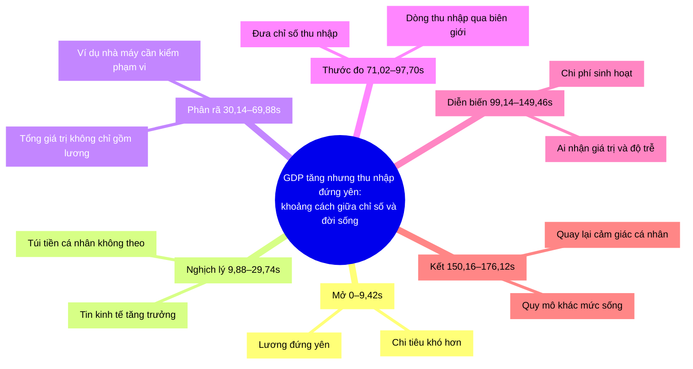

# GDP tăng nhưng thu nhập đứng yên: khoảng cách giữa chỉ số và đời sống

[Video gốc — @nqs.kinhte](https://www.tiktok.com/@nqs.kinhte/video/7603323663328316679) · ID `7603323663328316679`

**Tóm tắt cách kể:** Lo âu cá nhân có đại lượng cụ thể → tin tốt ở cấp tổng thể → hỏi vì sao không khớp → phân rã và theo dòng giá trị → quay lại khoản chi người xem.

[Mindmap](#mindmap) · [Diễn biến](#dien-bien) · [Nhịp cảm xúc](#cam-xuc) · [Cách áp dụng](#ap-dung)

## Dữ liệu và nguồn

- Đăng: 2026-02-05T10:19:06+00:00. Metadata lấy: 2026-11-15T03:45:50.745490+00:00.
- **1,300,000 view**; thích 55,100; bình luận 941; chia sẻ 5,172; lưu 5,265. Dấu phẩy tách hàng nghìn.
- Thời lượng media: 177.61s.
- **5.69× P50** 228,300 của 149 bài đủ 48h trong snapshot kênh. Clip có trong cửa sổ baseline. Không phải thống kê toàn bộ kênh.

## Phạm vi kiểm

Đã tải lại media, xem khung chọn lọc và đọc ASR có mốc lưu lúc 2026-11-05T12:47:12.544674+00:00. Đối chiếu cùng ID và thời lượng, lệch 0.0455s. **Chưa nghe toàn âm hoặc xem chuyển động liên tục; chưa xác nhận toàn văn ASR hay mọi dữ kiện kinh tế trong clip.**

Media SHA256: `2316b548701a0808d5b64270201d8950b6ff7f2dd17aa577c998a936f6fff21b`. [Metadata và các hash khác](../videos.json). Video/ASR đầy đủ giữ ở bộ nghiên cứu cục bộ; bản chia sẻ giữ link gốc, trích ngắn và phân tích riêng.

## Lời hứa và câu hỏi trung tâm

**Lời hứa:** Giải thích vì sao tin tăng trưởng có thể khác cảm giác ví tiền và mức sống của một người làm công.

**Câu hỏi:** Một con số kinh tế tăng có nhất thiết đồng nghĩa thu nhập hoặc khả năng chi trả của người xem tăng?

## Mở đầu: lời và hình

Phần đầu dùng một mức thu nhập đứng yên và chi tiêu khó hơn để gọi đúng cảm giác của người xem, rồi đặt cạnh tin kinh tế tăng trưởng. Các khung 1–3 giây giữ tiền trên cột năm, còn 26,64 giây đặt thu nhập không tăng cạnh đường tăng trưởng; mâu thuẫn được làm rõ ở cấp độ cá nhân và tổng thể khác nhau.

> 7 triệu đồng là thu nhập của bạn từ năm ngoái sang năm nay không tăng thêm một đồng nào.

Trích ASR ngắn từ segment 00:00.00–00:03.98. Đoạn ASR ngắn, chưa đối chiếu toàn bộ âm; xem giới hạn từng ca. Dấu … nghĩa là bỏ bớt, không khẳng định toàn câu vừa ba giây.

| Mốc khung đã xem | Điều quan sát được |
|---|---|
| 00:00.00 | Các công trình đô thị trên nền giấy, chưa có số GDP. |
| 00:02.00 | Bàn tay cầm tiền trên một cột có mốc năm và nhãn thu nhập tháng. |
| 00:03.00 | Cột năm kế tiếp nằm cạnh cột trước trong cùng khung, phục vụ đối chiếu qua thời gian. |
| 00:26.64 | Đường tăng trưởng xanh đặt phía sau thu nhập có nhãn không tăng. |
| 00:53.28 | Hình nhà máy và số giá trị hàng hóa mà tác giả dùng trong ví dụ. |
| 01:19.92 | Nhãn GNI và biểu thức liên hệ với GDP trên nền đỏ. |
| 02:39.85 | Người dẫn cùng chữ về giá nhà và giá học, đưa chỉ số trở lại các khoản chi. |
| 02:56.61 | Người dẫn giữ hình ở phần kết, không có CTA mua sản phẩm. |

Không suy chuyển động giữa các khung từ ảnh tĩnh.

## Diễn biến và nhiệm vụ từng beat

| Mốc ASR | Diễn giải riêng | Vai trò |
|---|---|---|
| 00:00.00–00:09.42 | Nêu thu nhập giữ nguyên và người lao động phải tính kỹ các khoản chi. | Đặt cảm giác cá nhân trước thuật ngữ vĩ mô. |
| 00:09.88–00:29.74 | Đặt các tin tăng trưởng cạnh ví tiền không đổi rồi hỏi tiền chảy về đâu. | Hình thành xung đột hai cấp đo lường. |
| 00:30.14–01:09.88 | Dùng hình dung một giỏ giá trị, tách lương, lợi nhuận và các phần khác; minh họa bằng một nhà máy. | Phân rã con số tổng thành các phần, chưa phải kiểm đúng cách tính GDP. |
| 01:11.02–01:37.70 | Đưa một chỉ số thu nhập khác, giải thích dòng thu nhập qua biên giới và nêu một tỷ lệ. | Thêm khái niệm để nối từ sản lượng tới thu nhập; nguồn chuyên môn cần kiểm. |
| 01:39.14–02:12.44 | Chuyển từ tổng quy mô sang ai tạo giá trị và độ trễ để dòng tiền tới người dân. | Nâng câu trả lời từ cơ cấu kế toán sang phân phối và thời gian. |
| 02:13.10–02:29.46 | Đưa chi phí sinh hoạt và nhà ở để giải thích cảm giác mức sống nặng hơn. | Trả lại trải nghiệm mở bằng sức mua, không chỉ thu nhập danh nghĩa. |
| 02:30.16–02:56.12 | Phân biệt quy mô nền kinh tế với những câu hỏi về sự thoải mái và cơ hội của người dân. | Kết đóng nghịch lý: hai chỉ dấu không phản ánh cùng điều. |

## Nhịp cảm xúc — giả thuyết biên tập

Các trạng thái dưới đây là cách đọc câu chuyện từ bằng chứng, không phải cảm xúc người xem đã đo hoặc biểu đồ retention.

| Mốc | Cảm xúc có thể gợi | Bằng chứng | Cách diễn giải |
|---|---|---|---|
| 00:00.00–00:09.42 | Được gọi đúng nỗi vướng | Thu nhập đứng yên và khó cân chi xuất hiện trước khái niệm. | Nhận diện hoàn cảnh có thể tạo kết nối, chưa có dữ liệu đo phản ứng. |
| 00:09.88–00:29.74 | Bất hợp lý cần giải thích | Tin tăng trưởng được đặt đối diện túi tiền. | Khán giả có câu hỏi rõ hơn là chỉ tiếp nhận tin kinh tế. |
| 00:30.14–01:37.70 | Từng bước thấy phần bị lẫn | Giỏ giá trị và chỉ số thu nhập được dùng để chia nhỏ tổng số. | Cảm giác hiểu ra có thể đến từ phân biệt phạm vi, nhưng số liệu/định nghĩa cần kiểm. |
| 01:39.14–02:29.46 | Thấy khoảng cách vẫn còn | Dòng tiền đi qua nhiều khâu rồi gặp chi phí sinh hoạt. | Không đóng câu hỏi quá sớm; thêm thời gian và sức mua vào lời giải. |
| 02:30.16–02:56.12 | Quay về câu hỏi thực của cá nhân | Kết hỏi mức sống và cơ hội thay vì chỉ quy mô. | Đóng bằng tiêu chí người xem vốn quan tâm từ đầu. |

## Cách phân phối thông tin

| Mốc | Động tác viết | Vì sao đáng chú ý |
|---|---|---|
| 00:00.00–00:29.74 | Đặt trải nghiệm trước tin tổng hợp | Giúp người xem biết tại sao cần quan tâm đến cách đo. |
| 00:30.14–01:09.88 | Phân rã đại lượng bằng vật chứa và ví dụ | Biến một tổng thành nhiều phần để giải thích vì sao không đồng nhất với lương. |
| 01:11.02–01:37.70 | Thêm một chỉ số so sánh | Có thể làm rõ phạm vi thu nhập nhưng cũng tăng tải thuật ngữ. |
| 01:39.14–02:29.46 | Theo dòng tiền và thay đổi chi phí | Cho câu hỏi hai chiều: tiền tới ai/khi nào và khoản đó mua được gì. |
| 02:30.16–02:56.12 | Đưa ngôn ngữ đo lường trở lại đời sống | Kết gắn với người xem thay vì dừng ở danh sách số liệu. |

## Giải đáp và cách kết

Kết quay về cảm giác dễ sống của cá nhân, nhấn khác biệt giữa quy mô tổng thể và điều người xem cảm nhận. Câu hỏi đầu được trả bằng nhiều lớp giải thích, nhưng các tỷ lệ và ví dụ kế toán không được xem là đã kiểm đúng.

## Điểm mạnh có dẫn chứng

- **Mâu thuẫn hai cấp độ được đặt rõ** — 0–29,74 giây đối chiếu thu nhập cá nhân với tin tăng trưởng.

- **Hình hỗ trợ phép phân biệt** — 26,64 giây có đường tăng trưởng cạnh thu nhập đứng yên; 79,92 giây chuyển sang chỉ số khác.

- **Kết trả đúng mối quan tâm mở** — 150,16–176,12 giây trở về mức sống và cơ hội.

## Điểm yếu và điều không nên bắt chước

- **Cần kiểm khái niệm trước khi học nội dung** — Ví dụ nhà máy 49,78–69,88 giây và tỷ lệ 87,90–97,70 giây chưa được kiểm chuyên môn.

- **Một clip chứa nhiều lớp nguyên nhân khó cô lập** — Từ cấu phần giá trị sang xuyên biên giới, độ trễ và giá nhà trong 30,14–149,46 giây.

- **Tiêu đề dễ bị hiểu như quy kết hoàn cảnh cá nhân** — Phần mở cần giữ phạm vi tình huống thay vì xác nhận lý do nghèo của mọi người.

## Khả năng được chia sẻ — chưa kiểm chứng

Không có dữ liệu phân phối/retention để kết luận vì sao viral. Các ý sau chỉ là giả thuyết để thử:

- Sự đối lập giữa tin tốt và ví tiền có thể khơi trao đổi trải nghiệm cá nhân; chưa có dữ liệu bình luận chứng minh.

- Cách tách hai loại thước đo có thể được kể lại ngắn gọn; chưa kiểm mức nhớ hoặc tác động đến chia sẻ.

## Chuyển cơ chế sang bài mới

Học cách đặt hai thước đo gần nghĩa nhưng khác phạm vi cạnh nhau. Bài mới phải định nghĩa đúng mỗi thước đo và tránh dùng một cảm giác cá nhân để phủ định toàn bộ số liệu tổng hợp.

- Bắt đầu bằng một trải nghiệm cụ thể rồi mới nêu chênh lệch với đại lượng tổng.

- Ghi rõ hai đại lượng khác phạm vi; không biến sự khác nhau thành bằng chứng một bên giả.

- Nếu dùng phép phân rã, kiểm định nghĩa và cơ sở tính trước.

- Kết trở lại tiêu chí đời sống đã đặt ở mở.

Không dùng bài chuyển thể chưa được người dùng duyệt làm mẫu giọng lâu dài.

## Mindmap

[Mã Mermaid riêng](../mindmaps/7603323663328316679.mmd)

## Giới hạn còn lại

- Bằng chứng gồm ASR có mốc và các khung chọn lọc đã xem; chưa nghe trực tiếp toàn âm hoặc xem chuyển động liên tục.

- Phân tích cách kể không xác nhận dữ kiện lịch sử, kinh tế hoặc thống kê trong clip. Không có retention/A-B để khẳng định cơ chế gây viral.

- ASR có lỗi tên chỉ số và thuật ngữ; tên GNI được đọc từ khung 79,92 giây, không coi mọi chữ chép là chuẩn.

- Các số GDP, thu nhập, giá nhà và tỷ lệ hưởng giá trị là phát biểu trong clip. Phần ví dụ nhà máy cần kiểm lại phạm vi giá trị gia tăng, không chuyển thành kiến thức được bảo chứng.
