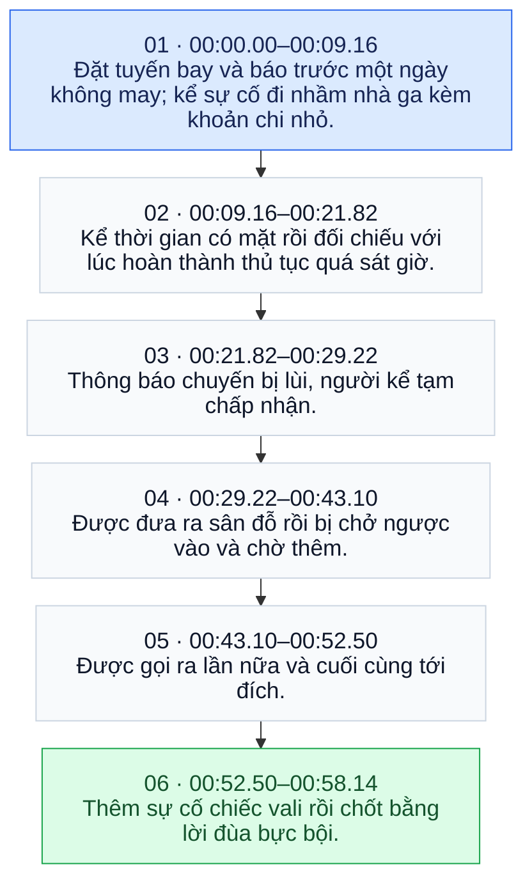

# Một chuyến bay kể theo chuỗi rắc rối và cú chốt chiếc vali

[Video gốc — @longkhongphainong](https://www.tiktok.com/@longkhongphainong/video/7608607292241497362) · ID `7608607292241497362`

**Tóm tắt cách kể:** Tự thuật có địa điểm → báo trước một ngày trục trặc → từng bước tưởng sắp xong lại thêm rắc rối → cho về đích → thêm một vật chứng làm cú chốt.

[Sơ đồ diễn biến](#mindmap) · [Diễn biến](#dien-bien) · [Nhịp cảm xúc](#cam-xuc) · [Cách áp dụng](#ap-dung)

## Sơ đồ diễn biến

Đọc từ trên xuống: mỗi hộp là một nhịp theo mốc ASR hoặc khung hình được ghi trong phân tích. Xanh dương là mở đầu, xanh lá là nhịp cuối. Chi tiết và giới hạn nằm trong phân tích bên dưới.

[Mã Mermaid riêng](../mindmaps/7608607292241497362.mmd)

## Dữ liệu và nguồn

**Cách thể hiện:** Hoạt hình bình luận

**Ngữ cảnh thương mại:** Chưa xác nhận hợp tác thương mại; xem các đoạn tự quảng bá/giới hạn được ghi riêng.

- Đăng: 2026-02-20T13:30:00+00:00. Metadata lấy: 2026-11-15T03:46:15.807069+00:00.
- **388,500 view**; thích 11,600; bình luận 64; chia sẻ 566; lưu 308. Dấu phẩy tách hàng nghìn.
- Thời lượng media: 58.24s.
- **21.58× P50** 18,000 của 150 bài đủ 48h trong snapshot kênh. Clip có trong cửa sổ baseline. Không phải thống kê toàn bộ kênh.

## Phạm vi kiểm

Đã tải media, xem khung chọn lọc và đọc ASR có mốc lưu lúc 2026-11-05T13:04:18.373160+00:00. Đối chiếu cùng ID và thời lượng, lệch 0.0s. **Chưa nghe toàn âm hoặc xem chuyển động liên tục; chưa xác nhận toàn văn ASR hay mọi dữ kiện kinh tế trong clip.**

Media SHA256: `541763b1d12ec89776a029a01529cabba4811f33c3117c96a768b933dda7aa2c`. [Metadata và các hash khác](../videos.json). Video/ASR đầy đủ giữ ở bộ nghiên cứu cục bộ; bản chia sẻ giữ link gốc, trích ngắn và phân tích riêng.

## Lời hứa và câu hỏi trung tâm

**Lời hứa:** Kể cho người xem biết chuyến đi được báo trước là không may đã trục trặc theo những bước nào và vì sao kết thúc còn có cú chốt.

**Câu hỏi:** Người kể có tới được đích trọn vẹn sau chuỗi bước tưởng sắp hoàn tất hay chưa?

## Mở đầu: lời và hình

Người kể mở ngôi một bằng một chuyến bay cụ thể và báo trước trải nghiệm không may, chưa giảng mô hình kinh doanh hay đưa kết luận tổng quát. Bản đồ hai thành phố ở 0–3 giây đặt tuyến đi; sau đó lời tăng rắc rối từng chặng cho tới một vật chứng cuối là chiếc vali. Đây là chuyện tự thuật của tác giả, không phải sự việc đã được lượt phân tích này xác minh.

> Hôm trước tôi bay từ thành phố Hồ Chí Minh ra Hà Nội, nó ngắn gọn là hơi đen

Trích ASR ngắn từ segment 00:00.00–00:03.62. Đoạn ASR ngắn, chưa đối chiếu toàn bộ âm; xem giới hạn từng ca. Dấu … nghĩa là bỏ bớt, không khẳng định toàn câu vừa ba giây.

| Mốc khung đã xem | Điều quan sát được |
|---|---|
| 00:01.00 | Bản đồ Việt Nam đánh dấu hai thành phố và tuyến di chuyển, nhân vật rồng xuất hiện ở dưới. |
| 00:08.74 | Nhân vật ở khu nhà ga, thẻ tiền âm xuất hiện bên hành động trả tiền. |
| 00:17.48 | Khung quầy thủ tục có đồng hồ đỏ và hai nhân vật giao tiếp. |
| 00:34.95 | Biển lên máy bay và cửa ra được đặt trên cảnh hành khách/nhân vật. |
| 00:43.68 | Khung sân đỗ/máy bay có một nhóm nhân vật, nối phần đưa ra rồi quay lại. |
| 00:57.24 | Khung cuối biến câu phàn nàn thành bong bóng thoại bên biểu tượng thương hiệu, mang sắc thái đùa chua chát. |

Không suy chuyển động giữa các khung từ ảnh tĩnh.

## Diễn biến và nhiệm vụ từng beat

| Mốc ASR | Diễn giải riêng | Vai trò |
|---|---|---|
| 00:00.00–00:09.16 | Đặt tuyến bay và báo trước một ngày không may; kể sự cố đi nhầm nhà ga kèm khoản chi nhỏ. | Mở một chuyện cá nhân có nơi/chặng, cho người nghe lý do đợi sự cố tiếp. |
| 00:09.16–00:21.82 | Kể thời gian có mặt rồi đối chiếu với lúc hoàn thành thủ tục quá sát giờ. | Dùng đồng hồ để tăng áp lực tiến độ và cho người nghe theo chuỗi nhân quả. |
| 00:21.82–00:29.22 | Thông báo chuyến bị lùi, người kể tạm chấp nhận. | Một nhịp hạ kỳ vọng trước trở ngại mới. |
| 00:29.22–00:43.10 | Được đưa ra sân đỗ rồi bị chở ngược vào và chờ thêm. | Tiến gần mục tiêu rồi bị trả lại trạng thái cũ; rắc rối tăng thay vì chỉ liệt kê. |
| 00:43.10–00:52.50 | Được gọi ra lần nữa và cuối cùng tới đích. | Cho cảm giác câu chuyện đã được giải quyết. |
| 00:52.50–00:58.14 | Thêm sự cố chiếc vali rồi chốt bằng lời đùa bực bội. | Cú chốt sau đích đến làm lời báo trước không may ở đầu có thêm một nấc. |

## Nhịp cảm xúc — giả thuyết biên tập

Các trạng thái dưới đây là cách đọc câu chuyện từ bằng chứng, không phải cảm xúc người xem đã đo hoặc biểu đồ retention.

| Mốc | Cảm xúc có thể gợi | Bằng chứng | Cách diễn giải |
|---|---|---|---|
| 00:00.00–00:09.16 | Tò mò và đồng cảm nhẹ | Một tuyến đi quen, một khoản mất nhỏ và báo trước trải nghiệm tệ. | Tình huống dễ nhận ra có thể tạo vai đồng hành cho người nghe. |
| 00:09.16–00:21.82 | Sốt ruột | Thời gian có mặt và giờ làm thủ tục bị đặt sát nhau, hình có đồng hồ đỏ. | Mốc giờ làm trở ngại cụ thể hơn lời nói chung rằng phải chờ. |
| 00:21.82–00:29.22 | Tạm chấp nhận | Người kể chấp nhận lần lùi giờ đầu. | Nhịp hạ có thể làm trở ngại sau cảm thấy trái kỳ vọng hơn. |
| 00:29.22–00:43.10 | Bực tăng | Được đưa tới máy bay rồi phải quay vào sảnh. | Chuyển động tiến/rút trong cốt chuyện làm mục tiêu bị tước ngay khi gần đạt. |
| 00:43.10–00:52.50 | Nhẹ nhõm | Cuối cùng tới Hà Nội và có thể kể lại chuyện. | Một điểm kết giả được dựng rõ trước cú chốt. |
| 00:52.50–00:58.14 | Cười chua chát | Chiếc vali thêm một mất mát cuối, hình kết dùng bong bóng thoại. | Vật thể cụ thể có thể giúp chuyện được nhớ hơn một kết luận tổng quát. |

## Cách phân phối thông tin

| Mốc | Động tác viết | Vì sao đáng chú ý |
|---|---|---|
| 00:00.00–00:09.16 | Chốt bối cảnh và sắc thái trước sự cố | Người nghe biết tuyến đi và cảm xúc chủ đạo mà chưa phải nghe lý lịch. |
| 00:09.16–00:29.22 | Dùng mốc thời gian làm thang áp lực | Các chặng được kể theo trình tự, tạo logic không cần định nghĩa. |
| 00:29.22–00:43.10 | Đảo tiến độ | Sắp lên máy bay trở thành quay lại sảnh, một lần đổi trạng thái đủ rõ để kể. |
| 00:43.10–00:58.14 | Kết giả rồi kết thật | Đến nơi trả mục tiêu di chuyển; chiếc vali trả sắc thái không may đã hứa đầu. |

## Giải đáp và cách kết

Tới được đích chưa phải hết chuyện: chiếc vali mở thêm rắc rối cuối. Cú chốt làm câu chuyện thành một trải nghiệm có đường cong, nhưng không cung cấp kiểm chứng độc lập hay kết luận công bằng về mọi chuyến bay/thương hiệu.

## Điểm mạnh có dẫn chứng

- **Có mục tiêu đơn giản xuyên suốt.** — 0–52,5 giây theo một hành trình từ xuất phát đến đến nơi.

- **Trở ngại có thang tăng thay vì nhiều điều rời rạc.** — 29,22–43,1 giây kể bị đưa tới rồi chở ngược, sau các lần chờ.

- **Vật thể làm lời chốt có điểm bám.** — 52,5–58,14 giây mới đưa chiếc vali vào như một rắc rối sau đích đến.

## Điểm yếu và điều không nên bắt chước

- **Tự thuật không đủ chứng minh toàn bộ trách nhiệm thương hiệu.** — Tất cả chi tiết được kể qua góc nhìn một người, hình là hoạt họa.

- **Lời chốt chép máy không chắc từ.** — 54,94–58,14 giây có lỗi ASR; không nên sao chép để làm mẫu câu chuẩn.

- **Nếu chuyển sang video giải thích, chuyện cần nối tới một cơ chế.** — Ca nguồn chủ yếu kể trải nghiệm; không phân tích nguyên nhân vận hành hệ thống.

## Khả năng được chia sẻ — chưa kiểm chứng

Không có dữ liệu phân phối/retention để kết luận vì sao viral. Các ý sau chỉ là giả thuyết để thử:

- Có thể gợi người xem kể chuyện trục trặc tương tự khi đi lại; chưa có dữ liệu bình luận thực để kiểm giả thuyết này.

- Chuỗi tình huống tiến-rút và cú chốt đồ vật có thể làm câu chuyện dễ kể lại, không đồng nghĩa là nguyên nhân view cao.

## Chuyển cơ chế sang bài mới

Học cấu trúc tiến gần mục tiêu rồi bị kéo ngược và cách dùng mốc giờ/vật thể làm trục kể. Chỉ dùng ngôi một khi người dùng cung cấp trải nghiệm thật; không bịa khiếu nại hoặc gán sự cố của một clip thành đặc tính phổ quát của doanh nghiệp.

- Chỉ lấy ngôi một từ trải nghiệm thật được cung cấp, không dựng tố cáo để tạo hook.

- Chọn một mục tiêu và để mỗi trở ngại thay đổi khoảng cách tới mục tiêu ấy.

- Đặt mốc thời gian/đồ vật khi chúng làm hệ quả dễ hiểu, không rải số cho có vẻ thật.

- Tách phân tích cách kể khỏi phán quyết về doanh nghiệp.

Không dùng bài chuyển thể chưa được người dùng duyệt làm mẫu giọng lâu dài.

## Giới hạn còn lại

- Đã đọc ASR có mốc và xem contact sheet mới gồm các khung chọn lọc; chưa nghe toàn âm hoặc xem chuyển động liên tục.

- Nhịp cảm xúc, lý do chú ý và khả năng chia sẻ dưới đây là giả thuyết biên tập, không phải dữ liệu retention hay kết quả thử nghiệm.

- Đây là lời tự thuật của tác giả; lượt này không xác minh chuyến bay, thời gian, lý do chậm hoặc tình trạng hành lý.

- ASR có lỗi ở các từ cuối; không công bố lời chốt như nguyên văn đã nghe đối chiếu.

- Hình hoạt họa là cách tái hiện câu chuyện, không tự là bằng chứng sự việc xảy ra.
