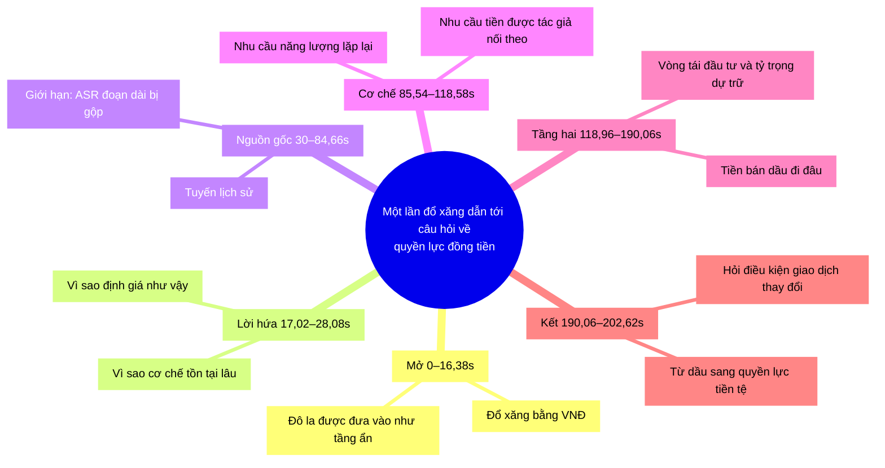

# Một lần đổ xăng dẫn tới câu hỏi về quyền lực đồng tiền

[Video gốc — @nqs.kinhte](https://www.tiktok.com/@nqs.kinhte/video/7615111628383669512) · ID `7615111628383669512`

**Tóm tắt cách kể:** Hành động đời thường → đối tượng tưởng không liên quan nhưng hiện diện gián tiếp → nguồn gốc → nhu cầu lặp lại → vòng tiền tự củng cố → câu hỏi điều kiện tương lai.

[Mindmap](#mindmap) · [Diễn biến](#dien-bien) · [Nhịp cảm xúc](#cam-xuc) · [Cách áp dụng](#ap-dung)

## Dữ liệu và nguồn

- Đăng: 2026-03-09T04:42:29+00:00. Metadata lấy: 2026-11-15T03:45:49.883058+00:00.
- **1,400,000 view**; thích 58,900; bình luận 276; chia sẻ 6,305; lưu 4,398. Dấu phẩy tách hàng nghìn.
- Thời lượng media: 203.76s.
- **6.13× P50** 228,300 của 149 bài đủ 48h trong snapshot kênh. Clip có trong cửa sổ baseline. Không phải thống kê toàn bộ kênh.

## Phạm vi kiểm

Đã tải lại media, xem khung chọn lọc và đọc ASR có mốc lưu lúc 2026-11-05T12:45:45.061007+00:00. Đối chiếu cùng ID và thời lượng, lệch 0.018s. **Chưa nghe toàn âm hoặc xem chuyển động liên tục; chưa xác nhận toàn văn ASR hay mọi dữ kiện kinh tế trong clip.**

Media SHA256: `40d605c5a604494cecffc0f91e1ac878e51202156d78b8fe3003be9041ae28b7`. [Metadata và các hash khác](../videos.json). Video/ASR đầy đủ giữ ở bộ nghiên cứu cục bộ; bản chia sẻ giữ link gốc, trích ngắn và phân tích riêng.

## Lời hứa và câu hỏi trung tâm

**Lời hứa:** Giải thích vì sao một người trả tiền xăng bằng VNĐ vẫn liên quan tới một hệ thống đồng tiền toàn cầu và vì sao hệ thống đó tồn tại lâu.

**Câu hỏi:** Đồng tiền không có mặt trong giao dịch trước mắt ảnh hưởng đến nó qua mắt xích nào?

## Mở đầu: lời và hình

Lời mở đặt người xem vào một giao dịch rất gần đời sống bằng tiền Việt, rồi chỉ ra một đồng tiền không xuất hiện trong tay vẫn có vai trò phía sau. Các khung 0–5 giây lần lượt cho thấy vòi xăng, tờ tiền Việt rồi đô la; mâu thuẫn được xây bằng việc thay đối tượng trên cùng tình huống, trước khi tác giả đặt tên cơ chế.

> Hãy tưởng tượng, sáng nay bạn vẫn cầm tờ 50.000 Việt Nam đồng đi đổ xăng như mọi khi.

Trích ASR ngắn từ segment 00:00.00–00:04.20. Đoạn ASR ngắn, chưa đối chiếu toàn bộ âm; xem giới hạn từng ca. Dấu … nghĩa là bỏ bớt, không khẳng định toàn câu vừa ba giây.

| Mốc khung đã xem | Điều quan sát được |
|---|---|
| 00:00.00 | Vòi xăng đỏ trên nền tối, chưa có người dẫn hay biểu đồ vĩ mô. |
| 00:02.00 | Bàn tay cầm tờ 50.000 đồng xuất hiện phía trên vòi xăng. |
| 00:05.00 | Hình tờ đô la đặt cạnh vòi xăng, đổi đơn vị tiền trên cùng đối tượng. |
| 00:30.56 | Khung trích có mốc 1971 trên đường thời gian, cho thấy tuyến giải thích lịch sử. |
| 01:31.69 | Những thùng dầu được đặt thành cụm trên nền sáng. |
| 02:32.82 | Sơ đồ dòng tiền nối các nhóm quốc gia với nhiều loại tài sản và trở về Mỹ. |
| 03:03.38 | Ảnh bài viết có sơ đồ và tỷ trọng dự trữ ngoại hối; sự xuất hiện nguồn không tự xác nhận số liệu. |
| 03:22.76 | Người dẫn trên nền tối cùng câu hỏi cuối về sự thay đổi quyền lực. |

Không suy chuyển động giữa các khung từ ảnh tĩnh.

## Diễn biến và nhiệm vụ từng beat

| Mốc ASR | Diễn giải riêng | Vai trò |
|---|---|---|
| 00:00.00–00:16.38 | Từ việc đổ xăng bằng tiền Việt, tác giả đưa ra một tầng định giá bằng đô la phía sau. | Tạo liên kết vô hình giữa hành động nhỏ và hệ thống lớn. |
| 00:17.02–00:28.08 | Đặt hai câu hỏi về lý do định giá và độ bền của cơ chế rồi chuyển sang nguồn gốc. | Lời hứa giải thích gồm nguyên nhân và khả năng tự duy trì. |
| 00:30.00–01:24.66 | Tuyến lịch sử dẫn từ nhu cầu nền tảng kinh tế sang thỏa thuận dầu mỏ và sự phổ biến một chuẩn thanh toán. | Cho cơ chế một điểm xuất phát; đoạn ASR 30–57 giây quá gộp, không đủ chi tiết hóa từng nhịp lời bên trong. |
| 01:25.54–01:58.58 | So một tài sản có thể được giữ lâu với nguyên liệu bị tiêu dùng hàng ngày, rồi nối nhu cầu năng lượng với nhu cầu đồng tiền. | Đưa chuỗi nhân quả được tác giả sử dụng để giải câu hỏi đầu. |
| 01:58.96–02:41.48 | Mở câu hỏi tiền bán dầu đi đâu, kể các đường tái đầu tư và dòng tiền quay lại. | Mở tầng thứ hai sau đáp án đầu thay vì kết ở một định nghĩa. |
| 02:43.60–03:10.06 | Đối chiếu vòng tiền của Mỹ với trường hợp nước khác và đưa các tỷ trọng dự trữ. | Tăng quy mô ý nghĩa; số liệu và sự so sánh cần kiểm riêng. |
| 03:10.06–03:22.62 | Đổi trọng tâm từ dầu sang quyền lực đồng tiền rồi đặt một điều kiện tương lai. | Khép giải thích hiện tại nhưng mở câu hỏi nếu chuẩn giao dịch thay đổi. |

## Nhịp cảm xúc — giả thuyết biên tập

Các trạng thái dưới đây là cách đọc câu chuyện từ bằng chứng, không phải cảm xúc người xem đã đo hoặc biểu đồ retention.

| Mốc | Cảm xúc có thể gợi | Bằng chứng | Cách diễn giải |
|---|---|---|---|
| 00:00.00–00:16.38 | Quen thuộc rồi ngạc nhiên | Giao dịch đổ xăng bằng tiền Việt được đặt cạnh tầng đô la phía sau. | Sự nhận diện tình huống có thể giảm khoảng cách với chủ đề vĩ mô; đây là giả thuyết biên tập. |
| 00:17.02–00:28.08 | Muốn giải mã | Hai câu hỏi nguyên nhân và độ bền được nêu trước lịch sử. | Đặt hai phần đáp án giúp người xem biết còn phần chưa giải thích. |
| 01:25.54–01:58.58 | Hiểu được một mắt xích | Tác giả chuyển từ tính chất dầu tới nhu cầu đồng tiền. | Chuỗi ngắn hơn tuyến lịch sử có thể tạo một điểm hiểu ra. |
| 01:58.96–02:41.48 | Tò mò thêm một tầng | Sau nhu cầu tiền là câu hỏi về nơi tiền quay về. | Câu hỏi mới phát sinh từ đáp án cũ, giúp mạch có lý do tiến lên. |
| 03:10.06–03:22.62 | Dè chừng trước điều kiện mới | Kết hỏi điều gì xảy ra nếu việc định giá thay đổi. | Giữ tính chưa đóng của tương lai mà không chứng minh dự báo. |

## Cách phân phối thông tin

| Mốc | Động tác viết | Vì sao đáng chú ý |
|---|---|---|
| 00:00.00–00:16.38 | Thay đồng tiền trên cùng hình giao dịch | Giữ vòi xăng làm mốc trong khi tăng quy mô hệ thống. |
| 00:30.00–01:24.66 | Lùi về nguồn gốc sau khi đã có câu hỏi | Lịch sử phục vụ lời hứa, dù ASR gộp khiến một phần tuyến này chưa đủ chi tiết. |
| 01:25.54–01:58.58 | So tính chất tiêu dùng của dầu với tài sản giữ lâu | Đưa động cơ nhu cầu lặp lại trước kết luận về đồng tiền. |
| 01:58.96–02:41.48 | Biến tuyến thanh toán thành vòng tái đầu tư | Sơ đồ ở 152,82 giây làm một quan hệ phản hồi nhìn được. |
| 03:10.06–03:22.62 | Kết bằng thay đổi một điều kiện của mô hình | Câu hỏi cuối gắn cơ chế vừa giải thay vì thêm một chủ đề rời. |

## Giải đáp và cách kết

Kết giải thích đây là cơ chế quyền lực tiền tệ rồi để ngỏ một kịch bản khác. Không có đáp án định lượng cho kịch bản tương lai; nó là câu hỏi mở sau phần giải thích, không phải dữ liệu dự báo.

## Điểm mạnh có dẫn chứng

- **Cửa vào vĩ mô có vật và hành động cụ thể** — 0–5 giây: vòi xăng, VNĐ rồi đô la.

- **Không chỉ kể một nguyên nhân đơn lẻ** — 85,54–161,48 giây chuyển từ nhu cầu nguyên liệu tới vòng tái đầu tư.

- **Câu hỏi cuối phát sinh từ cơ chế chính** — 197,56–202,62 giây đổi điều kiện giao dịch dầu.

## Điểm yếu và điều không nên bắt chước

- **Một phần nguồn lời không đủ phân giải để mổ xẻ sát từng nhịp** — ASR 30–57 giây có segment dài bất thường.

- **Những khẳng định tuyệt đối dễ bị học lại như chân lý** — 7,64–16,38 và 69,18–84,66 giây cần nguồn kiểm chứng chuyên môn.

- **Tỷ trọng dự trữ tạo tải thông tin nhưng chưa có đo hiệu quả** — 179,58–190,06 giây thêm nhiều con số sau tuyến giải thích dài.

## Khả năng được chia sẻ — chưa kiểm chứng

Không có dữ liệu phân phối/retention để kết luận vì sao viral. Các ý sau chỉ là giả thuyết để thử:

- Mối nối giữa một lần đổ xăng và hệ thống toàn cầu có thể tạo cảm giác nhìn thấy điều ẩn; chưa có dữ liệu người xem chia sẻ vì lý do này.

- Sơ đồ vòng tiền có thể giúp người xem kể lại bằng vài bước; không có thử nghiệm kiểm mức nhớ hoặc retention.

## Chuyển cơ chế sang bài mới

Học cách bắt đầu từ một giao dịch người xem đã làm, tìm một mắt xích họ không nhìn thấy và lần theo các bước có thể minh họa. Khi đổi chủ đề, cần chứng minh liên kết thật và kiểm nguồn cơ chế, thay vì dùng sự bất ngờ làm lý do bỏ qua độ chính xác.

- Giữ một hành động gần khán giả làm điểm neo khi tăng quy mô giải thích.

- Câu hỏi thứ hai nên sinh từ đáp án trước, không chèn bí ẩn không liên quan.

- Kiểm riêng nguồn lịch sử và các phát biểu tuyệt đối trước khi viết lại.

- Không chép chuỗi con số của tác giả như nguồn đã kiểm.

Không dùng bài chuyển thể chưa được người dùng duyệt làm mẫu giọng lâu dài.

## Mindmap

[Mã Mermaid riêng](../mindmaps/7615111628383669512.mmd)

## Giới hạn còn lại

- Bằng chứng gồm ASR có mốc và các khung chọn lọc đã xem; chưa nghe trực tiếp toàn âm hoặc xem chuyển động liên tục.

- Phân tích cách kể không xác nhận dữ kiện lịch sử, kinh tế hoặc thống kê trong clip. Không có retention/A-B để khẳng định cơ chế gây viral.

- ASR có một segment 30–57 giây kéo dài nhưng rất ít chữ, nên không xác nhận nội dung lời chi tiết ở khoảng đó.

- Các diễn giải về thỏa thuận Mỹ–Saudi, sự độc quyền định giá và tỷ lệ dự trữ là lập luận của tác giả, không được lượt phân tích này xác thực.
