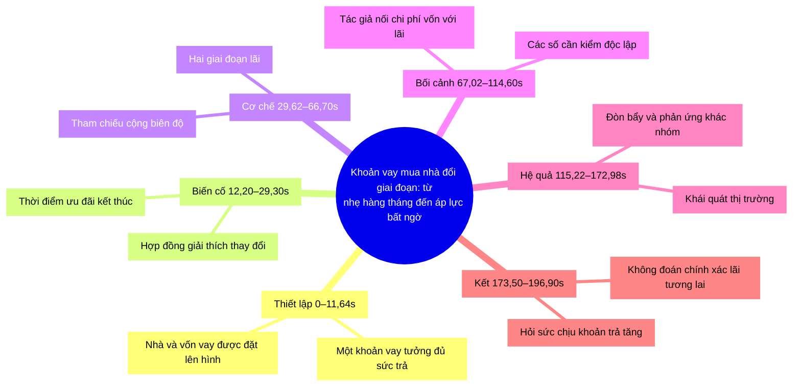

# Khoản vay mua nhà đổi giai đoạn: từ nhẹ hàng tháng đến áp lực bất ngờ

[Video gốc — @nqs.kinhte](https://www.tiktok.com/@nqs.kinhte/video/7618909168044461319) · ID `7618909168044461319`

**Tóm tắt cách kể:** Tình huống tưởng đủ sức trả → thời điểm điều kiện ưu đãi đổi → khoản trả tăng gây sốc → giải điều khoản bị bỏ qua → kết bằng stress-test khả năng chịu thay đổi.

[Mindmap](#mindmap) · [Diễn biến](#dien-bien) · [Nhịp cảm xúc](#cam-xuc) · [Cách áp dụng](#ap-dung)

## Dữ liệu và nguồn

- Đăng: 2026-03-19T10:18:52+00:00. Metadata lấy: 2026-11-15T03:46:03.214635+00:00.
- **1,300,000 view**; thích 77,600; bình luận 671; chia sẻ 14,200; lưu 13,000. Dấu phẩy tách hàng nghìn.
- Thời lượng media: 198.09s.
- **5.69× P50** 228,300 của 149 bài đủ 48h trong snapshot kênh. Clip có trong cửa sổ baseline. Không phải thống kê toàn bộ kênh.

## Phạm vi kiểm

Đã tải lại media, xem khung chọn lọc và đọc ASR có mốc lưu lúc 2026-11-05T12:47:51.801532+00:00. Đối chiếu cùng ID và thời lượng, lệch 0.0455s. **Chưa nghe toàn âm hoặc xem chuyển động liên tục; chưa xác nhận toàn văn ASR hay mọi dữ kiện kinh tế trong clip.**

Media SHA256: `bfb167e8489fd45d7f49dbfb3f323dca7fb67c3bfd49eb1a8fba1bad58a2d995`. [Metadata và các hash khác](../videos.json). Video/ASR đầy đủ giữ ở bộ nghiên cứu cục bộ; bản chia sẻ giữ link gốc, trích ngắn và phân tích riêng.

## Lời hứa và câu hỏi trung tâm

**Lời hứa:** Làm rõ một khoản vay tưởng trả được vì sao đổi mạnh sau giai đoạn ưu đãi, rồi hướng người xem tới câu hỏi chuẩn bị.

**Câu hỏi:** Điều kiện nào trong cùng một khoản vay làm nghĩa vụ tháng sau khác nghĩa vụ ban đầu?

## Mở đầu: lời và hình

Tác giả dựng một tình huống mua nhà với giá nhà, vốn vay, lãi ưu đãi, khoản trả và thu nhập hộ gia đình; sau đó nhảy sang tháng hết ưu đãi để làm số trả tăng mạnh. Khung đầu nhấn căn nhà và phần vốn vay, khung 29,71 giây đưa hợp đồng; câu hỏi được chuyển từ lỗi bất ngờ sang điều khoản đã ký.

> Bạn mua một căn nhà 5 tỷ …

Trích ASR ngắn từ segment 00:00.00–00:05.20. Đoạn ASR ngắn, chưa đối chiếu toàn bộ âm; xem giới hạn từng ca. Dấu … nghĩa là bỏ bớt, không khẳng định toàn câu vừa ba giây.

| Mốc khung đã xem | Điều quan sát được |
|---|---|
| 00:00.00 | Mô hình một căn nhà trên nền lưới tối. |
| 00:02.00 | Giá nhà được đặt thành chữ dọc cạnh căn nhà. |
| 00:03.00 | Một phần căn nhà chuyển đỏ và có nhãn vốn vay; đây là minh họa mức vay trong tình huống tác giả. |
| 00:05.00 | Nhãn lãi suất ưu đãi cạnh nhà và phần vay. |
| 00:29.71 | Trang hợp đồng với dòng lãi thả nổi được nhấn. |
| 00:59.43 | Sơ đồ lãi tham chiếu cộng biên độ, ghi cả mối neo vào lãi huy động. |
| 01:58.85 | Đường đỏ đi lên và tiền đồng minh họa áp lực vốn. |
| 02:28.56 | Các lựa chọn thuê nhà hoặc dịch ra vùng ven xuất hiện ở phần phân nhóm phản ứng. |
| 02:58.28 | Người dẫn quay lại câu hỏi về năng lực chịu khoản trả tăng. |
| 03:17.09 | Người dẫn ở phần kết cùng ý chuẩn bị kỹ thay vì đoán mức tăng. |

Không suy chuyển động giữa các khung từ ảnh tĩnh.

## Diễn biến và nhiệm vụ từng beat

| Mốc ASR | Diễn giải riêng | Vai trò |
|---|---|---|
| 00:00.00–00:11.64 | Thiết lập một khoản vay và thu nhập gia đình mà tác giả mô tả là còn dư khả năng trả. | Cho người xem một trạng thái tưởng ổn định, không phải bảng tính đã được kiểm. |
| 00:12.20–00:29.30 | Đổi sang tháng hết ưu đãi, tăng số trả, đặt câu hỏi lỗi thuộc ai rồi chỉ về hợp đồng. | Tạo biến cố theo thời gian và đổi đối tượng cần giải thích từ hành vi ngân hàng sang cơ chế hợp đồng. |
| 00:29.62–01:06.70 | Hỏi cơ chế và trình bày hai giai đoạn lãi, công thức lãi tham chiếu cộng biên độ. | Giải thích điều kiện đã khiến tình huống thay đổi. |
| 01:07.02–01:54.60 | Dùng tuyến chu kỳ chi phí vốn để giải thích thay đổi của lãi tham chiếu và quay lại số trả ban đầu. | Nối cơ chế hợp đồng với môi trường tác giả mô tả; các mốc/số cần kiểm riêng. |
| 01:55.22–02:30.38 | Mở từ hóa đơn cá nhân sang đòn bẩy và chia phản ứng của nhà đầu tư/người mua ở thực. | Tăng phạm vi hệ quả, biểu diễn tác động khác nhau theo nhóm. |
| 02:31.00–02:52.98 | Tác giả khái quát việc thay đổi chi phí vốn thành giai đoạn thị trường phải định giá lại. | Mở rộng từ ca vay sang diễn giải thị trường, chưa là kết luận được xác minh. |
| 02:53.50–03:16.90 | Đổi câu hỏi dự đoán lãi sang khả năng hộ gia đình chịu được khoản trả tăng. | Đóng bằng một phép thử sức chịu đựng thay vì dự báo chính xác. |

## Nhịp cảm xúc — giả thuyết biên tập

Các trạng thái dưới đây là cách đọc câu chuyện từ bằng chứng, không phải cảm xúc người xem đã đo hoặc biểu đồ retention.

| Mốc | Cảm xúc có thể gợi | Bằng chứng | Cách diễn giải |
|---|---|---|---|
| 00:00.00–00:11.64 | Tưởng trong tầm tay | Nhà, khoản vay và thu nhập được thiết lập thành một trạng thái có vẻ ổn. | Khán giả được đặt trong một quyết định cụ thể trước khi gặp rủi ro. |
| 00:12.20–00:29.30 | Bị đảo trạng thái | Mốc tháng thứ 25 kéo số trả tăng rồi điều khoản được chỉ ra. | Đổi điều kiện thời gian tạo bất ngờ có cơ chế cần giải, không cần một biến cố vô cớ. |
| 00:29.62–01:06.70 | Bắt đầu giải mã | Hai giai đoạn và công thức lãi được trình bày. | Có thể giảm cảm giác mơ hồ khi điều kiện được gọi tên. |
| 01:55.22–02:52.98 | Thấy hệ quả rộng hơn | Tác động cá nhân được mở sang nhóm dùng đòn bẩy và thị trường. | Tăng stakes nhưng có nguy cơ đi xa lời hứa ban đầu. |
| 02:53.50–03:16.90 | Quay về phần có thể chuẩn bị | Câu hỏi cuối đổi từ đoán lãi sang chịu được khoản tăng. | Kết chuyển sự chú ý về khả năng của người xem thay vì một con số tương lai. |

## Cách phân phối thông tin

| Mốc | Động tác viết | Vì sao đáng chú ý |
|---|---|---|
| 00:00.00–00:29.30 | Dựng trạng thái A rồi nhảy tới trạng thái B | Một hợp đồng được nhìn ở hai thời điểm giúp lộ điều kiện người vay dễ bỏ qua. |
| 00:29.62–01:06.70 | Chỉ điều khoản sau biến cố | Trang hợp đồng và sơ đồ cộng lãi cung cấp chỗ bám cho lời giải. |
| 01:07.02–01:54.60 | Nối biến số hợp đồng với chi phí vốn | Tác giả thêm lý do biến số thay đổi, nhưng dữ kiện thị trường chưa kiểm. |
| 01:55.22–02:52.98 | Phân nhóm phản ứng | Cho thấy cùng thay đổi chi phí có thể dẫn tới lựa chọn khác nhau. |
| 02:53.50–03:16.90 | Thay câu hỏi dự báo bằng kiểm sức chịu | Làm kết quay lại quyết định cá nhân đã đặt trước. |

## Giải đáp và cách kết

Kết không đoán lãi sẽ lên tới mức nào mà chuyển tiêu chí thành sự chuẩn bị và khả năng chịu chi phí. Nó quay về hộ gia đình ở mở, nhưng các con số trả nợ trong tình huống chưa được kiểm đủ kỳ hạn và lịch gốc/lãi.

## Điểm mạnh có dẫn chứng

- **Biến cố có thời điểm và điều kiện cụ thể** — 12,20–29,30 giây đổi tháng và mở điều khoản.

- **Hình giải thích được cấu trúc thay vì chỉ thêm chữ cảnh báo** — 29,71 và 59,43 giây có hợp đồng và sơ đồ công thức.

- **Kết trở về câu hỏi quyết định** — 173,50–196,90 giây tập trung sức chịu chứ không chốt dự báo.

## Điểm yếu và điều không nên bắt chước

- **Con số gây sốc chưa thể xem là phép tính được xác nhận** — 0–29,30 và 109,78–114,60 giây thiếu lịch trả đầy đủ để kiểm.

- **Câu chuyện thị trường có thể kéo bài ra ngoài cơ chế khoản vay** — 133,48–172,98 giây mở nhiều nhóm và khái quát.

- **Ngôn ngữ chắc về chu kỳ cần nguồn và thời điểm** — 70,62–114,60 giây có các mức/mốc thị trường, không nên tái dùng như dữ kiện hiện hành.

## Khả năng được chia sẻ — chưa kiểm chứng

Không có dữ liệu phân phối/retention để kết luận vì sao viral. Các ý sau chỉ là giả thuyết để thử:

- Tình huống người vay gặp điều kiện đã ký nhưng bỏ qua có thể gợi người xem gửi cho người cùng cảnh; chưa kiểm dữ liệu chia sẻ.

- Câu hỏi sức chịu ở cuối có thể giúp người xem tự liên hệ thay vì chỉ sợ; đây là suy luận từ cấu trúc bài.

## Chuyển cơ chế sang bài mới

Học cách dùng thời điểm đổi điều kiện như biến cố của câu chuyện và kết bằng tiêu chí ra quyết định thay vì một dự đoán. Bài mới phải có lịch dòng tiền và giả định đủ trước khi dùng số trả để gây bất ngờ.

- Nếu dùng trạng thái trước/sau, thay đổi phải được giải bằng điều kiện thật của mô hình.

- Số minh họa phải đủ kỳ hạn và lịch trả để người xem kiểm lại.

- Chỉ mở tới hệ quả nhóm khi nó giúp trả câu hỏi cá nhân.

- Kết bằng tiêu chí có thể đánh giá, không đưa dự báo chắc chắn về thị trường.

Không dùng bài chuyển thể chưa được người dùng duyệt làm mẫu giọng lâu dài.

## Mindmap

[Mã Mermaid riêng](../mindmaps/7618909168044461319.mmd)

## Giới hạn còn lại

- Bằng chứng gồm ASR có mốc và các khung chọn lọc đã xem; chưa nghe trực tiếp toàn âm hoặc xem chuyển động liên tục.

- Phân tích cách kể không xác nhận dữ kiện lịch sử, kinh tế hoặc thống kê trong clip. Không có retention/A-B để khẳng định cơ chế gây viral.

- Không xác nhận phép tính từ giá nhà, số vay, lãi và khoản trả tháng của clip; thiếu lịch trả gốc, kỳ hạn và điều kiện tham chiếu để kiểm toàn bộ.

- Các mức lãi suất, mốc chu kỳ và nhận định thanh lọc là lời tác giả; không dùng như thông tin thị trường hiện tại.

- ASR có lỗi từ tài chính; sơ đồ lãi thả nổi được quan sát trên khung nhưng chưa thay thế tài liệu hợp đồng thật.
