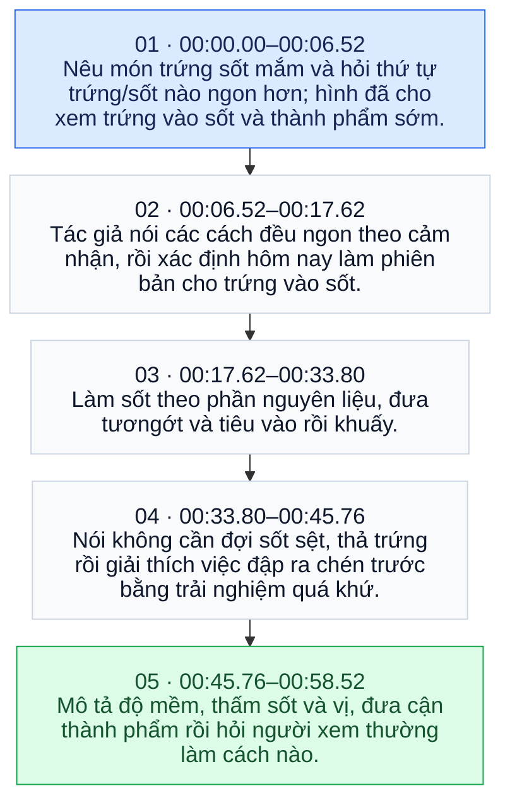

# Trứng sốt mắm: chọn cách làm rồi cho xem một phiên bản

[Video gốc — @genjadao](https://www.tiktok.com/@genjadao/video/7620769376920145160) · ID `7620769376920145160`

**Tóm tắt cách kể:** Thao tác có kết quả cảm quan → câu lựa chọn hai thứ tự → cho trước thành phẩm → quay về trình tự làm → giải thích tiểu tiết đang thấy → trở lại thành phẩm/câu hỏi. Nguyên liệu và hành động làm hook cụ thể; câu đầu không thể tách khỏi cận chảo để học.

[Sơ đồ diễn biến](#mindmap) · [Diễn biến](#dien-bien) · [Nhịp cảm xúc](#cam-xuc) · [Cách áp dụng](#ap-dung)

## Sơ đồ diễn biến

Đọc từ trên xuống: mỗi hộp là một nhịp theo mốc ASR hoặc khung hình được ghi trong phân tích. Xanh dương là mở đầu, xanh lá là nhịp cuối. Chi tiết và giới hạn nằm trong phân tích bên dưới.

[Mã Mermaid riêng](../mindmaps/7620769376920145160.mmd)

## Dữ liệu và nguồn

**Cách thể hiện:** Thao tác nấu ăn và thuyết minh

**Phạm vi học:** Học cách chia thông tin theo hình và ASR, giữ giới hạn từng ca.

**Ngữ cảnh thương mại:** Chưa xác nhận tài trợ; nhận diện thương hiệu/quảng bá quan sát được nằm trong phân tích.

- Đăng: 2026-03-24T10:37:27+00:00. Metadata lấy: 2026-11-15T04:33:50.095450+00:00.
- **10,800,000 view**; thích 321,900; bình luận 943; chia sẻ 42,000; lưu 108,708. Dấu phẩy tách hàng nghìn.
- Thời lượng media: 58.84s.
- **25.75× P50** 419,400 của 150 bài đủ 48h trong snapshot kênh. Clip có trong cửa sổ baseline. Không phải thống kê toàn bộ kênh.

## Phạm vi kiểm

Đã tải media, xem khung chọn lọc và đọc ASR có mốc lưu lúc 2026-11-15T04:35:00.159161+00:00. Đối chiếu cùng ID và thời lượng, lệch 0.025s. **Chưa nghe toàn âm hoặc xem chuyển động liên tục; chưa xác nhận toàn văn ASR hay mọi dữ kiện trong clip.**

Media SHA256: `b73f3c150cd6c1bd173376063ff0e56da4b003b742ca857611c81682f676cdb7`. [Metadata và các hash khác](../videos.json). Video/ASR đầy đủ giữ ở bộ nghiên cứu cục bộ; bản chia sẻ giữ link gốc, trích ngắn và phân tích riêng.

## Lời hứa và câu hỏi trung tâm

**Lời hứa:** Cho xem một phiên bản trứng sốt mắm và mời trao đổi về thứ tự nấu.

**Câu hỏi:** Cho trứng vào sốt hay làm trứng trước rồi thêm sốt: tác giả sẽ trình diễn phiên bản nào?

## Mở đầu: lời và hình

Ngay0 giây đã thấy trứng được thả vào chảo sốt đỏ;1–3 giây thêm nhiều trứng và thấy hỗn hợp sôi. Lời dẫn nêu món quen rồi hỏi chọn cho trứng vào sốt hay chiên trước mới thêm sốt. Cảnh mở cung cấp vật thể và thao tác của một vế câu hỏi trước khi hướng dẫn quay về từ đầu, không cần một câu cảnh báo hay bí mật lớn.

## Nghiên cứu phần mở

Diễn giải từ bằng chứng đã lưu; lý do gây chú ý là giả thuyết biên tập, chưa đo retention.

**Cửa sổ quan sát:** 00:00.00–00:06.52

| Lớp | Quan sát/diễn giải |
|---|---|
| Lời | 0–2,02s nêu món;2,02–6,52s đặt lựa chọn thứ tự trứng và sốt, câuASR có từ sai nên diễn ý. |
| Hình | 0–3s liên tiếp thấy trứng vào sốt đang sôi;5s đã thấy thành phẩm có hành. |
| Chữ trên hình | Không thấy tiêu đề chữ lớn trong khung0–5s; đầu vào nhận diện bằng món và thao tác. |

**Động tác gây chú ý:** Câu hỏi lựa chọn rất cụ thể chạy cùng cận thao tác của một vế.

**Vì sao có thể muốn dừng lại:** Giả thuyết: người quen món muốn đối chiếu cách mình làm, đồng thời chảo trứng/sốt cung cấp kết quả cảm quan ngay.

**Điều còn muốn biết:** Hôm nay tác giả làm vế nào, và thành phẩm trông ra sao?

**Thông tin chưa cho biết:** Trình tự làm sốt và lý do đập trứng vào chén chưa được giải ởmở; diện mạo thành phẩm không bị giấu hoàn toàn.

**Nhịp nối có gì mới:** Cho trước cảnh nếm/thành phẩm, rồi quay về làm sốt; nhịp giải thích chén trứng thêm một câu hỏi bám hình.

**Mốc trả/giới hạn giải đáp:** 00:45.76–00:58.52 — Thành phẩm cận và lời mô tả kết cấu trả phần xem một phiên bản; câu cách nào ngon hơn vẫn không có thửhai vế để kết luận.

**Tóm cấu trúc bằng hai câu:** Cho thấy một thao tác trên vật thể quen thuộc và đặt hai trình tự có thể dẫn tới cùng mục tiêu. Chọn một trình tự, cho xem cách làm và kết quả, rồi để câu lựa chọn mở đúng mức bằng chứng đang có.

**Chuyển sang ngách khác:** Chuyển được quan hệ hai quy trình cùng mục tiêu → minh họa một quy trình → kết quả có thể kiểm. Khi sangfinance, kết quả cảm quan phải được thay bằng đầu ra/cách tính có nguồn; sẽ sai nếu coi một lần minh họa là bằng chứng phương án tốt hơn.

**Điều không chuyển theo:**

- Không tạo câu chọnA/B rồi phán thắng khi chỉ cho xemA.
- Không coi thao tác có thương hiệu là khuyến nghị mua sản phẩm.

**Phạm vi:** ToànASR mới và12 khungtimestamp; chưa nghe toàn âm/xem liên tục; chỉ quan sát hình tại các mốc.

> Món trứng sốt nước mắm thì ngon khỏi phải nói

Trích ASR ngắn từ segment 00:00.00–00:02.02. Trích ASR ngắn chưa nghe so khớp toàn âm; không khẳng định cả segment là ba giây. Xem phạm vi/giới hạn từng ca. Dấu … nghĩa là bỏ bớt, không khẳng định toàn câu vừa ba giây.

| Mốc khung đã xem | Điều quan sát được |
|---|---|
| 00:00.00 | Hai tay đưa một quả trứng từ cốc nhỏ vào chảo sốt đỏ đang sôi, trứng đầu đã nằm trong sốt. |
| 00:01.00 | Chảo đã có thêm trứng; góc trên giữ rõ thao tác tay. |
| 00:03.00 | Bốn trứng trong sốt, phần lòng trắng đang chuyển màu. |
| 00:05.00 | Món đã rắc hành, muỗng lấy sốt ở cận cảnh; đây là hình thành phẩm được cho thấy sớm. |
| 00:08.83 | Người nấu cầm bát và muỗng trước chảo, tạo một nhịp nếm trong cảnh có gương mặt. |
| 00:17.65 | Chảo hành tím và chất lỏng ở góc cận trên, bắt đầu trình bày quy trình. |
| 00:26.48 | Chai tươngớtCHIN-SU được đưa lớn vào khung, nhãn nhìn rõ trước chảo. |
| 00:35.30 | Muỗng khuấy sốt đỏ trong chảo, tương ứng mốc sốt hòa tan. |
| 00:44.13 | Trứng từ cốc nhỏ được cho vào chảo; lời kể giải thích vì sao đập riêng. |
| 00:52.96 | Cận trứng vàsốt với hành, làm rõ diện mạo sau nấu. |
| 00:57.84 | Muỗng nâng phần lòng đỏ màu cam ra trước chảo ở khung cuối. |

Không suy chuyển động giữa các khung từ ảnh tĩnh.

## Diễn biến và nhiệm vụ từng beat

| Mốc ASR | Diễn giải riêng | Vai trò |
|---|---|---|
| 00:00.00–00:06.52 | Nêu món trứng sốt mắm và hỏi thứ tự trứng/sốt nào ngon hơn; hình đã cho xem trứng vào sốt và thành phẩm sớm. | Đặt lựa chọn quen thuộc trên một thao tác nhìn được. |
| 00:06.52–00:17.62 | Tác giả nói các cách đều ngon theo cảm nhận, rồi xác định hôm nay làm phiên bản cho trứng vào sốt. | Thu hẹp từ câu hỏi so sánh thành một cách được trình diễn, không mở thử nghiệm hai cách. |
| 00:17.62–00:33.80 | Làm sốt theo phần nguyên liệu, đưa tươngớt và tiêu vào rồi khuấy. | Cung cấp trình tự thực hiện; có một nhịp sản phẩm thương hiệu rõ. |
| 00:33.80–00:45.76 | Nói không cần đợi sốt sệt, thả trứng rồi giải thích việc đập ra chén trước bằng trải nghiệm quá khứ. | Giải một thắc mắc nhỏ của thao tác đang xem, thêm chuyện cá nhân ngắn. |
| 00:45.76–00:58.52 | Mô tả độ mềm, thấm sốt và vị, đưa cận thành phẩm rồi hỏi người xem thường làm cách nào. | Trả phần thưởng cảm quan của một phiên bản và quay lại câu lựa chọn để mời trao đổi. |

## Nhịp cảm xúc — giả thuyết biên tập

Các trạng thái dưới đây là cách đọc câu chuyện từ bằng chứng, không phải cảm xúc người xem đã đo hoặc biểu đồ retention.

| Mốc | Cảm xúc có thể gợi | Bằng chứng | Cách diễn giải |
|---|---|---|---|
| 00:00.00–00:06.52 | Nhận ra món và muốn chọn | Hình trứng/sốt đã hiện trong lúc lời hỏi thứ tự. | Người từng làm món có thể tự có lựa chọn; đây là giả thuyết biên tập. |
| 00:06.52–00:17.62 | Chờ xem cách tác giả làm | Tác giả chọn một phiên bản sau khi nói các cách đều ngon. | Hạ cuộc tranh hơn/thua thành chia sẻ thực hành. |
| 00:33.80–00:45.76 | Tò mò về chi tiết nhỏ | Thắc mắc vì sao đập trứng ra chén được nói cùng thao tác. | Câu hỏi phụ mọc từ hình, không cần dựng thêm câu sốc. |
| 00:45.76–00:58.52 | Thấy kết quả cụ thể | Cận món vàmuỗng lòng đỏ, lời mô tả vị và độ mềm. | Món thật làm phần thưởng; chưa đo phản ứng thèm ăn. |

## Cách phân phối thông tin

| Mốc | Động tác viết | Vì sao đáng chú ý |
|---|---|---|
| 00:00.00–00:06.52 | Đặt hai thứ tự thao tác trên cùng món. | Chủ đề đủ hẹp để hiểu lựa chọn ngay. |
| 00:00.00–00:17.62 | Cho trước quá trình cuối và cảnh nếm. | Người xem biết đầu ra của hướng dẫn trước khi đi qua công thức. |
| 00:17.62–00:33.80 | Trình bày sốt theo các phần. | Tạo quy tắc theo dõi thay vì một danh sách nguyên liệu không hành động. |
| 00:33.80–00:45.76 | Giải thích một hành động trông hơi thừa. | Biến thắc mắc tự nhiên từ hình thành nhịp trò chuyện. |
| 00:45.76–00:58.52 | Cho cận kết quả rồi hỏi lại lựa chọn. | Nối đầu-cuối bằng cùng vấn đề nhưng không giả vờ có thử nghiệmso sánh. |

## Giải đáp và cách kết

Kết bằng cận lòng đỏ và câu hỏi người xem chọn cách nào. Clip không tổ chức đối chiếu hai chảo hay kết luận khách quan rằng một cách thắng; lời hứa thực tế là cho xem một phiên bản hấp dẫn.

## Điểm mạnh có dẫn chứng

- **Vật thể và hành động rõ từ0s** — Chảo sốt, cốc trứng và tay đang thả cùng nằm trong khung.

- **Có hình thành phẩm trước hướng dẫn** — 5s thấy món rắc hành vàmuỗng sốt;8,83s có cảnh nếm.

- **Câu hỏi phụ bám thao tác** — 37,84–45,76s giải thích chén đập trứng trong lúc người xem đang thấy thả trứng.

## Điểm yếu và điều không nên bắt chước

- **Câu chọn cách ngon hơn không được kiểm hai vế** — 15,64–17,62s chỉ chọn phiên bản trứng vào sốt; cuối hỏi ý kiến thay vì đối chiếu.

- **Thương hiệu có thể bị hiểu như nguyên liệu bắt buộc** — ChaiCHIN-SU chiếm rõ khung26,48s và lời nhấn không thể thiếu; không nên học thành khẳng định phải mua nhãn này.

- **Nhiều nhận xét vị vẫn là lời chủ quan** — 45,76–55,96s nói mềm, thấm và hao cơm, không phải kết quả đo.

## Khả năng được chia sẻ — chưa kiểm chứng

Không có dữ liệu phân phối/retention để kết luận vì sao viral. Các ý sau chỉ là giả thuyết để thử:

- Lựa chọn hai cách quen có thể mời người xem kể cách nhà mình làm, thay vì chỉ khen món; chưa có dữ liệu bình luận để kiểm.

- Cận thành phẩm có thể khiến người xem lưu để làm lại, nhưng không có số lưu theo đoạn.

## Chuyển cơ chế sang bài mới

Chuyển sangfinance có thể giữ quan hệ hai cách làm cùng mục tiêu, cho thấy đầu ra rồi giải thích một quy trình minh họa. Nếu chỉ làm một vế, phải nói rõ chưa chứng minh vế đó tốt hơn; một ví dụ giao dịch không thay so sánh kết quả có kiểm soát.

- Hook bắt đầu từ hành động/đồ vật nhìn rõ, không chỉ nhãn công thức.

- Nếu nêu hai lựa chọn mà chỉ diễn một, nói đúng phạm vi minh họa.

- Giải thích tiểu tiết đúng lúc nó xuất hiện trên hình.

- Không biến cảm nhận cá nhân thành so sánh khách quan.

- Ghi hiện diện thương hiệu và tìm bằng chứng trước kết luận tài trợ.

Không dùng bài chuyển thể chưa được người dùng duyệt làm mẫu giọng lâu dài.

## Giới hạn còn lại

- Đã đọc toàn bộ ASR có timestamp và xem 12 khung trích của bản tải mới; chưa nghe toàn âm hoặc xem video liên tục.

- Mốc nhịp dựa trên ASR; không dùng bản chép tự động làm trích dẫn nguyên văn.

- Không có retention hay thử nghiệm nhân quả; số lượt xem không chứng minh hook tạo ra kết quả.

- CHIN-SU xuất hiện rõ trong hình26,48s và đượcASR nêu tên; chưa có bằng chứng trong dữ liệu này xác định có tài trợ hoặc tiền quảng cáo.

- ASR sai vài từ ở câu lựa chọn và nguyên liệu; không trích như hướng dẫn nấu chuẩn.

- Độ ngon và kết cấu theo tác giả là cảm nhận, không có thử hai cách độc lập.

- Phân tích cách trình bày; không cung cấp hướng dẫn an toàn thực phẩm hoặc khuyến nghị mua sản phẩm.
