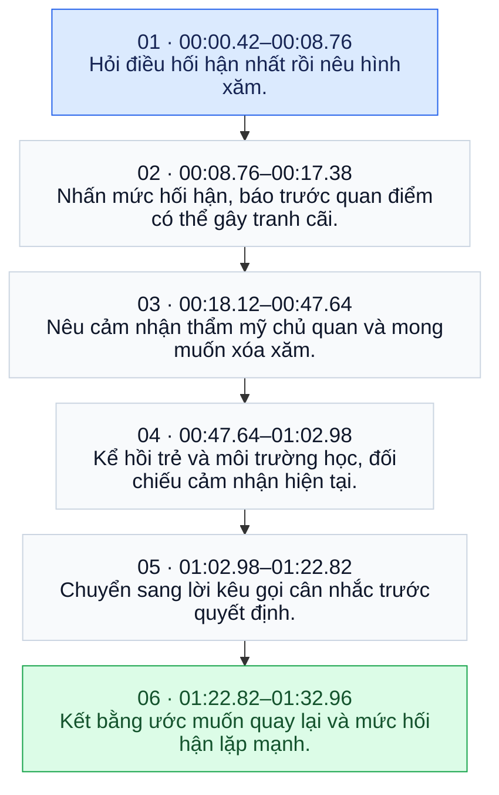

# Nêu điều hối hận nhất, rồi trả lời bằng quan điểm cá nhân dễ tranh luận

[Video gốc — @halinhofficial](https://www.tiktok.com/@halinhofficial/video/7644445587944836370) · ID `7644445587944836370`

**Tóm tắt cách kể:** Cực đại hóa một trải nghiệm cá nhân → trả đối tượng hối hận → tự báo ranh giới tranh cãi → lý do và đối chiếu tuổi trước/sau → kêu gọi người khác cân nhắc. Độ căng đến từ góc nhìn đổi qua thời gian và khả năng bất đồng, không phải phát hiện khoa học.

[Sơ đồ diễn biến](#mindmap) · [Diễn biến](#dien-bien) · [Nhịp cảm xúc](#cam-xuc) · [Cách áp dụng](#ap-dung)

## Sơ đồ diễn biến

Đọc từ trên xuống: mỗi hộp là một nhịp theo mốc ASR hoặc khung hình được ghi trong phân tích. Xanh dương là mở đầu, xanh lá là nhịp cuối. Chi tiết và giới hạn nằm trong phân tích bên dưới.

[Mã Mermaid riêng](../mindmaps/7644445587944836370.mmd)

## Dữ liệu và nguồn

**Cách thể hiện:** Nói trực diện/tiểu phẩm bán hàng

**Phạm vi học:** Học cách chia thông tin theo hình và ASR, giữ giới hạn từng ca.

**Ngữ cảnh thương mại:** Chưa xác nhận tài trợ; nhận diện thương hiệu/quảng bá quan sát được nằm trong phân tích.

- Đăng: 2026-05-27T05:53:11+00:00. Metadata lấy: 2026-11-15T04:34:22.099261+00:00.
- **12,300,000 view**; thích 494,000; bình luận 11,400; chia sẻ 66,000; lưu 15,448. Dấu phẩy tách hàng nghìn.
- Thời lượng media: 93.43s.
- **4.32× P50** 2,850,000 của 150 bài đủ 48h trong snapshot kênh. Clip có trong cửa sổ baseline. Không phải thống kê toàn bộ kênh.

## Phạm vi kiểm

Đã tải media, xem khung chọn lọc và đọc ASR có mốc lưu lúc 2026-11-15T04:36:02.927228+00:00. Đối chiếu cùng ID và thời lượng, lệch 0.001s. **Chưa nghe toàn âm hoặc xem chuyển động liên tục; chưa xác nhận toàn văn ASR hay mọi dữ kiện trong clip.**

Media SHA256: `2502133ef93cb95ba8006ea8eccdc1422ac6fdb167fc8777824a48c36f0ff4a0`. [Metadata và các hash khác](../videos.json). Video/ASR đầy đủ giữ ở bộ nghiên cứu cục bộ; bản chia sẻ giữ link gốc, trích ngắn và phân tích riêng.

## Lời hứa và câu hỏi trung tâm

**Lời hứa:** Nói rõ lựa chọn nào khiến tác giả hối hận nhất và vì sao góc nhìn đã đổi.

**Câu hỏi:** Điều gì đã khiến người nói đổi cách nhìn về một lựa chọn cá nhân?

## Mở đầu: lời và hình

ASR 0,42–5,8 giây nêu điều hối hận nhất ở tuổi hiện tại và lặp câu hỏi; 5,8–8,76 giây mới nêu hình xăm. Khung 1 giây tay chỉ lên, 2–3 giây che trán, làm lời hối hận hiện ra qua biểu cảm. Phần mở dùng tự bộc lộ với mức độ cực đại, sau đó chủ động báo đây là ý kiến có thể gây tranh cãi. Đánh giá thẩm mỹ trong lời là quan điểm tác giả, không phải kết luận về người có hình xăm.

## Nghiên cứu phần mở

Diễn giải từ bằng chứng đã lưu; lý do gây chú ý là giả thuyết biên tập, chưa đo retention.

**Cửa sổ quan sát:** 00:00.42–00:08.76

| Lớp | Quan sát/diễn giải |
|---|---|
| Lời | Câu hỏi điều hối hận nhất rồi trả hình xăm ở 5,8–8,76 giây. |
| Hình | Cận mặt, ngón tay nhấn tại 1 giây, che trán tại 2–3 giây. |
| Chữ trên hình | Không thấy chữ hook trong khung mở. |

**Động tác gây chú ý:** Bộc lộ điều cực đại trong trải nghiệm cá nhân, rồi hé đối tượng.

**Vì sao có thể muốn dừng lại:** Giả thuyết: người xem muốn biết điều gì khiến một người bộc lộ hối hận mạnh như vậy.

**Điều còn muốn biết:** Lựa chọn nào, và vì sao hiện tại người nói nghĩ khác?

**Thông tin chưa cho biết:** Đối tượng chỉ được nêu sau câu hỏi; nguyên nhân kéo sang phần sau.

**Nhịp nối có gì mới:** Nêu đối tượng xong chuyển sang lý do thẩm mỹ và hoàn cảnh quá khứ.

**Mốc trả/giới hạn giải đáp:** 00:18.12–01:02.98 — Có lời giải cá nhân: cảm nhận hiện tại và đối chiếu hồi trẻ; chưa có bằng chứng kết luận chung về hình xăm.

**Tóm cấu trúc bằng hai câu:** Nêu một lựa chọn quá khứ mà góc nhìn hiện tại đã đổi. Trả lựa chọn sớm rồi giải thích điều gì thay đổi giữa hai thời điểm.

**Chuyển sang ngách khác:** Chuyển được quan hệ lựa chọn trước → tiêu chí sau đã đổi; sang finance phải bổ sung bối cảnh và dữ liệu, không lấy hối tiếc cá nhân làm khuyến nghị đầu tư.

**Điều không chuyển theo:**

- Ngôn ngữ hạ thấp người có hình xăm
- Dùng tranh cãi như mục tiêu duy nhất
- Tư vấn sức khỏe hoặc điều trị từ lời kể

**Phạm vi:** 12 khung + toàn ASR, chưa nghe giọng để xác định sắc thái.

> Điều hối hận nhất

Trích ASR ngắn từ segment 00:00.42–00:01.54. Trích ASR ngắn chưa nghe so khớp toàn âm; không khẳng định cả segment là ba giây. Xem phạm vi/giới hạn từng ca. Dấu … nghĩa là bỏ bớt, không khẳng định toàn câu vừa ba giây.

| Mốc khung đã xem | Điều quan sát được |
|---|---|
| 00:00.00 | Cận mặt trong phòng, trang phục ở nhà, chưa có chữ dẫn nội dung. |
| 00:01.00 | Một ngón tay giơ trước mặt như nhấn một điểm. |
| 00:02.00 | Bàn tay che một phần mặt và trán; mắt nhắm. |
| 00:14.02 | Tay gần miệng khi ASR nói khả năng có tranh cãi. |
| 00:42.05 | Vẫn cận mặt, tay ở vùng miệng trong phần kể mong muốn thay đổi. |
| 01:10.08 | Biểu cảm nhấn mạnh khi ASR chuyển sang người trẻ cân nhắc quyết định. |
| 01:32.43 | Cùng bố cục cận mặt ở cuối, không có thẻ kết. |

Không suy chuyển động giữa các khung từ ảnh tĩnh.

## Diễn biến và nhiệm vụ từng beat

| Mốc ASR | Diễn giải riêng | Vai trò |
|---|---|---|
| 00:00.42–00:08.76 | Hỏi điều hối hận nhất rồi nêu hình xăm. | Mở khoảng trống cá nhân và trả danh tính vấn đề. |
| 00:08.76–00:17.38 | Nhấn mức hối hận, báo trước quan điểm có thể gây tranh cãi. | Đặt người xem trước một quan điểm nhạy cảm. |
| 00:18.12–00:47.64 | Nêu cảm nhận thẩm mỹ chủ quan và mong muốn xóa xăm. | Giải thích lý do cá nhân; không xác nhận tính đúng hay phương pháp xóa. |
| 00:47.64–01:02.98 | Kể hồi trẻ và môi trường học, đối chiếu cảm nhận hiện tại. | Tạo trục thời gian giữa lựa chọn cũ và góc nhìn mới. |
| 01:02.98–01:22.82 | Chuyển sang lời kêu gọi cân nhắc trước quyết định. | Mở trải nghiệm cá nhân thành thông điệp rộng hơn. |
| 01:22.82–01:32.96 | Kết bằng ước muốn quay lại và mức hối hận lặp mạnh. | Khép cảm xúc, không đưa bằng chứng ngoài tự thuật. |

## Nhịp cảm xúc — giả thuyết biên tập

Các trạng thái dưới đây là cách đọc câu chuyện từ bằng chứng, không phải cảm xúc người xem đã đo hoặc biểu đồ retention.

| Mốc | Cảm xúc có thể gợi | Bằng chứng | Cách diễn giải |
|---|---|---|---|
| 00:00.42–00:08.76 | Mở khoảng trống cá nhân và trả danh tính vấn đề. | Hỏi điều hối hận nhất rồi nêu hình xăm. | Đây là diễn giải tác dụng của trình tự, không xác nhận cảm xúc thực tế của khán giả. |
| 00:08.76–00:17.38 | Đặt người xem trước một quan điểm nhạy cảm. | Nhấn mức hối hận, báo trước quan điểm có thể gây tranh cãi. | Đây là diễn giải tác dụng của trình tự, không xác nhận cảm xúc thực tế của khán giả. |
| 00:18.12–00:47.64 | Giải thích lý do cá nhân; không xác nhận tính đúng hay phương pháp xóa. | Nêu cảm nhận thẩm mỹ chủ quan và mong muốn xóa xăm. | Đây là diễn giải tác dụng của trình tự, không xác nhận cảm xúc thực tế của khán giả. |
| 00:47.64–01:02.98 | Tạo trục thời gian giữa lựa chọn cũ và góc nhìn mới. | Kể hồi trẻ và môi trường học, đối chiếu cảm nhận hiện tại. | Đây là diễn giải tác dụng của trình tự, không xác nhận cảm xúc thực tế của khán giả. |
| 01:02.98–01:22.82 | Mở trải nghiệm cá nhân thành thông điệp rộng hơn. | Chuyển sang lời kêu gọi cân nhắc trước quyết định. | Đây là diễn giải tác dụng của trình tự, không xác nhận cảm xúc thực tế của khán giả. |
| 01:22.82–01:32.96 | Khép cảm xúc, không đưa bằng chứng ngoài tự thuật. | Kết bằng ước muốn quay lại và mức hối hận lặp mạnh. | Đây là diễn giải tác dụng của trình tự, không xác nhận cảm xúc thực tế của khán giả. |

## Cách phân phối thông tin

| Mốc | Động tác viết | Vì sao đáng chú ý |
|---|---|---|
| 00:00.42–00:08.76 | Mở khoảng trống cá nhân và trả danh tính vấn đề. | Hỏi điều hối hận nhất rồi nêu hình xăm. |
| 00:08.76–00:17.38 | Đặt người xem trước một quan điểm nhạy cảm. | Nhấn mức hối hận, báo trước quan điểm có thể gây tranh cãi. |
| 00:18.12–00:47.64 | Giải thích lý do cá nhân; không xác nhận tính đúng hay phương pháp xóa. | Nêu cảm nhận thẩm mỹ chủ quan và mong muốn xóa xăm. |
| 00:47.64–01:02.98 | Tạo trục thời gian giữa lựa chọn cũ và góc nhìn mới. | Kể hồi trẻ và môi trường học, đối chiếu cảm nhận hiện tại. |
| 01:02.98–01:22.82 | Mở trải nghiệm cá nhân thành thông điệp rộng hơn. | Chuyển sang lời kêu gọi cân nhắc trước quyết định. |
| 01:22.82–01:32.96 | Khép cảm xúc, không đưa bằng chứng ngoài tự thuật. | Kết bằng ước muốn quay lại và mức hối hận lặp mạnh. |

## Giải đáp và cách kết

Kết bằng tự thuật hối hận được nhấn lại. Không có đối chiếu quan điểm khác hay bằng chứng khái quát; clip trả câu hỏi cá nhân, không xác lập kết luận về giá trị hình xăm.

## Điểm mạnh có dẫn chứng

- **Có câu hỏi giới hạn trong chính trải nghiệm người kể** — 0,42–8,76 giây điều hối hận được nêu rồi trả.

- **Có đối chiếu trước–sau** — 47,64–62,98 giây kể hoàn cảnh trẻ và góc nhìn hiện tại.

## Điểm yếu và điều không nên bắt chước

- **Quan điểm cá nhân bị phát biểu như đánh giá bao quát** — 18,12–33,2 giây dùng đánh giá thẩm mỹ hạ thấp; không đủ bằng chứng khái quát.

- **Lặp cường độ cảm xúc nhiều hơn thêm bằng chứng** — Các nhịp 8,76–10,32;46,34–47,64;57,48–62,98;90,1–92,96 cùng nhấn hối hận.

## Khả năng được chia sẻ — chưa kiểm chứng

Không có dữ liệu phân phối/retention để kết luận vì sao viral. Các ý sau chỉ là giả thuyết để thử:

- Tình huống có thể được gửi vì người xem nhận ra hành vi quen thuộc; chưa đọc dữ liệu chia sẻ hay bình luận để xác nhận.

## Chuyển cơ chế sang bài mới

Có thể học việc đặt một lựa chọn quá khứ cạnh góc nhìn hiện tại, nêu lý do đổi ý. Với finance phải có điều kiện và dữ liệu để tránh biến cảm giác cá nhân thành kết luận về mọi nhà đầu tư; không học lời hạ thấp thẩm mỹ hay tạo tranh cãi nhằm công kích.

- Giữ chủ thể tôi và nêu hoàn cảnh khi kể thay đổi quan điểm.

- Cho lý do đổi ý, không coi mức cảm xúc mạnh là bằng chứng phổ quát.

- Không chuyển công kích thẩm mỹ hay kích động tranh cãi sang kịch bản.

- Không đưa tư vấn xóa xăm hay hứa kết quả điều trị từ tự thuật.

Không dùng bài chuyển thể chưa được người dùng duyệt làm mẫu giọng lâu dài.

## Giới hạn còn lại

- Đã xem 12 khung trích có timestamp từ bản tải mới và đọc ASR khi có; chưa nghe âm hoặc xem video liên tục.

- Cách gây chú ý và giữ chân là giả thuyết biên tập, không phải số đo retention hay quan hệ nhân quả.

- Đánh giá hình xăm là quan điểm thẩm mỹ cá nhân của tác giả; không đồng nhất với sự thật hay giá trị con người.

- Không kiểm chứng chuyện tuổi, nghề nghiệp hay trải nghiệm, và không đưa lời khuyên y tế.
