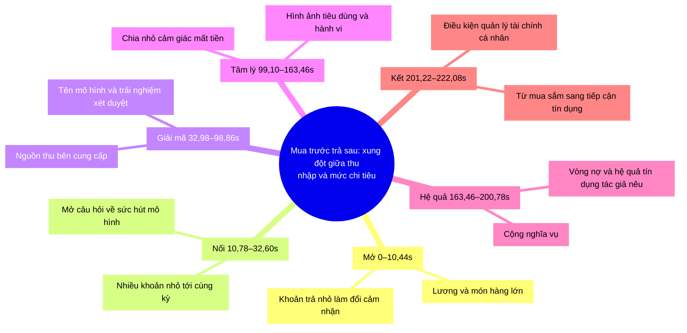

# Mua trước trả sau: xung đột giữa thu nhập và mức chi tiêu

[Video gốc — @nqs.kinhte](https://www.tiktok.com/@nqs.kinhte/video/7644506205179612423) · ID `7644506205179612423`

**Tóm tắt cách kể:** Mâu thuẫn định lượng gần người xem → làm lộ cảm giác rẻ do chia nhỏ khoản trả → hỏi động cơ kinh doanh phía sau → quay lại tổng nghĩa vụ. Bằng chứng cho cơ chế là trình tự các đoạn ASR và tiền/điện thoại trong những khung mở, không phải bằng chứng nhân quả về lượt xem.

[Mindmap](#mindmap) · [Diễn biến](#dien-bien) · [Nhịp cảm xúc](#cam-xuc) · [Cách áp dụng](#ap-dung)

## Dữ liệu và nguồn

- Đăng: 2026-05-27T09:48:25+00:00. Metadata lấy: 2026-11-15T03:29:32.652796+00:00.
- **3,300,000 view**; thích 99,500; bình luận 1,913; chia sẻ 26,200; lưu 8,585. Dấu phẩy tách hàng nghìn.
- Thời lượng media: 223.56s.
- **14.45× P50** 228,300 của 149 bài đủ 48h trong snapshot kênh. Clip có trong cửa sổ baseline. Không phải thống kê toàn bộ kênh.

## Phạm vi kiểm

Đã tải lại media, xem khung chọn lọc và đọc ASR có mốc lưu lúc 2026-11-05T12:43:01.682479+00:00. Đối chiếu cùng ID và thời lượng, lệch 0.0679s. **Chưa nghe toàn âm hoặc xem chuyển động liên tục; chưa xác nhận toàn văn ASR hay mọi dữ kiện kinh tế trong clip.**

Media SHA256: `2db5e7b0fc5669f5d1a81964cde51e93ed0239064c471941d554651c9ec3c21d`. [Metadata và các hash khác](../videos.json). Video/ASR đầy đủ giữ ở bộ nghiên cứu cục bộ; bản chia sẻ giữ link gốc, trích ngắn và phân tích riêng.

## Lời hứa và câu hỏi trung tâm

**Lời hứa:** Giải thích vì sao một món hàng lớn lại tạo cảm giác có thể mua ngay khi nghĩa vụ được chia nhỏ, ai hưởng lợi và hệ quả cộng dồn nằm ở đâu.

**Câu hỏi:** Khả năng trả một khoản nhỏ mỗi kỳ có đang bị nhầm với khả năng gánh toàn bộ quyết định mua?

## Mở đầu: lời và hình

ASR 0–7,56 giây đặt mức lương bên cạnh giá một điện thoại cao hơn nhiều, sau đó thu nhỏ nghĩa vụ thành khoản trả mỗi tháng. Cùng thời gian đó, các khung 0–5 giây cho thấy một nhân vật quay lưng, tiền ở một tay và điện thoại ở tay còn lại. Đây là một tình huống định lượng có mâu thuẫn, chưa phải phần định nghĩa sản phẩm tín dụng.

> Lương 12 triệu, nhưng chốt đơn iPhone 40 triệu …

Trích ASR ngắn từ segment 00:00.00–00:04.12. Đoạn ASR ngắn, chưa đối chiếu toàn bộ âm; xem giới hạn từng ca. Dấu … nghĩa là bỏ bớt, không khẳng định toàn câu vừa ba giây.

| Mốc khung đã xem | Điều quan sát được |
|---|---|
| 00:00.00 | Nhân vật nam mặc áo khoác quay lưng, đứng giữa nền có họa tiết; chưa có người dẫn ngồi bàn. |
| 00:01.00 | Tiền và dòng chữ chỉ mức lương xuất hiện cạnh tay nhân vật. |
| 00:03.00 | Điện thoại màu cam ở phía tay còn lại; lời ASR đang nói về khoản chi lớn so với lương. |
| 00:05.00 | Khung trích tiếp tục giữ cả thông tin thu nhập và một con số khoản trả nhỏ hơn, làm phép đối chiếu bằng hình. |
| 01:07.07 | Người dẫn nữ ngồi tại bàn trên nền tối, phụ đề hai đến ba dòng và vạch vàng bên trái; tại vị trí này ASR bắt đầu giải thích một nguồn thu của mô hình. |
| 01:40.60 | Ảnh cửa hàng điện máy trả góp nằm trong khung bo góc, có ghi nguồn Internet. |
| 02:47.67 | Ảnh người đẩy xe mua sắm đi cùng nhãn đỏ về ảo giác tài chính; đây là một ví dụ hình phục vụ phần cảnh báo. |
| 03:42.56 | Người dẫn xuất hiện ở khung kết, phụ đề nhắc điều kiện thiếu khả năng quản lý tài chính cá nhân. |

Không suy chuyển động giữa các khung từ ảnh tĩnh.

## Diễn biến và nhiệm vụ từng beat

| Mốc ASR | Diễn giải riêng | Vai trò |
|---|---|---|
| 00:00.00–00:10.44 | Đặt lương, giá điện thoại và khoản trả tháng cạnh nhau, rồi đổi từ cảm giác hợp lý sang cảnh báo mắc bẫy. | Tạo mâu thuẫn gần đời sống và đảo cách người xem đánh giá khoản chi. |
| 00:10.78–00:32.60 | Mô tả các khoản trả nhỏ cộng lại khi nhận lương, sau đó đưa số liệu người dùng trẻ và đặt câu hỏi về sức hút của mô hình. | Nối chuyện cá nhân sang hiện tượng rộng hơn; các tỷ lệ là luận điểm nguồn cần kiểm riêng. |
| 00:32.98–01:01.70 | Gọi tên bản chất cho vay tiêu dùng, so cách diễn đạt và xét duyệt với ngân hàng truyền thống. | Giải mã sự tiện lợi mà phần mở đã cho thấy. |
| 01:02.00–01:38.86 | Đặt câu hỏi bên cung cấp kiếm tiền từ đâu khi quảng bá không thu lãi, rồi trình bày hoa hồng và phí chậm trả. | Mở một câu hỏi kinh doanh thứ hai và trả lời trước khi sang tâm lý người mua. |
| 01:39.10–02:43.46 | Nối tăng trưởng nền tảng với việc giảm cảm giác mất tiền, so số tiền lớn trả ngay và số nhỏ trả từng kỳ, rồi kể về nhu cầu giữ hình ảnh tiêu dùng. | Giải thích vì sao một khoản vay có thể được cảm nhận thành khả năng mua sắm. |
| 02:43.46–03:20.78 | Quay lại tổng nghĩa vụ thanh toán, mô tả vòng nợ và tác giả nêu hệ quả tín dụng dài hạn. | Tăng hệ quả và trả lại câu cảnh báo ở mở đầu; phần quy định/hệ thống tín dụng chưa được kiểm chứng trong lượt phân tích này. |
| 03:21.22–03:42.08 | Đặt mua sắm trực tuyến như lần đầu một số người tiếp cận tín dụng, kết bằng khả năng thành khoản nợ xấu khi thiếu quản lý. | Kết có điều kiện, mở rộng từ món điện thoại sang năng lực tài chính cá nhân. |

## Nhịp cảm xúc — giả thuyết biên tập

Các trạng thái dưới đây là cách đọc câu chuyện từ bằng chứng, không phải cảm xúc người xem đã đo hoặc biểu đồ retention.

| Mốc | Cảm xúc có thể gợi | Bằng chứng | Cách diễn giải |
|---|---|---|---|
| 00:00.00–00:07.56 | Nhận diện rồi tưởng hợp lý | Lương, giá điện thoại và khoản trả tháng được đặt cạnh nhau. | Sự cụ thể cho khán giả tự so với tình huống của mình trước khi nghe định nghĩa. |
| 00:07.84–00:32.60 | Bị đổi đánh giá | Cảnh báo nối khoản nhỏ với tổng hóa đơn khi nhận lương. | Cùng món hàng được đổi từ cơ hội tiêu dùng sang nghĩa vụ; hiệu quả cảm xúc chưa được đo. |
| 00:32.98–01:38.86 | Muốn biết cơ chế phía sau | Tên mô hình, cách tiếp cận và các nguồn thu được lần lượt đưa ra. | Câu hỏi về bên bán phát sinh từ cảm giác tiện lợi đã thấy ở mở. |
| 02:00.22–02:43.46 | Hiểu vì sao mình có thể bị cuốn vào | Tác giả quay về cảm giác đau khi trả tiền và nhu cầu giữ hình ảnh tiêu dùng. | Một cơ chế tâm lý được dùng để liên kết mô hình với hành vi, chưa chứng minh đúng cho mọi người. |
| 02:43.46–03:20.78 | Lo hệ quả cộng dồn | Nhiều nghĩa vụ nhỏ được gom thành vòng nợ và hệ quả tín dụng. | Tăng stakes bằng sự tích lũy, không phải một biến cố hoàn toàn mới. |
| 03:21.22–03:42.08 | Nhìn lại cách tiếp cận tín dụng | Kết chuyển từ điện thoại sang lần đầu tiếp xúc tài chính cá nhân. | Kết có điều kiện giúp bớt tuyệt đối hơn các câu cảnh báo mạnh giữa bài. |

## Cách phân phối thông tin

| Mốc | Động tác viết | Vì sao đáng chú ý |
|---|---|---|
| 00:00.00–00:10.44 | Đặt ba con số rồi đổi khung đánh giá | Món hàng lớn có vẻ nhỏ khi tách kỳ trả; hình tiền/điện thoại giữ các đại lượng trên cùng cảnh. |
| 00:32.98–01:01.70 | Gọi tên sau khi mô tả hành vi | Khái niệm giải thích một việc người xem vừa hình dung, không đứng riêng như bài định nghĩa. |
| 01:02.00–01:38.86 | Mở câu hỏi về nguồn thu | Đổi từ người mua sang bên cung cấp để câu chuyện có một tầng mới. |
| 02:00.22–02:59.22 | Quay lại phép chia nhỏ rồi cộng lại | Tác giả lặp mốc ban đầu nhưng đổi kết quả khi nhiều nghĩa vụ cùng đến hạn. |
| 03:05.90–03:42.08 | Kéo hệ quả theo thời gian | Từ hóa đơn hiện tại đến khả năng tiếp cận tín dụng sau này; claim quy định cần kiểm riêng. |

## Giải đáp và cách kết

Kết trở lại việc mua trước trả sau có hai mặt: tạo khả năng chi tiêu dễ hơn nhưng có thể dẫn tới hệ quả tín dụng khi người dùng thiếu quản lý. Nó không kết bằng một mẹo mua hàng hay CTA tách rời chủ đề.

## Điểm mạnh có dẫn chứng

- **Mở bằng phép đối chiếu có thể nhìn được** — 0–7,56 giây và các khung 1, 3, 5 giây giữ tiền/điện thoại/khoản trả trong cùng tình huống.

- **Câu hỏi tiếp có lý do xuất hiện** — 62 giây hỏi nguồn thu ngay sau phần quảng bá không lãi mà tác giả mô tả.

- **Đoạn cộng nghĩa vụ trả lại điểm mù ở đầu** — 168,50–179,22 giây cho thấy nhiều khoản nhỏ cùng lúc.

## Điểm yếu và điều không nên bắt chước

- **Phần cảnh báo có lặp ý mạnh** — Cảnh báo xuất hiện ở 7,84–13,24; 87,30–98,86; 163,46–179,22 giây, chưa biết các lần lặp có ích hay làm chậm.

- **Số và cơ chế nền tảng được nói khá chắc** — 20,88–32,60; 68,46–81,14; 99,10–109,94 giây cần nguồn độc lập.

- **Không nên biến một mô hình thành phán xét toàn bộ sản phẩm** — Ngôn ngữ cảnh báo giữa bài cần được giữ điều kiện như phần kết 213,44–222,08 giây.

## Khả năng được chia sẻ — chưa kiểm chứng

Không có dữ liệu phân phối/retention để kết luận vì sao viral. Các ý sau chỉ là giả thuyết để thử:

- Một quyết định mua quen thuộc gắn với số cụ thể có thể khơi tự đối chiếu hoặc gửi cho người đang trả góp; chưa có dữ liệu bình luận/chia sẻ giải thích động cơ.

- Đổi giữa trả nhỏ theo kỳ và tổng nghĩa vụ có thể làm bài dễ tóm lại; chưa có kiểm tra mức hiểu.

## Chuyển cơ chế sang bài mới

Khi học cách mở, chọn một quyết định tài chính có hai cách nhìn cùng tồn tại, biểu diễn hai đại lượng trên cùng hình rồi dành phần sau giải thích chỗ người xem dễ bỏ sót. Cần làm rõ kỳ hạn, tổng trả và nguồn con số; không dùng các mức lương/giá trong clip làm khuyến nghị hay bài tính hoàn chỉnh.

- Nếu dùng số, các số phải cùng lịch và đủ điều kiện để không biến tương phản thành phép tính sai.

- Dùng hình để giữ các đại lượng cạnh nhau, tránh chỉ đọc một chuỗi số.

- Câu hỏi bên cung cấp kiếm gì nên trả lời trước khi mở sang hệ quả mới.

- Không sao chép tỷ lệ người dùng hoặc hệ quả tín dụng của clip như dữ kiện đã xác nhận.

Không dùng bài chuyển thể chưa được người dùng duyệt làm mẫu giọng lâu dài.

## Mindmap

[Mã Mermaid riêng](../mindmaps/7644506205179612423.mmd)

## Giới hạn còn lại

- Đã đọc ASR có timestamp và xem contact sheet 12 khung lấy từ bản video mới tải; chưa nghe âm và chưa xem toàn chuyển động liên tục.

- ASR có lỗi nhận dạng tên sản phẩm và từ chỉ mua trước trả sau; các diễn giải trên dựa cấu trúc lời, không phải bản lời đã hiệu đính bằng tai.

- Các tỷ lệ người dùng, giá trị giỏ hàng, cách nền tảng xét duyệt và hệ quả CIC là phát biểu tác giả, chưa kiểm nguồn độc lập.

- Phần cảnh báo tâm lý và hệ quả nợ được lặp qua nhiều đoạn; lượt xem cao không cho biết người xem có theo đến các đoạn đó hay không.

- Bản này chỉ phân tích cách kể, không xác nhận mọi sản phẩm mua trước trả sau đều có cùng phí hoặc cùng cách ghi nhận tín dụng.
