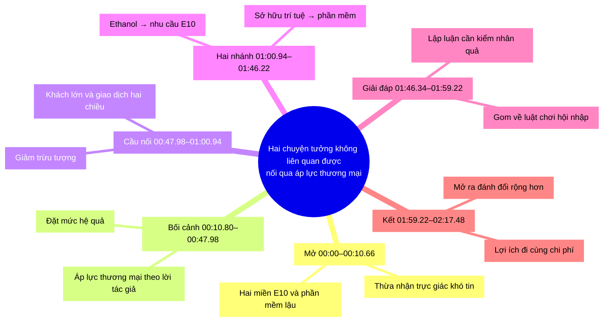

# Hai chuyện tưởng không liên quan được nối qua áp lực thương mại

[Video gốc — @huyen_chungkhoan101](https://www.tiktok.com/@huyen_chungkhoan101/video/7651946778392153362) · ID `7651946778392153362`

**Tóm tắt cách kể:** Hai chuyện khác miền → thừa nhận trực giác chúng không liên quan → dựng bối cảnh chung → giải từng nhánh → gom về một lực đẩy.

[Mindmap](#mindmap) · [Diễn biến](#dien-bien) · [Nhịp cảm xúc](#cam-xuc) · [Cách áp dụng](#ap-dung)

## Dữ liệu và nguồn

- Đăng: 2026-06-16T11:01:46+00:00. Metadata lấy: 2026-11-15T03:45:41.351263+00:00.
- **1,500,000 view**; thích 62,300; bình luận 967; chia sẻ 9,221; lưu 6,460. Dấu phẩy tách hàng nghìn.
- Thời lượng media: 137.61s.
- **19.63× P50** 76,400 của 150 bài đủ 48h trong snapshot kênh. Clip có trong cửa sổ baseline. Không phải thống kê toàn bộ kênh.

## Phạm vi kiểm

Đã tải lại media, xem khung chọn lọc và đọc ASR có mốc lưu lúc 2026-11-05T13:14:09.750680+00:00. Đối chiếu cùng ID và thời lượng, lệch 0.0561s. **Chưa nghe toàn âm hoặc xem chuyển động liên tục; chưa xác nhận toàn văn ASR hay mọi dữ kiện kinh tế trong clip.**

Media SHA256: `8ab2af32129e6394e350550ed49ebbd51db08bbdfbfe9df7dcdc195762e61957`. [Metadata và các hash khác](../videos.json). Video/ASR đầy đủ giữ ở bộ nghiên cứu cục bộ; bản chia sẻ giữ link gốc, trích ngắn và phân tích riêng.

## Lời hứa và câu hỏi trung tâm

**Lời hứa:** Giải thích vì sao hai thay đổi khác miền có thể xuất hiện gần nhau, theo một nguyên nhân chung.

**Câu hỏi:** Hai hiện tượng được nối bởi bối cảnh nào, và từng nhánh nối bằng mắt xích gì?

## Mở đầu: lời và hình

Lời mở đặt xăng E10 cạnh việc xử lý phần mềm lậu, hai chủ đề khác miền, rồi thừa nhận cảm giác vô lý trước khi hứa chỉ ra một bản chất chung. Khung 0–5 giây giữ người dẫn và một câu hỏi lớn về thời điểm hai chuyện cùng được kích hoạt, nên lời và chữ cùng đặt một nút cần gỡ.

> Các bạn có tin là chuyển đổi sang E10

Trích ASR ngắn từ segment 00:00.00–00:01.72. Đoạn ASR ngắn, chưa đối chiếu toàn bộ âm; xem giới hạn từng ca. Dấu … nghĩa là bỏ bớt, không khẳng định toàn câu vừa ba giây.

| Mốc khung đã xem | Điều quan sát được |
|---|---|
| 00:00.00 | Người dẫn cầm micro giữa khung; chữ lớn đặt hai chủ đề E10 và phần mềm bản quyền trên cùng một câu hỏi. |
| 00:05.00 | Câu hỏi mở vẫn giữ trên màn hình, chưa có đồ thị hay danh sách trả lời. |
| 00:20.64 | Một bảng số và nhãn nguồn CNN/VTVdigital xuất hiện, minh họa đoạn chuyển sang áp lực thương mại. |
| 01:22.57 | Sơ đồ hàng nhập khẩu dẫn tới ethanol rồi xăng E10, cụ thể hóa nhánh giải thích thứ nhất. |
| 01:43.21 | Hai mốc thời gian và biểu tượng phần mềm được đặt thành một chuỗi; màn hình còn có nhãn khẳng định hai việc không trùng hợp. |
| 02:16.61 | Khung trở lại người dẫn, không có thêm một dữ kiện mới trên sơ đồ. |

Không suy chuyển động giữa các khung từ ảnh tĩnh.

## Diễn biến và nhiệm vụ từng beat

| Mốc ASR | Diễn giải riêng | Vai trò |
|---|---|---|
| 00:00.00–00:10.66 | Đặt hai hiện tượng khác miền, thừa nhận khó tin, rồi hỏi nguyên nhân chung. | Tạo tò mò từ mối nối, không từ việc giấu tên chủ đề. |
| 00:10.80–00:47.98 | Nêu bối cảnh thuế đối ứng, phản ứng thị trường và thặng dư thương mại theo lời tác giả. | Dựng một sức ép đủ lớn để giải thích vì sao hai chuyện có thể liên quan. |
| 00:47.98–01:00.94 | Chuyển cán cân thương mại thành tình huống khách hàng mua nhiều nhưng chưa được mua lại tương xứng. | Đổi quan hệ vĩ mô thành quan hệ giao dịch người xem hình dung được. |
| 01:00.94–01:32.34 | Tách nhánh tăng nhập khẩu, rồi nối ethanol với nhu cầu chuyển sang E10. | Trả nửa thứ nhất của câu hỏi bằng chuỗi nhu cầu và nguồn cung. |
| 01:32.34–01:46.22 | Chuyển sang nhánh sở hữu trí tuệ và hành động với phần mềm lậu. | Giữ cùng bối cảnh nhưng đổi miền sự kiện; nhịp hỏi nối báo trước nửa còn lại. |
| 01:46.34–01:59.22 | Gộp hai nhánh dưới một cách giải thích về luật chơi và sức ép hội nhập. | Đưa câu trả lời chung mà phần mở đã hứa. |
| 01:59.22–02:17.48 | Mở rộng sang lợi ích và chi phí tham gia dòng vốn/công nghệ quốc tế. | Đổi đáp án của hai sự kiện thành một nhận định rộng để chốt bài. |

## Nhịp cảm xúc — giả thuyết biên tập

Các trạng thái dưới đây là cách đọc câu chuyện từ bằng chứng, không phải cảm xúc người xem đã đo hoặc biểu đồ retention.

| Mốc | Cảm xúc có thể gợi | Bằng chứng | Cách diễn giải |
|---|---|---|---|
| 00:00.00–00:10.66 | Ngạc nhiên và nghi ngờ | Hai chủ đề được ghép, rồi người dẫn tự nêu cảm giác vô lý. | Có thể tạo nhu cầu kiểm tra một mối nối lạ; chưa có số đo tò mò. |
| 00:10.80–00:47.98 | Áp lực | Lời chuyển sang thuế và thiệt hại/thặng dư thương mại. | Tăng mức đặt cược để mối nối không còn là một câu đố nhỏ. |
| 00:47.98–01:00.94 | Dễ hình dung hơn | Ẩn dụ khách mua nhiều nhưng không được mua lại. | Giảm tải trừu tượng trước hai nhánh dài. |
| 01:00.94–01:46.22 | Chờ đủ hai vế | Nhánh E10 được giải trước, nhánh sở hữu trí tuệ theo sau. | Danh sách hai phần cho người xem biết còn thiếu phần nào. |
| 01:46.34–01:59.22 | Cảm giác ráp đủ | Hai nhánh được gộp về cùng một cách lý giải. | Đây là điểm giải đáp trong cấu trúc, không phải chứng minh thực nghiệm. |
| 01:59.22–02:17.48 | Suy ngẫm về đánh đổi | Kết nói đến cái giá của việc hưởng lợi từ bên ngoài. | Mở mức liên quan rộng hơn hai sự kiện đầu. |

## Cách phân phối thông tin

| Mốc | Động tác viết | Vì sao đáng chú ý |
|---|---|---|
| 00:00.00–00:10.66 | Đặt cặp lệch miền và tự xử lý phản đối | Người xem biết cả hai đầu cần nối ngay khi mở. |
| 00:47.98–01:00.94 | Ẩn dụ giao dịch | Cho quan hệ áp lực quốc tế một mô hình quen thuộc. |
| 01:00.94–01:46.22 | Tách hai nhánh có thứ tự | Tránh trộn nguyên liệu thương mại với thể chế trong cùng một đoạn. |
| 01:46.34–01:59.22 | Gom nhánh về một nhãn lý giải | Trả câu hỏi chung thay vì chỉ kể hai bản tin song song. |

## Giải đáp và cách kết

Clip trả được mối nối mà chính nó đề xuất: hai việc được gộp vào sức ép hội nhập. Tuy nhiên đây vẫn là lập luận của tác giả; sự trùng thời điểm và sơ đồ nhân quả trên màn hình không đủ tự xác minh nguyên nhân chính sách.

## Điểm mạnh có dẫn chứng

- **Mở có một mâu thuẫn cụ thể chứ không chỉ một từ gây sốc** — 0–10,66 giây đặt hai hiện tượng và hỏi bản chất chung.

- **Có một điểm giải đáp nhận diện được** — 106,34–119,22 giây tổng hợp hai nhánh.

- **Sơ đồ giữa bài thực hiện phần việc giải thích** — Khung 82,57 và 103,21 giây tổ chức từng chuỗi sự kiện.

## Điểm yếu và điều không nên bắt chước

- **Lập luận dễ bị hiểu thành sự thật nhân quả đã chắc** — Các nhánh 60,94–106,22 giây gộp thời điểm và sức ép, nhưng lượt này chưa kiểm nguồn chính sách.

- **Đoạn bối cảnh dài trước khi trả nhánh đầu** — 10,8–60,94 giây chủ yếu dựng nền cho câu hỏi ban đầu.

## Khả năng được chia sẻ — chưa kiểm chứng

Không có dữ liệu phân phối/retention để kết luận vì sao viral. Các ý sau chỉ là giả thuyết để thử:

- Có thể được chia sẻ như một cách nối hai tin đang được bàn cùng lúc; đó là giả thuyết về nhu cầu giải thích, chưa có dữ liệu share theo nhịp.

- Việc có hai đầu sự kiện dễ gọi tên có thể giúp người xem kể lại lập luận ngắn hơn, nhưng không xác minh tính đúng của lập luận.

## Chuyển cơ chế sang bài mới

Học cách tìm một mối nối thật có thể kiểm giữa hai sự kiện và giữ cả hai nhánh trong dàn ý. Khi áp dụng, lời hứa cần được trả bằng bằng chứng; không dùng việc xảy ra gần nhau làm bằng chứng duy nhất cho nguyên nhân.

- Tìm hai hiện tượng có bằng chứng về mắt xích chung, không chỉ giống thời điểm.

- Dựng hai nhánh có độ sâu đủ tương xứng; đừng trả nhánh thứ nhất rồi bỏ quên nhánh thứ hai.

- Tách kỹ thuật tạo mối nối khỏi dữ kiện nguyên nhân chính sách cần kiểm riêng.

Không dùng bài chuyển thể chưa được người dùng duyệt làm mẫu giọng lâu dài.

## Mindmap

[Mã Mermaid riêng](../mindmaps/7651946778392153362.mmd)

## Giới hạn còn lại

- Đã đọc toàn segments ASR có mốc và xem 12 khung mới tải ở contact sheet; chưa nghe âm trực tiếp hoặc xem chuyển động liên tục.

- Mốc là mốc ASR/khung trích, không phải căn chỉnh bằng tai; đoạn không xuất hiện trong các khung không được suy thành một chuyển động cụ thể.

- Đây là phân tích kỹ thuật kể, không xác minh độc lập các khẳng định kinh tế, số liệu hoặc chính sách trong clip.

- Không có retention hay thử A/B; nhịp cảm xúc và khả năng lan truyền dưới đây là diễn giải/giả thuyết, không phải kết quả đo.
