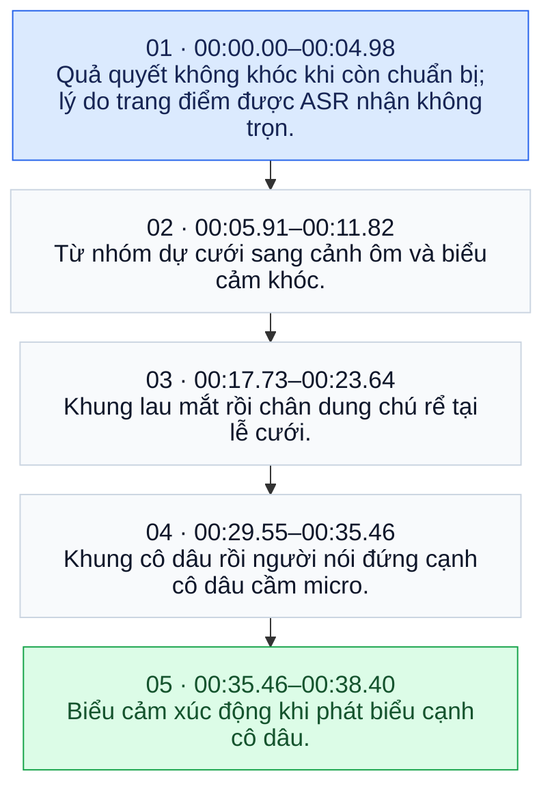

# Lời quả quyết trước đám cưới bị montage cảm xúc bác lại

[Video gốc — @vietphuongthoa98](https://www.tiktok.com/@vietphuongthoa98/video/7653107443475467527) · ID `7653107443475467527`

**Tóm tắt cách kể:** Cam kết chắc chắn trước sự kiện → đặt người nói vào sự kiện giàu tình cảm → montage phản chứng → kết ở vai người phát biểu. Hình sau tự tạo sự hài và xúc động, không cần người dẫn nói rằng lời đầu đã sai.

[Sơ đồ diễn biến](#mindmap) · [Diễn biến](#dien-bien) · [Nhịp cảm xúc](#cam-xuc) · [Cách áp dụng](#ap-dung)

## Sơ đồ diễn biến

Đọc từ trên xuống: mỗi hộp là một nhịp theo mốc ASR hoặc khung hình được ghi trong phân tích. Xanh dương là mở đầu, xanh lá là nhịp cuối. Chi tiết và giới hạn nằm trong phân tích bên dưới.

[Mã Mermaid riêng](../mindmaps/7653107443475467527.mmd)

## Dữ liệu và nguồn

**Cách thể hiện:** Diễn tình huống và montage

**Phạm vi học:** Học cách chia thông tin theo hình và ASR, giữ giới hạn từng ca.

**Ngữ cảnh thương mại:** Chưa xác nhận tài trợ; nhận diện thương hiệu/quảng bá quan sát được nằm trong phân tích.

- Đăng: 2026-06-19T14:05:41+00:00. Metadata lấy: 2026-11-15T04:34:09.384851+00:00.
- **10,200,000 view**; thích 1,100,000; bình luận 5,245; chia sẻ 47,800; lưu 31,586. Dấu phẩy tách hàng nghìn.
- Thời lượng media: 39.40s.
- **4.08× P50** 2,500,000 của 147 bài đủ 48h trong snapshot kênh. Clip có trong cửa sổ baseline. Không phải thống kê toàn bộ kênh.

## Phạm vi kiểm

Đã tải media, xem khung chọn lọc và đọc ASR có mốc lưu lúc 2026-11-15T04:35:40.037087+00:00. Đối chiếu cùng ID và thời lượng, lệch 0.004s. **Chưa nghe toàn âm hoặc xem chuyển động liên tục; chưa xác nhận toàn văn ASR hay mọi dữ kiện trong clip.**

Media SHA256: `ead40757caf885f3e8c7cf859b96e58686ca643e1cd848d58a40977b6b7d6b7b`. [Metadata và các hash khác](../videos.json). Video/ASR đầy đủ giữ ở bộ nghiên cứu cục bộ; bản chia sẻ giữ link gốc, trích ngắn và phân tích riêng.

## Lời hứa và câu hỏi trung tâm

**Lời hứa:** Cho xem khoảng cách giữa lời tự tin trước lễ và phản ứng trong lễ.

**Câu hỏi:** Lời quyết không khóc có giữ được khi sự kiện diễn ra không?

## Mở đầu: lời và hình

ASR 0–3,04 giây nhận một lời quả quyết sẽ không khóc ở đám cưới; tên riêng nhận sai nên không trích. 3,04–4,98 giây có lý do liên quan trang điểm nhưng con số không đủ tin. Khung 2 giây người nói đưa lòng bàn tay ra như nhấn quyết tâm, đến khung 11,82 giây đã có cảnh ôm và nhắm mắt khóc. Câu chuyện dựng một lời hứa có thể bị hình ảnh sau đó phản chứng.

## Nghiên cứu phần mở

Diễn giải từ bằng chứng đã lưu; lý do gây chú ý là giả thuyết biên tập, chưa đo retention.

**Cửa sổ quan sát:** 00:00.00–00:04.98

| Lớp | Quan sát/diễn giải |
|---|---|
| Lời | Lời quả quyết không khóc; đoạn lý do trang điểm nhận dạng kém nên không dùng số. |
| Hình | Đang chuẩn bị, nhìn camera, lòng bàn tay đưa ra ở 2 giây. |
| Chữ trên hình | Không thấy phụ đề hook ở khung mẫu. |

**Động tác gây chú ý:** Lập cam kết rồi hứa ngầm một phép thử.

**Vì sao có thể muốn dừng lại:** Giả thuyết: người xem muốn xem lời chắc chắn có bị sự kiện làm thay đổi.

**Điều còn muốn biết:** Đến lễ, người nói có giữ được lời không?

**Thông tin chưa cho biết:** Phản ứng trong sự kiện chưa cho ở cảnh chuẩn bị.

**Nhịp nối có gì mới:** Cắt từ phòng chuẩn bị sang lễ rồi đưa các phản ứng cảm xúc.

**Mốc trả/giới hạn giải đáp:** 00:11.82–00:17.73 — Hình ôm, nhắm mắt và lau mắt trả lời bằng một phản ứng trái lời quả quyết; không suy diễn câu phát biểu cuối.

**Tóm cấu trúc bằng hai câu:** Cho nhân vật phát biểu một dự đoán về chính mình trước sự kiện. Dùng hình sau sự kiện kiểm tra dự đoán thay vì đọc kết luận.

**Chuyển sang ngách khác:** Chuyển được quan hệ lời dự đoán → bằng chứng trái kỳ vọng; sang finance cần dữ liệu cùng tiêu chí và bối cảnh, vì nước mắt không kiểm chứng lợi nhuận hay chất lượng quyết định.

**Điều không chuyển theo:**

- Tên và số tiền ASR nhận sai
- Suy đoán quan hệ cá nhân
- Lấy xúc động làm chứng cứ tài chính

**Phạm vi:** 12 khung và toàn ASR; lời mở dùng diễn ý, lời cuối không đủ rõ.

> Tôi nhất định sẽ không khóc …

Trích ASR ngắn từ segment 00:00.00–00:03.04. Chỉ trích phần ngắn trước tên sự kiện/người bị nhận dạng sai; chưa nghe so khớp toàn âm. Dấu … nghĩa là bỏ bớt, không khẳng định toàn câu vừa ba giây.

| Mốc khung đã xem | Điều quan sát được |
|---|---|
| 00:00.00 | Người mặc đồ ngủ đang chuẩn bị tóc/trang điểm trong phòng. |
| 00:02.00 | Người nhìn camera và đưa lòng bàn tay ra trước. |
| 00:05.91 | Chuyển sang nhóm người mặc trang phục dự cưới ngoài trời. |
| 00:11.82 | Người tóc ngắn ôm người khác, mắt nhắm và mặt có biểu cảm khóc. |
| 00:17.73 | Hai người đối diện lau vùng mắt trong bối cảnh ngoài trời. |
| 00:35.46 | Người tóc ngắn đứng cạnh cô dâu và cầm micro. |
| 00:38.40 | Khung cuối vẫn ở cạnh cô dâu, người cầm micro có biểu cảm xúc động. |

Không suy chuyển động giữa các khung từ ảnh tĩnh.

## Diễn biến và nhiệm vụ từng beat

| Mốc ASR | Diễn giải riêng | Vai trò |
|---|---|---|
| 00:00.00–00:04.98 | Quả quyết không khóc khi còn chuẩn bị; lý do trang điểm được ASR nhận không trọn. | Dựng một cam kết có thể kiểm chứng bằng hình sau. |
| 00:05.91–00:11.82 | Từ nhóm dự cưới sang cảnh ôm và biểu cảm khóc. | Hình ảnh bắt đầu bác lời quả quyết. |
| 00:17.73–00:23.64 | Khung lau mắt rồi chân dung chú rể tại lễ cưới. | Mở cảm xúc từ người nói sang sự kiện. |
| 00:29.55–00:35.46 | Khung cô dâu rồi người nói đứng cạnh cô dâu cầm micro. | Đưa quan hệ nhân vật trở lại trung tâm. |
| 00:35.46–00:38.40 | Biểu cảm xúc động khi phát biểu cạnh cô dâu. | Củng cố mâu thuẫn vui mà ấm với lời không khóc đầu clip. |

## Nhịp cảm xúc — giả thuyết biên tập

Các trạng thái dưới đây là cách đọc câu chuyện từ bằng chứng, không phải cảm xúc người xem đã đo hoặc biểu đồ retention.

| Mốc | Cảm xúc có thể gợi | Bằng chứng | Cách diễn giải |
|---|---|---|---|
| 00:00.00–00:04.98 | Dựng một cam kết có thể kiểm chứng bằng hình sau. | Quả quyết không khóc khi còn chuẩn bị; lý do trang điểm được ASR nhận không trọn. | Đây là diễn giải tác dụng của trình tự, không xác nhận cảm xúc thực tế của khán giả. |
| 00:05.91–00:11.82 | Hình ảnh bắt đầu bác lời quả quyết. | Từ nhóm dự cưới sang cảnh ôm và biểu cảm khóc. | Đây là diễn giải tác dụng của trình tự, không xác nhận cảm xúc thực tế của khán giả. |
| 00:17.73–00:23.64 | Mở cảm xúc từ người nói sang sự kiện. | Khung lau mắt rồi chân dung chú rể tại lễ cưới. | Đây là diễn giải tác dụng của trình tự, không xác nhận cảm xúc thực tế của khán giả. |
| 00:29.55–00:35.46 | Đưa quan hệ nhân vật trở lại trung tâm. | Khung cô dâu rồi người nói đứng cạnh cô dâu cầm micro. | Đây là diễn giải tác dụng của trình tự, không xác nhận cảm xúc thực tế của khán giả. |
| 00:35.46–00:38.40 | Củng cố mâu thuẫn vui mà ấm với lời không khóc đầu clip. | Biểu cảm xúc động khi phát biểu cạnh cô dâu. | Đây là diễn giải tác dụng của trình tự, không xác nhận cảm xúc thực tế của khán giả. |

## Cách phân phối thông tin

| Mốc | Động tác viết | Vì sao đáng chú ý |
|---|---|---|
| 00:00.00–00:04.98 | Dựng một cam kết có thể kiểm chứng bằng hình sau. | Quả quyết không khóc khi còn chuẩn bị; lý do trang điểm được ASR nhận không trọn. |
| 00:05.91–00:11.82 | Hình ảnh bắt đầu bác lời quả quyết. | Từ nhóm dự cưới sang cảnh ôm và biểu cảm khóc. |
| 00:17.73–00:23.64 | Mở cảm xúc từ người nói sang sự kiện. | Khung lau mắt rồi chân dung chú rể tại lễ cưới. |
| 00:29.55–00:35.46 | Đưa quan hệ nhân vật trở lại trung tâm. | Khung cô dâu rồi người nói đứng cạnh cô dâu cầm micro. |
| 00:35.46–00:38.40 | Củng cố mâu thuẫn vui mà ấm với lời không khóc đầu clip. | Biểu cảm xúc động khi phát biểu cạnh cô dâu. |

## Giải đáp và cách kết

Khung cuối người mở clip đang cầm micro bên cô dâu, có biểu cảm xúc động. ASR đoạn này vỡ nhiều từ, không đủ để tóm nội dung phát biểu; payoff có căn cứ nhất là đối lập lời quả quyết với chuỗi hình cảm xúc.

## Điểm mạnh có dẫn chứng

- **Lời mở tạo tiêu chí theo dõi cụ thể** — 0–3,04 giây quyết không khóc; các khung 11,82;17,73;38,4 giây cho biểu cảm đối lập.

- **Đổi bối cảnh làm tiến trình rõ** — Khung 0–5 giây trong phòng, 5,91 giây chuyển ra nhóm dự cưới.

## Điểm yếu và điều không nên bắt chước

- **Lời phát biểu cuối không đọc được đáng tin qua ASR** — 30–38,48 giây nhận dạng rời rạc, không kết luận nội dung lời chúc.

- **Cảm xúc phụ thuộc quan hệ cá nhân** — Montage có cô dâu và người thân/bạn bè nhưng quan hệ chi tiết không được kiểm chứng.

## Khả năng được chia sẻ — chưa kiểm chứng

Không có dữ liệu phân phối/retention để kết luận vì sao viral. Các ý sau chỉ là giả thuyết để thử:

- Tình huống có thể được gửi vì người xem nhận ra hành vi quen thuộc; chưa đọc dữ liệu chia sẻ hay bình luận để xác nhận.

## Chuyển cơ chế sang bài mới

Học quan hệ dự đoán của nhân vật với bằng chứng xuất hiện sau đó. Khi chuyển sang lĩnh vực dữ kiện, cần cùng chủ thể/cùng tiêu chí trước–sau và giải thích nguyên nhân; không dùng cảnh khóc làm bằng chứng về kết quả tài chính.

- Cho lời dự đoán có tiêu chí để hình sau thực sự kiểm tra được.

- Đừng thêm lời giải thích nếu chuỗi hình đã làm rõ khoảng cách trước–sau.

- Không dùng tên riêng hay con số trang điểm từ ASR lỗi.

- Giữ cảm xúc người thật, không giả tạo nước mắt để tạo bằng chứng.

Không dùng bài chuyển thể chưa được người dùng duyệt làm mẫu giọng lâu dài.

## Giới hạn còn lại

- Đã xem 12 khung trích có timestamp từ bản tải mới và đọc ASR khi có; chưa nghe âm hoặc xem video liên tục.

- Cách gây chú ý và giữ chân là giả thuyết biên tập, không phải số đo retention hay quan hệ nhân quả.

- ASR nhận sai tên riêng, chi phí trang điểm và lời phát biểu cuối; chỉ dùng diễn ý chắc ở mở, không trích số hay nội dung lời chúc.
