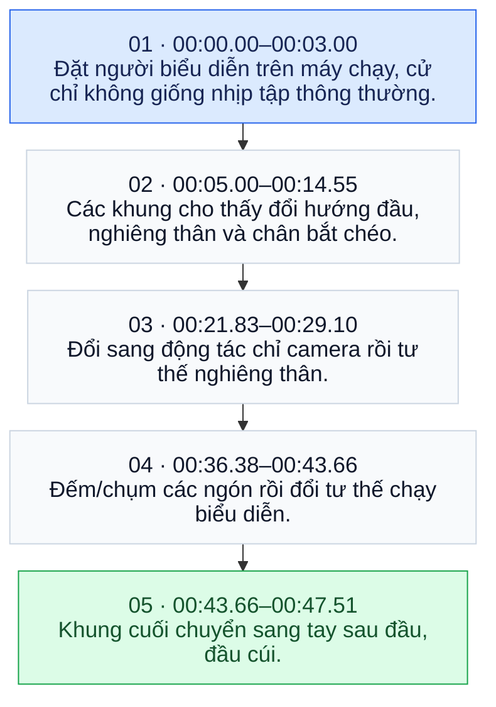

# Máy chạy thành sân khấu: vận động lệch kỳ vọng tập luyện

[Video gốc — @thunglongfamily](https://www.tiktok.com/@thunglongfamily/video/7657036293284629780) · ID `7657036293284629780`

**Tóm tắt cách kể:** Không gian tập luyện tạo dự đoán động tác lặp đều; cử chỉ, chân bắt chéo và biểu cảm thay dự đoán đó bằng trình diễn. Người ở sau giữ thêm một lớp bối cảnh. Đây là sự bất thường thị giác có ngay đầu và được duy trì bằng biến thể, không phải câu hỏi giấu đáp án.

[Sơ đồ diễn biến](#mindmap) · [Diễn biến](#dien-bien) · [Nhịp cảm xúc](#cam-xuc) · [Cách áp dụng](#ap-dung)

## Sơ đồ diễn biến

Đọc từ trên xuống: mỗi hộp là một nhịp theo mốc ASR hoặc khung hình được ghi trong phân tích. Xanh dương là mở đầu, xanh lá là nhịp cuối. Chi tiết và giới hạn nằm trong phân tích bên dưới.

[Mã Mermaid riêng](../mindmaps/7657036293284629780.mmd)

## Dữ liệu và nguồn

**Cách thể hiện:** Biểu diễn hình thể

**Phạm vi học:** Học bố cục/hành động/chữ thấy được; không dùng làm bằng chứng lời thoại.

**Ngữ cảnh thương mại:** Chưa xác nhận tài trợ; nhận diện thương hiệu/quảng bá quan sát được nằm trong phân tích.

- Đăng: 2026-06-30T04:11:39+00:00. Metadata lấy: 2026-11-15T04:34:14.621050+00:00.
- **3,000,000 view**; thích 90,200; bình luận 482; chia sẻ 1,717; lưu 2,216. Dấu phẩy tách hàng nghìn.
- Thời lượng media: 48.51s.
- **11.18× P50** 268,250 của 150 bài đủ 48h trong snapshot kênh. Clip có trong cửa sổ baseline. Không phải thống kê toàn bộ kênh.

## Phạm vi kiểm

Đã tải media, xem khung chọn lọc và đọc ASR có mốc lưu lúc 2026-11-15T04:35:48.604681+00:00. Đối chiếu cùng ID và thời lượng, lệch 0.002s. **Chưa nghe toàn âm hoặc xem chuyển động liên tục; chưa xác nhận toàn văn ASR hay mọi dữ kiện trong clip.**

Media SHA256: `899ef16b1d9310f5002df175c0a2c27a4f87d1b6df0182a639cb411d4783f34d`. [Metadata và các hash khác](../videos.json). Video/ASR đầy đủ giữ ở bộ nghiên cứu cục bộ; bản chia sẻ giữ link gốc, trích ngắn và phân tích riêng.

## Lời hứa và câu hỏi trung tâm

**Lời hứa:** Một màn biểu diễn tiếp tục biến đổi trong không gian tập luyện.

**Câu hỏi:** Trong khung tập luyện này, nhân vật còn biến tấu động tác ra sao?

## Mở đầu: lời và hình

Khung 0–3 giây đặt một người ở máy chạy nhưng tay quấn trắng và biểu cảm/cử chỉ hướng máy quay làm hành động lệch khuôn tập luyện thông thường. ASR là lời bài hát, không có cơ sở coi đó là đối thoại dẫn hook. Nhìn từ các khung lấy mẫu, sự hấp dẫn nằm ở liên tiếp biến dáng đi thành màn trình diễn trong cùng một khung.

## Nghiên cứu phần mở

Diễn giải từ bằng chứng đã lưu; lý do gây chú ý là giả thuyết biên tập, chưa đo retention.

**Cửa sổ quan sát:** 00:00.00–00:03.00

| Lớp | Quan sát/diễn giải |
|---|---|
| Lời | ASR nhận lời bài hát; không dùng lyric làm phát biểu của nhân vật. |
| Hình | Máy chạy, tay quấn trắng, cử chỉ hướng camera. |
| Chữ trên hình | Không thấy chữ giải thích hook ở các khung mở. |

**Động tác gây chú ý:** Sai lệch hành động trong không gian quen.

**Vì sao có thể muốn dừng lại:** Giả thuyết: người xem dừng để xem vì sao một buổi tập có dáng biểu diễn.

**Điều còn muốn biết:** Nhân vật sẽ đổi động tác thế nào?

**Thông tin chưa cho biết:** Không có bằng chứng một thông tin cụ thể bị giấu.

**Nhịp nối có gì mới:** Đổi tư thế trong cùng khung thay cho mở vòng hỏi bằng lời.

**Mốc trả/giới hạn giải đáp:** 00:43.66–00:47.51 — Chỉ có hồi đáp thị giác: thêm một tư thế; không có lời giải tự sự.

**Tóm cấu trúc bằng hai câu:** Đặt bối cảnh có hành động được kỳ vọng rõ. Thay hành động đó bằng biến thể lạ rồi tiếp tục thay đổi hình dáng.

**Chuyển sang ngách khác:** Chuyển được quan hệ bối cảnh → hành động trái kỳ vọng; sang finance phải giải thích sự lệch bằng dữ kiện, vì vũ đạo không chứng minh nhận định.

**Điều không chuyển theo:**

- Động tác có rủi ro trên máy chạy
- Lời bài hát
- Giả định mọi hành động lạ đều có ích cho kịch bản

**Phạm vi:** 12 khung + ASR chủ yếu nhạc; timeline hình theo các mốc đã lấy mẫu.

Không trích ASR mở vì là nhạc hoặc nhận dạng không đáng tin; phân tích hình/chữ theo mốc khung.

| Mốc khung đã xem | Điều quan sát được |
|---|---|
| 00:00.00 | Người mặc đồ thể thao đứng trên máy chạy, một tay quấn trắng; phía sau có người ngồi. |
| 00:01.00 | Người biểu diễn xoay người và giơ tay hướng camera. |
| 00:03.00 | Tay quấn trắng được đưa gần mặt trong tư thế diễn. |
| 00:07.28 | Thân người nghiêng, chân bắt chéo trên mặt máy chạy. |
| 00:21.83 | Người biểu diễn đưa tay về phía camera trong một tư thế khác. |
| 00:47.51 | Khung cuối lấy mẫu có tay đưa sau đầu và đầu cúi; bối cảnh vẫn là máy chạy. |

Không suy chuyển động giữa các khung từ ảnh tĩnh.

## Diễn biến và nhiệm vụ từng beat

| Mốc ASR | Diễn giải riêng | Vai trò |
|---|---|---|
| 00:00.00–00:03.00 | Đặt người biểu diễn trên máy chạy, cử chỉ không giống nhịp tập thông thường. | Sai lệch giữa bối cảnh và hành động. |
| 00:05.00–00:14.55 | Các khung cho thấy đổi hướng đầu, nghiêng thân và chân bắt chéo. | Duy trì biến tấu bằng cơ thể; đây là mốc quan sát. |
| 00:21.83–00:29.10 | Đổi sang động tác chỉ camera rồi tư thế nghiêng thân. | Thay hình dáng trong cùng bố cục. |
| 00:36.38–00:43.66 | Đếm/chụm các ngón rồi đổi tư thế chạy biểu diễn. | Thêm biến thể, chưa có câu chuyện lời thoại. |
| 00:43.66–00:47.51 | Khung cuối chuyển sang tay sau đầu, đầu cúi. | Đóng một chuỗi biểu diễn; không thấy cú giải bí mật riêng. |

## Nhịp cảm xúc — giả thuyết biên tập

Các trạng thái dưới đây là cách đọc câu chuyện từ bằng chứng, không phải cảm xúc người xem đã đo hoặc biểu đồ retention.

| Mốc | Cảm xúc có thể gợi | Bằng chứng | Cách diễn giải |
|---|---|---|---|
| 00:00.00–00:03.00 | Sai lệch giữa bối cảnh và hành động. | Đặt người biểu diễn trên máy chạy, cử chỉ không giống nhịp tập thông thường. | Đây là diễn giải tác dụng của trình tự, không xác nhận cảm xúc thực tế của khán giả. |
| 00:05.00–00:14.55 | Duy trì biến tấu bằng cơ thể; đây là mốc quan sát. | Các khung cho thấy đổi hướng đầu, nghiêng thân và chân bắt chéo. | Đây là diễn giải tác dụng của trình tự, không xác nhận cảm xúc thực tế của khán giả. |
| 00:21.83–00:29.10 | Thay hình dáng trong cùng bố cục. | Đổi sang động tác chỉ camera rồi tư thế nghiêng thân. | Đây là diễn giải tác dụng của trình tự, không xác nhận cảm xúc thực tế của khán giả. |
| 00:36.38–00:43.66 | Thêm biến thể, chưa có câu chuyện lời thoại. | Đếm/chụm các ngón rồi đổi tư thế chạy biểu diễn. | Đây là diễn giải tác dụng của trình tự, không xác nhận cảm xúc thực tế của khán giả. |
| 00:43.66–00:47.51 | Đóng một chuỗi biểu diễn; không thấy cú giải bí mật riêng. | Khung cuối chuyển sang tay sau đầu, đầu cúi. | Đây là diễn giải tác dụng của trình tự, không xác nhận cảm xúc thực tế của khán giả. |

## Cách phân phối thông tin

| Mốc | Động tác viết | Vì sao đáng chú ý |
|---|---|---|
| 00:00.00–00:03.00 | Sai lệch giữa bối cảnh và hành động. | Đặt người biểu diễn trên máy chạy, cử chỉ không giống nhịp tập thông thường. |
| 00:05.00–00:14.55 | Duy trì biến tấu bằng cơ thể; đây là mốc quan sát. | Các khung cho thấy đổi hướng đầu, nghiêng thân và chân bắt chéo. |
| 00:21.83–00:29.10 | Thay hình dáng trong cùng bố cục. | Đổi sang động tác chỉ camera rồi tư thế nghiêng thân. |
| 00:36.38–00:43.66 | Thêm biến thể, chưa có câu chuyện lời thoại. | Đếm/chụm các ngón rồi đổi tư thế chạy biểu diễn. |
| 00:43.66–00:47.51 | Đóng một chuỗi biểu diễn; không thấy cú giải bí mật riêng. | Khung cuối chuyển sang tay sau đầu, đầu cúi. |

## Giải đáp và cách kết

Ở khung 47,51 giây vẫn đang biểu diễn trên máy chạy. Không thấy thẻ kết hay một lời giải tách biệt; không xác định loop liền mạch chỉ từ khung lấy mẫu.

## Điểm mạnh có dẫn chứng

- **Bối cảnh được nhận ra ngay** — Máy chạy chiếm tiền cảnh từ khung 0 giây.

- **Biến tấu không cần đổi bối cảnh** — Các khung 3;7,28;21,83;47,51 giây cho những dáng người khác nhau.

## Điểm yếu và điều không nên bắt chước

- **Phụ thuộc diễn xuất cơ thể hơn cấu trúc lời** — Không có phần thoại giải thích đáng tin; các khung lấy mẫu là biểu diễn.

- **Không có đáp án tự sự độc lập để bê sang bài giải thích** — Khung cuối vẫn tiếp tục động tác, không thấy bước giải cơ chế.

## Khả năng được chia sẻ — chưa kiểm chứng

Không có dữ liệu phân phối/retention để kết luận vì sao viral. Các ý sau chỉ là giả thuyết để thử:

- Tình huống có thể được gửi vì người xem nhận ra hành vi quen thuộc; chưa đọc dữ liệu chia sẻ hay bình luận để xác nhận.

## Chuyển cơ chế sang bài mới

Có thể học việc đưa một hành động lệch kỳ vọng vào bối cảnh người xem nhận ra ngay. Sang nội dung giải thích, cần biến lệch kỳ vọng thành một quan hệ có thể giải thích; chỉ thêm vũ đạo không tạo được bằng chứng hay giá trị kiến thức.

- Giữ bối cảnh dễ nhận trước khi đưa hành động trái kỳ vọng.

- Nếu chuyển thể, phải có ý nghĩa cho sự lệch đó; không chỉ chép dáng diễn.

- Không dùng động tác trên máy chạy làm hướng dẫn tập luyện.

Không dùng bài chuyển thể chưa được người dùng duyệt làm mẫu giọng lâu dài.

## Giới hạn còn lại

- Đã xem 12 khung trích có timestamp từ bản tải mới và đọc ASR khi có; chưa nghe âm hoặc xem video liên tục.

- Cách gây chú ý và giữ chân là giả thuyết biên tập, không phải số đo retention hay quan hệ nhân quả.

- ASR là lời bài hát; không dùng để xác nhận lời nói của người xuất hiện.

- Không thể suy ra nhịp nhạc, tốc độ máy chạy hay tính an toàn từ ảnh lấy mẫu.
