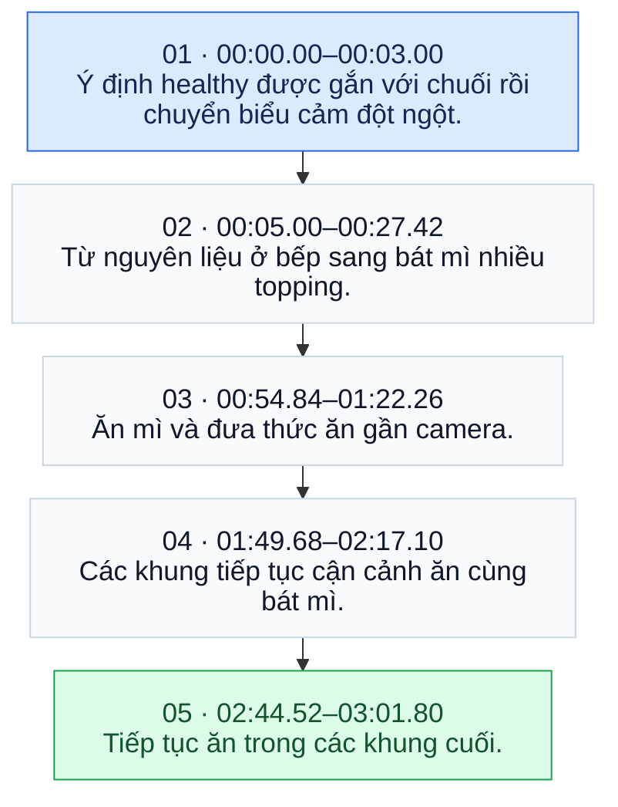

# Ý định ăn healthy chuyển ngay sang bữa mì và mukbang

[Video gốc — @vietphuongthoa98](https://www.tiktok.com/@vietphuongthoa98/video/7660917957991779592) · ID `7660917957991779592`

**Tóm tắt cách kể:** Chữ tình huống tạo kế hoạch A, đạo cụ chuối khiến nó nhìn được; chuyển cảnh đưa sang hành động B trái với kế hoạch; cận cảnh món ăn kéo dài phần hưởng thụ. Payoff của mâu thuẫn tới sớm hơn nhiều so với toàn thời lượng mukbang.

[Sơ đồ diễn biến](#mindmap) · [Diễn biến](#dien-bien) · [Nhịp cảm xúc](#cam-xuc) · [Cách áp dụng](#ap-dung)

## Sơ đồ diễn biến

Đọc từ trên xuống: mỗi hộp là một nhịp theo mốc ASR hoặc khung hình được ghi trong phân tích. Xanh dương là mở đầu, xanh lá là nhịp cuối. Chi tiết và giới hạn nằm trong phân tích bên dưới.

[Mã Mermaid riêng](../mindmaps/7660917957991779592.mmd)

## Dữ liệu và nguồn

**Cách thể hiện:** Diễn tình huống và montage

**Phạm vi học:** Học bố cục/hành động/chữ thấy được; không dùng làm bằng chứng lời thoại.

**Ngữ cảnh thương mại:** Chưa xác nhận tài trợ; nhận diện thương hiệu/quảng bá quan sát được nằm trong phân tích.

- Đăng: 2026-07-10T15:14:24+00:00. Metadata lấy: 2026-11-15T04:34:12.548159+00:00.
- **12,300,000 view**; thích 733,800; bình luận 6,247; chia sẻ 75,400; lưu 30,561. Dấu phẩy tách hàng nghìn.
- Thời lượng media: 182.80s.
- **4.92× P50** 2,500,000 của 147 bài đủ 48h trong snapshot kênh. Clip có trong cửa sổ baseline. Không phải thống kê toàn bộ kênh.

## Phạm vi kiểm

Đã tải media, xem khung chọn lọc và đọc ASR có mốc lưu lúc 2026-11-15T04:36:18.198007+00:00. Đối chiếu cùng ID và thời lượng, lệch 0.034s. **Chưa nghe toàn âm hoặc xem chuyển động liên tục; chưa xác nhận toàn văn ASR hay mọi dữ kiện trong clip.**

Media SHA256: `4bea8c2f8f37e786c3c77f4a5ff50e5097664cf48cf07ffa5ff7d28e203ad2cf`. [Metadata và các hash khác](../videos.json). Video/ASR đầy đủ giữ ở bộ nghiên cứu cục bộ; bản chia sẻ giữ link gốc, trích ngắn và phân tích riêng.

## Lời hứa và câu hỏi trung tâm

**Lời hứa:** Một tình huống hài về khoảng cách giữa dự định ăn uống và bữa ăn thực tế.

**Câu hỏi:** Ý định đầu clip sẽ được thực hiện hay bị thay bằng việc khác?

## Mở đầu: lời và hình

Chữ ở khung 0 giây định nghĩa tình huống mỗi lần tính ăn healthy; trước mặt nhân vật là chuối. Khung 3 giây mặt và thân giật sang bên, khung 5 giây đã là gói nguyên liệu bị tung lên ở bếp, rồi 27,42 giây thấy mì nhiều topping. Quan hệ hook là ý định tự kiểm soát bị hành động sau bẻ hướng; không có lời nói đủ tin để bổ sung động cơ.

## Nghiên cứu phần mở

Diễn giải từ bằng chứng đã lưu; lý do gây chú ý là giả thuyết biên tập, chưa đo retention.

**Cửa sổ quan sát:** 00:00.00–00:05.00

| Lớp | Quan sát/diễn giải |
|---|---|
| Lời | Không dùng speech; ASR nhạc và đoạn CTA lặp không khớp. |
| Hình | Chuối/tiến tới ở 0–2 giây, chuyển biểu cảm tại 3 giây, bếp ở 5 giây. |
| Chữ trên hình | Chữ mô tả ý định ăn healthy. |

**Động tác gây chú ý:** Ý định được vật thể hóa rồi hành động đổi hướng.

**Vì sao có thể muốn dừng lại:** Giả thuyết: khoảng cách giữa ý định quen thuộc và cú chuyển phi lý khiến người xem nhìn tiếp.

**Điều còn muốn biết:** Rốt cuộc nhân vật sẽ ăn gì?

**Thông tin chưa cho biết:** Bữa ăn thay thế chưa xuất hiện ngay khi chữ mở nêu ý định.

**Nhịp nối có gì mới:** Chuyển từ chuối sang bếp rồi bát mì.

**Mốc trả/giới hạn giải đáp:** 00:05.00–00:27.42 — Các khung chuyển sang chuẩn bị rồi bát mì nhiều topping, trả lời bằng hình về bữa ăn thay thế.

**Tóm cấu trúc bằng hai câu:** Nêu một dự định quen thuộc và cho thấy đạo cụ của dự định. Đổi hành động sang kết quả trái dự định rồi cho người xem nhìn kết quả.

**Chuyển sang ngách khác:** Chuyển được quan hệ kế hoạch → hành động thực tế; sang finance phải có số liệu và hoàn cảnh để xác nhận lệch kế hoạch, không dùng nhãn healthy như tiêu chí tài chính.

**Điều không chuyển theo:**

- Nội dung CTA ASR lặp ảo
- Phán xét dinh dưỡng từ hình
- Kéo thời lượng ăn thành công thức giữ chân finance

**Phạm vi:** 12 khung trên clip 182,8 giây; ASR không dùng cho thoại, beats hình là cửa sổ quan sát.

Không trích ASR mở vì là nhạc hoặc nhận dạng không đáng tin; phân tích hình/chữ theo mốc khung.

| Mốc khung đã xem | Điều quan sát được |
|---|---|
| 00:00.00 | Chữ mở về ý định ăn healthy, đĩa chuối ở tiền cảnh, nhân vật tiến tới. |
| 00:03.00 | Nhân vật nghiêng mạnh sang bên với biểu cảm mở miệng; chuối vẫn ở trước. |
| 00:05.00 | Khung bếp với gói nguyên liệu trên không và cùng dòng chữ tình huống. |
| 00:27.42 | Cận bát mì phủ phô mai và topping. |
| 00:54.84 | Cận nhân vật ăn mì; bát có nhiều món ăn kèm. |
| 01:22.26 | Đưa một miếng thức ăn tới sát ống kính. |
| 03:01.80 | Khung cuối vẫn ăn trước camera; bát còn đồ ăn. |

Không suy chuyển động giữa các khung từ ảnh tĩnh.

## Diễn biến và nhiệm vụ từng beat

| Mốc ASR | Diễn giải riêng | Vai trò |
|---|---|---|
| 00:00.00–00:03.00 | Ý định healthy được gắn với chuối rồi chuyển biểu cảm đột ngột. | Đặt ý định trước khi bẻ hướng. |
| 00:05.00–00:27.42 | Từ nguyên liệu ở bếp sang bát mì nhiều topping. | Payoff thị giác cho việc lệch kế hoạch. |
| 00:54.84–01:22.26 | Ăn mì và đưa thức ăn gần camera. | Đổi sang phần thưởng nhìn món ăn. |
| 01:49.68–02:17.10 | Các khung tiếp tục cận cảnh ăn cùng bát mì. | Duy trì trải nghiệm ăn; mốc quan sát không phải điểm cắt. |
| 02:44.52–03:01.80 | Tiếp tục ăn trong các khung cuối. | Không có kết luận thay đổi ý định hay thông điệp dinh dưỡng. |

## Nhịp cảm xúc — giả thuyết biên tập

Các trạng thái dưới đây là cách đọc câu chuyện từ bằng chứng, không phải cảm xúc người xem đã đo hoặc biểu đồ retention.

| Mốc | Cảm xúc có thể gợi | Bằng chứng | Cách diễn giải |
|---|---|---|---|
| 00:00.00–00:03.00 | Đặt ý định trước khi bẻ hướng. | Ý định healthy được gắn với chuối rồi chuyển biểu cảm đột ngột. | Đây là diễn giải tác dụng của trình tự, không xác nhận cảm xúc thực tế của khán giả. |
| 00:05.00–00:27.42 | Payoff thị giác cho việc lệch kế hoạch. | Từ nguyên liệu ở bếp sang bát mì nhiều topping. | Đây là diễn giải tác dụng của trình tự, không xác nhận cảm xúc thực tế của khán giả. |
| 00:54.84–01:22.26 | Đổi sang phần thưởng nhìn món ăn. | Ăn mì và đưa thức ăn gần camera. | Đây là diễn giải tác dụng của trình tự, không xác nhận cảm xúc thực tế của khán giả. |
| 01:49.68–02:17.10 | Duy trì trải nghiệm ăn; mốc quan sát không phải điểm cắt. | Các khung tiếp tục cận cảnh ăn cùng bát mì. | Đây là diễn giải tác dụng của trình tự, không xác nhận cảm xúc thực tế của khán giả. |
| 02:44.52–03:01.80 | Không có kết luận thay đổi ý định hay thông điệp dinh dưỡng. | Tiếp tục ăn trong các khung cuối. | Đây là diễn giải tác dụng của trình tự, không xác nhận cảm xúc thực tế của khán giả. |

## Cách phân phối thông tin

| Mốc | Động tác viết | Vì sao đáng chú ý |
|---|---|---|
| 00:00.00–00:03.00 | Đặt ý định trước khi bẻ hướng. | Ý định healthy được gắn với chuối rồi chuyển biểu cảm đột ngột. |
| 00:05.00–00:27.42 | Payoff thị giác cho việc lệch kế hoạch. | Từ nguyên liệu ở bếp sang bát mì nhiều topping. |
| 00:54.84–01:22.26 | Đổi sang phần thưởng nhìn món ăn. | Ăn mì và đưa thức ăn gần camera. |
| 01:49.68–02:17.10 | Duy trì trải nghiệm ăn; mốc quan sát không phải điểm cắt. | Các khung tiếp tục cận cảnh ăn cùng bát mì. |
| 02:44.52–03:01.80 | Không có kết luận thay đổi ý định hay thông điệp dinh dưỡng. | Tiếp tục ăn trong các khung cuối. |

## Giải đáp và cách kết

Khung cuối vẫn ở bữa ăn. Không thấy cảnh quay lại chuối hay đánh giá dinh dưỡng, nên không gán một bài học sức khỏe cho clip.

## Điểm mạnh có dẫn chứng

- **Chữ và đạo cụ cùng xác lập kỳ vọng** — Khung 0 có dòng healthy và đĩa chuối.

- **Kết quả tương phản nhìn thấy được** — Khung 27,42 giây bát mì nhiều topping thay trọng tâm chuối ban đầu.

## Điểm yếu và điều không nên bắt chước

- **Phần sau không phát triển tiếp mâu thuẫn đầu** — 54,84–181,8 giây ở các khung lấy mẫu đều là ăn, không có bước ngoặt mới quan sát được.

- **Lời thoại không đủ tin để phân tích** — ASR nhiều lời nhạc và CTA kênh khác lặp kéo dài; không dùng làm speech evidence.

## Khả năng được chia sẻ — chưa kiểm chứng

Không có dữ liệu phân phối/retention để kết luận vì sao viral. Các ý sau chỉ là giả thuyết để thử:

- Tình huống có thể được gửi vì người xem nhận ra hành vi quen thuộc; chưa đọc dữ liệu chia sẻ hay bình luận để xác nhận.

## Chuyển cơ chế sang bài mới

Học việc làm rõ ý định bằng một đạo cụ, rồi cho kết quả khác xuất hiện bằng hình. Sang finance chỉ chuyển quan hệ kế hoạch–hành động–kết quả với dữ liệu thật; không đánh giá món ăn hay suy ra đạo đức quản lý tiền từ thói quen ăn.

- Đặt ý định bằng chữ và đạo cụ phù hợp trước khi đảo hành động.

- Phân biệt payoff của tiểu phẩm với thời lượng trải nghiệm mukbang.

- Không biến tương phản đồ ăn thành lời khuyên sức khỏe.

- Trong nội dung dữ kiện, cần đo được mức lệch kế hoạch thay vì chỉ dán nhãn.

Không dùng bài chuyển thể chưa được người dùng duyệt làm mẫu giọng lâu dài.

## Giới hạn còn lại

- Đã xem 12 khung trích có timestamp từ bản tải mới và đọc ASR khi có; chưa nghe âm hoặc xem video liên tục.

- Cách gây chú ý và giữ chân là giả thuyết biên tập, không phải số đo retention hay quan hệ nhân quả.

- ASR có lyric và hàng chục đoạn CTA về kênh khác, có đoạn quá duration; đã loại khỏi mọi kết luận lời nói.

- Khung lấy mẫu thưa ở phần dài, không đo được nhịp cắt hay hành động giữa hai khung.

- Không đưa hướng dẫn sức khỏe hay đánh giá dinh dưỡng.
