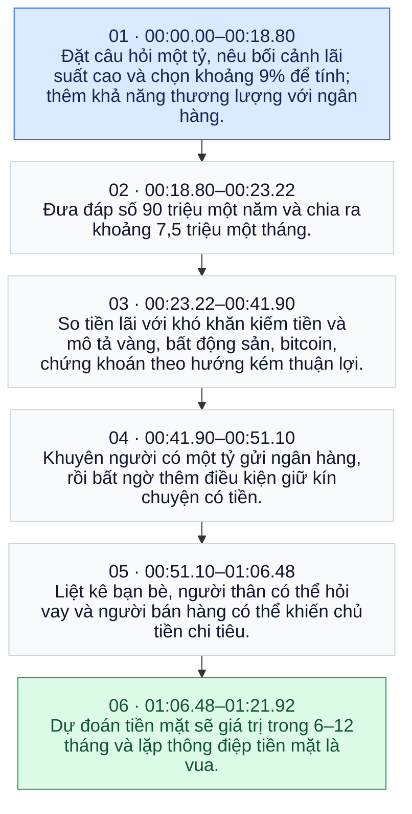

# Một tỷ gửi tiết kiệm: phép tính rồi chuyển sang giữ tiền mặt

[Video gốc — @nguyentrangtkneu](https://www.tiktok.com/@nguyentrangtkneu/video/7663067735391341842) · ID `7663067735391341842`

**Tóm tắt cách kể:** Số vốn cụ thể → tỷ lệ giả định → tiền lãi theo năm/tháng → so hoàn cảnh → lời khuyên riêng tư bất ngờ → khẩu quyết. Điểm có thể học là đáp số hữu hình trước, câu hỏi phụ sau; chưa có bằng chứng về tác động giữ chân.

[Sơ đồ diễn biến](#mindmap) · [Diễn biến](#dien-bien) · [Nhịp cảm xúc](#cam-xuc) · [Cách áp dụng](#ap-dung)

## Sơ đồ diễn biến

Đọc từ trên xuống: mỗi hộp là một nhịp theo mốc ASR hoặc khung hình được ghi trong phân tích. Xanh dương là mở đầu, xanh lá là nhịp cuối. Chi tiết và giới hạn nằm trong phân tích bên dưới.

[Mã Mermaid riêng](../mindmaps/7663067735391341842.mmd)

## Dữ liệu và nguồn

**Cách thể hiện:** Người dẫn nói trực diện

**Ngữ cảnh thương mại:** Chưa xác nhận hợp tác thương mại; xem các đoạn tự quảng bá/giới hạn được ghi riêng.

- Đăng: 2026-07-16T10:16:40+00:00. Metadata lấy: 2026-11-15T04:03:37.751500+00:00.
- **1,600,000 view**; thích 20,200; bình luận 1,230; chia sẻ 3,244; lưu 1,805. Dấu phẩy tách hàng nghìn.
- Thời lượng media: 82.27s.
- **153.11× P50** 10,450 của 150 bài đủ 48h trong snapshot kênh. Clip có trong cửa sổ baseline. Không phải thống kê toàn bộ kênh.

## Phạm vi kiểm

Đã tải media, xem khung chọn lọc và đọc ASR có mốc lưu lúc 2026-11-15T04:04:27.729011+00:00. Đối chiếu cùng ID và thời lượng, lệch 0.002s. **Chưa nghe toàn âm hoặc xem chuyển động liên tục; chưa xác nhận toàn văn ASR hay mọi dữ kiện kinh tế trong clip.**

Media SHA256: `dfe605d634c88623726b3257fe0e0873ac0aeb2512467b8ec6136d5dbb8292d0`. [Metadata và các hash khác](../videos.json). Video/ASR đầy đủ giữ ở bộ nghiên cứu cục bộ; bản chia sẻ giữ link gốc, trích ngắn và phân tích riêng.

## Lời hứa và câu hỏi trung tâm

**Lời hứa:** Trả lời một tỷ có thể tạo ra bao nhiêu tiền lãi dưới giả định tác giả chọn.

**Câu hỏi:** Từ một tỷ ban đầu, số tiền nhận được được hình dung theo năm và tháng thế nào?

## Mở đầu: lời và hình

ASR mở bằng câu hỏi một tỷ gửi tiết kiệm được bao nhiêu. Khung 0–3 giây đặt đúng câu hỏi số tiền bằng chữ vàng viền đen ngang thân người dẫn; gương mặt, chiếc nón rộng và nền cây xanh làm hình nhận diện, chưa có biểu đồ hay bảng lãi suất. Câu trả lời số học xuất hiện ở 18,8–23,22 giây; sau đó bài chuyển sang một thông điệp rộng hơn về giữ tiền.

> 1 tỷ mà gửi tiết kiệm ngân hàng bây giờ thì sẽ nhận được bao nhiêu tiền lãi

Trích ASR ngắn từ segment 00:00.00–00:03.88. Trích ASR chưa nghe đối chiếu; dữ kiện thuộc lời người đăng, chưa xác thực. Xem giới hạn từng ca. Dấu … nghĩa là bỏ bớt, không khẳng định toàn câu vừa ba giây.

| Mốc khung đã xem | Điều quan sát được |
|---|---|
| 00:00.00 | Người dẫn đứng ngoài trời, đội nón rộng; tiêu đề vàng hỏi một tỷ gửi tiết kiệm được bao nhiêu. |
| 00:03.00 | Cùng cảnh và tiêu đề, người dẫn đưa tay lên; không có bảng tính minh họa. |
| 00:12.34 | Tiêu đề lớn đã nhường cho cụm phụ đề ngắn; người dẫn vẫn chiếm gần toàn chiều cao hình. |
| 00:37.02 | Cùng bố cục ngoài trời, phụ đề nhắc số tiền lãi; không hiện so sánh lợi suất các tài sản. |
| 01:01.70 | Người dẫn mỉm cười trong cùng cảnh, phụ đề theo lời về người bên ngoài. |
| 01:14.04 | Nón được đưa xuống phía trước thân; đây là thay đổi hình nhìn thấy ở phần chốt giữ tiền. |
| 01:21.27 | Người dẫn cầm nón trước người ở khung gần cuối, phụ đề nhấn từ vua. |

Không suy chuyển động giữa các khung từ ảnh tĩnh.

## Diễn biến và nhiệm vụ từng beat

| Mốc ASR | Diễn giải riêng | Vai trò |
|---|---|---|
| 00:00.00–00:18.80 | Đặt câu hỏi một tỷ, nêu bối cảnh lãi suất cao và chọn khoảng 9% để tính; thêm khả năng thương lượng với ngân hàng. | Định lượng lời hứa rồi dựng giả định tính toán. |
| 00:18.80–00:23.22 | Đưa đáp số 90 triệu một năm và chia ra khoảng 7,5 triệu một tháng. | Trả lời câu hỏi cụ thể ngay trước khi mở rộng luận điểm. |
| 00:23.22–00:41.90 | So tiền lãi với khó khăn kiếm tiền và mô tả vàng, bất động sản, bitcoin, chứng khoán theo hướng kém thuận lợi. | Đặt đáp số vào phép so cảm nhận về cơ hội khác. |
| 00:41.90–00:51.10 | Khuyên người có một tỷ gửi ngân hàng, rồi bất ngờ thêm điều kiện giữ kín chuyện có tiền. | Mở câu hỏi phụ sau khi phép tính đã khép. |
| 00:51.10–01:06.48 | Liệt kê bạn bè, người thân có thể hỏi vay và người bán hàng có thể khiến chủ tiền chi tiêu. | Cụ thể hóa lý do giữ kín bằng những tương tác đời thường. |
| 01:06.48–01:21.92 | Dự đoán tiền mặt sẽ giá trị trong 6–12 tháng và lặp thông điệp tiền mặt là vua. | Đóng bằng khẩu quyết và dự báo thay vì thêm số học. |

## Nhịp cảm xúc — giả thuyết biên tập

Các trạng thái dưới đây là cách đọc câu chuyện từ bằng chứng, không phải cảm xúc người xem đã đo hoặc biểu đồ retention.

| Mốc | Cảm xúc có thể gợi | Bằng chứng | Cách diễn giải |
|---|---|---|---|
| 00:00.00–00:18.80 | Tò mò về số tiền cụ thể | Câu hỏi một tỷ đi trước các tỷ lệ lãi. | Đặt người xem vào phép tính dễ tự liên hệ; cảm xúc là giả thuyết phân tích. |
| 00:18.80–00:23.22 | Có đáp số để hình dung | 90 triệu/năm được chia tiếp theo tháng. | Đổi tỷ lệ trừu tượng thành một khoản thu quen thuộc. |
| 00:41.90–00:51.10 | Bất ngờ vì lời dặn mới | Sau khuyên gửi ngân hàng là yêu cầu giữ bí mật. | Chuyển điểm chú ý từ sản phẩm ngân hàng sang ứng xử xã hội. |
| 00:51.10–01:21.92 | Thận trọng và muốn giữ quyền chủ động | Liệt kê hỏi vay, bán hàng rồi chốt ưu thế tiền mặt. | Tạo cảm giác phòng vệ; không khẳng định người xem thực sự có phản ứng này. |

## Cách phân phối thông tin

| Mốc | Động tác viết | Vì sao đáng chú ý |
|---|---|---|
| 00:00.00–00:18.80 | Chốt một vốn gốc và một tỷ lệ tham chiếu. | Hạn chế số biến trước phép tính. |
| 00:18.80–00:23.22 | Đổi cùng kết quả qua hai đơn vị thời gian. | Giúp khoản lãi có thước đo sinh hoạt. |
| 00:41.90–01:06.48 | Thêm lời dặn xã hội sau đáp số. | Tạo một nhịp nội dung mới để bài không dừng ở máy tính. |
| 01:06.48–01:21.92 | Gói luận điểm thành khẩu quyết. | Tạo cụm nhớ được, nhưng cần phân biệt với bằng chứng. |

## Giải đáp và cách kết

Kết bằng thông điệp tiền mặt là vua, được lặp lại và đi cùng động tác hạ nón trong khung cuối. Bài đã trả câu hỏi tiền lãi nhưng phần kết nâng phép tính minh họa thành lựa chọn tài sản và dự báo.

## Điểm mạnh có dẫn chứng

- **Lời hứa nhìn được ngay** — Cả chữ mở màn và ASR đều nhắc một tỷ và số tiền lãi.

- **Trả số cụ thể** — 18,8–23,22 giây nêu kết quả theo năm rồi tháng.

- **Có một nhịp chuyển bất ngờ** — 49,44–51,1 giây thêm chuyện giữ kín sau khuyến nghị gửi tiền.

## Điểm yếu và điều không nên bắt chước

- **Phần đầu chờ đáp số khá lâu** — Phép tính chỉ tới ở 18,8 giây sau nhiều tỷ lệ và điều kiện thương lượng.

- **Hình không làm rõ giả định số học** — Các khung 12,34 và 37,02 giây vẫn là người dẫn với phụ đề ngắn, không có bảng tính.

- **Kết luận rộng hơn dữ liệu đã trình bày** — 66,48–81,92 giây dự báo ưu thế tiền mặt, trong khi phần tính chỉ minh họa một tỷ lệ.

## Khả năng được chia sẻ — chưa kiểm chứng

Không có dữ liệu phân phối/retention để kết luận vì sao viral. Các ý sau chỉ là giả thuyết để thử:

- Khoản lãi theo tháng có thể được gửi cho người cùng bàn chuyện ngân sách; đây là giả thuyết, không có dữ liệu chia sẻ theo đoạn.

- Lời dặn giữ kín tiền có thể gợi trao đổi về chuyện hỏi vay; không xem đó là xác nhận lời khuyên đúng.

## Chuyển cơ chế sang bài mới

Dùng một lượng tiền, thời gian hay chi phí quen thuộc làm đầu vào và trả phép tính minh bạch. Nếu mở thêm vấn đề hành vi sau đáp số, phải nối lý do rõ ràng và tách dự báo cá nhân khỏi phần tính được.

- Nêu rõ ngày, kỳ hạn và giả định khi dùng lãi suất.

- Đưa phép tính lên hình và trả đáp số sớm hơn nếu clip chỉ hứa tính tiền.

- Tách ba lớp: phép tính, ý kiến về hành vi, dự báo tài sản.

- Không chuyển mẫu này thành lời khuyên ngân hàng hay phân bổ tài sản cho mọi người.

Không dùng bài chuyển thể chưa được người dùng duyệt làm mẫu giọng lâu dài.

## Giới hạn còn lại

- Đã đọc toàn bộ ASR có timestamp và xem 12 khung trích của bản tải mới; chưa nghe toàn âm hoặc xem video liên tục.

- Mốc nhịp dựa trên ASR; không dùng bản chép tự động làm trích dẫn nguyên văn.

- Không có retention hay thử nghiệm nhân quả; số lượt xem không chứng minh hook tạo ra kết quả.

- Lãi suất, điều kiện thương lượng và bối cảnh tài sản chưa được kiểm chứng độc lập hoặc cập nhật.

- 7,5 triệu/tháng là phép chia từ số năm trong lời tác giả; chưa xác nhận lịch trả lãi thực tế.

- Các lời khuyên phân bổ tài sản và dự báo 6–12 tháng không phải kết luận của bộ dữ liệu.

- ASR thiếu đoạn khoảng 27,48–30 giây; không suy diễn nội dung khoảng trống.
