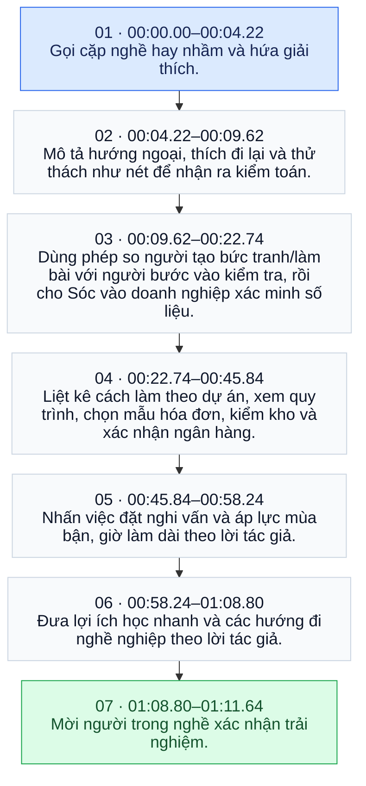

# Phân biệt kế toán và kiểm toán bằng người làm bài và người kiểm tra

[Video gốc — @longvasocbc1](https://www.tiktok.com/@longvasocbc1/video/7664269289972698376) · ID `7664269289972698376`

**Tóm tắt cách kể:** Cặp nghề dễ nhầm → cho người xem nhận diện mình → ẩn dụ phân vai → chuỗi nhiệm vụ → giá phải trả và thu hoạch → mời người trong nghề đối chiếu.

[Sơ đồ diễn biến](#mindmap) · [Diễn biến](#dien-bien) · [Nhịp cảm xúc](#cam-xuc) · [Cách áp dụng](#ap-dung)

## Sơ đồ diễn biến

Đọc từ trên xuống: mỗi hộp là một nhịp theo mốc ASR hoặc khung hình được ghi trong phân tích. Xanh dương là mở đầu, xanh lá là nhịp cuối. Chi tiết và giới hạn nằm trong phân tích bên dưới.

[Mã Mermaid riêng](../mindmaps/7664269289972698376.mmd)

## Dữ liệu và nguồn

**Cách thể hiện:** Hoạt hình giải thích

**Phạm vi học:** Xem phạm vi kiểm và giới hạn từng ca.

**Ngữ cảnh thương mại:** Chưa xác nhận hợp tác thương mại; xem các đoạn tự quảng bá/giới hạn được ghi riêng.

- Đăng: 2026-07-19T15:59:22+00:00. Metadata lấy: 2026-11-15T03:45:47.693707+00:00.
- **232,400 view**; thích 15,600; bình luận 114; chia sẻ 2,969; lưu 1,976. Dấu phẩy tách hàng nghìn.
- Thời lượng media: 71.91s.
- **18.44× P50** 12,600 của 75 bài đủ 48h trong snapshot kênh. Clip có trong cửa sổ baseline. Không phải thống kê toàn bộ kênh.

## Phạm vi kiểm

Đã tải media, xem khung chọn lọc và đọc ASR có mốc lưu lúc 2026-10-22T00:32:05.622993+00:00. Đối chiếu cùng ID và thời lượng, lệch 0.0s. **Chưa nghe toàn âm hoặc xem chuyển động liên tục; chưa xác nhận toàn văn ASR hay mọi dữ kiện trong clip.**

Media SHA256: `d117cf26dc1f383bcf16d8e10c47d23238b5faf28e4b5507b91183a29d082dae`. [Metadata và các hash khác](../videos.json). Video/ASR đầy đủ giữ ở bộ nghiên cứu cục bộ; bản chia sẻ giữ link gốc, trích ngắn và phân tích riêng.

## Lời hứa và câu hỏi trung tâm

**Lời hứa:** Giúp phân biệt hai công việc quen tên và hình dung một ngày/đợt làm kiểm toán có gì.

**Câu hỏi:** Người kiểm toán làm gì khác người tạo số liệu, và công việc ấy đánh đổi điều gì?

## Mở đầu: lời và hình

Gọi thẳng hai nghề dễ nhầm, sau đó không giải bằng hai định nghĩa đối xứng mà đi vào đặc điểm người hợp nghề kiểm toán. Khung 0–3 giây đặt nhãn hai công việc cạnh nhau và nhân vật cầm que chỉ; lời hứa phân biệt được thể hiện bằng hình trước các ví dụ nhiệm vụ.

> Kế toán và kiểm toán

Trích ASR ngắn từ segment 00:00.00–00:01.48. Đoạn ASR ngắn, chưa đối chiếu toàn bộ âm; xem giới hạn từng ca. Dấu … nghĩa là bỏ bớt, không khẳng định toàn câu vừa ba giây.

| Mốc khung đã xem | Điều quan sát được |
|---|---|
| 00:00.00 | Hai nhãn kế toán và kiểm toán cùng hình tiền/máy tính được đặt cạnh nhau; nhân vật chỉ lên hai vế. |
| 00:05.00 | Nhân vật mặc đồ đi đường, xung quanh có các biển chỉ hướng và vật dụng du lịch; hình cụ thể hóa đoạn hướng ngoại/đi nhiều. |
| 00:10.79 | Nhân vật vẽ một báo cáo tài chính trên giá tranh; bong bóng nêu việc xử lý dữ liệu. |
| 00:32.36 | Nhân vật Sóc soi các giấy tờ và tiền bằng kính lúp, minh họa việc chọn mẫu và nghi vấn. |
| 00:53.93 | Nhân vật kiểm toán ôm nhiều hồ sơ, nét mặt mệt trong phần mùa bận. |
| 01:04.72 | Nhân vật được đặt cạnh tháp giấy và biển các hãng lớn; khung hiển thị mốc 3–5 năm. |
| 01:10.91 | Hồ sơ, đồng hồ, dấu quá hạn và nhân vật lo lắng chiếm khung cuối. |

Không suy chuyển động giữa các khung từ ảnh tĩnh.

## Diễn biến và nhiệm vụ từng beat

| Mốc ASR | Diễn giải riêng | Vai trò |
|---|---|---|
| 00:00.00–00:04.22 | Gọi cặp nghề hay nhầm và hứa giải thích. | Tạo một khoảng trống kiến thức rất cụ thể. |
| 00:04.22–00:09.62 | Mô tả hướng ngoại, thích đi lại và thử thách như nét để nhận ra kiểm toán. | Đưa câu hỏi nghề nghiệp về tính cách người xem. |
| 00:09.62–00:22.74 | Dùng phép so người tạo bức tranh/làm bài với người bước vào kiểm tra, rồi cho Sóc vào doanh nghiệp xác minh số liệu. | Đặt trục phân biệt là tạo số liệu so với kiểm bằng chứng. |
| 00:22.74–00:45.84 | Liệt kê cách làm theo dự án, xem quy trình, chọn mẫu hóa đơn, kiểm kho và xác nhận ngân hàng. | Trả lời nghề làm gì bằng các hành động quan sát được. |
| 00:45.84–00:58.24 | Nhấn việc đặt nghi vấn và áp lực mùa bận, giờ làm dài theo lời tác giả. | Đổi từ sự hấp dẫn nghề sang cái giá thực hiện. |
| 00:58.24–01:08.80 | Đưa lợi ích học nhanh và các hướng đi nghề nghiệp theo lời tác giả. | Cân bằng phần áp lực bằng một phần thu hoạch. |
| 01:08.80–01:11.64 | Mời người trong nghề xác nhận trải nghiệm. | Kết bằng cơ chế góp chuyện từ cộng đồng nghề thay vì hẹn một định nghĩa khác. |

## Nhịp cảm xúc — giả thuyết biên tập

Các trạng thái dưới đây là cách đọc câu chuyện từ bằng chứng, không phải cảm xúc người xem đã đo hoặc biểu đồ retention.

| Mốc | Cảm xúc có thể gợi | Bằng chứng | Cách diễn giải |
|---|---|---|---|
| 00:00.00–00:09.62 | Nhận ra nhầm lẫn và tự soi | Cặp nghề rồi các đặc điểm tính cách xuất hiện sớm. | Có thể kéo người đang chọn nghề từ khái niệm sang câu hỏi về bản thân. |
| 00:09.62–00:22.74 | Dễ hiểu hơn | Ẩn dụ người tạo bài và người kiểm tra được nối với nhân vật tại doanh nghiệp. | Trục phân biệt được giản lược về chức năng dễ hình dung. |
| 00:22.74–00:45.84 | Tò mò vào việc thật | Nhiệm vụ chọn mẫu, kiểm kho, xác nhận tiền được kể lần lượt. | Thông tin tiến lên nhờ đổi hành động, không chỉ nhắc nghề cần cẩn thận. |
| 00:45.84–00:58.24 | Áp lực | Nghi vấn liên tục, mùa bận và thời gian làm được đưa vào. | Một nhịp trừ điểm làm phần trước bớt giống quảng bá nghề. |
| 00:58.24–01:11.64 | Hy vọng rồi cộng đồng | Lợi ích học hỏi và lộ trình dẫn tới lời mời người trong nghề xác nhận. | Có thể mở phản hồi trải nghiệm thực, chưa có dữ liệu bình luận theo đoạn. |

## Cách phân phối thông tin

| Mốc | Động tác viết | Vì sao đáng chú ý |
|---|---|---|
| 00:00.00–00:22.74 | Từ cặp nhãn đến một trục chức năng | Không bắt người xem nhớ nhiều thuật ngữ mới trước khi hiểu sự khác biệt. |
| 00:22.74–00:45.84 | Nhiệm vụ tăng dần tính cụ thể | Quy trình chung được neo vào hóa đơn, hàng trong kho và tiền ngân hàng. |
| 00:45.84–01:08.80 | Đặt giá và lợi ích cạnh nhau | Phân tích nghề theo đánh đổi thay vì chỉ kể phẩm chất tốt. |
| 01:08.80–01:11.64 | Mời chuyên môn đối chiếu | Chuyển phần kết thành lời mời có đối tượng xác định. |

## Giải đáp và cách kết

Clip đã phân biệt vai trò trước khi chuyển sang đặc điểm nghề kiểm toán và lời mời xác nhận. Tuy nhiên phần kế toán ít được phát triển; một số hứa hẹn về tốc độ thăng tiến không có điều kiện đủ trong clip.

## Điểm mạnh có dẫn chứng

- **Trục so dễ nhớ** — 9,62–15,02 giây tách người làm số liệu và người kiểm tra bằng phép hình dung.

- **Có nhiều hành động cụ thể thay cho từ mô tả phẩm chất** — 25,68–45,84 giây đi qua quy trình, hóa đơn, kiểm kho và ngân hàng.

- **Phần áp lực tạo đối trọng** — 45,84–58,24 giây không chỉ nói nghề có tương lai.

## Điểm yếu và điều không nên bắt chước

- **Lời hứa hai nghề chuyển thành bài tập trung một nghề** — Sau 15 giây phần lớn diễn biến theo người kiểm toán.

- **Một số kết quả nghề nghiệp được nói chắc hơn chứng cứ trong clip** — 58,24–68,8 giây đưa học nhanh và lộ trình chuyển vị trí mà chưa nêu điều kiện.

- **Mốc lộ trình giữa hình và ASR chưa nhất quán** — Khung 64,72 giây và đoạn 62,96–68,8 giây cần đối chiếu lại.

## Khả năng được chia sẻ — chưa kiểm chứng

Không có dữ liệu phân phối/retention để kết luận vì sao viral. Các ý sau chỉ là giả thuyết để thử:

- Có thể hữu ích để gửi cho người đang chọn ngành/nghề vì tên hai công việc gần nhau nhưng nhiệm vụ khác.

- Lời mời người trong nghề xác nhận có thể tạo bình luận có kinh nghiệm; chưa kiểm dữ liệu phản hồi thực.

## Chuyển cơ chế sang bài mới

Học việc giải nghề bằng hành động cụ thể sau một phép phân vai đơn giản. Khi áp dụng, tách đặc điểm thường gặp khỏi tiêu chuẩn bắt buộc, và không biến lợi ích nghề nghiệp trong một clip thành bảo đảm thăng tiến.

- Mở bằng nhầm lẫn thật của khán giả, rồi chọn một trục phân biệt.

- Đưa ít nhất hai nhiệm vụ cụ thể thay vì chỉ liệt kê tính cách.

- Giữ điều kiện khi nêu lộ trình, giờ làm hoặc lợi ích nghề; không hứa chắc kết quả.

Không dùng bài chuyển thể chưa được người dùng duyệt làm mẫu giọng lâu dài.

## Giới hạn còn lại

- Đã đọc toàn segments ASR có mốc và xem 12 khung mới tải ở contact sheet; chưa nghe âm trực tiếp hoặc xem chuyển động liên tục.

- Mốc là mốc ASR/khung trích, không phải căn chỉnh bằng tai; đoạn không xuất hiện trong các khung không được suy thành một chuyển động cụ thể.

- Đây là phân tích kỹ thuật kể, không xác minh độc lập các khẳng định kinh tế, số liệu hoặc chính sách trong clip.

- Không có retention hay thử A/B; nhịp cảm xúc và khả năng lan truyền dưới đây là diễn giải/giả thuyết, không phải kết quả đo.

- Khung 64,72 giây hiển thị mốc 3–5 năm, trong khi ASR diễn đạt ba năm; không chọn một mốc làm phát biểu được xác nhận nếu chưa nghe/kiểm nguồn.

- Tên nghề và lộ trình nghề trong clip không phải tư vấn nghề nghiệp đã kiểm độc lập.
