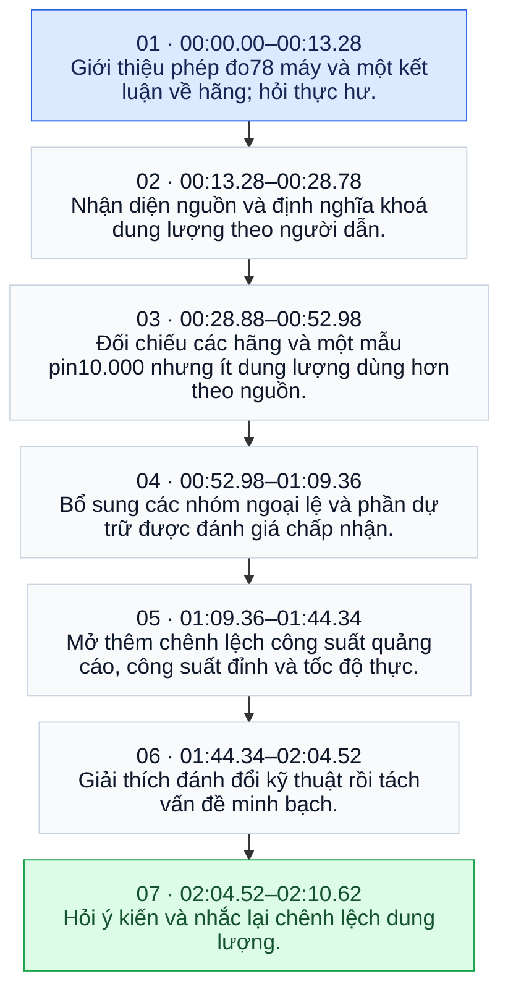

# Thông số pin trên quảng cáo và phần người dùng được sử dụng

[Video gốc — @vatvostudio](https://www.tiktok.com/@vatvostudio/video/7667805587454971144) · ID `7667805587454971144`

**Tóm tắt cách kể:** Quy mô phép kiểm → kết luận gây chú ý → định nghĩa biến đo → ví dụ và ngoại lệ → thêm biến công suất → lý do kỹ thuật → phân biệt giới hạn kỹ thuật với minh bạch. Điểm học được là đổi một cáo buộc tuyệt đối sang câu hỏi công bố điều kiện; ASR có chỗ tự mâu thuẫn nên không thể lấy clip làm bảng xếp hạng hãng.

[Sơ đồ diễn biến](#mindmap) · [Diễn biến](#dien-bien) · [Nhịp cảm xúc](#cam-xuc) · [Cách áp dụng](#ap-dung)

## Sơ đồ diễn biến

Đọc từ trên xuống: mỗi hộp là một nhịp theo mốc ASR hoặc khung hình được ghi trong phân tích. Xanh dương là mở đầu, xanh lá là nhịp cuối. Chi tiết và giới hạn nằm trong phân tích bên dưới.

[Mã Mermaid riêng](../mindmaps/7667805587454971144.mmd)

## Dữ liệu và nguồn

**Cách thể hiện:** Cầm sản phẩm và giải thích

**Phạm vi học:** Học cách chia thông tin theo hình và ASR, giữ giới hạn từng ca.

**Ngữ cảnh thương mại:** Chưa xác nhận tài trợ; nhận diện thương hiệu/quảng bá quan sát được nằm trong phân tích.

- Đăng: 2026-07-29T04:42:03+00:00. Metadata lấy: 2026-11-15T04:34:02.196916+00:00.
- **935,000 view**; thích 32,200; bình luận 1,635; chia sẻ 3,141; lưu 2,284. Dấu phẩy tách hàng nghìn.
- Thời lượng media: 130.80s.
- **16.37× P50** 57,100 của 148 bài đủ 48h trong snapshot kênh. Clip có trong cửa sổ baseline. Không phải thống kê toàn bộ kênh.

## Phạm vi kiểm

Đã tải media, xem khung chọn lọc và đọc ASR có mốc lưu lúc 2026-11-15T04:35:36.079842+00:00. Đối chiếu cùng ID và thời lượng, lệch 0.001s. **Chưa nghe toàn âm hoặc xem chuyển động liên tục; chưa xác nhận toàn văn ASR hay mọi dữ kiện trong clip.**

Media SHA256: `4895165f3df82aa9dcd4ef10a1ea0dc08de81563835b82cca9cc7d90dbbecd33`. [Metadata và các hash khác](../videos.json). Video/ASR đầy đủ giữ ở bộ nghiên cứu cục bộ; bản chia sẻ giữ link gốc, trích ngắn và phân tích riêng.

## Lời hứa và câu hỏi trung tâm

**Lời hứa:** Giải thích chênh lệch giữa thông số pin/sạc công bố và cách nguồn đo phần thực dùng, rồi bàn minh bạch.

**Câu hỏi:** Khác biệt giữa con số trên quảng cáo và trải nghiệm là gì, do giới hạn kỹ thuật hay cách công bố?

## Mở đầu: lời và hình

0–5,66 giây ASR dựng quy mô phép kiểm: một YouTuber tháo pin78 máy rồi đo theo chuẩn được nguồn nêu. Từ5,66–10,44s mới phát biểu kết luận chỉ hai hãng trung thực nhất, sau đó hỏi thực hư. Ảnh0–3 cho thấy bàn nhiều điện thoại đồng thời với mặt người dẫn; ảnh5 chuyển sang thiết bị đo. Hook dựa vào quy mô bằng chứng trước kết luận gây tranh luận, không mở ngay bằng mệnh đề pin10.000 chỉ dùng8.500 như tiêu đề metadata.

## Nghiên cứu phần mở

Diễn giải từ bằng chứng đã lưu; lý do gây chú ý là giả thuyết biên tập, chưa đo retention.

**Cửa sổ quan sát:** 00:00.00–00:13.28

| Lớp | Quan sát/diễn giải |
|---|---|
| Lời | 0–3,14s nêu tháo pin78 máy;3,14–5,66s nêu cách đo theo chuẩn được dẫn;5,66–10,44s đưa kết luận chỉ hai hãng trung thực;10,44–13,28s hỏi thực hư. |
| Hình | Ảnh0–3s bàn nhiều máy với mặt người bình luận trong cửa sổ;ảnh5s bàn đo có máy tính và thiết bị. |
| Chữ trên hình | Phụ đề lần lượt nêu YouTuber, quốc gia, số78 và điện thoại; nhãn nguồn Geekerwan hiện dưới tư liệu. Không có bảng kết quả hoàn chỉnh trong các ảnh0–5s. |

**Động tác gây chú ý:** Đưa độ lớn một cuộc kiểm tra và hình vật mẫu trước mệnh đề trái với kỳ vọng từ quảng cáo; người xem được hứa sẽ biết thực hư.

**Vì sao có thể muốn dừng lại:** Giả thuyết biên tập: bàn dày điện thoại khiến con số78 có hình đối chiếu; kết luận hai hãng có thể khiến người đang dùng hãng khác muốn kiểm tra. Không suy ra được retention hay độ đúng.

**Điều còn muốn biết:** Phép đo phát hiện chênh lệch gì, và kết luận về minh bạch có đủ căn cứ không?

**Thông tin chưa cho biết:** Định nghĩa phần dung lượng bị giới hạn, biểu đồ từng máy, ngoại lệ và lý do kỹ thuật chưa được giải trong hook.

**Nhịp nối có gì mới:** 13,28–28,78s giới thiệu nguồn rồi định nghĩa hành vi; ảnh19,62s có pin và khoá để làm khái niệm nhìn được.

**Mốc trả/giới hạn giải đáp:** 01:44.34–02:10.62 — Nguồn giải thích đánh đổi kỹ thuật rồi tách vấn đề minh bạch và mời bình luận. Đây là lời giải lập luận của clip, chưa xác nhận kết luận kỹ thuật hay xếp hạng hãng; ASR phần so hãng còn không rõ.

**Tóm cấu trúc bằng hai câu:** Cho quy mô kiểm tra hiện ra trước khi nêu chênh lệch mà phép kiểm được cho là phát hiện. Định nghĩa đại lượng, đối chiếu ví dụ và ngoại lệ, rồi tách nguyên nhân hợp lý khỏi mức công bố cho người dùng.

**Chuyển sang ngách khác:** Chuyển quan hệ số quảng bá–phần thực nhận–điều kiện đo sang phí, lãi hoặc quyền lợi tài chính có hồ sơ kiểm chứng. Sẽ hỏng nếu lấy một phép đo thứ cấp làm bằng chứng cố ý lừa dối hay bỏ sự khác nhau giữa lãi suất danh nghĩa và hiệu dụng.

**Điều không chuyển theo:**

- Không chuyển nhãn trung thực/giấu thành kết tội tổ chức tài chính khi thiếu bằng chứng.
- Không dùng biểu đồ thiếu phương pháp làm xác nhận thông số.
- Không lấy câu so hãng ASR không rõ làm dữ liệu.

**Phạm vi:** Đọc toàn ASR131s, xem12 ảnh có mốc; tư liệu được dẫn từ Geekerwan, chưa kiểm nghiệm độc lập và chưa nghe toàn âm/xem liên tục.

> Một youtuber người Trung Quốc đã tháo pin của 78 chiếc điện thoại

Trích ASR ngắn từ segment 00:00.00–00:03.14. Trích ASR ngắn chưa nghe so khớp toàn âm; không khẳng định cả segment là ba giây. Xem phạm vi/giới hạn từng ca. Dấu … nghĩa là bỏ bớt, không khẳng định toàn câu vừa ba giây.

| Mốc khung đã xem | Điều quan sát được |
|---|---|
| 00:00.00 | Người dẫn trong cửa sổ tròn, giữa khung là bàn nhiều điện thoại, có nhãn nguồn Geekerwan. |
| 00:02.00 | Người dẫn giơ tay, tư liệu vẫn nhiều máy trên bàn; phụ đề nêu số78 chiếc. |
| 00:05.00 | Tư liệu bàn có máy tính và thiết bị đo, nhãn nguồn giữ nguyên. |
| 00:19.62 | Đồ hoạ pin với ổ khoá phía trước, minh hoạ khái niệm bị giới hạn dung lượng. |
| 00:39.24 | Biểu đồ thanh so sánh nhiều dòng thiết bị; ảnh lấy mẫu không đủ đọc toàn phương pháp. |
| 00:58.86 | Một biểu đồ thanh khác với nhiều tên và mức số. |
| 01:18.48 | Biểu đồ công suất theo thời gian đi xuống dạng bậc, tư liệu chữ Trung Quốc. |
| 01:38.10 | Đồ thị nhiều đường tăng dần, minh hoạ so tốc độ tích luỹ năng lượng. |
| 01:57.72 | Tiếp tục đồ thị đường cùng cửa sổ người dẫn, không phải thí nghiệm tự thực hiện trước camera. |
| 02:09.80 | Người dẫn ra toàn khung tại bàn, tay đan và một điện thoại phía trước. |

Không suy chuyển động giữa các khung từ ảnh tĩnh.

## Diễn biến và nhiệm vụ từng beat

| Mốc ASR | Diễn giải riêng | Vai trò |
|---|---|---|
| 00:00.00–00:13.28 | Giới thiệu phép đo78 máy và một kết luận về hãng; hỏi thực hư. | Mượn quy mô kiểm tra để đặt chênh lệch quảng cáo–thực tế thành vấn đề. |
| 00:13.28–00:28.78 | Nhận diện nguồn và định nghĩa khoá dung lượng theo người dẫn. | Cho người xem từ vựng trước khi vào ví dụ. |
| 00:28.88–00:52.98 | Đối chiếu các hãng và một mẫu pin10.000 nhưng ít dung lượng dùng hơn theo nguồn. | Đưa nhận định xuống ví dụ định lượng và quyền lợi người dùng. |
| 00:52.98–01:09.36 | Bổ sung các nhóm ngoại lệ và phần dự trữ được đánh giá chấp nhận. | Thu hẹp cách nói bao trùm ở mở; ASR vài từ không chắc nên không xếp hạng lại ở đây. |
| 01:09.36–01:44.34 | Mở thêm chênh lệch công suất quảng cáo, công suất đỉnh và tốc độ thực. | Dùng vấn đề thứ hai để mở rộng cùng quan hệ thông số–trải nghiệm. |
| 01:44.34–02:04.52 | Giải thích đánh đổi kỹ thuật rồi tách vấn đề minh bạch. | Tránh dừng ở tố hãng; đổi từ có lý do sang có công bố đủ hay không. |
| 02:04.52–02:10.62 | Hỏi ý kiến và nhắc lại chênh lệch dung lượng. | Kết bằng tranh luận gắn quyền lợi người dùng. |

## Nhịp cảm xúc — giả thuyết biên tập

Các trạng thái dưới đây là cách đọc câu chuyện từ bằng chứng, không phải cảm xúc người xem đã đo hoặc biểu đồ retention.

| Mốc | Cảm xúc có thể gợi | Bằng chứng | Cách diễn giải |
|---|---|---|---|
| 00:00.00–00:13.28 | Nghi ngờ một lời quảng cáo | Phép kiểm nhiều máy được nối với kết luận chỉ hai hãng trung thực theo nguồn. | Quy mô và mệnh đề mạnh có thể tạo nhu cầu kiểm tra, cũng đòi bằng chứng chặt. |
| 00:13.28–00:52.98 | Thấy chênh lệch cụ thể | Định nghĩa giới hạn và ví dụ phần dung lượng người dùng được dùng. | Làm câu chuyện gắn với một đại lượng thay vì cảm giác chung. |
| 00:52.98–01:44.34 | Thêm điều kiện và so sánh | Nguồn thêm ngoại lệ rồi chuyển sang công suất sạc. | Mở bề rộng nhưng cũng tăng gánh theo dõi và sai số diễn giải. |
| 01:44.34–02:10.62 | Đánh giá có phân biệt | Nhận lý do kỹ thuật nhưng hỏi về minh bạch. | Người xem được gợi một tiêu chí đánh giá khác ngôn ngữ buộc tội ban đầu. |

## Cách phân phối thông tin

| Mốc | Động tác viết | Vì sao đáng chú ý |
|---|---|---|
| 00:00.00–00:13.28 | Nguồn phép đo trước kết luận | Hình bàn máy và thiết bị đo làm quy mô kiểm tra nhìn thấy được. |
| 00:13.28–00:52.98 | Định nghĩa rồi ví dụ | Trước khi so cần biết con số nào đang bị giới hạn theo lời nguồn. |
| 00:52.98–01:44.34 | Ngoại lệ và đại lượng thứ hai | Cùng vấn đề thông số được thử ở dung lượng lẫn công suất theo thời gian. |
| 01:44.34–02:10.62 | Lý do khác với minh bạch | Giải thích sự cần thiết kỹ thuật không tự xoá yêu cầu công bố điều kiện. |

## Giải đáp và cách kết

Phần kết thừa nhận đánh đổi kỹ thuật có lý do theo nguồn, nhưng đặt trọng tâm vào minh bạch rồi mời bình luận. Không có kết luận sản phẩm nào nên mua trong phân tích này.

## Điểm mạnh có dẫn chứng

- **Hình mở cụ thể hoá quy mô** — Ảnh0–3s là nhiều điện thoại, ảnh5s là thiết bị đo, khớp lời78 máy và đo kiểm.

- **Khái niệm khó có hình** — Ảnh19,62s dùng pin kèm khoá trước biểu đồ so sánh.

- **Kết có phân biệt nguyên nhân và trách nhiệm** — 104,34–124,52s giải lý do kỹ thuật rồi chuyển sang thông tin người dùng được biết.

## Điểm yếu và điều không nên bắt chước

- **Kết luận mở quá tuyệt đối so thân** — 5,66–10,44s dùng tiêu chí trung thực nhất; phần sau thêm ngoại lệ và lý do kỹ thuật.

- **Nguồn thứ cấp và ASR không đủ kiểm thông số** — Ảnh39,24s và78,48s là biểu đồ từ nguồn khác; ASR phần hãng và công suất có đoạn cần nghe lại.

- **Hai vấn đề kỹ thuật trong một bài** — 69,36s chuyển từ dung lượng sang sạc, có thể cần làm rõ mẫu so và điều kiện từng bài kiểm; chưa có retention.

## Khả năng được chia sẻ — chưa kiểm chứng

Không có dữ liệu phân phối/retention để kết luận vì sao viral. Các ý sau chỉ là giả thuyết để thử:

- Chênh lệch giữa lời công bố và phần nhận được có thể khơi thảo luận của người đang dùng các thiết bị tương tự.

- Đồ thị và ví dụ có số có thể được gửi để hỏi lại về phương pháp đo, không phải bằng chứng clip đã gây phản ứng đó.

## Chuyển cơ chế sang bài mới

Chuyển được quan hệ thông số công bố–định nghĩa phần thực nhận–điều kiện đo–đánh đổi. Với tài chính cần công bố phí, thời hạn, giả định và mẫu so; không đổi ngôn ngữ quảng cáo thành kết luận gian dối nếu chưa xác minh.

- Chỉ rõ số công bố và số đo là hai đại lượng gì.

- Dẫn nguồn phương pháp, không chỉ uy tín người thử.

- Đưa ngoại lệ trước khi chốt một nhận định bao trùm.

- Tách lý do kỹ thuật với yêu cầu minh bạch.

- Không chuyển lời bình sản phẩm thành cáo buộc tài chính hoặc khuyến nghị mua.

Không dùng bài chuyển thể chưa được người dùng duyệt làm mẫu giọng lâu dài.

## Giới hạn còn lại

- Đã đọc toàn bộ ASR có timestamp và xem 12 khung trích của cùng ID; chưa nghe toàn âm thanh hoặc xem video liên tục.

- Không có retention, tỷ lệ xem hết hay thử nghiệm nhân quả; các nhận định giữ chân và chia sẻ là giả thuyết về cách trình bày.

- Không kiểm nghiệm độc lập dung lượng, công suất, tên máy hay chuẩn thử; không xác nhận hãng nào trung thực hoặc che giấu.

- ASR52,98–69,36s có từ nhận sai và quan hệ giữa các nhóm hãng chưa rõ; không dùng để xếp hạng hoặc trích kết luận theo hãng.

- ASR82,24–87,68s về mức công suất có khả năng nhận sai số; không tái sử dụng làm dữ liệu kỹ thuật.

- Tư liệu đo là nguồn được người bình luận dẫn, không phải thí nghiệm do tài khoản này tự làm trong video. Chưa biết tiếp cận tự nhiên/trả phí.
