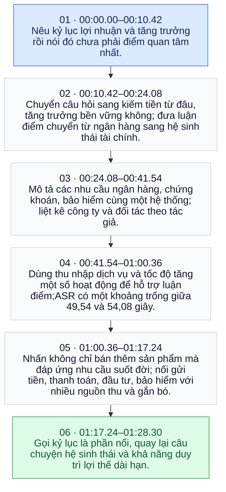

# Sau lợi nhuận kỷ lục Techcombank: đổi từ kết quả sang nguồn thu

[Video gốc — @quocthichkinhte](https://www.tiktok.com/@quocthichkinhte/video/7672004205518933255) · ID `7672004205518933255`

**Tóm tắt cách kể:** Tin thành tích → “điều tôi quan tâm hơn” → câu hỏi nguồn thu → định nghĩa bằng nhu cầu khách hàng → số liệu → cơ chế gắn bó → quay lại thành tích. Đây là hook đổi góc đánh giá: cho người xem thêm một câu hỏi về cùng bản tin. Không có dữ liệu chứng minh hook tạo lượt xem, và không dùng luận điểm quảng bá làm sự thật đã kiểm chứng.

[Sơ đồ diễn biến](#mindmap) · [Diễn biến](#dien-bien) · [Nhịp cảm xúc](#cam-xuc) · [Cách áp dụng](#ap-dung)

## Sơ đồ diễn biến

Đọc từ trên xuống: mỗi hộp là một nhịp theo mốc ASR hoặc khung hình được ghi trong phân tích. Xanh dương là mở đầu, xanh lá là nhịp cuối. Chi tiết và giới hạn nằm trong phân tích bên dưới.

[Mã Mermaid riêng](../mindmaps/7672004205518933255.mmd)

## Dữ liệu và nguồn

**Cách thể hiện:** Người dẫn và hình minh họa

**Ngữ cảnh thương mại:** Có hashtag #hoptaccungtechcombank trong metadata gốc; mẫu hợp tác thương mại, không coi là phân tích độc lập hoặc khuyến nghị ngân hàng.

- Đăng: 2026-08-09T13:30:00+00:00. Metadata lấy: 2026-11-15T04:08:56.952237+00:00.
- **316,300 view**; thích 360; bình luận 2; chia sẻ 4; lưu 33. Dấu phẩy tách hàng nghìn.
- Thời lượng media: 88.31s.
- **20.47× P50** 15,450 của 148 bài đủ 48h trong snapshot kênh. Clip có trong cửa sổ baseline. Không phải thống kê toàn bộ kênh.

## Phạm vi kiểm

Đã tải media, xem khung chọn lọc và đọc ASR có mốc lưu lúc 2026-11-15T04:09:13.844161+00:00. Đối chiếu cùng ID và thời lượng, lệch 0.001s. **Chưa nghe toàn âm hoặc xem chuyển động liên tục; chưa xác nhận toàn văn ASR hay mọi dữ kiện kinh tế trong clip.**

Media SHA256: `bced3e75fe3757355e9cb93b7bfb50bf9dbaa262a0fbf081c762581236102d31`. [Metadata và các hash khác](../videos.json). Video/ASR đầy đủ giữ ở bộ nghiên cứu cục bộ; bản chia sẻ giữ link gốc, trích ngắn và phân tích riêng.

## Lời hứa và câu hỏi trung tâm

**Lời hứa:** Giải thích điều tác giả xem quan trọng hơn lợi nhuận kỷ lục: cấu trúc nguồn thu và việc nối dịch vụ tài chính.

**Câu hỏi:** Ngoài con số lợi nhuận, nguồn thu và quan hệ với khách hàng cho biết điều gì về mô hình ngân hàng theo tác giả?

## Mở đầu: lời và hình

0–6,42 giây ASR nêu lợi nhuận trước thuế quýII và mức tăng theo tác giả. 6,42–10,42 giây lập tức đổi hướng: thành tích đó chưa phải điều người dẫn quan tâm nhất. Khung 1–5 giây chèn ảnh bài báo về kỷ lục, có tô vàng dòng số liệu; sau đó hình trở lại người dẫn. Hook dùng thông tin đang nổi để mở câu hỏi về chất lượng nguồn thu, trong một clip có hashtag hợp tác cùng Techcombank ở metadata.

> Techembang vừa công bố lợi nhuận chứa thuế Q2 đạt mức kỷ lục 9.670 tỷ đồng

Trích ASR ngắn từ segment 00:00.00–00:04.28. Trích ASR chưa nghe đối chiếu; dữ kiện thuộc lời người đăng, chưa xác thực. Xem giới hạn từng ca. Dấu … nghĩa là bỏ bớt, không khẳng định toàn câu vừa ba giây.

| Mốc khung đã xem | Điều quan sát được |
|---|---|
| 00:00.00 | Người dẫn áo đen trước nền ánh đỏ và bảng số kiểu chứng khoán; hai tay mở khi nói. |
| 00:01.00 | Ảnh bài báo với tiêu đề Techcombank tiếp tục phá kỷ lục lợi nhuận trong quýII phủ giữa thân người dẫn. |
| 00:03.00 | Dòng số liệu trong ảnh bài báo được tô vàng, làm rõ điểm mở bằng kết quả kinh doanh. |
| 00:13.25 | Người dẫn trở lại, phụ đề trắng có cụm quan trọng nhấn bằng nền đỏ. |
| 00:26.49 | Ảnh góc trên bàn tư vấn/họp chèn vào giữa, nền người dẫn phía sau được làm mờ. |
| 00:39.74 | Hình minh họa nhà/cây và thương hiệu đặt trong dải ngang, hai phía có nền đen; tương ứng phần dịch vụ/đối tác. |
| 00:52.98 | Thẻ biểu đồ cột cólogo Techcombank và số lợi nhuận trước thuế 18,5 nghìn tỷ; chữ nhỏ nên cần nguồn gốc để kiểm. |
| 01:06.23 | Người dẫn cùng phụ đề về toàn bộ nhu cầu, nhấn một cụm bằng màu đỏ. |
| 01:27.31 | Người dẫn chắp tay ở phần kết luận về lợi thế cạnh tranh; không thấy lệnh mua hay CTA trong khung cuối. |

Không suy chuyển động giữa các khung từ ảnh tĩnh.

## Diễn biến và nhiệm vụ từng beat

| Mốc ASR | Diễn giải riêng | Vai trò |
|---|---|---|
| 00:00.00–00:10.42 | Nêu kỷ lục lợi nhuận và tăng trưởng rồi nói đó chưa phải điểm quan tâm nhất. | Mượn kết quả dễ chú ý để mở khoảng trống về điều sâu hơn. |
| 00:10.42–00:24.08 | Chuyển câu hỏi sang kiếm tiền từ đâu, tăng trưởng bền vững không; đưa luận điểm chuyển từ ngân hàng sang hệ sinh thái tài chính. | Đổi thước đo từ quy mô lợi nhuận sang cấu trúc kinh doanh. |
| 00:24.08–00:41.54 | Mô tả các nhu cầu ngân hàng, chứng khoán, bảo hiểm cùng một hệ thống; liệt kê công ty và đối tác theo tác giả. | Dịch nhãn hệ sinh thái thành những dịch vụ cụ thể. |
| 00:41.54–01:00.36 | Dùng thu nhập dịch vụ và tốc độ tăng một số hoạt động để hỗ trợ luận điểm;ASR có một khoảng trống giữa 49,54 và 54,08 giây. | Đưa số liệu làm phần chống lưng sau khi đã giải thích mô hình. |
| 01:00.36–01:17.24 | Nhấn không chỉ bán thêm sản phẩm mà đáp ứng nhu cầu suốt đời; nối gửi tiền, thanh toán, đầu tư, bảo hiểm với nhiều nguồn thu và gắn bó. | Giải thích cơ chế kỳ vọng thay vì dừng ở danh sách công ty. |
| 01:17.24–01:28.30 | Gọi kỷ lục là phần nổi, quay lại câu chuyện hệ sinh thái và khả năng duy trì lợi thế dài hạn. | Khép vòng thông tin đầu bằng cùng một thước đo mới; đây là nhận định của tác giả. |

## Nhịp cảm xúc — giả thuyết biên tập

Các trạng thái dưới đây là cách đọc câu chuyện từ bằng chứng, không phải cảm xúc người xem đã đo hoặc biểu đồ retention.

| Mốc | Cảm xúc có thể gợi | Bằng chứng | Cách diễn giải |
|---|---|---|---|
| 00:00.00–00:10.42 | Chú ý rồi muốn biết điều bị bỏ qua | Con số kỷ lục đi trước câu chưa phải điều quan tâm nhất. | Hạ trọng tâm của tin lớn để mở một câu hỏi mới; phản ứng chưa được đo. |
| 00:10.42–00:24.08 | Chờ một cách đọc khác | Nguồn tiền và bền vững được nêu rồi dẫn sang hệ sinh thái. | Đặt người dẫn vào vai giải thích ý nghĩa, không chỉ đọc số. |
| 00:24.08–01:00.36 | Có mô hình để hình dung | Dịch vụ, công ty và số thu nhập được đưa thành từng lớp. | Tạo cảm giác luận điểm có cấu trúc; dữ kiện vẫn cần nguồn. |
| 01:00.36–01:28.30 | Có lời giải chung cho các dịch vụ | Nhiều nhu cầu trong đời khách hàng được nối với gắn bó và nguồn thu. | Cho các mục rời rạc một câu chuyện, nhưng kết luận hiện thuận chiều thương hiệu. |

## Cách phân phối thông tin

| Mốc | Động tác viết | Vì sao đáng chú ý |
|---|---|---|
| 00:00.00–00:10.42 | Đưa tin quen rồi đổi trọng tâm. | Tạo lý do xem tiếp sau khi người xem đã biết kết quả. |
| 00:10.42–00:24.08 | Nói tiêu chí đánh giá trước lời giải. | Nguồn thu và bền vững trở thành khung để đọc phần sau. |
| 00:24.08–00:41.54 | Dịch hệ sinh thái thành chuỗi nhu cầu. | Giảm tính trừu tượng của thuật ngữ doanh nghiệp. |
| 00:41.54–01:00.36 | Chèn số liệu và biểu đồ sau mô hình. | Các số có một ý cần hỗ trợ thay vì thành danh sách thành tích rời rạc. |
| 01:00.36–01:28.30 | Nối nhu cầu với nguồn thu/gắn bó rồi gọi lại mở bài. | Tạo kết luận thống nhất, nhưng cần thêm kiểm tra để tránh chỉ diễn đạt thông điệp hợp tác. |

## Giải đáp và cách kết

Kết quay lại con số kỷ lục để gọi nó là phần nổi, rồi nâng luận điểm hệ sinh thái thành khả năng duy trì lợi thế. Không thấy CTA mua trong ASR hoặc khung cuối, nhưng metadata có dấu hợp tác nên không coi đây là bình luận hoàn toàn độc lập.

## Điểm mạnh có dẫn chứng

- **Chuyển góc rất sớm** — 6,42–10,42 giây đã rời kỷ lục sang điều đáng quan tâm hơn.

- **Có hình cho mốc số mở đầu** — Khung 1–5 giây hiện ảnh bài báo và dòng tô vàng.

- **Thuật ngữ được giải thích bằng nhu cầu** — 24,08–33,16 giây nêu nhu cầu ngân hàng, đầu tư và bảo hiểm trước danh sách đơn vị.

- **Kết gọi lại mở bài** — 77,24–88,3 giây quay về con số kỷ lục như phần nổi.

## Điểm yếu và điều không nên bắt chước

- **Bền vững được hứa nhưng chưa kiểm đủ** — 15,32–17,3 giây đặt câu hỏi bền vững; kết chủ yếu nêu lợi ích hệ sinh thái mà chưa so rủi ro/chi phí.

- **Đọc tên nhiều đơn vị trong một nhịp** — 33,16–41,54 giây liệt kê công ty và đối tác, có thể dày thuật ngữ với người mới.

- **Nguồn số trên màn nhỏ** — Ảnh báo ở 1 giây và thẻ 52,98 giây chứa chữ nhỏ, cần đường dẫn tài liệu để kiểm.

- **Ngữ cảnh hợp tác ảnh hưởng cách học mẫu** — Hashtag hợp tác trong metadata đòi hỏi phân biệt thủ pháp giải thích với thông điệp quảng bá.

## Khả năng được chia sẻ — chưa kiểm chứng

Không có dữ liệu phân phối/retention để kết luận vì sao viral. Các ý sau chỉ là giả thuyết để thử:

- Câu hỏi tiền đến từ đâu có thể giúp người xem gửi clip như cách đọc báo cáo, nhưng chưa có dữ liệu chia sẻ xác nhận.

- Thông tin về ngân hàng quen có thể tạo nhận diện với khách hàng hiện hữu; không suy mức quan tâm thực từ lượt xem.

## Chuyển cơ chế sang bài mới

Học việc đưa một chỉ số tiêu đề rồi chuyển sang câu hỏi giúp đọc chất lượng của chỉ số đó. Phải thực sự đưa thêm dữ liệu và kiểm tra phản chứng; công khai ngữ cảnh hợp tác, tách nhận định thương hiệu khỏi kết luận phân tích độc lập.

- Công khai hợp tác khi có metadata hoặc bằng chứng tương ứng.

- Nếu hứa đánh giá bền vững, thêm nguồn gốc doanh thu, chi phí và yếu tố có thể bác luận điểm.

- Đính nguồn báo cáo gốc, kỳ so sánh và định nghĩa từng chỉ số.

- Cho sơ đồ dịch vụ theo nhu cầu trước khi đọc tên công ty.

- Giữ hook đổi góc nhưng trả lời phần mới bằng bằng chứng, không chỉ lời nhấn mạnh.

- Không chuyển bài phân tích thủ pháp thành khuyến nghị mua cổ phiếu hay sản phẩm ngân hàng.

Không dùng bài chuyển thể chưa được người dùng duyệt làm mẫu giọng lâu dài.

## Giới hạn còn lại

- Đã đọc toàn bộ ASR có timestamp và xem 12 khung trích của bản tải mới; chưa nghe toàn âm hoặc xem video liên tục.

- Mốc nhịp dựa trên ASR; không dùng bản chép tự động làm trích dẫn nguyên văn.

- Không có retention hay thử nghiệm nhân quả; số lượt xem không chứng minh hook tạo ra kết quả.

- Metadata mô tả có#hoptaccungtechcombank, nên đánh dấu nội dung hợp tác thương hiệu; không suy chi tiết hợp đồng hoặc mức chi trả.

- Lợi nhuận 9.670 tỷ, các mức tăng và thu nhập dịch vụ được ghi theo clip; chưa kiểm chứng báo cáo gốc, kỳ và cách phân loại.

- ASR nhận sai tên Techcombank,TechcomLife,TechcomInsurance và đối tác; phân tích không dùng cách viết máy như trích dẫn chính xác.

- ASR thiếu 49,54–54,08 giây; không suy nội dung phần này chỉ từ biểu đồ khung 52,98 giây.

- Mô hình hệ sinh thái có thể tạo gắn bó/lợi thế là luận điểm tác giả; clip mẫu chưa cung cấp phép đo nhân quả hoặc phân tích đầy đủ chi phí và rủi ro.
