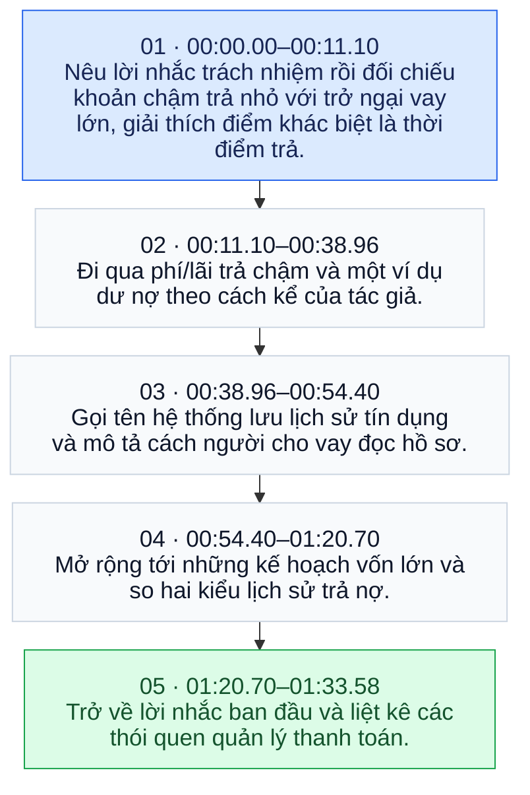

# Khoản trả chậm nhỏ và hệ quả tín dụng kéo dài

[Video gốc — @longkhongphainong](https://www.tiktok.com/@longkhongphainong/video/7672379979208035605) · ID `7672379979208035605`

**Tóm tắt cách kể:** Lệnh nhắc ngắn → khoản nhỏ va kế hoạch lớn → giải thích chi phí và hồ sơ → kéo hệ quả ra tương lai → quay lại hành động quản lý.

[Sơ đồ diễn biến](#mindmap) · [Diễn biến](#dien-bien) · [Nhịp cảm xúc](#cam-xuc) · [Cách áp dụng](#ap-dung)

## Sơ đồ diễn biến

Đọc từ trên xuống: mỗi hộp là một nhịp theo mốc ASR hoặc khung hình được ghi trong phân tích. Xanh dương là mở đầu, xanh lá là nhịp cuối. Chi tiết và giới hạn nằm trong phân tích bên dưới.

[Mã Mermaid riêng](../mindmaps/7672379979208035605.mmd)

## Dữ liệu và nguồn

**Cách thể hiện:** Hoạt hình bình luận

**Phạm vi học:** Xem phạm vi kiểm và giới hạn từng ca.

**Ngữ cảnh thương mại:** Chưa xác nhận hợp tác thương mại; xem các đoạn tự quảng bá/giới hạn được ghi riêng.

- Đăng: 2026-08-10T13:30:00+00:00. Metadata lấy: 2026-11-15T03:46:21.231155+00:00.
- **365,100 view**; thích 6,205; bình luận 35; chia sẻ 242; lưu 169. Dấu phẩy tách hàng nghìn.
- Thời lượng media: 94.78s.
- **20.28× P50** 18,000 của 150 bài đủ 48h trong snapshot kênh. Clip có trong cửa sổ baseline. Không phải thống kê toàn bộ kênh.

## Phạm vi kiểm

Đã tải media, xem khung chọn lọc và đọc ASR có mốc lưu lúc 2026-11-05T13:05:03.421754+00:00. Đối chiếu cùng ID và thời lượng, lệch 0.0219s. **Chưa nghe toàn âm hoặc xem chuyển động liên tục; chưa xác nhận toàn văn ASR hay mọi dữ kiện trong clip.**

Media SHA256: `c70e8b702efa26befadf94009ddcfbf3d59bb11ed8fb29998bfddd37aaeffd0a`. [Metadata và các hash khác](../videos.json). Video/ASR đầy đủ giữ ở bộ nghiên cứu cục bộ; bản chia sẻ giữ link gốc, trích ngắn và phân tích riêng.

## Lời hứa và câu hỏi trung tâm

**Lời hứa:** Giải thích vì sao một lần chậm trả ít tiền có thể ảnh hưởng cả kế hoạch vay lớn, rồi nêu các thói quen quản lý theo cách tác giả trình bày.

**Câu hỏi:** Vì sao mức tiền nhỏ không làm một vi phạm thời hạn trở thành chuyện không đáng kể trong đánh giá tín dụng?

## Mở đầu: lời và hình

Lời mở là một yêu cầu hành động khá chung, nhưng 1,62–6,82 giây lập tức đặt khoản trả chậm nhỏ cạnh kế hoạch vay lớn. Khung 1 giây hiển thị lời nhắc trách nhiệm; các khung 2–5 giây cho thấy nhân vật xem nhẹ việc chậm trả rồi gặp người đánh giá hồ sơ. Điểm tạo câu hỏi ở đây là vì sao chuyện nhỏ hiện tại có thể cản mục tiêu lớn sau này, không chỉ là câu mệnh lệnh đầu.

Không chép câu mở vì ASR có lỗi; xem diễn giải và khung nguồn.

| Mốc khung đã xem | Điều quan sát được |
|---|---|
| 00:01.00 | Một dòng chữ nhắc trách nhiệm chiếm giữa khung, nhân vật rồng đứng dưới. |
| 00:03.00 | Hai biểu tượng tín dụng mang dấu giận dữ cạnh nhân vật, phía trên có lời nghĩ xem nhẹ việc chậm trả. |
| 00:05.00 | Khung thêm người thẩm định và lời từ chối vay, đối lập sự xem nhẹ ở nửa trên. |
| 00:28.44 | Hai cột đỏ được đặt cạnh nhãn loại khoản vay để minh họa so chi phí. |
| 00:42.65 | Khung chữ đặt CIC như một khái niệm cần giải thích, nhân vật cầm điện thoại. |
| 01:25.31 | Ảnh giao diện Ví Trả Sau và ưu đãi xuất hiện trong phần nhắc thói quen sử dụng. |
| 01:33.78 | Khung cuối có giao diện hóa đơn/nhắc hạn thanh toán; đây là hình minh họa sản phẩm chứ chưa xác minh tính phổ quát của hướng dẫn. |

Không suy chuyển động giữa các khung từ ảnh tĩnh.

## Diễn biến và nhiệm vụ từng beat

| Mốc ASR | Diễn giải riêng | Vai trò |
|---|---|---|
| 00:00.00–00:11.10 | Nêu lời nhắc trách nhiệm rồi đối chiếu khoản chậm trả nhỏ với trở ngại vay lớn, giải thích điểm khác biệt là thời điểm trả. | Chuyển mệnh lệnh đạo đức thành một nghịch lý có hệ quả cụ thể. |
| 00:11.10–00:38.96 | Đi qua phí/lãi trả chậm và một ví dụ dư nợ theo cách kể của tác giả. | Giải thích chi phí trực tiếp và cho sự nhỏ trước mắt có một mức giá. |
| 00:38.96–00:54.40 | Gọi tên hệ thống lưu lịch sử tín dụng và mô tả cách người cho vay đọc hồ sơ. | Đưa mắt xích giữa hành vi hôm nay và đánh giá sau này. |
| 00:54.40–01:20.70 | Mở rộng tới những kế hoạch vốn lớn và so hai kiểu lịch sử trả nợ. | Trả câu hỏi mở bằng tương lai mà người xem có thể quan tâm. |
| 01:20.70–01:33.58 | Trở về lời nhắc ban đầu và liệt kê các thói quen quản lý thanh toán. | Đổi từ nhận diện rủi ro sang hành động; một tỷ lệ trong ASR không đáng tin nên không sao chép. |

## Nhịp cảm xúc — giả thuyết biên tập

Các trạng thái dưới đây là cách đọc câu chuyện từ bằng chứng, không phải cảm xúc người xem đã đo hoặc biểu đồ retention.

| Mốc | Cảm xúc có thể gợi | Bằng chứng | Cách diễn giải |
|---|---|---|---|
| 00:00.00–00:06.82 | Từ quen tai sang cảnh giác | Lời nhắc chung được nối ngay với đối chiếu khoản nhỏ và mục tiêu mua nhà/xe. | Hệ quả tương lai làm thông điệp chung có lý do nghe tiếp. |
| 00:06.82–00:11.10 | Muốn hiểu mắt xích | Tác giả chuyển trọng tâm từ số tiền sang việc trả trễ. | Điểm thay thước đo có thể mở một câu hỏi cơ chế. |
| 00:11.10–00:38.96 | Cân lại chi phí trước mắt | Ví dụ phí/lãi làm điều bị xem nhẹ có hậu quả trực tiếp. | Cần dữ kiện sản phẩm đúng để không biến giải thích thành hù dọa. |
| 00:38.96–01:20.70 | Nhìn xa hơn hiện tại | Lịch sử trả nợ được nối với hồ sơ và mục tiêu vốn tương lai. | Người xem có thể liên hệ với một kế hoạch bản thân, nhưng chưa có đo lường phản ứng. |
| 01:20.70–01:33.58 | Có việc để làm | Kết liệt kê nhắc hạn và chủ động thanh toán. | Đổi cảnh giác thành hành động có thể làm kết bớt bất lực; các hướng dẫn vẫn cần kiểm riêng. |

## Cách phân phối thông tin

| Mốc | Động tác viết | Vì sao đáng chú ý |
|---|---|---|
| 00:00.00–00:11.10 | Đổi thước đo của vấn đề | Từ khoản tiền nhiều/ít sang giữ hay lỡ cam kết thời gian. |
| 00:11.10–00:38.96 | Đi từ hậu quả trực tiếp | Phí/lãi là bước gần để không nhảy thẳng từ vài trăm nghìn tới vay nhà. |
| 00:38.96–00:54.40 | Giải thích cơ chế trung gian | Lịch sử tín dụng là mắt xích giúp quan hệ hiện tại/tương lai có logic. |
| 00:54.40–01:20.70 | Đặt người xem vào một kế hoạch lớn | Mua nhà, xe hoặc học tập làm hệ quả dài hạn cụ thể hơn chữ rủi ro. |
| 01:20.70–01:33.58 | Quay lại hành động | Kết nhắc điều có thể quản lý; không chỉ lặp rủi ro. |

## Giải đáp và cách kết

Lặp lại thông điệp trách nhiệm rồi chốt ở khả năng trả đúng hạn. Kết đã đóng được quan hệ khoản nhỏ với hệ quả dài, nhưng hướng dẫn sản phẩm/tỷ lệ trong clip không được lượt phân tích này xác nhận.

## Điểm mạnh có dẫn chứng

- **Bất cân xứng nhỏ/lớn xuất hiện ngay sau lời mở.** — 1,62–6,82 giây đặt khoản chậm nhỏ cạnh vay nhà/xe.

- **Có mắt xích giải thích trước hệ quả tương lai.** — 38,96–54,4 giây giải thích lịch sử trả nợ rồi mới đi tới các kế hoạch.

- **Lời kết trở lại được thông điệp đầu.** — 80,7–93,58 giây nhắc quản lý và trả đúng hạn.

## Điểm yếu và điều không nên bắt chước

- **Câu đầu riêng lẻ vẫn rất chung.** — 0–1,62 giây chỉ là lời kêu gọi trách nhiệm; sức nặng chủ yếu đến từ nhịp 1,62–11,1.

- **Khuyến nghị mang tính sản phẩm có thể bị khái quát quá mức.** — 11,1–38,96 giây nói phí/lãi, 83,14–86,28 giây có tỷ lệ ASR không chắc.

- **Hình cuối có yếu tố quảng bá giao diện và ưu đãi.** — 85,31 giây là giao diện Ví Trả Sau; cần phân biệt phân tích cơ chế với giới thiệu sản phẩm.

## Khả năng được chia sẻ — chưa kiểm chứng

Không có dữ liệu phân phối/retention để kết luận vì sao viral. Các ý sau chỉ là giả thuyết để thử:

- Có thể được chia sẻ như lời nhắc cho người mới dùng tín dụng, vì nối hành vi nhỏ với mục tiêu lớn; chưa có dữ liệu chia sẻ thực để xác nhận.

- Danh sách cuối có thể tạo động cơ lưu lại, nhưng lượt lưu riêng chưa chứng minh đoạn nào làm điều đó.

## Chuyển cơ chế sang bài mới

Học cách nối một hành động nhỏ với một mục tiêu dài hạn qua mắt xích cụ thể; đừng chỉ hù dọa bằng hệ quả lớn. Khi viết mới, kiểm quy định/sản phẩm thật và không bê tỷ lệ hoặc điều kiện phí từ ca nguồn sang mọi khoản vay.

- Đưa đối chiếu hệ quả cụ thể ngay sau câu nhắc chung.

- Giải thích mắt xích trung gian thay vì nhảy từ hành động nhỏ sang kết quả đáng sợ.

- Kiểm điều kiện của từng sản phẩm/tổ chức trước khi dùng số hay quy tắc.

- Nếu có hình sản phẩm/ưu đãi, làm rõ mục đích và không ngầm coi nó là nguồn tư vấn trung lập.

Không dùng bài chuyển thể chưa được người dùng duyệt làm mẫu giọng lâu dài.

## Giới hạn còn lại

- Đã đọc ASR có mốc và xem contact sheet mới gồm các khung chọn lọc; chưa nghe toàn âm hoặc xem chuyển động liên tục.

- Nhịp cảm xúc, lý do chú ý và khả năng chia sẻ dưới đây là giả thuyết biên tập, không phải dữ liệu retention hay kết quả thử nghiệm.

- Lượt này chưa kiểm quy tắc ghi nhận CIC, điều kiện phí/lãi hoặc phê duyệt khoản vay của các tổ chức tài chính.

- ASR nhận sai thuật ngữ tín dụng và tỷ lệ ở 83,14–86,28 giây; không dùng tỷ lệ đó làm dữ kiện hoặc lời khuyên.

- Khung cuối hiển thị giao diện và ưu đãi của một ví; chưa đủ bằng chứng để xác định đây là quảng cáo trả phí, nhưng cần ghi yếu tố thương mại thay vì gọi ca thuần trung lập.
