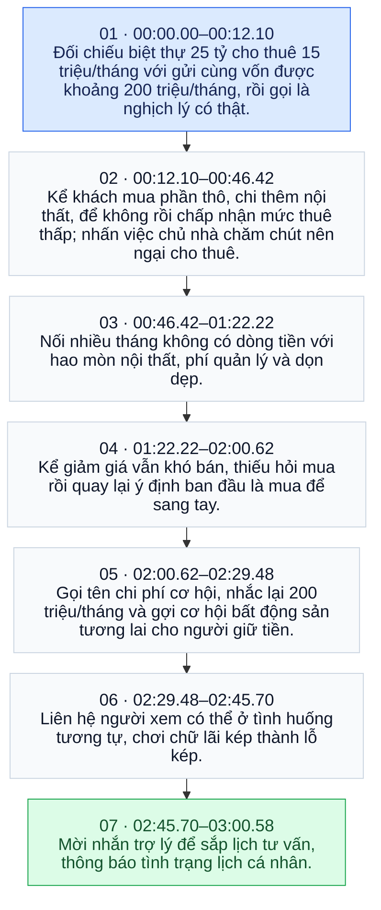

# Biệt thự 25 tỷ cho thuê 15 triệu: nghịch lý dòng tiền và chi phí cơ hội

[Video gốc — @nguyentrangtkneu](https://www.tiktok.com/@nguyentrangtkneu/video/7673475558734433543) · ID `7673475558734433543`

**Tóm tắt cách kể:** Cùng vốn nhưng khác dòng tiền → ca cụ thể → chuỗi chi phí và khó bán → gọi tên chi phí cơ hội → chơi chữ → tư vấn. Nhịp quay lại số đầu giúp liên kết câu chuyện dài, nhưng chưa có dữ liệu cho biết người xem ở lại đến CTA.

[Sơ đồ diễn biến](#mindmap) · [Diễn biến](#dien-bien) · [Nhịp cảm xúc](#cam-xuc) · [Cách áp dụng](#ap-dung)

## Sơ đồ diễn biến

Đọc từ trên xuống: mỗi hộp là một nhịp theo mốc ASR hoặc khung hình được ghi trong phân tích. Xanh dương là mở đầu, xanh lá là nhịp cuối. Chi tiết và giới hạn nằm trong phân tích bên dưới.

[Mã Mermaid riêng](../mindmaps/7673475558734433543.mmd)

## Dữ liệu và nguồn

**Cách thể hiện:** Người dẫn nói trực diện

**Phạm vi học:** Xem phạm vi kiểm và giới hạn từng ca.

**Ngữ cảnh thương mại:** Chưa xác nhận hợp tác thương mại; xem các đoạn tự quảng bá/giới hạn được ghi riêng.

- Đăng: 2026-08-13T11:24:20+00:00. Metadata lấy: 2026-11-15T04:03:38.114135+00:00.
- **1,200,000 view**; thích 17,900; bình luận 1,255; chia sẻ 1,382; lưu 1,511. Dấu phẩy tách hàng nghìn.
- Thời lượng media: 181.34s.
- **114.83× P50** 10,450 của 150 bài đủ 48h trong snapshot kênh. Clip có trong cửa sổ baseline. Không phải thống kê toàn bộ kênh.

## Phạm vi kiểm

Đã tải media, xem khung chọn lọc và đọc ASR có mốc lưu lúc 2026-11-15T04:04:44.912031+00:00. Đối chiếu cùng ID và thời lượng, lệch 0.0s. **Chưa nghe toàn âm hoặc xem chuyển động liên tục; chưa xác nhận toàn văn ASR hay mọi dữ kiện trong clip.**

Media SHA256: `86e149501315719fdcc1a128a6e17962267aa242d5a6d3d7ba9bcb0b8d260af4`. [Metadata và các hash khác](../videos.json). Video/ASR đầy đủ giữ ở bộ nghiên cứu cục bộ; bản chia sẻ giữ link gốc, trích ngắn và phân tích riêng.

## Lời hứa và câu hỏi trung tâm

**Lời hứa:** Giải thích vì sao tài sản giá trị cao vẫn có thể gây căng dòng tiền và chi phí cơ hội.

**Câu hỏi:** Điều gì biến kế hoạch sở hữu rồi bán một biệt thự thành thế mắc kẹt?

## Mở đầu: lời và hình

Khung 0–3 giây đặt nhiều con số đối diện: biệt thự 25 tỷ, thuê 15 triệu, gửi tiết kiệm và khoản theo tháng/năm. ASR lập cùng một phép so trong 0–9,28 giây, rồi gọi đó là một ca khách hàng. Đây là mở bằng khoảng cách giữa giá trị tài sản lớn và dòng tiền nhỏ, chưa phải minh chứng đầy đủ về hiệu quả hai khoản đầu tư.

> Mua biệt thự 25 tỷ

Trích ASR ngắn từ segment 00:00.00–00:01.92. Trích ASR chưa nghe đối chiếu; dữ kiện thuộc lời người đăng, chưa xác thực. Xem giới hạn từng ca. Dấu … nghĩa là bỏ bớt, không khẳng định toàn câu vừa ba giây.

| Mốc khung đã xem | Điều quan sát được |
|---|---|
| 00:00.00 | Người dẫn ngồi trong không gian nội thất, cầm micro; chữ vàng trên đầu đối chiếu biệt thự 25 tỷ và dòng tiền thuê/gửi tiết kiệm. |
| 00:03.00 | Tiêu đề số vẫn phủ phần trên khung, người dẫn nhìn về máy. |
| 00:27.20 | Tiêu đề đầu đã hết; phụ đề nhấn 25 tỷ khi tiếp tục câu chuyện. |
| 00:54.40 | Cùng cảnh người dẫn; chưa có ảnh căn nhà hay hồ sơ giao dịch trong khung được xem. |
| 01:48.81 | Người dẫn vẫn ngồi kể, phụ đề ngắn theo từng cụm. |
| 02:16.01 | Phụ đề nhấn con số 200 triệu ở phần quay lại phép so tiền gửi. |
| 03:00.34 | Khung cuối vẫn người dẫn, phụ đề về xếp lịch; phù hợp lời mời tư vấn cuối ASR. |

Không suy chuyển động giữa các khung từ ảnh tĩnh.

## Diễn biến và nhiệm vụ từng beat

| Mốc ASR | Diễn giải riêng | Vai trò |
|---|---|---|
| 00:00.00–00:12.10 | Đối chiếu biệt thự 25 tỷ cho thuê 15 triệu/tháng với gửi cùng vốn được khoảng 200 triệu/tháng, rồi gọi là nghịch lý có thật. | Đặt hai đầu ra khác biệt cạnh cùng một số vốn. |
| 00:12.10–00:46.42 | Kể khách mua phần thô, chi thêm nội thất, để không rồi chấp nhận mức thuê thấp; nhấn việc chủ nhà chăm chút nên ngại cho thuê. | Đổi con số mở màn thành một nhân vật và sự gắn bó cụ thể. |
| 00:46.42–01:22.22 | Nối nhiều tháng không có dòng tiền với hao mòn nội thất, phí quản lý và dọn dẹp. | Làm tổn thất thành chuỗi cộng dồn thay vì một khoản thuê thấp. |
| 01:22.22–02:00.62 | Kể giảm giá vẫn khó bán, thiếu hỏi mua rồi quay lại ý định ban đầu là mua để sang tay. | Giải thích thế mắc kẹt thanh khoản qua sự lệch giữa kế hoạch và kết quả. |
| 02:00.62–02:29.48 | Gọi tên chi phí cơ hội, nhắc lại 200 triệu/tháng và gợi cơ hội bất động sản tương lai cho người giữ tiền. | Quay lại cặp số đầu để khái quát bài học; đồng thời thêm dự báo. |
| 02:29.48–02:45.70 | Liên hệ người xem có thể ở tình huống tương tự, chơi chữ lãi kép thành lỗ kép. | Nén nhiều khoản mất mát thành một nhãn dễ nhớ. |
| 02:45.70–03:00.58 | Mời nhắn trợ lý để sắp lịch tư vấn, thông báo tình trạng lịch cá nhân. | Chuyển bài giải thích thành lời mời sử dụng dịch vụ. |

## Nhịp cảm xúc — giả thuyết biên tập

Các trạng thái dưới đây là cách đọc câu chuyện từ bằng chứng, không phải cảm xúc người xem đã đo hoặc biểu đồ retention.

| Mốc | Cảm xúc có thể gợi | Bằng chứng | Cách diễn giải |
|---|---|---|---|
| 00:00.00–00:12.10 | Ngạc nhiên vì chênh lệch | 25 tỷ đối diện 15 triệu và 200 triệu theo tháng. | Tương phản số có thể tạo thắc mắc ngay; chưa đo phản ứng. |
| 00:12.10–00:46.42 | Đồng cảm với người sở hữu | Câu chuyện chăm chút nội thất nhưng ngại cho thuê. | Đưa cảm xúc sở hữu vào lựa chọn vốn tưởng chỉ có số. |
| 00:46.42–02:00.62 | Áp lực cộng dồn | Không thu tiền, vẫn chi phí, giảm giá vẫn khó bán. | Mỗi nhịp thêm một tầng bất lợi. |
| 02:00.62–02:45.70 | Có tên cho vấn đề | Chi phí cơ hội và lỗ kép được nói sau chuỗi tình huống. | Khái niệm đến sau ví dụ có thể dễ ghi nhớ. |
| 02:45.70–03:00.58 | Được mời tìm trợ giúp | Tác giả hướng tới nhắn trợ lý đặt lịch. | Đổi quan hệ từ nghe câu chuyện sang khách hàng tiềm năng. |

## Cách phân phối thông tin

| Mốc | Động tác viết | Vì sao đáng chú ý |
|---|---|---|
| 00:00.00–00:12.10 | Giữ vốn gốc giống nhau, đổi đầu ra. | Làm nổi độ lệch dòng tiền trong một câu. |
| 00:12.10–01:22.22 | Tách giá mua, nội thất, tiền thuê và chi phí vận hành. | Xây chuỗi nguyên nhân cho câu chuyện. |
| 01:22.22–02:00.62 | Tiết lộ kế hoạch mua để bán sau phần khó bán. | Tạo quan hệ trước–sau có mâu thuẫn. |
| 02:00.62–02:45.70 | Đặt tên khái niệm và quay lại con số đầu. | Nối ví dụ với bài học bằng callback. |
| 02:45.70–03:00.58 | Gắn CTA lịch tư vấn. | Bộc lộ mục tiêu chuyển đổi cần được nhận diện khi học mẫu. |

## Giải đáp và cách kết

Phần chốt ý nằm ở nhãn lỗ kép; sau đó còn gần 15 giây mời tư vấn. Vì vậy kết thúc chức năng là chuyển đổi dịch vụ, không chỉ là khép bài học về dòng tiền.

## Điểm mạnh có dẫn chứng

- **Phép so đầu rõ đầu vào** — 0–9,28 giây đều xoay quanh cùng 25 tỷ.

- **Có quyết định và hậu quả** — 12,1–120,62 giây nối nội thất, ngại thuê, chi phí và khó bán.

- **Khái niệm xuất hiện sau tình huống** — Chi phí cơ hội tới ở 120,62 giây sau khi đã kể hậu quả.

## Điểm yếu và điều không nên bắt chước

- **Mật độ chữ số cao ở mở màn** — Khung 0 giây chứa vốn, tiền thuê, gửi tiết kiệm, tháng và năm trên nhiều dòng.

- **Bằng chứng ca ít nhìn được** — Các khung 27,2–108,81 giây vẫn là người dẫn, chưa có tài liệu căn nhà.

- **Phép so dễ bị hiểu thành đánh giá toàn bộ đầu tư** — Mở màn chỉ dùng dòng tiền trong khi phần sau nhận xét lựa chọn bất động sản.

- **CTA kéo dài sau điểm chốt** — 165,7–180,58 giây dành cho lịch tư vấn sau nhãn lỗ kép.

## Khả năng được chia sẻ — chưa kiểm chứng

Không có dữ liệu phân phối/retention để kết luận vì sao viral. Các ý sau chỉ là giả thuyết để thử:

- Cặp số có thể được chia sẻ để tranh luận về dòng tiền; không có dữ liệu chứng minh lý do chia sẻ.

- Nhãn lỗ kép có thể giúp người xem gọi tên trải nghiệm của mình, nhưng dễ làm đơn giản hóa hoàn cảnh khác nhau.

## Chuyển cơ chế sang bài mới

Học cách mở bằng cùng một đầu vào để làm rõ phép so, sau đó truy ngược những quyết định tạo ra chênh lệch. Khi dùng ca thật phải có nguồn hoặc đánh dấu lời kể của tác giả; so sánh cần nói đủ phạm vi, không dùng tiền thuê đối chiếu lãi gửi để kết luận tổng lợi nhuận.

- Chỉ dùng ca có nguồn, không bịa khách hàng để tăng uy tín.

- Đặt cùng kỳ hạn và ghi rõ đang so dòng tiền hay tổng lợi nhuận.

- Cho thấy bảng chi phí hoặc tài liệu đã ẩn thông tin thay vì chỉ tăng cường lời khẳng định.

- Nếu video có CTA, đánh dấu riêng đoạn bài học kết thúc và đoạn chuyển đổi.

Không dùng bài chuyển thể chưa được người dùng duyệt làm mẫu giọng lâu dài.

## Giới hạn còn lại

- Đã đọc toàn bộ ASR có timestamp và xem 12 khung trích của bản tải mới; chưa nghe toàn âm hoặc xem video liên tục.

- Mốc nhịp dựa trên ASR; không dùng bản chép tự động làm trích dẫn nguyên văn.

- Không có retention hay thử nghiệm nhân quả; số lượt xem không chứng minh hook tạo ra kết quả.

- Ca khách hàng, giá mua, giá thuê và nỗ lực bán chưa được xác thực độc lập.

- Lãi gửi 200 triệu/tháng, kỳ hạn và thuế/phí chưa được kiểm chứng; con số tiêu đề theo năm cần đối chiếu lại trước trích dẫn.

- Tiền thuê và lãi tiền gửi chưa bao quát tăng giảm giá tài sản, rủi ro, chi phí và thời hạn nắm giữ.

- Dự báo cơ hội mua bất động sản và CTA tư vấn là nội dung của tác giả, không phải khuyến nghị từ phân tích.
