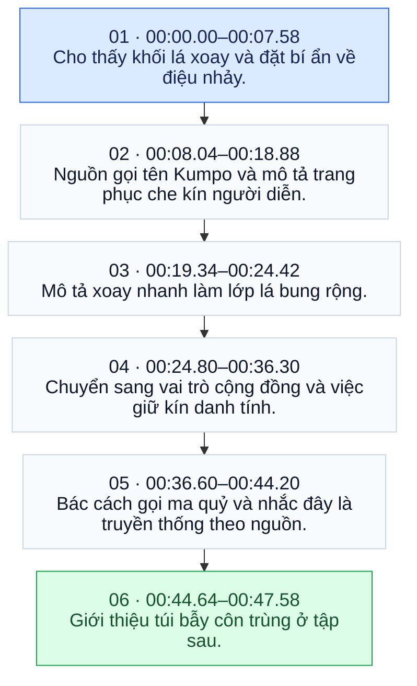

# Kumpo: từ vật thể kỳ lạ đến bối cảnh cộng đồng

[Video gốc — @kienkhongngu_official](https://www.tiktok.com/@kienkhongngu_official/video/7680097632626248968) · ID `7680097632626248968`

**Tóm tắt cách kể:** Hình chuyển động khó nhận diện → khơi dự đoán vui → gọi tên và chỉ ra trang phục → giải thích chuyển động → thêm bối cảnh cộng đồng → sửa nhãn sai. Bí ẩn được giải khá sớm để câu chuyện chuyển từ cái gì sang có ý nghĩa gì.

[Sơ đồ diễn biến](#mindmap) · [Diễn biến](#dien-bien) · [Nhịp cảm xúc](#cam-xuc) · [Cách áp dụng](#ap-dung)

## Sơ đồ diễn biến

Đọc từ trên xuống: mỗi hộp là một nhịp theo mốc ASR hoặc khung hình được ghi trong phân tích. Xanh dương là mở đầu, xanh lá là nhịp cuối. Chi tiết và giới hạn nằm trong phân tích bên dưới.

[Mã Mermaid riêng](../mindmaps/7680097632626248968.mmd)

## Dữ liệu và nguồn

**Cách thể hiện:** Giải thích trên footage

**Phạm vi học:** Học cách chia thông tin theo hình và ASR, giữ giới hạn từng ca.

**Ngữ cảnh thương mại:** Chưa xác nhận tài trợ; nhận diện thương hiệu/quảng bá quan sát được nằm trong phân tích.

- Đăng: 2026-09-02T11:00:00+00:00. Metadata lấy: 2026-11-15T04:34:02.094078+00:00.
- **708,800 view**; thích 17,100; bình luận 62; chia sẻ 1,802; lưu 360. Dấu phẩy tách hàng nghìn.
- Thời lượng media: 48.02s.
- **4.03× P50** 175,800 của 147 bài đủ 48h trong snapshot kênh. Clip có trong cửa sổ baseline. Không phải thống kê toàn bộ kênh.

## Phạm vi kiểm

Đã tải media, xem khung chọn lọc và đọc ASR có mốc lưu lúc 2026-11-15T04:35:18.597841+00:00. Đối chiếu cùng ID và thời lượng, lệch 0.025s. **Chưa nghe toàn âm hoặc xem chuyển động liên tục; chưa xác nhận toàn văn ASR hay mọi dữ kiện trong clip.**

Media SHA256: `244326b09d8620cee3a2b82522c53cacb97c86b801d10b33d1031525f4892f3c`. [Metadata và các hash khác](../videos.json). Video/ASR đầy đủ giữ ở bộ nghiên cứu cục bộ; bản chia sẻ giữ link gốc, trích ngắn và phân tích riêng.

## Lời hứa và câu hỏi trung tâm

**Lời hứa:** Nhận diện một trình diễn có vẻ kỳ lạ và đặt nó vào bối cảnh văn hoá theo nguồn.

**Câu hỏi:** Khối lá tự xoay là gì, và vì sao nó xuất hiện trong cộng đồng?

## Mở đầu: lời và hình

0–2,54 giây ASR dùng lời hứa về sự thật của một điệu nhảy Tây Phi; ảnh0–2 cho thấy một khối lá đang chuyển động giữa sân có khán giả. Từ3–7,58 giây lời dẫn mới diễn tả nó giống bụi cỏ tự xoay. Hình lạ là chất liệu tò mò cụ thể; cách nói toàn thế giới ngạc nhiên chỉ là cường điệu chưa có bằng chứng.

## Nghiên cứu phần mở

Diễn giải từ bằng chứng đã lưu; lý do gây chú ý là giả thuyết biên tập, chưa đo retention.

**Cửa sổ quan sát:** 00:00.00–00:07.58

| Lớp | Quan sát/diễn giải |
|---|---|
| Lời | 0–2,54s hứa tiết lộ sự thật về điệu nhảy;3–7,58s mô tả hiện tượng giống một bụi cỏ xoay và đặt cách hiểu ngộ nghĩnh. |
| Hình | Ảnh0–3s: trang phục phủ lá trong sân đất; hình chuyển từ xa sang gần và lá bung ở tư thế khác. |
| Chữ trên hình | Thẻ đỏ đầu clip nhắc sự thật và Tây Phi; ảnh3s chuyển phụ đề mô tả chuyển động. Không có tên Kumpo trong những ảnh mở đã xem. |

**Động tác gây chú ý:** Vật thể khó nhận diện được đặt trước tên gọi, cho người xem một nhiệm vụ nhận ra nguyên nhân chuyển động.

**Vì sao có thể muốn dừng lại:** Giả thuyết biên tập: khối lá có hình dáng như tự di chuyển giữa người thật có thể khiến người xem dừng để nhận diện; chưa có retention xác nhận.

**Điều còn muốn biết:** Thứ đang xoay là gì, có người bên trong không?

**Thông tin chưa cho biết:** Tên Kumpo, vật liệu trang phục và chức năng cộng đồng chưa xuất hiện trong cửa sổ mở.

**Nhịp nối có gì mới:** 8,04–18,88s không kéo bí ẩn mà gọi tên, đặt địa bàn theo nguồn và giải thích lớp lá che người; sau đó mở câu hỏi về ý nghĩa.

**Mốc trả/giới hạn giải đáp:** 00:08.04–00:44.20 — Trả nhận diện qua trang phục/người diễn và chuyển động; bổ sung ý nghĩa cộng đồng, sửa cách gọi ma quỷ theo nguồn. Kỹ thuật diễn và chi tiết văn hoá chưa được kiểm chứng độc lập.

**Tóm cấu trúc bằng hai câu:** Đưa một hiện tượng khó nhận diện lên hình rồi gọi đúng câu hỏi mà vẻ ngoài gây ra. Giải nhận diện bằng chi tiết thấy được, sau đó mở bối cảnh chức năng và sửa cách hiểu sai.

**Chuyển sang ngách khác:** Chuyển quan hệ hiện tượng bề ngoài–cơ chế bên dưới–ý nghĩa thực sang một biểu đồ hoặc giao dịch có dữ liệu kiểm tra. Sẽ hỏng nếu vẻ lạ được dùng để kết tội bên tham gia hay nếu cơ chế chỉ là suy đoán.

**Điều không chuyển theo:**

- Không dùng nhãn kỳ bí hay phóng đại cả thế giới để thay bằng chứng.
- Không biến hình ảnh tài chính khó hiểu thành cáo buộc gian lận.

**Phạm vi:** Đọc toàn ASR48s và xem12 ảnh có mốc; chưa nghe toàn âm/xem liên tục, chưa xác minh văn hoá gốc.

> Thế giới ngã ngửa trước sự thật về một điệu nhảy tâm linh ở Tây Phi.

Trích ASR ngắn từ segment 00:00.00–00:02.54. Trích ASR ngắn chưa nghe so khớp toàn âm; không khẳng định cả segment là ba giây. Xem phạm vi/giới hạn từng ca. Dấu … nghĩa là bỏ bớt, không khẳng định toàn câu vừa ba giây.

| Mốc khung đã xem | Điều quan sát được |
|---|---|
| 00:00.00 | Một khối trang phục phủ lá ở sân đất có người xem; thẻ đỏ nêu sự thật về điệu nhảy Tây Phi. |
| 00:02.00 | Trang phục ở trạng thái bung rộng, phía sau là người đứng xem. |
| 00:03.00 | Cỡ gần của khối lá; phụ đề mô tả xoay giữa làng. |
| 00:07.20 | Cận lá bung, khoảng dưới trang phục tối; ảnh không đủ xác định người biểu diễn. |
| 00:14.41 | Tư liệu khác với lớp lá màu nâu và người đứng phía sau. |
| 00:21.61 | Phần dưới trang phục cho thấy chân và vải hoa, có ký hiệu mũi tên đỏ chỉ vào. |
| 00:28.81 | Người mặc trang phục đứng gần nhóm người và xe máy trong sân. |
| 00:36.01 | Trang phục lá xoay gần máy, phù hợp đoạn lời nói danh tính thường giữ kín nhưng không xác minh danh tính. |
| 00:43.22 | Toàn thân trang phục đứng cao với một trục nhô lên, người xem trong sân. |
| 00:47.02 | Túi bẫy côn trùng treo ngoài trời, phụ đề hỏi về chủ đề sau. |

Không suy chuyển động giữa các khung từ ảnh tĩnh.

## Diễn biến và nhiệm vụ từng beat

| Mốc ASR | Diễn giải riêng | Vai trò |
|---|---|---|
| 00:00.00–00:07.58 | Cho thấy khối lá xoay và đặt bí ẩn về điệu nhảy. | Kích hoạt câu hỏi thứ gì hoặc ai khiến nó chuyển động. |
| 00:08.04–00:18.88 | Nguồn gọi tên Kumpo và mô tả trang phục che kín người diễn. | Trả lời nhận diện bằng tên và vật liệu, không tiếp tục gợi siêu nhiên. |
| 00:19.34–00:24.42 | Mô tả xoay nhanh làm lớp lá bung rộng. | Giải thích vẻ ngoài khác thường từ chuyển động quan sát được. |
| 00:24.80–00:36.30 | Chuyển sang vai trò cộng đồng và việc giữ kín danh tính. | Mở ý nghĩa vượt khỏi một mẹo trình diễn. |
| 00:36.60–00:44.20 | Bác cách gọi ma quỷ và nhắc đây là truyền thống theo nguồn. | Sửa lối diễn giải giật gân đã có trên mạng. |
| 00:44.64–00:47.58 | Giới thiệu túi bẫy côn trùng ở tập sau. | Cầu nối tập sau sau khi đã trả nhận diện và bối cảnh. |

## Nhịp cảm xúc — giả thuyết biên tập

Các trạng thái dưới đây là cách đọc câu chuyện từ bằng chứng, không phải cảm xúc người xem đã đo hoặc biểu đồ retention.

| Mốc | Cảm xúc có thể gợi | Bằng chứng | Cách diễn giải |
|---|---|---|---|
| 00:00.00–00:07.58 | Lạ mắt | Hình trang phục lá chuyển động đi cùng mô tả như bụi cỏ tự xoay. | Bí ẩn đến từ khó nhận ra hình người, không phải bằng chứng siêu nhiên. |
| 00:08.04–00:24.42 | Có lời giải vật lý | Lời gọi tên, vật liệu che người và chuyển động được đưa liên tiếp. | Câu hỏi nhận diện được giải sớm để mở lớp ý nghĩa khác. |
| 00:24.80–00:36.30 | Tò mò về ý nghĩa | Nguồn kể chức năng cộng đồng và giữ kín danh tính. | Duy trì quan tâm bằng bối cảnh thay vì kéo dài trò đoán. |
| 00:36.60–00:47.58 | Sửa nhận thức rồi chuyển đề tài | Bác tên gọi ma quỷ trước lời hẹn tập. | Đưa sự lạ về phạm vi văn hoá theo nguồn, không xác nhận toàn bộ nội dung. |

## Cách phân phối thông tin

| Mốc | Động tác viết | Vì sao đáng chú ý |
|---|---|---|
| 00:00.00–00:07.58 | Cho thấy trước khi định danh | Người xem có hiện tượng cụ thể để đặt câu hỏi. |
| 00:08.04–00:24.42 | Gọi tên rồi giải vẻ ngoài | Tách trang phục, người diễn và chuyển động. |
| 00:24.80–00:44.20 | Bổ sung chức năng và sửa nhãn | Biến một hình lạ thành bài giải thích bối cảnh theo nguồn. |
| 00:44.64–00:47.58 | Đề tài mới | Không treo câu hỏi cũ để buộc xem tiếp. |

## Giải đáp và cách kết

Phần chính khép bằng việc sửa tên gọi giật gân, nhấn bối cảnh truyền thống theo nguồn; đuôi hẹn một vật lạ khác. Clip không giải hết kỹ thuật biểu diễn hay xác thực từng chi tiết văn hoá.

## Điểm mạnh có dẫn chứng

- **Hình mở tự tạo câu hỏi** — Ảnh0–3s cho thấy trang phục lá chuyển động giữa người xem, trước đoạn định danh8,04s.

- **Có chuyển lớp câu hỏi** — 8,04–24,42s giải cái gì và vì sao trông lạ;24,8–44,2s kể ý nghĩa và sửa nhãn.

- **Chi tiết người diễn được minh hoạ** — Ảnh21,61s có chân và vải dưới lá, hỗ trợ phần giải thích trang phục.

## Điểm yếu và điều không nên bắt chước

- **Mở phóng đại phản ứng xã hội** — 0–2,54s khẳng định cả thế giới ngỡ ngàng mà không có chứng cứ kèm theo.

- **Bối cảnh văn hoá được tóm rất ngắn** — 27,08–44,2s gồm nhiều khái quát cộng đồng nhưng thiếu nguồn chuyên biệt để kiểm tra. Đây là giới hạn bằng chứng, không khẳng định nội dung sai.

## Khả năng được chia sẻ — chưa kiểm chứng

Không có dữ liệu phân phối/retention để kết luận vì sao viral. Các ý sau chỉ là giả thuyết để thử:

- Một vật khó định danh có thể được gửi như câu đố nhìn hình.

- Đoạn sửa cách gọi sai có thể hữu ích trong cuộc trao đổi về một clip tương tự; chưa có dữ liệu chia sẻ.

## Chuyển cơ chế sang bài mới

Học quan hệ vẻ ngoài gây hiểu sai–chi tiết quan sát sửa cách hiểu–bối cảnh làm rõ chức năng. Sang tài chính chỉ áp dụng khi có một hiện tượng và cơ chế có nguồn; không gắn kỳ bí hoặc đạo đức cho nhóm người, không coi một ảnh là bằng chứng gian lận.

- Cho vật thật và chi tiết quan sát trước khi dùng nhãn cơ chế.

- Trả bí ẩn nhận diện sớm rồi mở lớp chức năng có nguồn.

- Tránh cường điệu phản ứng toàn xã hội.

- Kiểm tên gọi và nguồn văn hoá, không khai thác sự lạ để kỳ thị.

Không dùng bài chuyển thể chưa được người dùng duyệt làm mẫu giọng lâu dài.

## Giới hạn còn lại

- Đã đọc toàn bộ ASR có timestamp và xem 12 khung trích của cùng ID; chưa nghe toàn âm thanh hoặc xem video liên tục.

- Không có retention, tỷ lệ xem hết hay thử nghiệm nhân quả; các nhận định giữ chân và chia sẻ là giả thuyết về cách trình bày.

- Các tên văn hoá trong ASR có thể sai phiên âm; bài này gọi Kumpo theo nguồn và không xác nhận cách phiên âm tên cộng đồng.

- Chưa kiểm chứng độc lập xuất xứ tư liệu, ý nghĩa nghi lễ, vùng địa lý hay các khái quát văn hoá.

- Không có bằng chứng cho phát biểu cường điệu toàn thế giới ngạc nhiên. Mô tả metadata không cho biết tiếp cận tự nhiên hay trả phí.
