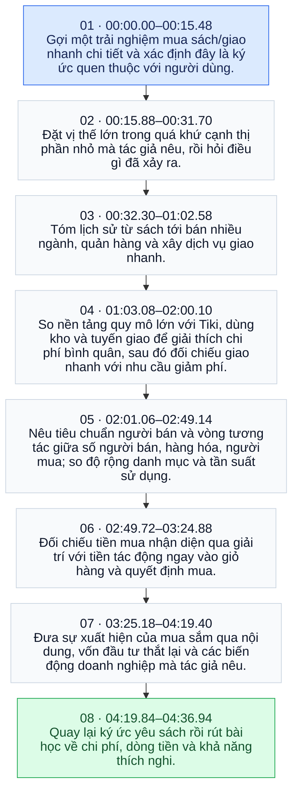

# Tiki: từ ký ức giao sách nhanh đến câu hỏi về mô hình chi phí

[Video gốc — @nqs.kinhte](https://www.tiktok.com/@nqs.kinhte/video/7682344714850323730) · ID `7682344714850323730`

**Tóm tắt cách kể:** Trải nghiệm quen thuộc cụ thể → đối lập quá khứ/hiện tại → lật lợi thế thành một phần của áp lực → phân tầng nguyên nhân → quay lại ký ức. Hook ở đây là một chuỗi mở dài, cho thấy không thể ép mọi ca thành một câu giật trong ba giây.

[Sơ đồ diễn biến](#mindmap) · [Diễn biến](#dien-bien) · [Nhịp cảm xúc](#cam-xuc) · [Cách áp dụng](#ap-dung)

## Sơ đồ diễn biến

Đọc từ trên xuống: mỗi hộp là một nhịp theo mốc ASR hoặc khung hình được ghi trong phân tích. Xanh dương là mở đầu, xanh lá là nhịp cuối. Chi tiết và giới hạn nằm trong phân tích bên dưới.

[Mã Mermaid riêng](../mindmaps/7682344714850323730.mmd)

## Dữ liệu và nguồn

**Cách thể hiện:** Người dẫn và hình minh họa

**Phạm vi học:** Xem phạm vi kiểm và giới hạn từng ca.

**Ngữ cảnh thương mại:** Chưa xác nhận hợp tác thương mại; xem các đoạn tự quảng bá/giới hạn được ghi riêng.

- Đăng: 2026-09-06T09:01:09+00:00. Metadata lấy: 2026-11-15T03:29:48.246050+00:00.
- **1,500,000 view**; thích 77,900; bình luận 612; chia sẻ 7,056; lưu 3,833. Dấu phẩy tách hàng nghìn.
- Thời lượng media: 277.89s.
- **6.57× P50** 228,300 của 149 bài đủ 48h trong snapshot kênh. Clip có trong cửa sổ baseline. Không phải thống kê toàn bộ kênh.

## Phạm vi kiểm

Đã tải media, xem khung chọn lọc và đọc ASR có mốc lưu lúc 2026-11-05T12:44:58.275345+00:00. Đối chiếu cùng ID và thời lượng, lệch 0.0426s. **Chưa nghe toàn âm hoặc xem chuyển động liên tục; chưa xác nhận toàn văn ASR hay mọi dữ kiện trong clip.**

Media SHA256: `545b2389ddff1289eef8a4872e68dd90808cd66703ed3f14dd594f162d65e3fc`. [Metadata và các hash khác](../videos.json). Video/ASR đầy đủ giữ ở bộ nghiên cứu cục bộ; bản chia sẻ giữ link gốc, trích ngắn và phân tích riêng.

## Lời hứa và câu hỏi trung tâm

**Lời hứa:** Giải thích một thương hiệu gắn với trải nghiệm giao sách tốt vì sao bị tác giả mô tả là mất vị thế, qua chi phí và thay đổi hành vi mua.

**Câu hỏi:** Một trải nghiệm tốt cho khách hàng có đủ làm mô hình doanh nghiệp tồn tại khi quy mô và hành vi mua thay đổi?

## Mở đầu: lời và hình

ASR 0–15,48 giây cho người xem nhập vai một trải nghiệm đặt sách và nhận nhanh, rồi 15,88–31,70 giây chuyển sang đối lập giữa vị thế cũ và quy mô tác giả mô tả ở hiện tại. Khung 0–5 giây dùng bản đồ, vị trí nhà, biểu tượng mua sách và đồng hồ thay cho giới thiệu người dẫn. Câu hỏi lớn không nằm trọn trong ba giây đầu mà được xây qua cả đoạn mở khoảng nửa phút.

> Hãy hình dung, bạn đặt mua một cuốn sách vào lúc 9 giờ sáng và đúng 2 tiếng sau, nhân viên giao …

Trích ASR ngắn từ segment 00:00.00–00:10.10. Đoạn ASR ngắn, chưa đối chiếu toàn bộ âm; xem giới hạn từng ca. Dấu … nghĩa là bỏ bớt, không khẳng định toàn câu vừa ba giây.

| Mốc khung đã xem | Điều quan sát được |
|---|---|
| 00:00.00 | Bản đồ Việt Nam làm hình đầu trước khi xuất hiện người dẫn. |
| 00:02.00 | Một vị trí nhà được đánh dấu trên bản đồ đô thị, gắn trải nghiệm với người xem giả định. |
| 00:03.00 | Biểu tượng sách, giỏ hàng và đồng hồ xuất hiện quanh vị trí nhà. |
| 00:05.00 | Khung trích vẫn giữ đồng hồ và các biểu tượng trên nền bản đồ; đây là hình cụ thể cho phần đặt sách/giao hàng trong ASR. |
| 00:41.68 | Footage nhân viên xử lý kiện hàng trong kho xuất hiện ở đoạn lịch sử mở rộng hoạt động. |
| 01:23.37 | Hai biểu tượng kho đặt trên/dưới một đường phân cách phục vụ phần so quy mô chi phí. |
| 02:46.73 | Điện thoại hiển thị giao diện khuyến mãi Shopee, tương ứng phần so thói quen và tần suất mở ứng dụng. |
| 03:28.42 | Khung trích gần như tối đen; một ảnh đơn không đủ kết luận đây là chuyển cảnh có chủ ý hay khung lỗi. |
| 04:10.10 | Giao diện Tiki Trading trên điện thoại xuất hiện ở phần kể thay đổi vị thế và kênh bán. |
| 04:36.89 | Người dẫn ngồi bàn, phụ đề kết nhấn việc thay đổi khi hành vi tiêu dùng thay đổi. |

Không suy chuyển động giữa các khung từ ảnh tĩnh.

## Diễn biến và nhiệm vụ từng beat

| Mốc ASR | Diễn giải riêng | Vai trò |
|---|---|---|
| 00:00.00–00:15.48 | Gợi một trải nghiệm mua sách/giao nhanh chi tiết và xác định đây là ký ức quen thuộc với người dùng. | Tạo nhận diện và cảm giác mất mát tiềm tàng trước khi đưa bài toán kinh doanh. |
| 00:15.88–00:31.70 | Đặt vị thế lớn trong quá khứ cạnh thị phần nhỏ mà tác giả nêu, rồi hỏi điều gì đã xảy ra. | Biến hồi tưởng thành nghịch lý kết quả cần giải thích. |
| 00:32.30–01:02.58 | Tóm lịch sử từ sách tới bán nhiều ngành, quản hàng và xây dịch vụ giao nhanh. | Thiết lập lợi thế ban đầu trước khi chỉ ra chi phí của lợi thế đó. |
| 01:03.08–02:00.10 | So nền tảng quy mô lớn với Tiki, dùng kho và tuyến giao để giải thích chi phí bình quân, sau đó đối chiếu giao nhanh với nhu cầu giảm phí. | Đảo lợi thế dịch vụ thành áp lực chi phí; cơ chế lời được hỗ trợ bởi hình kho ở 83,37 giây. |
| 02:01.06–02:49.14 | Nêu tiêu chuẩn người bán và vòng tương tác giữa số người bán, hàng hóa, người mua; so độ rộng danh mục và tần suất sử dụng. | Thêm một tầng nguyên nhân khác với logistics, chuyển sang hiệu ứng mạng lưới. |
| 02:49.72–03:24.88 | Đối chiếu tiền mua nhận diện qua giải trí với tiền tác động ngay vào giỏ hàng và quyết định mua. | Tạo cặp khác biệt rõ về mục tiêu dùng ngân sách, tránh chỉ kể danh sách sự kiện. |
| 03:25.18–04:19.40 | Đưa sự xuất hiện của mua sắm qua nội dung, vốn đầu tư thắt lại và các biến động doanh nghiệp mà tác giả nêu. | Đẩy áp lực từ cạnh tranh mô hình sang thay đổi môi trường; các sự kiện cần nguồn độc lập nếu dùng làm dữ kiện. |
| 04:19.84–04:36.94 | Quay lại ký ức yêu sách rồi rút bài học về chi phí, dòng tiền và khả năng thích nghi. | Khép vòng trải nghiệm người dùng ở mở đầu bằng một kết luận về điều kiện tồn tại doanh nghiệp. |

## Nhịp cảm xúc — giả thuyết biên tập

Các trạng thái dưới đây là cách đọc câu chuyện từ bằng chứng, không phải cảm xúc người xem đã đo hoặc biểu đồ retention.

| Mốc | Cảm xúc có thể gợi | Bằng chứng | Cách diễn giải |
|---|---|---|---|
| 00:00.00–00:15.48 | Nhớ lại trải nghiệm cụ thể | Giờ đặt sách, giao nhanh, hộp và thẻ cảm ơn dựng một ký ức tiêu dùng. | Chi tiết tạo một cảnh để người xem nhập vai, không phải một câu giật gân độc lập. |
| 00:15.88–00:31.70 | Ngạc nhiên về sự sa sút được kể | Vị thế quá khứ đặt cạnh quy mô hiện tại rồi thành câu hỏi. | Ký ức tốt làm chênh lệch kết quả đáng giải thích hơn. |
| 01:03.08–02:00.10 | Lợi thế đổi thành áp lực | Giao nhanh và kho vận được nhìn lại như một cấu trúc chi phí. | Một chi tiết mang nghĩa mới có thể tạo điểm hiểu ra. |
| 02:01.06–03:24.88 | Nhận ra nhiều tầng cạnh tranh | Tiêu chuẩn người bán, danh mục và ngân sách kéo tới tần suất sử dụng. | Bài tránh một nguyên nhân duy nhất nhưng tăng số lớp khán giả phải giữ. |
| 03:25.18–04:19.40 | Áp lực lớn hơn cá nhân doanh nghiệp | Mua sắm qua nội dung và dòng vốn xuất hiện như môi trường thay đổi. | Tăng cảm giác cuộc chơi đã đổi; chưa xác nhận mọi sự kiện và quan hệ nhân quả. |
| 04:19.84–04:36.94 | Quay về ký ức và rút điều kiện | Tác giả gọi lại người yêu sách rồi nêu chi phí, dòng tiền, thích nghi. | Đóng vòng cảm xúc bằng cảnh mở, kết không chỉ là thêm một con số. |

## Cách phân phối thông tin

| Mốc | Động tác viết | Vì sao đáng chú ý |
|---|---|---|
| 00:00.00–00:31.70 | Mở bằng một cảnh rồi mới nêu nghịch lý | Câu hỏi kinh doanh được xây qua gần nửa phút, khác khuôn hook ba giây. |
| 00:32.30–01:02.58 | Thiết lập lựa chọn chiến lược trước hệ quả | Lịch sử có nhiệm vụ giải thích doanh nghiệp đã xây loại năng lực nào. |
| 01:03.08–02:00.10 | Lật nghĩa một lợi thế | Cùng khả năng giao nhanh được nhìn từ mặt khách hàng sang mặt chi phí. |
| 02:01.06–03:24.88 | Tách các nguyên nhân thành các cấp | Từ logistics sang mạng lưới, tần suất, rồi hiệu quả ngân sách; mỗi lớp thêm tiêu chí so. |
| 03:25.18–04:36.94 | Đổi môi trường rồi callback ký ức | Thay đổi hành vi/vốn dẫn tới kết luận điều kiện, sau đó quay về cảnh mua sách. |

## Giải đáp và cách kết

Kết kéo người xem trở về ký ức mua sách, rồi chuyển bài học từ chất lượng sản phẩm sang chi phí, dòng tiền và khả năng theo kịp hành vi tiêu dùng. Có sự trả lời câu hỏi biến đổi vị thế, nhưng câu chuyện được tác giả kể theo một chuỗi nguyên nhân chưa được lượt phân tích này xác minh.

## Điểm mạnh có dẫn chứng

- **Cảnh mở có hành động và đồ vật cụ thể** — 0–15,48 giây có hành trình đặt/nhận; khung 2–5 giây có vị trí nhà và đồng hồ.

- **Lời giải cho lợi thế có mặt trái** — 63,08–120,10 giây đối chiếu trải nghiệm giao nhanh và chi phí quy mô.

- **Kết không rời câu chuyện đầu** — 259,84–276,94 giây quay lại ký ức yêu sách và điều kiện tồn tại mô hình.

## Điểm yếu và điều không nên bắt chước

- **Cửa vào kéo dài trước câu hỏi chính** — Câu hỏi được hoàn thiện ở 15,88–31,70 giây; không có retention để biết có phù hợp bài ngắn hơn.

- **Nhiều lớp nguyên nhân có thể che độ mạnh yếu của từng giả thuyết** — 121,06–259,40 giây chứa mạng lưới, marketing, nội dung và vốn; chưa kiểm được đóng góp nhân quả.

- **Một tuyến suy giảm có thể làm thiếu góc nhìn khác** — Các mốc thị phần/định giá và thay đổi quản trị đều qua lời kể tác giả, chưa là toàn cảnh trung lập.

## Khả năng được chia sẻ — chưa kiểm chứng

Không có dữ liệu phân phối/retention để kết luận vì sao viral. Các ý sau chỉ là giả thuyết để thử:

- Ký ức mua sách và giao nhanh có thể tạo điểm đồng cảm giữa người từng dùng dịch vụ; chưa có dữ liệu chứng minh động cơ tương tác.

- Việc cùng lợi thế trở thành gánh nặng có thể tạo một bài học dễ kể lại về mô hình; chưa đo mức hiểu hoặc chia sẻ.

## Chuyển cơ chế sang bài mới

Học cách dùng một trải nghiệm người xem từng có để đặt câu hỏi về biến chuyển lớn, rồi phân biệt từng lớp cơ chế thay vì kể biên niên. Có thể đối chiếu lợi ích và chi phí của cùng một lựa chọn, nhưng cần nguồn riêng cho mọi kết luận về thị phần, dòng vốn hoặc doanh nghiệp; không bê kết luận của clip sang như chân lý.

- Chọn trải nghiệm cụ thể mà khán giả thật sự có, không bịa ký ức thay họ.

- Khi dùng quá khứ/hiện tại, dữ kiện hai đầu phải cùng phạm vi.

- Tách từng lớp nguyên nhân và cho biết đâu là giả thuyết.

- Callback chỉ có ích nếu kết luận đã trả câu hỏi, không dùng hoài niệm để thay chứng minh.

Không dùng bài chuyển thể chưa được người dùng duyệt làm mẫu giọng lâu dài.

## Giới hạn còn lại

- Bằng chứng là ASR có timestamp và 12 khung trích đã xem; chưa nghe âm hoặc xem liên tục toàn video.

- ASR có lỗi nhận dạng tên công ty, thuật ngữ logistics, tên dịch vụ và từ tài chính; không dùng nó làm bản lời chuẩn để trích dài.

- Các mốc định giá, thị phần, khoản đầu tư, thay đổi nhân sự và câu chuyện doanh nghiệp là phát biểu của tác giả, chưa được kiểm sự thật độc lập.

- Mở dài hơn nhiều so với khuôn ba giây; có lượt xem cao cũng chưa chứng minh phần mở dài này là yếu tố tạo hiệu quả.

- Một khung tối ở 208,42 giây chưa đủ kết luận có lỗi hay một nhịp ngắt chủ ý; cần xem chuyển động quanh mốc nếu muốn nhận xét dựng.

- Kết dùng hồi tưởng và khái quát mạnh, có thể làm câu chuyện nghiêng về một tuyến suy giảm; cần tránh coi cách kể này là toàn cảnh trung lập.
