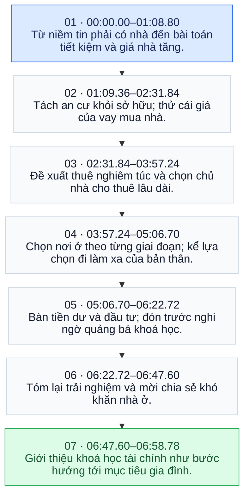

# An cư có nhất thiết phải sở hữu nhà?

[Video gốc — @thayqueo](https://www.tiktok.com/@thayqueo/video/7682350442730229013) · ID `7682350442730229013`

**Tóm tắt cách kể:** Tự nhận từng tin vào một chuẩn sống → đặt chuẩn ấy vào bài toán khả năng chi trả → đổi mục tiêu từ sở hữu sang chỗ ở ổn định → đưa lựa chọn thuê theo giai đoạn. Sự hấp dẫn nằm ở việc tháo một tiền đề gây áp lực; clip còn chuyển sang đầu tư và khoá học nên không nên rút thành công thức giáo dục thuần tuý.

[Sơ đồ diễn biến](#mindmap) · [Diễn biến](#dien-bien) · [Nhịp cảm xúc](#cam-xuc) · [Cách áp dụng](#ap-dung)

## Sơ đồ diễn biến

Đọc từ trên xuống: mỗi hộp là một nhịp theo mốc ASR hoặc khung hình được ghi trong phân tích. Xanh dương là mở đầu, xanh lá là nhịp cuối. Chi tiết và giới hạn nằm trong phân tích bên dưới.

[Mã Mermaid riêng](../mindmaps/7682350442730229013.mmd)

## Dữ liệu và nguồn

**Cách thể hiện:** Người dẫn nói trực diện

**Phạm vi học:** Xem phạm vi kiểm và giới hạn từng ca.

**Ngữ cảnh thương mại:** Chưa xác nhận hợp tác thương mại; xem các đoạn tự quảng bá/giới hạn được ghi riêng.

- Đăng: 2026-09-06T11:00:00+00:00. Metadata lấy: 2026-11-15T04:03:51.800168+00:00.
- **256,900 view**; thích 12,700; bình luận 180; chia sẻ 1,295; lưu 885. Dấu phẩy tách hàng nghìn.
- Thời lượng media: 423.11s.
- **12.12× P50** 21,200 của 147 bài đủ 48h trong snapshot kênh. Clip có trong cửa sổ baseline. Không phải thống kê toàn bộ kênh.

## Phạm vi kiểm

Đã tải media, xem khung chọn lọc và đọc ASR có mốc lưu lúc 2026-11-15T04:06:10.858816+00:00. Đối chiếu cùng ID và thời lượng, lệch 0.0s. **Chưa nghe toàn âm hoặc xem chuyển động liên tục; chưa xác nhận toàn văn ASR hay mọi dữ kiện trong clip.**

Media SHA256: `44bccb38c34f81b18f93929bdde4295c92455d615ddb1fcd517d176cf8aae0e5`. [Metadata và các hash khác](../videos.json). Video/ASR đầy đủ giữ ở bộ nghiên cứu cục bộ; bản chia sẻ giữ link gốc, trích ngắn và phân tích riêng.

## Lời hứa và câu hỏi trung tâm

**Lời hứa:** Giảm bế tắc về chỗ ở bằng cách xem lại quan niệm phải sở hữu nhà rồi đưa lựa chọn thuê thực tế.

**Câu hỏi:** Điều cần ổn định là cuộc sống hay nhất thiết là quyền sở hữu một căn nhà?

## Mở đầu: lời và hình

Người nói tự đặt mình trong thế hệ tin rằng phải có nhà mới yên tâm lập nghiệp. Khung 0–3 giây thấy người áo hồng, nói thẳng vào máy, phụ đề chia thành cụm ngắn; chưa có đồ thị hay số liệu. Mở từ niềm tin mà chính người nói từng có trước khi đưa bài toán thu nhập và giá nhà.

> Tôi là cái thế hệ 8X, vẫn cổ hữu kiểu như là phải an cư, lạc nghiệp

Trích ASR ngắn từ segment 00:00.00–00:04.58. Trích ASR chưa nghe đối chiếu; dữ kiện thuộc lời người đăng, chưa xác thực. Xem giới hạn từng ca. Dấu … nghĩa là bỏ bớt, không khẳng định toàn câu vừa ba giây.

| Mốc khung đã xem | Điều quan sát được |
|---|---|
| 00:00.00 | Người áo hồng ở trung cảnh, nhìn máy; phụ đề giới thiệu thế hệ 8X. |
| 00:03.00 | Biểu cảm nhíu mày và hai tay nâng, phụ đề tiếp ý về một điều phải có. |
| 01:03.47 | Đổi sang góc gần cửa sổ, người nói đưa tay; phụ đề hỏi lao động thế nào. |
| 02:06.93 | Trở lại nền tối, nụ cười căng và phụ đề nói về sở hữu căn nhà. |
| 04:13.86 | Khung nội thất căn hộ, có trần đèn và đồ đạc; không còn toàn cảnh người nói. |
| 05:17.33 | Cận người nói, phụ đề nêu ví dụ chứng khoán. |
| 06:20.79 | Cận người nói với tay trước ngực; phụ đề nhấn nguyên tắc và chiến lược. |
| 07:02.11 | Khung cuối mẫu đen; không đủ căn cứ suy ra nội dung lời sau 418,78 giây. |

Không suy chuyển động giữa các khung từ ảnh tĩnh.

## Diễn biến và nhiệm vụ từng beat

| Mốc ASR | Diễn giải riêng | Vai trò |
|---|---|---|
| 00:00.00–01:08.80 | Từ niềm tin phải có nhà đến bài toán tiết kiệm và giá nhà tăng. | Dựng mâu thuẫn giữa mục tiêu quen thuộc và khả năng chi trả. |
| 01:09.36–02:31.84 | Tách an cư khỏi sở hữu; thử cái giá của vay mua nhà. | Đổi định nghĩa mục tiêu để mở một lối giải khác. |
| 02:31.84–03:57.24 | Đề xuất thuê nghiêm túc và chọn chủ nhà cho thuê lâu dài. | Chuyển phản biện thành các tiêu chí hành động. |
| 03:57.24–05:06.70 | Chọn nơi ở theo từng giai đoạn; kể lựa chọn đi làm xa của bản thân. | Cho lời khuyên một tình huống đánh đổi cụ thể. |
| 05:06.70–06:22.72 | Bàn tiền dư và đầu tư; đón trước nghi ngờ quảng bá khoá học. | Mở rộng sang quản lý tài chính và xử lý phản đối. |
| 06:22.72–06:47.60 | Tóm lại trải nghiệm và mời chia sẻ khó khăn nhà ở. | Đóng phần trao đổi cộng đồng. |
| 06:47.60–06:58.78 | Giới thiệu khoá học tài chính như bước hướng tới mục tiêu gia đình. | Đuôi quảng bá; cần phân biệt với lời giải về thuê và mua nhà. |

## Nhịp cảm xúc — giả thuyết biên tập

Các trạng thái dưới đây là cách đọc câu chuyện từ bằng chứng, không phải cảm xúc người xem đã đo hoặc biểu đồ retention.

| Mốc | Cảm xúc có thể gợi | Bằng chứng | Cách diễn giải |
|---|---|---|---|
| 00:00.00–01:08.80 | Áp lực và bế tắc | Ví dụ thu nhập, tiết kiệm nhiều năm rồi giá nhà tiếp tục tăng. | Tình huống làm mục tiêu thông thường trở nên khó với một nhóm cụ thể. |
| 01:09.36–02:31.84 | Có lối nghĩ khác | Người nói tách ổn định chỗ ở khỏi sở hữu và nêu sức ép của khoản vay. | Cảm giác giải toả được gợi bởi đổi tiêu chí, chưa phải kết quả tài chính được đo. |
| 02:31.84–05:06.70 | Khả năng chủ động | Ba cụm lời khuyên thuê và chuyện tự chấp nhận đi xa. | Những đánh đổi cụ thể có thể giúp người xem hình dung lựa chọn. |
| 05:06.70–06:22.72 | Đề phòng phản đối | Lời bàn đầu tư nối sang phản hồi nghi ngờ bán khoá học. | Sự chuyển chủ đề có thể kéo người quan tâm tài chính, cũng có thể làm giảm tin cậy. |
| 06:22.72–06:58.78 | Đồng cảm rồi chào bán | Mời kể trải nghiệm trước lời giới thiệu khoá học. | Cần đọc cả hai chức năng cộng đồng và thương mại của phần kết. |

## Cách phân phối thông tin

| Mốc | Động tác viết | Vì sao đáng chú ý |
|---|---|---|
| 00:00.00–01:08.80 | Định lượng khó khăn | Tạo khoảng cách giữa niềm tin và nguồn lực trước khi đề nghị thay đổi. |
| 01:09.36–02:31.84 | Định nghĩa lại đích đến | Giải bài toán bằng thay điều kiện sở hữu, không chỉ tăng thu nhập. |
| 02:31.84–05:06.70 | Tiêu chí và trải nghiệm | Biến hướng nghĩ thành lựa chọn đồ đạc, chủ nhà, vị trí theo giai đoạn. |
| 05:06.70–06:22.72 | Mở rộng và đón phản đối | Thừa nhận câu hỏi về động cơ thương mại thay vì chỉ thêm lời khuyên. |
| 06:22.72–06:58.78 | Hai chức năng kết | Tách lời mời bình luận với giới thiệu sản phẩm để đọc đúng cấu trúc. |

## Giải đáp và cách kết

Phần trao đổi khép bằng tổng kết và mời chia sẻ, sau đó có lời giới thiệu khoá Intelligence Money từ 407,6 đến 418,78 giây trong ASR. Đây là đuôi thương mại thật, không phải bằng chứng độc lập cho lời khuyên trước đó.

## Điểm mạnh có dẫn chứng

- **Người nói cũng nằm trong niềm tin bị xét lại** — 0–13,4 giây đặt bản thân vào thế hệ và đưa câu hỏi của một cặp vợ chồng.

- **Đáp án thay tiêu chí, không chỉ phủ định** — 69,36–151,84 giây định nghĩa chỗ ở ổn định rồi đối chiếu áp lực khoản vay.

- **Có ví dụ đánh đổi có giới hạn** — 288,48–306,7 giây kể thời gian đi làm để đổi lấy môi trường cho con.

## Điểm yếu và điều không nên bắt chước

- **Số liệu mở đầu dễ bị coi là kết luận phổ quát** — 34,94–68,8 giây đi từ tỷ lệ tăng giá quá khứ sang giả định và lãi vay; nguồn và điều kiện chưa được làm rõ trong ASR.

- **Lời giải chính đến khá muộn** — Đến 69,36 giây mới bắt đầu đổi nghĩa an cư; chưa có retention để khẳng định ảnh hưởng.

- **Đuôi đổi mục tiêu** — 306,7 giây trở đi mở sang đầu tư; 407,6 giây bắt đầu quảng bá khoá học.

## Khả năng được chia sẻ — chưa kiểm chứng

Không có dữ liệu phân phối/retention để kết luận vì sao viral. Các ý sau chỉ là giả thuyết để thử:

- Bài toán nhà ở có thể được gửi giữa các cặp đôi đang bàn mua hay thuê; đây là khả năng từ chủ đề, không phải dữ liệu chia sẻ.

- Việc người nói xét lại chính niềm tin cũ có thể khuyến khích người xem kể trải nghiệm tương tự.

## Chuyển cơ chế sang bài mới

Học cách bắt đầu từ áp lực thực rồi kiểm tra lại định nghĩa mục tiêu. Khi ứng dụng, dùng giả định tính toán minh bạch, tách bài toán ở khỏi khuyến nghị đầu tư và ghi rõ quảng bá. Không sao chép số tăng giá hay lãi suất của mẫu như dữ kiện đã kiểm chứng.

- Nêu rõ ai đang gặp bài toán và nguồn lực của họ.

- Chỉ dùng phép tính có đủ giả định, mốc thời gian và nguồn.

- Thử sửa định nghĩa mục tiêu trước khi nêu cách giải.

- Lời khuyên phải có điều kiện và đánh đổi; tách khỏi lời khuyên đầu tư.

- Giữ lời mời thảo luận và nội dung quảng bá thành hai nhịp nhận diện được.

Không dùng bài chuyển thể chưa được người dùng duyệt làm mẫu giọng lâu dài.

## Giới hạn còn lại

- Đã đọc toàn bộ ASR có timestamp và xem 12 khung trích của cùng ID; chưa nghe toàn âm thanh hoặc xem video liên tục.

- Không có retention, tỷ lệ xem hết hay thử nghiệm nhân quả; các nhận định giữ chân và chia sẻ là giả thuyết về cách trình bày.

- Các số về giá nhà, thu nhập, lãi vay và dự phóng là phát biểu hoặc giả định của nguồn; phân tích này không kiểm chứng dữ liệu hay phép tính.

- Đây là quan điểm và trải nghiệm cá nhân, không đủ để kết luận phương án thuê hay mua phù hợp mọi gia đình.

- ASR lời kết dừng 418,78 giây; hình mẫu cuối 422,11 giây đen, không gán thêm nội dung cho khoảng sau đó.
