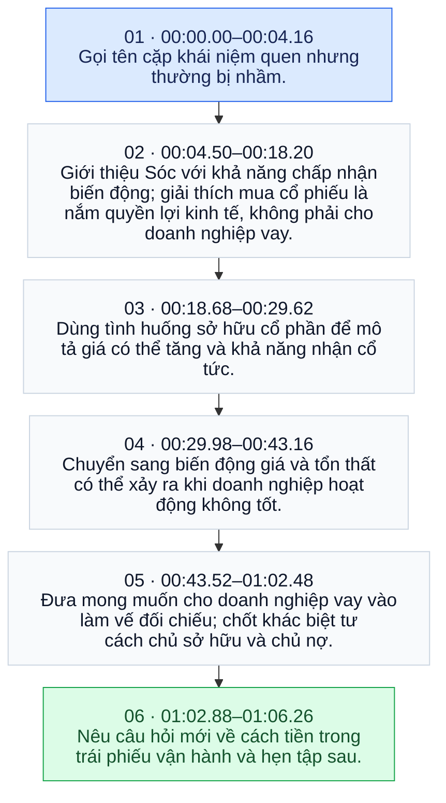

# Cổ phiếu và trái phiếu được phân biệt qua vai trò của người đưa vốn

[Video gốc — @longvasocbc1](https://www.tiktok.com/@longvasocbc1/video/7683455896910908690) · ID `7683455896910908690`

**Tóm tắt cách kể:** Nêu một nhầm lẫn có tên → theo một nhân vật để làm rõ vế thứ nhất → chuyển lợi ích sang rủi ro → đưa vế còn lại vào cùng trục quyền lợi. Điểm học được nằm ở trục phân biệt và nhịp lợi ích/rủi ro, không phải một câu sốc.

[Sơ đồ diễn biến](#mindmap) · [Diễn biến](#dien-bien) · [Nhịp cảm xúc](#cam-xuc) · [Cách áp dụng](#ap-dung)

## Sơ đồ diễn biến

Đọc từ trên xuống: mỗi hộp là một nhịp theo mốc ASR hoặc khung hình được ghi trong phân tích. Xanh dương là mở đầu, xanh lá là nhịp cuối. Chi tiết và giới hạn nằm trong phân tích bên dưới.

[Mã Mermaid riêng](../mindmaps/7683455896910908690.mmd)

## Dữ liệu và nguồn

**Cách thể hiện:** Hoạt hình giải thích

**Ngữ cảnh thương mại:** Chưa xác nhận hợp tác thương mại; xem các đoạn tự quảng bá/giới hạn được ghi riêng.

- Đăng: 2026-09-09T08:53:09+00:00. Metadata lấy: 2026-11-15T03:29:27.470812+00:00.
- **484,800 view**; thích 34,000; bình luận 44; chia sẻ 3,574; lưu 4,841. Dấu phẩy tách hàng nghìn.
- Thời lượng media: 66.53s.
- **38.48× P50** 12,600 của 75 bài đủ 48h trong snapshot kênh. Clip có trong cửa sổ baseline. Không phải thống kê toàn bộ kênh.

## Phạm vi kiểm

Đã tải media, xem khung chọn lọc và đọc ASR có mốc lưu lúc 2026-10-22T00:30:34.301912+00:00. Đối chiếu cùng ID và thời lượng, lệch 0.0s. **Chưa nghe toàn âm hoặc xem chuyển động liên tục; chưa xác nhận toàn văn ASR hay mọi dữ kiện kinh tế trong clip.**

Media SHA256: `ae159be2d1a57a1350560082c7104b69cd64575f52775ebe768a9c14b3a22d7f`. [Metadata và các hash khác](../videos.json). Video/ASR đầy đủ giữ ở bộ nghiên cứu cục bộ; bản chia sẻ giữ link gốc, trích ngắn và phân tích riêng.

## Lời hứa và câu hỏi trung tâm

**Lời hứa:** Phân biệt cổ phiếu và trái phiếu qua quan hệ giữa người đưa vốn và doanh nghiệp.

**Câu hỏi:** Người mua đang cùng sở hữu hay đang cho vay?

## Mở đầu: lời và hình

ASR mở bằng việc hai tài sản quen thuộc hay bị đánh đồng, rồi gọi tên cặp cần phân biệt. Đây là lời hứa gỡ nhầm lẫn trực tiếp, không phải một câu chuyện có xung đột. Khung đầu dùng hai linh vật, tiền và biểu đồ, nên chủ đề tài chính xuất hiện trước khi phân tích dài.

> Hai loại tài sản rất quen thuộc trên thị trường tài chính nhưng lại thường bị đánh đồng với nhau nhất, cổ …

Trích ASR ngắn từ segment 00:00.00–00:04.16. Đoạn ASR ngắn, chưa đối chiếu toàn bộ âm; xem giới hạn từng ca. Dấu … nghĩa là bỏ bớt, không khẳng định toàn câu vừa ba giây.

| Mốc khung đã xem | Điều quan sát được |
|---|---|
| 00:00.00 | Long và Sóc đứng giữa khung trên nền giấy; một nhân vật cầm biểu đồ tăng, nhân vật kia cầm đồng tiền, tiền giấy/đồng xu nằm phía dưới. |
| 00:05.00 | Một hình thu nhỏ có tên hai loại chứng khoán được đặt giữa, nguồn Vietstock nằm gần phía dưới; đây là khung gọi tên khái niệm. |
| 00:19.96 | Sóc cầm một chứng nhận/quyền lợi trong khi đứng cạnh túi tiền, hỗ trợ phần mô tả tư cách người sở hữu. |
| 00:29.94 | Hình Long với túi tiền lớn đối lập với Sóc trên hình bập bênh, kèm tiền rơi; đây là hình minh họa rủi ro chứ không phải dữ liệu giao dịch. |
| 00:39.92 | Hai nhân vật đứng cạnh biểu đồ có cả đoạn đi xuống lẫn đi lên, đồng thời có cây tiền. |
| 00:59.87 | Long đứng cạnh một cửa hàng nhỏ, phụ đề ở khung nói tới tư cách chủ sở hữu. |
| 01:05.53 | Sóc và tòa nhà được nối bằng đường tiền uốn cong; phụ đề thông báo phần sau. |

Không suy chuyển động giữa các khung từ ảnh tĩnh.

## Diễn biến và nhiệm vụ từng beat

| Mốc ASR | Diễn giải riêng | Vai trò |
|---|---|---|
| 00:00.00–00:04.16 | Gọi tên cặp khái niệm quen nhưng thường bị nhầm. | Mở bằng lỗ hổng hiểu biết cụ thể và hứa phân biệt. |
| 00:04.50–00:18.20 | Giới thiệu Sóc với khả năng chấp nhận biến động; giải thích mua cổ phiếu là nắm quyền lợi kinh tế, không phải cho doanh nghiệp vay. | Đi sâu một vế, đồng thời gieo sẵn vế đối chiếu còn lại. |
| 00:18.68–00:29.62 | Dùng tình huống sở hữu cổ phần để mô tả giá có thể tăng và khả năng nhận cổ tức. | Cụ thể hóa quan hệ sở hữu bằng kết quả người góp vốn có thể nhận. |
| 00:29.98–00:43.16 | Chuyển sang biến động giá và tổn thất có thể xảy ra khi doanh nghiệp hoạt động không tốt. | Đổi chiều từ lợi ích sang đánh đổi, tránh chỉ kể phần có lời. |
| 00:43.52–01:02.48 | Đưa mong muốn cho doanh nghiệp vay vào làm vế đối chiếu; chốt khác biệt tư cách chủ sở hữu và chủ nợ. | Trả lời lời hứa phân biệt ở đầu bằng một trục so duy nhất. |
| 01:02.88–01:06.26 | Nêu câu hỏi mới về cách tiền trong trái phiếu vận hành và hẹn tập sau. | Đã đóng phân biệt chính rồi mở sang cơ chế chi tiết của vế thứ hai. |

## Nhịp cảm xúc — giả thuyết biên tập

Các trạng thái dưới đây là cách đọc câu chuyện từ bằng chứng, không phải cảm xúc người xem đã đo hoặc biểu đồ retention.

| Mốc | Cảm xúc có thể gợi | Bằng chứng | Cách diễn giải |
|---|---|---|---|
| 00:00.00–00:04.16 | Nhận ra một nhầm lẫn | Hai tài sản được gọi tên cùng lời hứa phân biệt. | Không cần giật gân nếu khoảng trống kiến thức đủ cụ thể. |
| 00:04.50–00:29.62 | Hiểu quyền lợi và thấy cơ hội | Nhân vật mua cổ phiếu, có quyền lợi và khả năng hưởng tăng trưởng/cổ tức. | Đưa khái niệm vào một vai trước khi so trừu tượng. |
| 00:29.98–00:43.16 | Cân nhắc rủi ro | Giá có thể giảm và doanh nghiệp có thể hoạt động kém. | Nhịp trừ điểm cân lại phần cơ hội. |
| 00:43.52–01:02.48 | Ráp được vế còn lại | Cho vay được đặt cạnh tư cách góp vốn/chủ sở hữu. | Một trục quyền lợi giải quyết cặp nhầm lẫn. |
| 01:02.88–01:06.26 | Còn câu hỏi ứng dụng | Chuyển sang cách tiền trái phiếu vận hành. | Vòng hỏi mới nối tiếp sau khi đã trả phân biệt cơ bản. |

## Cách phân phối thông tin

| Mốc | Động tác viết | Vì sao đáng chú ý |
|---|---|---|
| 00:00.00–00:18.20 | Nêu cặp rồi đi sâu một vế | Tránh đưa hai chuỗi thuật ngữ đồng thời. |
| 00:18.68–00:43.16 | Cơ hội rồi rủi ro | Một vai được xem cả mặt có lợi và mặt đánh đổi. |
| 00:43.52–01:02.48 | Đưa vế đối chiếu cùng trục | Điểm chốt không phải dài-ngắn hay an toàn-rủi ro mà là quan hệ quyền lợi. |
| 01:02.88–01:06.26 | Đóng câu cũ, mở câu mới | Phân biệt được trả trước lời hẹn tiếp. |

## Giải đáp và cách kết

Cặp quyền lợi chính được phân biệt trước đoạn hẹn tiếp. Khác với clip CEO, lời hứa phân biệt ban đầu đã có đáp án cơ bản; câu hỏi để lại là cơ chế tiền của trái phiếu, không hoàn toàn lặp lại câu hỏi mở.

## Điểm mạnh có dẫn chứng

- **Một trục so xuyên suốt** — 16,08–18,2 rồi 53,1–62,48 giây giữ trọng tâm quyền lợi/tư cách.

- **Không chỉ trình bày mặt sinh lời** — 29,98–43,16 giây có biến động và tổn thất.

## Điểm yếu và điều không nên bắt chước

- **Độ sâu hai vế chưa cân** — Cổ phiếu chiếm gần 40 giây, trái phiếu chủ yếu vào qua vế chốt.

- **Nêu phù hợp đầu tư cần điều kiện riêng** — 39,98–43,16 giây có nhận định về người phù hợp, chưa phải khuyến nghị cá nhân được kiểm.

## Khả năng được chia sẻ — chưa kiểm chứng

Không có dữ liệu phân phối/retention để kết luận vì sao viral. Các ý sau chỉ là giả thuyết để thử:

- Một cặp thuật ngữ tài chính quen có thể làm clip hữu ích để giải thích cho người mới.

- Trục chủ sở hữu/chủ nợ có thể dễ kể lại hơn danh sách nhiều đặc điểm; chưa đo khả năng nhớ.

## Chuyển cơ chế sang bài mới

Với một cặp khái niệm cần giải thích, chọn một trục so quan trọng và giữ nhân vật xuyên suốt. Cho người xem đủ ví dụ để tự hiểu vế đầu rồi mới đưa vế đối chiếu. Nếu bài chỉ có một phần, phần kết nên đóng cả nhu cầu ứng dụng chứ không cần hẹn tập kế.

- Chọn một trục so có sức phân biệt thật.

- Giữ nhân vật theo một vai rõ, không đổi tư cách nửa chừng.

- Trả khác biệt cốt lõi trước khi chuyển sang bài sau.

Không dùng bài chuyển thể chưa được người dùng duyệt làm mẫu giọng lâu dài.

## Giới hạn còn lại

- Đã xem 12 khung trích mới và đọc ASR theo timestamp, chưa kiểm âm hoặc chuyển động liên tục.

- ASR gọi tên Sóc không nhất quán; khi dùng nguồn nên gắn nhân vật từ hình thay vì chép lỗi nhận dạng.

- Đánh giá rủi ro và tính phù hợp đầu tư trong lời nguồn chưa được kiểm độc lập; không lấy đó làm khuyến nghị.

- Nội dung có thể đạt nhiều view vì nhiều yếu tố; không có dữ liệu giữ chân để tách tác dụng từng beat.
