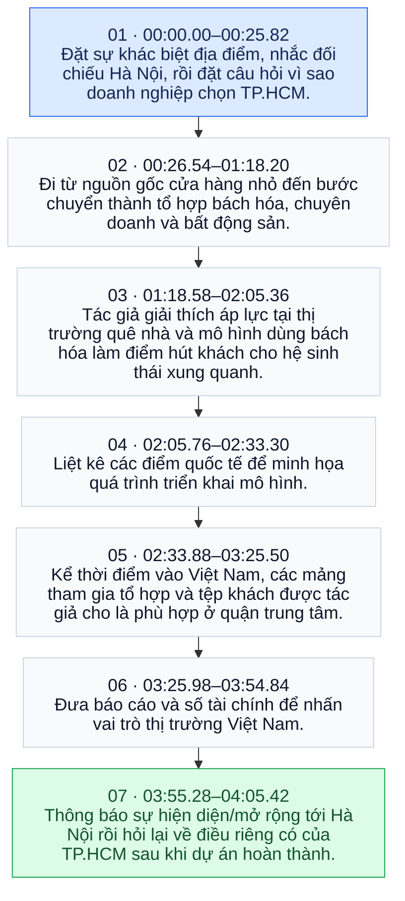

# Từ một điểm mua sắm ở TP.HCM đến mô hình kinh doanh đô thị

[Video gốc — @nqs.kinhte](https://www.tiktok.com/@nqs.kinhte/video/7686055803199032594) · ID `7686055803199032594`

**Tóm tắt cách kể:** Khác biệt địa phương tưởng dễ trả lời → bóc tách mô hình kinh doanh phía sau thương hiệu → quay lại địa điểm → đưa biến cố làm tiền đề đầu bớt chắc. Hình bản đồ ở các khung mở giúp xác định hai cấp không gian, còn lời dẫn đưa tên riêng thành câu hỏi kinh doanh.

[Sơ đồ diễn biến](#mindmap) · [Diễn biến](#dien-bien) · [Nhịp cảm xúc](#cam-xuc) · [Cách áp dụng](#ap-dung)

## Sơ đồ diễn biến

Đọc từ trên xuống: mỗi hộp là một nhịp theo mốc ASR hoặc khung hình được ghi trong phân tích. Xanh dương là mở đầu, xanh lá là nhịp cuối. Chi tiết và giới hạn nằm trong phân tích bên dưới.

[Mã Mermaid riêng](../mindmaps/7686055803199032594.mmd)

## Dữ liệu và nguồn

**Cách thể hiện:** Người dẫn và hình minh họa

**Phạm vi học:** Xem phạm vi kiểm và giới hạn từng ca.

**Ngữ cảnh thương mại:** Chưa xác nhận hợp tác thương mại; xem các đoạn tự quảng bá/giới hạn được ghi riêng.

- Đăng: 2026-09-16T09:02:06+00:00. Metadata lấy: 2026-11-15T03:29:33.306181+00:00.
- **2,000,000 view**; thích 114,600; bình luận 602; chia sẻ 22,600; lưu 6,217. Dấu phẩy tách hàng nghìn.
- Thời lượng media: 246.60s.
- **8.76× P50** 228,300 của 149 bài đủ 48h trong snapshot kênh. Clip có trong cửa sổ baseline. Không phải thống kê toàn bộ kênh.

## Phạm vi kiểm

Đã tải media, xem khung chọn lọc và đọc ASR có mốc lưu lúc 2026-11-05T12:44:02.857521+00:00. Đối chiếu cùng ID và thời lượng, lệch 0.0479s. **Chưa nghe toàn âm hoặc xem chuyển động liên tục; chưa xác nhận toàn văn ASR hay mọi dữ kiện trong clip.**

Media SHA256: `e79529ffda9bd509889270a7ee18bc070c2d441a8565a0fd0fad1bd17a0d6ab0`. [Metadata và các hash khác](../videos.json). Video/ASR đầy đủ giữ ở bộ nghiên cứu cục bộ; bản chia sẻ giữ link gốc, trích ngắn và phân tích riêng.

## Lời hứa và câu hỏi trung tâm

**Lời hứa:** Từ một khác biệt mua sắm giữa địa phương, giải thích vì sao thương hiệu đặt điểm đầu ở TP.HCM và mô hình kinh doanh phía sau cửa hàng.

**Câu hỏi:** Một điểm bán xuất hiện tại địa phương nào có thể phản ánh điều gì về cách doanh nghiệp kiếm tiền?

## Mở đầu: lời và hình

ASR 0–25,82 giây đưa ra một sự khác biệt giữa TP.HCM và các địa phương khác, gọi tên một cửa hàng bách hóa rồi hỏi vì sao thương hiệu chọn nơi này. Các khung 0–5 giây đi từ bản đồ khu vực đến ranh giới TP.HCM và logo thương hiệu, khiến đối tượng được xác định bằng địa điểm trước lịch sử doanh nghiệp.

> Một điểm chỉ thành phố Hồ Chí Minh có mà tất cả các nơi khác đều không có, đó chính là Takashimeya.

Trích ASR ngắn từ segment 00:00.00–00:05.62. Đoạn ASR ngắn, chưa đối chiếu toàn bộ âm; xem giới hạn từng ca. Dấu … nghĩa là bỏ bớt, không khẳng định toàn câu vừa ba giây.

| Mốc khung đã xem | Điều quan sát được |
|---|---|
| 00:00.00 | Bản đồ rộng của khu vực châu Á và Đông Nam Á làm hình mở. |
| 00:01.00 | Ranh giới Việt Nam được tô viền trên bản đồ. |
| 00:03.00 | Nhãn TP.HCM và ranh giới địa phương hiện rõ trên khung trích. |
| 00:05.00 | Logo Takashimaya nằm cạnh bản đồ TP.HCM, gắn câu mở với một tên riêng cụ thể. |
| 00:36.99 | Ảnh mặt tiền cửa hàng truyền thống đi cùng phần ASR về nguồn gốc doanh nghiệp. |
| 01:13.98 | Hình trang phục và logo trên nền sáng minh họa mảng bán lẻ. |
| 02:27.96 | Bản đồ có nhãn Bangkok và một nhãn điểm bán tại Thượng Hải, tương ứng phần kể mở rộng quốc tế. |
| 03:41.94 | Ảnh tòa nhà và một con số doanh thu được nhấn bằng chữ lớn; đây là số liệu xuất hiện trong video, chưa xác nhận tính đúng. |
| 04:05.60 | Người dẫn ngồi bàn với câu hỏi về điều TP.HCM có mà nơi khác không có, quay lại cách đặt vấn đề đầu. |

Không suy chuyển động giữa các khung từ ảnh tĩnh.

## Diễn biến và nhiệm vụ từng beat

| Mốc ASR | Diễn giải riêng | Vai trò |
|---|---|---|
| 00:00.00–00:25.82 | Đặt sự khác biệt địa điểm, nhắc đối chiếu Hà Nội, rồi đặt câu hỏi vì sao doanh nghiệp chọn TP.HCM. | Dùng khác biệt địa phương và tên thương hiệu quen để mở một câu hỏi chiến lược. |
| 00:26.54–01:18.20 | Đi từ nguồn gốc cửa hàng nhỏ đến bước chuyển thành tổ hợp bách hóa, chuyên doanh và bất động sản. | Đổi quy mô hiểu của người xem: đối tượng không chỉ là nơi bán hàng. |
| 01:18.58–02:05.36 | Tác giả giải thích áp lực tại thị trường quê nhà và mô hình dùng bách hóa làm điểm hút khách cho hệ sinh thái xung quanh. | Nêu cơ chế kinh doanh cốt lõi trước khi quay về Việt Nam. |
| 02:05.76–02:33.30 | Liệt kê các điểm quốc tế để minh họa quá trình triển khai mô hình. | Bổ sung trường hợp so sánh; đoạn này có nhiều tên và diện tích khiến tải thông tin tăng. |
| 02:33.88–03:25.50 | Kể thời điểm vào Việt Nam, các mảng tham gia tổ hợp và tệp khách được tác giả cho là phù hợp ở quận trung tâm. | Trả lời câu hỏi chọn địa điểm bằng cấu trúc kiếm tiền và khách hàng thay vì chỉ lịch sử thương hiệu. |
| 03:25.98–03:54.84 | Đưa báo cáo và số tài chính để nhấn vai trò thị trường Việt Nam. | Tạo trọng lượng bằng số liệu nguồn được tác giả nêu; chưa có bước kiểm số trong lượt này. |
| 03:55.28–04:05.42 | Thông báo sự hiện diện/mở rộng tới Hà Nội rồi hỏi lại về điều riêng có của TP.HCM sau khi dự án hoàn thành. | Dùng biến cố ở cuối làm thay đổi tiền đề độc nhất ở đầu, tạo một vòng hỏi lại. |

## Nhịp cảm xúc — giả thuyết biên tập

Các trạng thái dưới đây là cách đọc câu chuyện từ bằng chứng, không phải cảm xúc người xem đã đo hoặc biểu đồ retention.

| Mốc | Cảm xúc có thể gợi | Bằng chứng | Cách diễn giải |
|---|---|---|---|
| 00:00.00–00:25.82 | Tò mò từ điều quen ở địa phương | TP.HCM, Hà Nội và tên thương hiệu được đặt cạnh nhau trước câu hỏi chọn địa điểm. | Khác biệt gần khán giả có thể kéo họ vào câu chuyện chiến lược. |
| 00:26.54–01:18.20 | Đổi quy mô hiểu | Tuyến từ tiệm nhỏ tới tổ hợp bách hóa/bất động sản. | Đối tượng bớt đơn giản: không chỉ một cửa hàng lớn. |
| 01:18.58–02:05.36 | Hiểu động cơ phía sau | Áp lực thị trường quê nhà nối với việc dùng cửa hàng làm điểm hút cho tổ hợp. | Lời giải mô hình có thể tạo điểm hiểu ra nếu khán giả theo được nhiều tên. |
| 02:33.88–03:25.50 | Trở lại địa điểm đầu | Vai trò các mảng và tệp khách ở trung tâm TP.HCM được tác giả giải thích. | Đưa tuyến quốc tế quay về câu hỏi đã hứa. |
| 03:25.98–03:54.84 | Tăng trọng lượng bằng quy mô | Báo cáo và các con số tài chính được đưa vào. | Đây là ý đồ tạo tin cậy được suy từ trình bày, không phải xác nhận số đúng hoặc hiệu quả. |
| 03:55.28–04:05.42 | Tiền đề bị đặt lại | Đoạn cuối nói tới Hà Nội rồi quay lại câu hỏi điều riêng có. | Tạo vòng kết đổi thời điểm của mệnh đề mở, có nguy cơ làm hiểu nhầm nếu thiếu phân biệt dự án và điểm đang mở. |

## Cách phân phối thông tin

| Mốc | Động tác viết | Vì sao đáng chú ý |
|---|---|---|
| 00:00.00–00:25.82 | Từ không gian quen tới câu hỏi chiến lược | Bản đồ nêu địa điểm trước lịch sử thương hiệu. |
| 00:26.54–01:18.20 | Lịch sử như một quá trình đổi mô hình | Những bước từ bán lẻ tới tổ hợp được chọn để chuẩn bị lời giải, nhưng đoạn khá dài. |
| 01:18.58–02:05.36 | Giải thích hạt nhân và hệ sinh thái | Cửa hàng được dùng làm một phần trong cơ chế tạo giá trị quanh nó. |
| 02:33.88–03:25.50 | Áp mô hình vào địa điểm đang hỏi | Không chỉ liệt kê điểm đến; tác giả nối cấu trúc kiếm tiền với khách hàng và vị trí. |
| 03:55.28–04:05.42 | Kết thay đổi điều kiện thời gian | Câu mở được gọi lại nhưng trong trạng thái thị trường được kể đã đổi. |

## Giải đáp và cách kết

Câu cuối quay về điều riêng có của TP.HCM nhưng đặt trong bối cảnh dự án ở Hà Nội. Đây là kết đổi phạm vi của mệnh đề mở đầu, không phải chỉ lặp lại thông tin cửa hàng.

## Điểm mạnh có dẫn chứng

- **Nguồn tò mò cụ thể và gần người xem** — Bản đồ TP.HCM/logo ở 3–5 giây làm đối tượng rõ trước tên thuật ngữ.

- **Lời giải đi sâu hơn câu hỏi cửa hàng ở đâu** — 78,58–125,36 giây mô tả cửa hàng như điểm hút cho một tổ hợp.

- **Có callback làm kết liên quan mở** — 235,28–245,42 giây quay lại đối chiếu địa phương.

## Điểm yếu và điều không nên bắt chước

- **Tiền đề độc nhất phụ thuộc thời điểm và loại hiện diện** — Mở 0–25,82 và kết 235,28–245,42 cần tách đang hoạt động/dự án để không mâu thuẫn giả.

- **Lịch sử và tên riêng kéo dài trước cơ chế chính** — 26,54–78,20 và 125,76–153,30 giây tăng tải thông tin.

- **Số tài chính không phải bằng chứng sẵn cho bài mới** — 205,98–234,84 giây có số doanh thu/lợi nhuận chưa đối chiếu tài liệu gốc.

## Khả năng được chia sẻ — chưa kiểm chứng

Không có dữ liệu phân phối/retention để kết luận vì sao viral. Các ý sau chỉ là giả thuyết để thử:

- Một sự khác biệt giữa hai thành phố có thể khơi nhận diện địa phương và trao đổi trải nghiệm mua sắm; chưa có dữ liệu kiểm động cơ chia sẻ.

- Cách đổi từ điểm bán sang mô hình tổ hợp có thể cho người xem một góc nhìn mới để kể lại; chưa đo mức nhớ.

## Chuyển cơ chế sang bài mới

Có thể học cách lấy một quan sát địa phương mà khán giả nhận ra để dẫn vào mô hình kinh doanh ẩn phía sau, rồi kết bằng điều kiện thay đổi. Khi chuyển thể phải kiểm tính đúng và thời điểm của tiền đề mở; không dùng tuyên bố độc nhất đã lỗi thời để cố tạo tò mò.

- Tiền đề địa lý phải có ngày và định nghĩa loại điểm hiện diện.

- Lịch sử chỉ giữ phần giải được mô hình, không mặc định càng nhiều mốc càng hấp dẫn.

- Khi quay lại mở ở cuối, nói rõ biến nào đã thay đổi.

- Số liệu doanh nghiệp cần báo cáo và đơn vị trước khi dùng lại.

Không dùng bài chuyển thể chưa được người dùng duyệt làm mẫu giọng lâu dài.

## Giới hạn còn lại

- Đã xem khung trích và đọc ASR; chưa nghe âm hoặc xem toàn chuyển động liên tục.

- ASR nhận sai nhiều tên thương hiệu, địa danh và thuật ngữ; các tên/chi tiết trong đoạn diễn giải không được coi là bản chép lời chuẩn.

- Số doanh thu, lợi nhuận và lịch sử dự án là phát biểu trong clip, chưa được đối chiếu báo cáo doanh nghiệp hoặc nguồn khác.

- Tiền đề chỉ một nơi có được chính đoạn kết đặt lại; cần giữ cả bối cảnh thời gian và phân biệt cửa hàng đang hoạt động với dự án tương lai, tránh học một khẳng định tuyệt đối.

- Phần lịch sử từ khoảng 26 giây kéo dài trước khi vào cơ chế chính; không có retention để biết đoạn đó giúp hay làm người xem rời đi.
