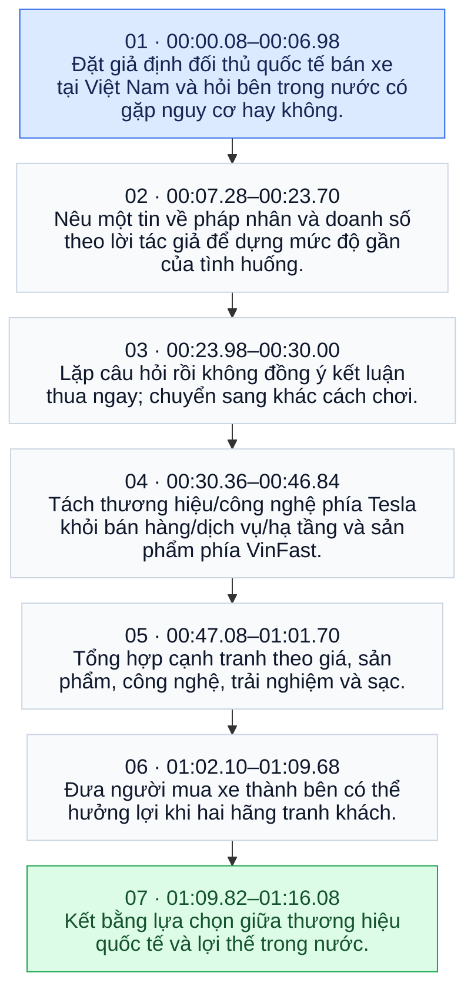

# Đối thủ mới gia nhập và người hưởng lợi ngoài cuộc đối đầu

[Video gốc — @longvasocbc1](https://www.tiktok.com/@longvasocbc1/video/7686294941173058824) · ID `7686294941173058824`

**Tóm tắt cách kể:** Đối thủ mới và bên đương nhiệm → câu hỏi ai gặp nguy → so lợi thế có điều kiện → đổi người hưởng lợi → mời lựa chọn.

[Sơ đồ diễn biến](#mindmap) · [Diễn biến](#dien-bien) · [Nhịp cảm xúc](#cam-xuc) · [Cách áp dụng](#ap-dung)

## Sơ đồ diễn biến

Đọc từ trên xuống: mỗi hộp là một nhịp theo mốc ASR hoặc khung hình được ghi trong phân tích. Xanh dương là mở đầu, xanh lá là nhịp cuối. Chi tiết và giới hạn nằm trong phân tích bên dưới.

[Mã Mermaid riêng](../mindmaps/7686294941173058824.mmd)

## Dữ liệu và nguồn

**Cách thể hiện:** Hoạt hình giải thích

**Ngữ cảnh thương mại:** Chưa xác nhận hợp tác thương mại; xem các đoạn tự quảng bá/giới hạn được ghi riêng.

- Đăng: 2026-09-17T00:30:07+00:00. Metadata lấy: 2026-11-15T03:45:46.572725+00:00.
- **426,700 view**; thích 14,600; bình luận 550; chia sẻ 803; lưu 486. Dấu phẩy tách hàng nghìn.
- Thời lượng media: 76.46s.
- **33.87× P50** 12,600 của 75 bài đủ 48h trong snapshot kênh. Clip có trong cửa sổ baseline. Không phải thống kê toàn bộ kênh.

## Phạm vi kiểm

Đã tải media, xem khung chọn lọc và đọc ASR có mốc lưu lúc 2026-10-22T00:31:29.131687+00:00. Đối chiếu cùng ID và thời lượng, lệch 0.0s. **Chưa nghe toàn âm hoặc xem chuyển động liên tục; chưa xác nhận toàn văn ASR hay mọi dữ kiện kinh tế trong clip.**

Media SHA256: `b5a3f8d7a7b140ae16b8d9664d2b4a7f71b0e0b9c6bd67544c858daa544be0c7`. [Metadata và các hash khác](../videos.json). Video/ASR đầy đủ giữ ở bộ nghiên cứu cục bộ; bản chia sẻ giữ link gốc, trích ngắn và phân tích riêng.

## Lời hứa và câu hỏi trung tâm

**Lời hứa:** Giải thích tác động cạnh tranh của một đối thủ mới, thay vì chỉ gọi tên hai thương hiệu.

**Câu hỏi:** Tác động phụ thuộc vào những lợi thế nào, và ai có thể được lợi từ cuộc cạnh tranh?

## Mở đầu: lời và hình

Phần mở nêu giả định Tesla bán chính hãng tại Việt Nam và hỏi tác động với VinFast. Hình 0–2 giây đặt các gương mặt và logo hai hãng cạnh nhau; câu chuyện được đóng như một cuộc đối đầu trước khi bài chuyển sang các lợi thế khác nhau. ASR sai một chữ trong câu hỏi mở, nên không xem nó là nguyên văn đã nghe xác nhận.

Không dùng câu ASR mở làm nguyên văn vì nhận dạng lỗi; xem diễn giải và đối chiếu nguồn.

| Mốc khung đã xem | Điều quan sát được |
|---|---|
| 00:00.00 | Logo Tesla và ảnh Elon Musk phía trên nhân vật Long. |
| 00:02.00 | Có thêm ảnh Phạm Nhật Vượng và logo VinFast đặt cạnh Tesla; phụ đề đặt câu hỏi về khả năng chịu cạnh tranh. |
| 00:11.47 | Ảnh một bài báo về pháp nhân Tesla ở Việt Nam hiện giữa khung. |
| 00:22.94 | Ảnh bài về doanh số VinFast hỗ trợ đoạn tác giả đặt vị thế bên đang có mặt trên thị trường. |
| 00:34.41 | Hình địa cầu, công nghệ và người hâm mộ được tổ chức thành nhóm lợi thế. |
| 01:08.82 | Một xe ở trước bản đồ Việt Nam và đám đông, hỗ trợ đoạn chuyển sang người mua. |
| 01:15.46 | Hai nhân vật đối diện với hai xe và dấu hiệu quốc gia/nhà ở phía dưới. |

Không suy chuyển động giữa các khung từ ảnh tĩnh.

## Diễn biến và nhiệm vụ từng beat

| Mốc ASR | Diễn giải riêng | Vai trò |
|---|---|---|
| 00:00.08–00:06.98 | Đặt giả định đối thủ quốc tế bán xe tại Việt Nam và hỏi bên trong nước có gặp nguy cơ hay không. | Đóng vấn đề thành cuộc đối đầu có hai cái tên dễ nhận ra. |
| 00:07.28–00:23.70 | Nêu một tin về pháp nhân và doanh số theo lời tác giả để dựng mức độ gần của tình huống. | Chuyển từ giả định xa sang vấn đề có vẻ đáng theo dõi hiện tại. |
| 00:23.98–00:30.00 | Lặp câu hỏi rồi không đồng ý kết luận thua ngay; chuyển sang khác cách chơi. | Một đáp án chưa chắc tạo chỗ cho phép so nhiều điều kiện. |
| 00:30.36–00:46.84 | Tách thương hiệu/công nghệ phía Tesla khỏi bán hàng/dịch vụ/hạ tầng và sản phẩm phía VinFast. | Phân vai lợi thế thay cho kết luận bên nào mạnh tuyệt đối. |
| 00:47.08–01:01.70 | Tổng hợp cạnh tranh theo giá, sản phẩm, công nghệ, trải nghiệm và sạc. | Đổi trận đấu hai thương hiệu thành các tiêu chí người mua có thể đánh giá. |
| 01:02.10–01:09.68 | Đưa người mua xe thành bên có thể hưởng lợi khi hai hãng tranh khách. | Nhịp chuyển người hưởng hệ quả làm câu chuyện rộng hơn fan hai bên. |
| 01:09.82–01:16.08 | Kết bằng lựa chọn giữa thương hiệu quốc tế và lợi thế trong nước. | Mời người xem đặt vị trí của mình vào các tiêu chí vừa kể. |

## Nhịp cảm xúc — giả thuyết biên tập

Các trạng thái dưới đây là cách đọc câu chuyện từ bằng chứng, không phải cảm xúc người xem đã đo hoặc biểu đồ retention.

| Mốc | Cảm xúc có thể gợi | Bằng chứng | Cách diễn giải |
|---|---|---|---|
| 00:00.08–00:06.98 | Lo ngại/đối đầu | Câu hỏi đặt một thương hiệu vào khả năng gặp đối thủ mới. | Hai cái tên có thể tạo động cơ theo dõi ở khán giả đã có lựa chọn, chưa có dữ liệu xác nhận. |
| 00:07.28–00:23.70 | Cảm giác gần và có quy mô | Một tin pháp nhân và doanh số được nêu. | Bối cảnh làm giả định bớt xa vời trong cách kể. |
| 00:23.98–00:46.84 | Tạm dịu và cân nhắc | Bài không kết luận thua, phân lợi thế hai bên. | Người xem được chuyển từ chọn phe sang xét điều kiện. |
| 00:47.08–01:01.70 | Tập trung tiêu chí | Liệt kê các chiều cạnh tranh và nhu cầu chứng minh giá trị. | Cụ thể hóa chuyện cạnh tranh thành thứ có thể so. |
| 01:02.10–01:16.08 | Có phần mình trong câu chuyện | Người mua được đưa vào làm bên hưởng hệ quả và được hỏi chọn gì. | Câu kết có thể mở thảo luận lựa chọn hơn là kết luận thắng-thua. |

## Cách phân phối thông tin

| Mốc | Động tác viết | Vì sao đáng chú ý |
|---|---|---|
| 00:00.08–00:06.98 | Đặt câu hỏi nhị phân dễ nắm | Một bên vào, bên kia có lo: người xem biết điều cần trả. |
| 00:23.98–00:46.84 | Bác kết luận sớm bằng phép so điều kiện | Mở không bị trả bằng một câu có/không quá đơn giản. |
| 00:47.08–01:01.70 | Chuyển từ tên hãng sang tiêu chí | Dẫn từ thương hiệu sang giá/sản phẩm/trải nghiệm/hạ tầng. |
| 01:02.10–01:16.08 | Đổi vai trung tâm sang người mua | Câu chuyện có ích cho người không phải fan hai hãng. |

## Giải đáp và cách kết

Bài không chốt bên thắng mà đổi câu hỏi sang lợi ích và lựa chọn của khách mua xe. Đó là một dạng trả lời có điều kiện; không xác minh kết quả gia nhập thị trường thực tế chỉ bằng diễn biến clip.

## Điểm mạnh có dẫn chứng

- **Có nhịp đổi cách hiểu rõ** — 23,98–30 giây từ câu hỏi nguy cơ sang hai cách chơi khác nhau.

- **Kết đưa ích lợi về khán giả** — 62,1–76,08 giây đi từ hãng sang người mua và lựa chọn.

## Điểm yếu và điều không nên bắt chước

- **Câu kết lại rút nhiều tiêu chí về hai nhãn lớn** — 69,82–76,08 giây gộp thành thương hiệu toàn cầu và lợi thế sân nhà, có thể đơn giản hóa nhu cầu mua.

- **Tin tức thời điểm có thể cũ nhanh** — 7,28–23,7 giây dùng pháp nhân/doanh số làm nền, cần cập nhật trước khi dùng lại.

## Khả năng được chia sẻ — chưa kiểm chứng

Không có dữ liệu phân phối/retention để kết luận vì sao viral. Các ý sau chỉ là giả thuyết để thử:

- Hai thương hiệu quen thuộc và câu hỏi chọn xe có thể mời bình luận theo sở thích; chưa có số tương tác theo quan điểm.

- Nhịp người mua được lợi có thể giúp bài được chuyển tới người đang cân nhắc xe, nhưng không suy ra từ tổng view.

## Chuyển cơ chế sang bài mới

Học cách mở bằng giả định cạnh tranh rồi thay câu thắng-thua bằng tiêu chí. Khi chuyển sang bài mới, kiểm tình trạng gia nhập và số liệu riêng, giữ điều kiện để không biến giả định thành tin đã xảy ra.

- Giữ tính giả định nếu việc gia nhập chưa được xác nhận.

- Dùng tiêu chí phục vụ quyết định thay vì công kích hoặc cổ vũ thương hiệu.

- Cho câu trả lời điều kiện trước khi mời chọn phe.

Không dùng bài chuyển thể chưa được người dùng duyệt làm mẫu giọng lâu dài.

## Giới hạn còn lại

- Đã đọc toàn segments ASR có mốc và xem 12 khung mới tải ở contact sheet; chưa nghe âm trực tiếp hoặc xem chuyển động liên tục.

- Mốc là mốc ASR/khung trích, không phải căn chỉnh bằng tai; đoạn không xuất hiện trong các khung không được suy thành một chuyển động cụ thể.

- Đây là phân tích kỹ thuật kể, không xác minh độc lập các khẳng định kinh tế, số liệu hoặc chính sách trong clip.

- Không có retention hay thử A/B; nhịp cảm xúc và khả năng lan truyền dưới đây là diễn giải/giả thuyết, không phải kết quả đo.

- Không dùng lỗi nhận dạng ở câu ASR mở làm câu trích được xác nhận.

- Pháp nhân, doanh số và đặc điểm sản phẩm trong clip có tính thời điểm; lượt này chưa kiểm tài liệu gốc.
