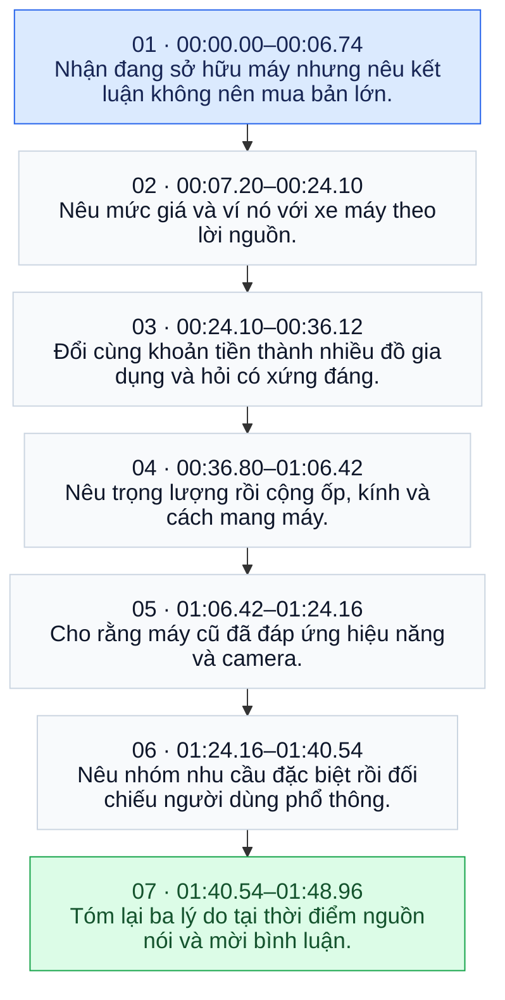

# Người đang sở hữu máy nêu ba lý do không nâng cấp

[Video gốc — @vatvostudio](https://www.tiktok.com/@vatvostudio/video/7687220059579632903) · ID `7687220059579632903`

**Tóm tắt cách kể:** Người đã sở hữu nói ngược kỳ vọng bán hàng → ba tiêu chí lần lượt là khoản chi, bất tiện dùng hằng ngày và phần nâng cấp cần thiết → thêm ngoại lệ theo nhu cầu → chốt có thời điểm. Hình vật thật và ví dụ đồ gia dụng khiến lý do có đối tượng cụ thể; không xác nhận được trải nghiệm sử dụng chỉ từ việc người dẫn cầm máy.

[Sơ đồ diễn biến](#mindmap) · [Diễn biến](#dien-bien) · [Nhịp cảm xúc](#cam-xuc) · [Cách áp dụng](#ap-dung)

## Sơ đồ diễn biến

Đọc từ trên xuống: mỗi hộp là một nhịp theo mốc ASR hoặc khung hình được ghi trong phân tích. Xanh dương là mở đầu, xanh lá là nhịp cuối. Chi tiết và giới hạn nằm trong phân tích bên dưới.

[Mã Mermaid riêng](../mindmaps/7687220059579632903.mmd)

## Dữ liệu và nguồn

**Cách thể hiện:** Cầm sản phẩm và giải thích

**Phạm vi học:** Học cách chia thông tin theo hình và ASR, giữ giới hạn từng ca.

**Ngữ cảnh thương mại:** Chưa xác nhận tài trợ; nhận diện thương hiệu/quảng bá quan sát được nằm trong phân tích.

- Đăng: 2026-09-19T12:20:00+00:00. Metadata lấy: 2026-11-15T04:34:07.384171+00:00.
- **653,900 view**; thích 10,700; bình luận 653; chia sẻ 1,787; lưu 642. Dấu phẩy tách hàng nghìn.
- Thời lượng media: 109.10s.
- **11.45× P50** 57,100 của 148 bài đủ 48h trong snapshot kênh. Clip có trong cửa sổ baseline. Không phải thống kê toàn bộ kênh.

## Phạm vi kiểm

Đã tải media, xem khung chọn lọc và đọc ASR có mốc lưu lúc 2026-11-15T04:35:43.862361+00:00. Đối chiếu cùng ID và thời lượng, lệch 0.012s. **Chưa nghe toàn âm hoặc xem chuyển động liên tục; chưa xác nhận toàn văn ASR hay mọi dữ kiện trong clip.**

Media SHA256: `9778205e310e017e1f7be0e899a8432d62264cb77864ffa1bdbef7659f2f70c5`. [Metadata và các hash khác](../videos.json). Video/ASR đầy đủ giữ ở bộ nghiên cứu cục bộ; bản chia sẻ giữ link gốc, trích ngắn và phân tích riêng.

## Lời hứa và câu hỏi trung tâm

**Lời hứa:** Giải thích vì sao người đã sở hữu dòng máy vẫn không thấy việc mua bản lớn phù hợp số đông tại thời điểm nguồn nói.

**Câu hỏi:** Nếu đã dùng, vì sao người dẫn lại cho rằng người khác chưa cần mua?

## Mở đầu: lời và hình

0–2,04 giây người dẫn nhận mình đang sở hữu dòng máy, rồi2,04–5,92s lại khuyên không mua bản lớn hơn;5,92–6,74s hỏi tại sao. Ảnh0–1 cho thấy người dẫn thực sự cầm máy trước khi hạ xuống ở2s. Sự căng nằm giữa vị thế người đã chọn mua và kết luận không khuyến khích người khác, không nằm ở một lời chê chưa có bối cảnh.

## Nghiên cứu phần mở

Diễn giải từ bằng chứng đã lưu; lý do gây chú ý là giả thuyết biên tập, chưa đo retention.

**Cửa sổ quan sát:** 00:00.00–00:06.74

| Lớp | Quan sát/diễn giải |
|---|---|
| Lời | 0–2,04s tự nhận sở hữu dòng máy;2,04–5,92s nêu kết luận không nên mua bản lớn;5,92–6,74s hỏi tại sao. |
| Hình | Ảnh0–1s đưa điện thoại lên làm đối tượng trực tiếp;ảnh2–3s người dẫn nói và diễn giải bằng tay;ảnh5s cận sản phẩm. |
| Chữ trên hình | Ảnh1–2s phụ đề về sở hữu;ảnh5s câu hỏi không nên mua với tên máy được nhấn màu vàng. |

**Động tác gây chú ý:** Dùng một người có liên quan trực tiếp đưa lập trường ngược kỳ vọng, rồi hứa lý do; vật đang cầm xác định đối tượng của tranh luận.

**Vì sao có thể muốn dừng lại:** Giả thuyết biên tập: sự lệch giữa sở hữu và không khuyến khích mua có thể làm người xem muốn biết điều người trong cuộc thấy; không phải dữ liệu dừng lướt.

**Điều còn muốn biết:** Điều gì khiến người đang sở hữu máy vẫn nói việc mua chưa phù hợp?

**Thông tin chưa cho biết:** Ba tiêu chí về khoản chi, bất tiện mang theo và mức cần nâng cấp chưa được nêu trong hook.

**Nhịp nối có gì mới:** 7,2–24,1s vào ngay lý do kinh tế và so số tiền với một vật quen, không tiếp tục lặp nhận định không mua.

**Mốc trả/giới hạn giải đáp:** 01:24.16–01:48.96 — Nguồn giới hạn nhóm cần tính năng đặc biệt, đối chiếu nhu cầu phổ thông rồi nhắc lại lập trường tại thời điểm nói. Ba nhóm lý do đã được trình bày; không phải kết luận sản phẩm độc lập của phân tích.

**Tóm cấu trúc bằng hai câu:** Cho người đã có trải nghiệm liên quan đưa một kết luận trái kỳ vọng và đặt câu hỏi về lý do. Trả bằng các tiêu chí có ví dụ riêng, so phương án thay thế rồi chỉ rõ ngoại lệ trước khi chốt.

**Chuyển sang ngách khác:** Chuyển quan hệ vị thế đã chọn–xem lại tiêu chí–so lựa chọn khác–nêu ngoại lệ sang thảo luận một quyết định có dữ liệu. Sẽ hỏng ở tài chính nếu vị thế đang nắm giữ được dùng để mời mua/bán hay thay cho phân tích rủi ro và xung đột lợi ích.

**Điều không chuyển theo:**

- Không dùng việc sở hữu như chứng cứ sinh lời hoặc khách quan.
- Không chuyển ý kiến không mua thiết bị thành lời kêu gọi bán tài sản.
- Không giữ giá và thông số của mẫu như dữ kiện hiện hành.

**Phạm vi:** Toàn ASR109s và12 ảnh mới có mốc; chưa nghe toàn âm/xem liên tục, chưa kiểm tra giá, tên máy hoặc bài so kỹ thuật.

> Mặc dù là một người sở hữu iPhone 18 Pro

Trích ASR ngắn từ segment 00:00.00–00:02.04. Trích ASR ngắn chưa nghe so khớp toàn âm; không khẳng định cả segment là ba giây. Xem phạm vi/giới hạn từng ca. Dấu … nghĩa là bỏ bớt, không khẳng định toàn câu vừa ba giây.

| Mốc khung đã xem | Điều quan sát được |
|---|---|
| 00:00.00 | Người dẫn ngồi cầm điện thoại trước người; ảnh có độ mờ chuyển động ở máy. |
| 00:01.00 | Đưa mặt lưng điện thoại lên sát mặt, phụ đề nhận đang sở hữu máy. |
| 00:03.00 | Hai tay diễn giải, điện thoại đã ra khỏi vị trí giơ cao. |
| 00:05.00 | Cận lưng điện thoại ngoài trời, chữ lớn hỏi không nên mua và tên dòng máy theo nguồn. |
| 00:16.36 | Cận một điện thoại màu đỏ tím trên tay ngoài đường, chưa có chứng từ giá. |
| 00:32.73 | Trở lại người dẫn ngồi với tay mở sang bên, phụ đề về độ khó khi chi tiền. |
| 00:49.09 | Hai máy trong ốp dày màu khác nhau đặt cạnh nhau trên tay; hỗ trợ lời về phụ kiện và trọng lượng. |
| 01:05.46 | Cận mặt trước điện thoại trên tay ngoài đường. |
| 01:21.82 | Hai hình người đứng ngoài trời xếp dọc với nhãn hai đời máy, minh hoạ so camera. |
| 01:48.10 | Người dẫn ngồi cùng nền đỏ, tay trước người, phụ đề mời bình luận. |

Không suy chuyển động giữa các khung từ ảnh tĩnh.

## Diễn biến và nhiệm vụ từng beat

| Mốc ASR | Diễn giải riêng | Vai trò |
|---|---|---|
| 00:00.00–00:06.74 | Nhận đang sở hữu máy nhưng nêu kết luận không nên mua bản lớn. | Đặt mâu thuẫn vị thế–lời khuyên rồi mở câu hỏi vì sao. |
| 00:07.20–00:24.10 | Nêu mức giá và ví nó với xe máy theo lời nguồn. | Lý do đầu được quy về khả năng chi trả và cách so có hình dung. |
| 00:24.10–00:36.12 | Đổi cùng khoản tiền thành nhiều đồ gia dụng và hỏi có xứng đáng. | Làm chi phí cơ hội thành các món đời thường. |
| 00:36.80–01:06.42 | Nêu trọng lượng rồi cộng ốp, kính và cách mang máy. | Chuyển từ giá ban đầu sang bất tiện lặp mỗi ngày. |
| 01:06.42–01:24.16 | Cho rằng máy cũ đã đáp ứng hiệu năng và camera. | Đặt lựa chọn mới cạnh phương án đang có thay vì đánh giá tuyệt đối. |
| 01:24.16–01:40.54 | Nêu nhóm nhu cầu đặc biệt rồi đối chiếu người dùng phổ thông. | Thu hẹp kết luận theo nhu cầu, không hoàn toàn phủ nhận sản phẩm. |
| 01:40.54–01:48.96 | Tóm lại ba lý do tại thời điểm nguồn nói và mời bình luận. | Kết bằng lập trường có điều kiện và câu hỏi cộng đồng. |

## Nhịp cảm xúc — giả thuyết biên tập

Các trạng thái dưới đây là cách đọc câu chuyện từ bằng chứng, không phải cảm xúc người xem đã đo hoặc biểu đồ retention.

| Mốc | Cảm xúc có thể gợi | Bằng chứng | Cách diễn giải |
|---|---|---|---|
| 00:00.00–00:06.74 | Bất ngờ về vị thế | Người sở hữu lại đưa kết luận không mua, tay cầm máy xuất hiện ngay. | Mâu thuẫn này có thể khiến người xem muốn nghe căn cứ, không tự chứng minh người nói khách quan. |
| 00:07.20–00:36.12 | Cân chi phí | Từ giá cao sang xe máy và đồ gia dụng. | Cho số tiền một nhóm phương án thay thế quen thuộc. |
| 00:36.80–01:06.42 | Hình dung bất tiện | Khối lượng và phụ kiện nối cách mang trong người. | Đưa một tiêu chí vật lý vào trải nghiệm thường ngày. |
| 01:06.42–01:40.54 | Tự đối chiếu nhu cầu | Nguồn so máy cũ và phân nhóm người cần tính năng riêng. | Câu hỏi chuyển từ máy tốt không sang cần phần thêm ấy không. |
| 01:40.54–01:48.96 | Có lập trường để trao đổi | Tóm lý do ở thời điểm này và mời bình luận. | Mở thảo luận trên tiêu chí, không có dữ liệu phản ứng thực. |

## Cách phân phối thông tin

| Mốc | Động tác viết | Vì sao đáng chú ý |
|---|---|---|
| 00:00.00–00:06.74 | Vị thế rồi kết luận nghịch kỳ vọng | Cầm vật thật hỗ trợ nhận diện đối tượng nhưng không thay bằng chứng hiệu quả. |
| 00:07.20–00:36.12 | Đổi giá ra lựa chọn khác | Số tiền được so với món cụ thể để hình dung chi phí cơ hội. |
| 00:36.80–01:06.42 | Thêm chi phí sử dụng | Ốp, kính và việc mang theo nối thông số với trải nghiệm. |
| 01:06.42–01:40.54 | Phương án cũ và ngoại lệ | Giữ quan hệ giữa nâng cấp và nhu cầu thay vì chê sản phẩm toàn diện. |
| 01:40.54–01:48.96 | Chốt có thời điểm | Giới hạn phạm vi ý kiến rồi mời phản hồi. |

## Giải đáp và cách kết

Nguồn chốt lại lý do không mua tại thời điểm đang nói rồi mời ý kiến. Thân bài đã nêu ngoại lệ cho nhu cầu đặc biệt; đây là quan điểm đánh giá của người dẫn, không phải khuyến nghị mua thiết bị từ phân tích này.

## Điểm mạnh có dẫn chứng

- **Mâu thuẫn mở có vật thật** — 0–2,04s nhận sở hữu, ảnh0–1s cầm máy, rồi kết luận không mua trong2,04–5,92s.

- **Lý do có chất liệu riêng** — 24,1–36,12s đồ gia dụng;ảnh49,09s ốp dày;ảnh81,82s so camera.

- **Có ngoại lệ trước kết luận** — 84,16–100,54s phân nhóm nhu cầu đặc biệt và cách dùng thông thường.

## Điểm yếu và điều không nên bắt chước

- **Giá và thông số cần bối cảnh thời gian** — 11,72–21,88s nêu giá khác nhau theo nơi mua nhưng không có chứng từ trong ảnh mẫu; không kiểm tra mức hiện tại.

- **Vị thế sử dụng có thể bị hiểu là kiểm chứng đầy đủ** — Cầm máy và nhãn so camera không cho biết thời gian dùng hoặc điều kiện bài so.

- **Một số lời kỹ thuật ASR chưa rõ** — Đoạn53,22–54,96s và86,64–90,26s cần nghe lại trước khi trích số hoặc tính năng.

## Khả năng được chia sẻ — chưa kiểm chứng

Không có dữ liệu phân phối/retention để kết luận vì sao viral. Các ý sau chỉ là giả thuyết để thử:

- Một lập trường ngược kỳ vọng từ người đang sở hữu có thể được gửi cho người cân nhắc cùng một quyết định.

- Các tiêu chí chi phí–mang theo–nhu cầu có thể khiến bình luận đưa thêm trường hợp riêng; chưa có dữ liệu bình luận để xác nhận.

## Chuyển cơ chế sang bài mới

Chuyển được quan hệ người đã chọn vẫn xét lại–so cùng nguồn lực với phương án khác–kiểm mức cần thiết–nêu ngoại lệ. Trong tài chính, vị thế người đang nắm giữ không tự xác nhận tính đúng của lời khuyên; phải khai báo lợi ích, mục tiêu, rủi ro và tránh dùng sở hữu làm chứng cứ hiệu quả.

- Khai báo vị thế liên quan nhưng không dùng nó thay kiểm chứng.

- Lý do phải có ví dụ riêng, không chỉ gọi đắt, nặng hay dư.

- So với phương án sẵn có và cùng ngân sách.

- Nêu ngoại lệ và thời điểm để giữ đúng phạm vi kết luận.

- Với tài chính, không lấy việc sở hữu tài sản làm uy tín cho dự báo hay lời mời mua.

Không dùng bài chuyển thể chưa được người dùng duyệt làm mẫu giọng lâu dài.

## Giới hạn còn lại

- Đã đọc toàn bộ ASR có timestamp và xem 12 khung trích của cùng ID; chưa nghe toàn âm thanh hoặc xem video liên tục.

- Không có retention, tỷ lệ xem hết hay thử nghiệm nhân quả; các nhận định giữ chân và chia sẻ là giả thuyết về cách trình bày.

- Tên đời máy, giá, trọng lượng và tính năng là lời của nguồn; không xác nhận thông số, thời điểm phát hành hay mức giá hiện tại.

- Một số ASR như đơn vị trọng lượng và mô tả camera chưa rõ; không dùng làm bảng thông số kỹ thuật.

- Không có phép đo trải nghiệm do phân tích này thực hiện, không kết luận nên mua hay không mua. Metadata chưa cho biết tỷ lệ tiếp cận tự nhiên hoặc tài trợ.
