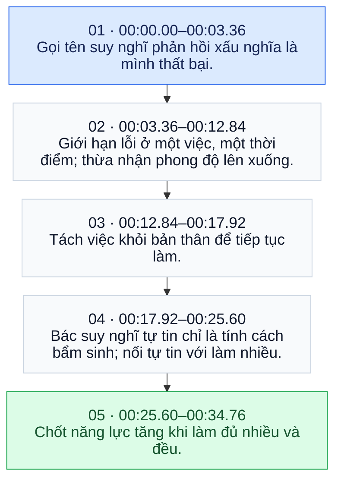

# Tách phản hồi về việc làm khỏi bản sắc: tự tin qua lặp lại

[Video gốc — @vietcetera_](https://www.tiktok.com/@vietcetera_/video/7688299045974052112) · ID `7688299045974052112`

**Tóm tắt cách kể:** Gọi tên một câu tự phán xét → giới hạn lại đối tượng và thời điểm của đánh giá → giải thích vì sao cần giới hạn ấy để tiếp tục → đổi tự tin từ phẩm chất cố định thành kết quả luyện tập. Khác hook tò mò ở chỗ câu sửa được đưa ngay, còn phần sau làm nó hữu dụng hơn.

[Sơ đồ diễn biến](#mindmap) · [Diễn biến](#dien-bien) · [Nhịp cảm xúc](#cam-xuc) · [Cách áp dụng](#ap-dung)

## Sơ đồ diễn biến

Đọc từ trên xuống: mỗi hộp là một nhịp theo mốc ASR hoặc khung hình được ghi trong phân tích. Xanh dương là mở đầu, xanh lá là nhịp cuối. Chi tiết và giới hạn nằm trong phân tích bên dưới.

[Mã Mermaid riêng](../mindmaps/7688299045974052112.mmd)

## Dữ liệu và nguồn

**Cách thể hiện:** Phỏng vấn và tự thuật

**Phạm vi học:** Xem phạm vi kiểm và giới hạn từng ca.

**Ngữ cảnh thương mại:** Chưa xác nhận hợp tác thương mại; xem các đoạn tự quảng bá/giới hạn được ghi riêng.

- Đăng: 2026-09-23T13:00:00+00:00. Metadata lấy: 2026-11-15T04:04:12.412847+00:00.
- **617,100 view**; thích 66,700; bình luận 194; chia sẻ 7,168; lưu 10,307. Dấu phẩy tách hàng nghìn.
- Thời lượng media: 41.66s.
- **199.77× P50** 3,089 của 147 bài đủ 48h trong snapshot kênh. Clip có trong cửa sổ baseline. Không phải thống kê toàn bộ kênh.

## Phạm vi kiểm

Đã tải media, xem khung chọn lọc và đọc ASR có mốc lưu lúc 2026-11-15T04:06:55.092953+00:00. Đối chiếu cùng ID và thời lượng, lệch 0.017s. **Chưa nghe toàn âm hoặc xem chuyển động liên tục; chưa xác nhận toàn văn ASR hay mọi dữ kiện trong clip.**

Media SHA256: `d3038d8480e2eaa0a4dd65dc23998fd7c627330ac086b4c554a1495630046021`. [Metadata và các hash khác](../videos.json). Video/ASR đầy đủ giữ ở bộ nghiên cứu cục bộ; bản chia sẻ giữ link gốc, trích ngắn và phân tích riêng.

## Lời hứa và câu hỏi trung tâm

**Lời hứa:** Một cách diễn giải phản hồi giúp tách lỗi công việc khỏi giá trị bản thân và tiếp tục luyện tập.

**Câu hỏi:** Làm sao nhận phản hồi không tốt mà không biến nó thành phán quyết về con người mình?

## Mở đầu: lời và hình

0–3,36 giây diễn đạt một suy nghĩ tự quy kết quen thuộc: nhận phản hồi xấu rồi coi bản thân thất bại. 3,36–7,04 giây sửa ngay bằng cách giới hạn đánh giá vào việc và thời điểm. Khung 3 giây cận mặt, bàn tay đặt lên ngực, phụ đề chỉ sự tự quy kết. Hook ở đây là nhận diện lời nói trong đầu rồi phân biệt hai cách diễn giải, không cần số gây sốc hay câu hỏi treo.

> Chúng ta rất hay nghĩ rằng là nếu có ai đó phản hồi không tốt thì tôi là một sự thất bại.

Trích ASR ngắn từ segment 00:00.00–00:03.36. Trích ASR chưa nghe đối chiếu; dữ kiện thuộc lời người đăng, chưa xác thực. Xem giới hạn từng ca. Dấu … nghĩa là bỏ bớt, không khẳng định toàn câu vừa ba giây.

| Mốc khung đã xem | Điều quan sát được |
|---|---|
| 00:00.00 | Người ngồi trên ghế trước nền tối, phụ đề đặt giữa phần thân; logo chương trình ở trên. |
| 00:03.00 | Cỡ cảnh cận hơn, tay đặt lên ngực khi phụ đề nêu việc tự coi mình thất bại. |
| 00:06.25 | Trở về cỡ cảnh vừa, tay đưa ra trước; phụ đề giới hạn vào việc đã làm không tốt. |
| 00:18.75 | Cỡ cảnh cận người nói ở đoạn bắt đầu bàn về tự tin. |
| 00:31.25 | Người nói dùng hai tay trong khung vừa; phụ đề về làm đủ nhiều và đều. |
| 00:40.66 | Thẻ cuối đen trắng có tên khách mời và chủ đề tự tin qua lặp lại. |

Không suy chuyển động giữa các khung từ ảnh tĩnh.

## Diễn biến và nhiệm vụ từng beat

| Mốc ASR | Diễn giải riêng | Vai trò |
|---|---|---|
| 00:00.00–00:03.36 | Gọi tên suy nghĩ phản hồi xấu nghĩa là mình thất bại. | Hook nhận diện tự quy kết. |
| 00:03.36–00:12.84 | Giới hạn lỗi ở một việc, một thời điểm; thừa nhận phong độ lên xuống. | Sửa cách diễn giải và làm rõ bằng tình huống chuẩn bị kỹ vẫn chưa đạt. |
| 00:12.84–00:17.92 | Tách việc khỏi bản thân để tiếp tục làm. | Nêu mục đích thực dụng của đổi cách nhìn. |
| 00:17.92–00:25.60 | Bác suy nghĩ tự tin chỉ là tính cách bẩm sinh; nối tự tin với làm nhiều. | Chuyển từ bảo vệ tâm lý sang khả năng rèn luyện. |
| 00:25.60–00:34.76 | Chốt năng lực tăng khi làm đủ nhiều và đều. | Kết bằng nguyên tắc hành động ngắn. |

## Nhịp cảm xúc — giả thuyết biên tập

Các trạng thái dưới đây là cách đọc câu chuyện từ bằng chứng, không phải cảm xúc người xem đã đo hoặc biểu đồ retention.

| Mốc | Cảm xúc có thể gợi | Bằng chứng | Cách diễn giải |
|---|---|---|---|
| 00:00.00–00:03.36 | Được gọi đúng suy nghĩ khó chịu | Phản hồi xấu bị đồng nhất với bản thân thất bại. | Có thể tạo nhận diện trước khi giảng giải. |
| 00:03.36–00:17.92 | Giảm tự quy kết | Lỗi được đặt vào việc cụ thể, thời điểm cụ thể và phong độ. | Cho cách hiểu ít tuyệt đối hơn để giữ khả năng hành động. |
| 00:17.92–00:25.60 | Mở cảm giác có thể rèn | Tự tin được tách khỏi đặc điểm bẩm sinh. | Đổi khung từ số phận sang quá trình. |
| 00:25.60–00:34.76 | Hướng về thực hành | Làm nhiều, làm đều gắn với năng lực. | Kết bằng hướng hành động nhưng chưa có kế hoạch cụ thể. |

## Cách phân phối thông tin

| Mốc | Động tác viết | Vì sao đáng chú ý |
|---|---|---|
| 00:00.00–00:07.04 | Nêu suy nghĩ rồi sửa ngay | Không giữ đáp án để tạo khoảng trống giả. |
| 00:07.04–00:17.92 | Bình thường hóa biến động và nêu mục đích | Cho người xem hiểu vì sao sự phân biệt có ích. |
| 00:17.92–00:34.76 | Mở sang nguyên tắc rèn luyện | Nối cách nghĩ với tiếp tục làm, không chỉ dừng ở an ủi. |

## Giải đáp và cách kết

Lời kết nhấn việc làm nhiều và làm đều; thẻ cuối cô đọng chủ đề tự tin qua lặp lại. Không có bằng chứng thí nghiệm hay bài tập cụ thể trong clip.

## Điểm mạnh có dẫn chứng

- **Phân biệt chính xác thay cho khẩu hiệu** — 3,36–7,04 giây tách một việc tại một thời điểm khỏi con người.

- **Đáp án có ngay trong mở** — Trong 7,04 giây đã cung cấp cách sửa, phần sau bổ sung ý nghĩa.

- **Hình và lời có sự hỗ trợ ở khung mẫu** — Khung 3 giây tay lên ngực ở tự quy kết; khung 6,25 giây phụ đề chuyển sang một việc.

## Điểm yếu và điều không nên bắt chước

- **Từ làm nhiều sang tự tin được trình bày khái quát** — 22,28–34,76 giây không nêu phản hồi, cách sửa hay điều kiện luyện tập hiệu quả.

- **Không đưa ví dụ chuyên môn hoàn chỉnh** — Tình huống chuẩn bị kỹ nhưng chưa đạt ở 9,52–12,84 giây chỉ là mô tả chung.

## Khả năng được chia sẻ — chưa kiểm chứng

Không có dữ liệu phân phối/retention để kết luận vì sao viral. Các ý sau chỉ là giả thuyết để thử:

- Có thể được gửi cho người vừa bị đánh giá công việc vì clip cho ngôn ngữ tách lỗi khỏi bản thân.

- Câu kết về lặp lại có thể phù hợp lưu để nhắc mình; chưa có dữ liệu save hoặc khảo sát ý định.

## Chuyển cơ chế sang bài mới

Học cách diễn đạt chính xác một suy nghĩ mà người xem có thể gặp, rồi thay bằng một phân biệt hẹp và có hệ quả hành động. Tránh trình bày quan điểm khách mời thành chẩn đoán hay lời hứa chữa vấn đề tâm lý.

- Mở bằng suy nghĩ cụ thể, tránh gắn cho mọi người một trạng thái tâm lý.

- Trả phân biệt cốt lõi ngay rồi dùng thời lượng còn lại làm rõ hệ quả.

- Khi mở rộng thành kịch bản, thêm một ví dụ sửa việc và vòng phản hồi thực tế; không chỉ lặp lời động viên.

- Giữ đây là góc nhìn về học kỹ năng, không hứa chữa vấn đề tâm lý.

Không dùng bài chuyển thể chưa được người dùng duyệt làm mẫu giọng lâu dài.

## Giới hạn còn lại

- Phân tích dựa trên toàn bộ ASR có timestamp và 12 khung hình lấy mẫu từ bản tải mới; chưa nghe âm hoặc xem video liên tục.

- Cảm xúc, khả năng chia sẻ và giữ chân là giả thuyết biên tập; không có retention hay thử nghiệm nhân quả.

- Đây là quan điểm/phân tích trải nghiệm của khách mời, không phải bằng chứng lâm sàng hoặc kết luận nghiên cứu về tự tin.

- ASR có một cụm nhận dạng chưa mượt ở 22,28–25,6 giây; phân tích chỉ dùng ý lặp lại được phụ đề tại 25 giây hỗ trợ, không trích nguyên văn.
