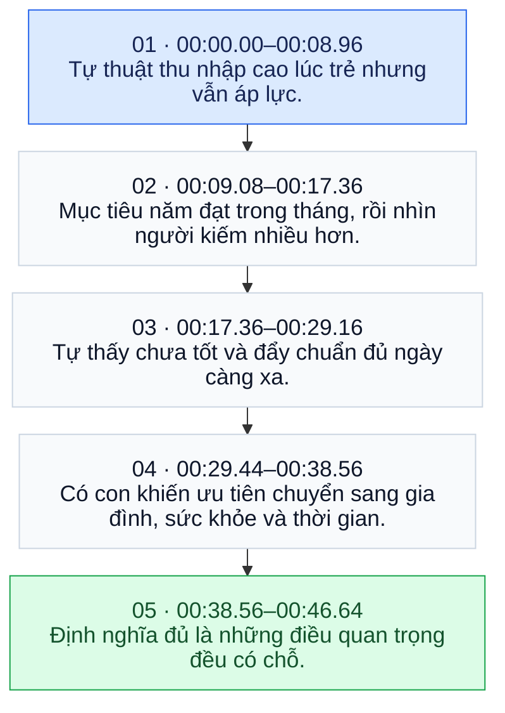

# Tự thuật nghịch lý thu nhập: đạt mục tiêu rồi vẫn thấy thiếu

[Video gốc — @vietcetera_](https://www.tiktok.com/@vietcetera_/video/7690176024939629842) · ID `7690176024939629842`

**Tóm tắt cách kể:** Một con số tự thuật gây chú ý → kết quả cảm xúc trái kỳ vọng → chỉ ra so sánh xã hội khiến vạch đích dời đi → một thay đổi đời sống làm thước đo đổi. Sự khác biệt là người thật tự nhận mâu thuẫn của mình, không dùng người dẫn phán xét việc người xem nên sống ra sao.

[Sơ đồ diễn biến](#mindmap) · [Diễn biến](#dien-bien) · [Nhịp cảm xúc](#cam-xuc) · [Cách áp dụng](#ap-dung)

## Sơ đồ diễn biến

Đọc từ trên xuống: mỗi hộp là một nhịp theo mốc ASR hoặc khung hình được ghi trong phân tích. Xanh dương là mở đầu, xanh lá là nhịp cuối. Chi tiết và giới hạn nằm trong phân tích bên dưới.

[Mã Mermaid riêng](../mindmaps/7690176024939629842.mmd)

## Dữ liệu và nguồn

**Cách thể hiện:** Phỏng vấn và tự thuật

**Ngữ cảnh thương mại:** Chưa xác nhận hợp tác thương mại; xem các đoạn tự quảng bá/giới hạn được ghi riêng.

- Đăng: 2026-09-27T13:00:00+00:00. Metadata lấy: 2026-11-15T04:04:11.595620+00:00.
- **311,000 view**; thích 9,035; bình luận 23; chia sẻ 1,021; lưu 652. Dấu phẩy tách hàng nghìn.
- Thời lượng media: 53.55s.
- **100.68× P50** 3,089 của 147 bài đủ 48h trong snapshot kênh. Clip có trong cửa sổ baseline. Không phải thống kê toàn bộ kênh.

## Phạm vi kiểm

Đã tải media, xem khung chọn lọc và đọc ASR có mốc lưu lúc 2026-11-15T04:06:55.106037+00:00. Đối chiếu cùng ID và thời lượng, lệch 0.024s. **Chưa nghe toàn âm hoặc xem chuyển động liên tục; chưa xác nhận toàn văn ASR hay mọi dữ kiện kinh tế trong clip.**

Media SHA256: `e0cf5e8ff53512fcdc5ff0b61ce4d127d35b1ce934c5fd87c79bcd4a7bcc5c4d`. [Metadata và các hash khác](../videos.json). Video/ASR đầy đủ giữ ở bộ nghiên cứu cục bộ; bản chia sẻ giữ link gốc, trích ngắn và phân tích riêng.

## Lời hứa và câu hỏi trung tâm

**Lời hứa:** Giải thích vì sao đạt mốc tiền từng mơ vẫn có thể chưa tạo cảm giác đủ, qua lời tự thuật của khách mời.

**Câu hỏi:** Điều gì khiến cảm giác đủ cứ lùi xa dù mục tiêu tài chính đã đạt?

## Mở đầu: lời và hình

0–5,18 giây khách mời tự thuật một mức thu nhập từng đạt lúc trẻ; 5,18–8,96 giây lập tức đặt nó cạnh cảm giác không hạnh phúc và áp lực. Khung 0–2 giây là cảnh người đứng sau bàn; 3–5 giây cận hơn khi phụ đề nêu con số. Cơ chế là lời thú nhận mâu thuẫn với thước đo thành công, không phải cam kết dạy người xem kiếm mức tiền ấy.

> Cái thời điểm em 22, 23 tuổi có những cái tháng em kiếm được 300-400 triệu

Trích ASR ngắn từ segment 00:00.00–00:05.18. Trích ASR chưa nghe đối chiếu; dữ kiện thuộc lời người đăng, chưa xác thực. Xem giới hạn từng ca. Dấu … nghĩa là bỏ bớt, không khẳng định toàn câu vừa ba giây.

| Mốc khung đã xem | Điều quan sát được |
|---|---|
| 00:00.00 | Khách mời đứng sau bàn trong trường quay có logo chương trình, phụ đề về độ tuổi. |
| 00:03.00 | Cỡ cảnh gần hơn và phụ đề nêu con số thu nhập tự thuật. |
| 00:08.03 | Góc máy rộng lệch bên, phụ đề nói chưa hạnh phúc và áp lực. |
| 00:24.10 | Cận người nói với cử chỉ tay và phụ đề về tận hưởng, cảm thấy đủ. |
| 00:40.16 | Cảnh rộng cùng người nói; phụ đề tách định nghĩa đủ khỏi con số. |
| 00:52.55 | Thẻ kết dùng chân dung khách mời và câu tiêu đề về thu nhập nhưng chưa thấy đủ. |

Không suy chuyển động giữa các khung từ ảnh tĩnh.

## Diễn biến và nhiệm vụ từng beat

| Mốc ASR | Diễn giải riêng | Vai trò |
|---|---|---|
| 00:00.00–00:08.96 | Tự thuật thu nhập cao lúc trẻ nhưng vẫn áp lực. | Hook lời thú nhận nghịch kỳ vọng. |
| 00:09.08–00:17.36 | Mục tiêu năm đạt trong tháng, rồi nhìn người kiếm nhiều hơn. | Tạo bước ngoặt từ thành tựu sang so sánh. |
| 00:17.36–00:29.16 | Tự thấy chưa tốt và đẩy chuẩn đủ ngày càng xa. | Giải thích vòng lặp tâm lý bằng trải nghiệm cá nhân. |
| 00:29.44–00:38.56 | Có con khiến ưu tiên chuyển sang gia đình, sức khỏe và thời gian. | Đưa biến cố đổi tiêu chí thành công. |
| 00:38.56–00:46.64 | Định nghĩa đủ là những điều quan trọng đều có chỗ. | Đóng bằng một thước đo khác thay vì số tiền. |

## Nhịp cảm xúc — giả thuyết biên tập

Các trạng thái dưới đây là cách đọc câu chuyện từ bằng chứng, không phải cảm xúc người xem đã đo hoặc biểu đồ retention.

| Mốc | Cảm xúc có thể gợi | Bằng chứng | Cách diễn giải |
|---|---|---|---|
| 00:00.00–00:08.96 | Ngạc nhiên và gần gũi | Thu nhập tự thuật cao đi cùng áp lực. | Lời thừa nhận làm hình ảnh thành công có mặt dễ tổn thương. |
| 00:09.08–00:29.16 | Nhận ra vòng lặp | Đạt mục tiêu rồi nhìn người hơn mình, tự nâng chuẩn. | Chuyển sự ngạc nhiên về con số sang nhận diện một quá trình. |
| 00:29.44–00:38.56 | Đổi trọng tâm | Khách mời kể việc có con và các ưu tiên mới. | Cho lời giải có bối cảnh thay vì khẩu hiệu chung. |
| 00:38.56–00:46.64 | Nhẹ hơn theo lời kể | Định nghĩa đủ không còn quy về số. | Đóng chuyển biến, không xác nhận phản ứng người xem. |

## Cách phân phối thông tin

| Mốc | Động tác viết | Vì sao đáng chú ý |
|---|---|---|
| 00:00.00–00:08.96 | Thành tựu + cảm xúc trái kỳ vọng | Tạo lời hứa giải thích một mâu thuẫn nội tại. |
| 00:09.08–00:29.16 | Kể vòng lặp từng bước | Mục tiêu đạt → so sánh → tự gây áp lực → nâng chuẩn. |
| 00:29.44–00:46.64 | Đổi tiêu chí thay vì nâng mục tiêu | Trả lời đầu bài bằng một cách đo khác có lý do cá nhân. |

## Giải đáp và cách kết

Kết lời ở định nghĩa đủ bằng chỗ dành cho các ưu tiên. Khung 48,19 giây có logo trên nền đen; 52,55 giây là thẻ chân dung và câu tiêu đề. Clip đóng được chuyển biến cá nhân thay vì bán công thức thu nhập.

## Điểm mạnh có dẫn chứng

- **Mâu thuẫn được trả sớm** — Chưa tới 9 giây đã nói cả mức tiền lẫn sự không hạnh phúc.

- **Có cơ chế trung gian cụ thể** — 12–26,64 giây nối xem mạng, so sánh và dời chuẩn đủ.

- **Chuyển biến có nguyên nhân đời sống** — 29,44 giây việc có con dẫn vào ưu tiên mới.

## Điểm yếu và điều không nên bắt chước

- **Con số có thể lấn thông điệp** — Thẻ 52,55 giây tiếp tục nhấn thu nhập, trong khi phần kết nói về ưu tiên.

- **Khó khái quát sang hoàn cảnh khác** — 29,44–38,56 giây bước ngoặt gắn với trải nghiệm làm cha mẹ của khách mời.

## Khả năng được chia sẻ — chưa kiểm chứng

Không có dữ liệu phân phối/retention để kết luận vì sao viral. Các ý sau chỉ là giả thuyết để thử:

- Người đang so sánh thu nhập có thể gửi clip như một cách diễn đạt điều mình gặp; cần dữ liệu chia sẻ để xác nhận.

- Cụm ý về dành chỗ cho ưu tiên có thể dễ nhớ hơn số tiền; đây là giả thuyết, chưa đo ghi nhớ.

## Chuyển cơ chế sang bài mới

Học cấu trúc thành tựu đã đạt nhưng vấn đề vẫn còn, rồi kể cơ chế và sự thay đổi tiêu chí bằng trải nghiệm có thật. Con số chỉ tạo bối cảnh, phải gắn nhãn tự thuật; không biến câu chuyện thành bằng chứng tiền bạc không có ích cho tất cả mọi người.

- Dùng trải nghiệm thật và nói rõ đó là tự thuật.

- Nêu mâu thuẫn cảm xúc ngay sau thành tựu để tránh biến thành khoe số.

- Cho thấy các bước gây ra vấn đề, không nhảy thẳng từ giàu sang lời khuyên sống đủ.

- Giữ kết luận trong phạm vi trải nghiệm; không khẳng định áp dụng cho mọi hoàn cảnh.

Không dùng bài chuyển thể chưa được người dùng duyệt làm mẫu giọng lâu dài.

## Giới hạn còn lại

- Phân tích dựa trên toàn bộ ASR có timestamp và 12 khung hình lấy mẫu từ bản tải mới; chưa nghe âm hoặc xem video liên tục.

- Cảm xúc, khả năng chia sẻ và giữ chân là giả thuyết biên tập; không có retention hay thử nghiệm nhân quả.

- Số thu nhập, tuổi và trải nghiệm là lời khách mời tự thuật, chưa kiểm chứng bằng tài liệu tài chính.

- Một trải nghiệm không chứng minh quan hệ phổ quát giữa thu nhập, có con và hạnh phúc.
