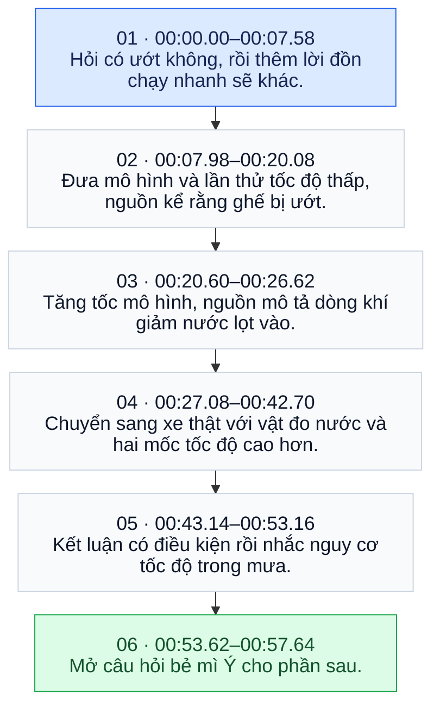

# Xe mui trần gặp mưa: lời đồn được thử qua nhiều tốc độ

[Video gốc — @kienkhongngu_official](https://www.tiktok.com/@kienkhongngu_official/video/7691281157266132231) · ID `7691281157266132231`

**Tóm tắt cách kể:** Câu hỏi thấy được bằng hình → thêm biến tốc độ → kết quả lần đầu → tăng biến và giải thích dòng khí → thử ở xe thật → đáp án kèm giới hạn. Chi tiết có thể học là kết quả đến từng bậc thay vì giữ toàn bộ đáp án tới cuối.

[Sơ đồ diễn biến](#mindmap) · [Diễn biến](#dien-bien) · [Nhịp cảm xúc](#cam-xuc) · [Cách áp dụng](#ap-dung)

## Sơ đồ diễn biến

Đọc từ trên xuống: mỗi hộp là một nhịp theo mốc ASR hoặc khung hình được ghi trong phân tích. Xanh dương là mở đầu, xanh lá là nhịp cuối. Chi tiết và giới hạn nằm trong phân tích bên dưới.

[Mã Mermaid riêng](../mindmaps/7691281157266132231.mmd)

## Dữ liệu và nguồn

**Cách thể hiện:** Giải thích trên footage

**Phạm vi học:** Học cách chia thông tin theo hình và ASR, giữ giới hạn từng ca.

**Ngữ cảnh thương mại:** Chưa xác nhận tài trợ; nhận diện thương hiệu/quảng bá quan sát được nằm trong phân tích.

- Đăng: 2026-09-30T10:59:08+00:00. Metadata lấy: 2026-11-15T04:34:01.342733+00:00.
- **1,100,000 view**; thích 35,400; bình luận 103; chia sẻ 4,828; lưu 632. Dấu phẩy tách hàng nghìn.
- Thời lượng media: 58.07s.
- **6.26× P50** 175,800 của 147 bài đủ 48h trong snapshot kênh. Clip có trong cửa sổ baseline. Không phải thống kê toàn bộ kênh.

## Phạm vi kiểm

Đã tải media, xem khung chọn lọc và đọc ASR có mốc lưu lúc 2026-11-15T04:35:09.230582+00:00. Đối chiếu cùng ID và thời lượng, lệch 0.002s. **Chưa nghe toàn âm hoặc xem chuyển động liên tục; chưa xác nhận toàn văn ASR hay mọi dữ kiện trong clip.**

Media SHA256: `febf6c18be6f11dd311cbf5a8f474144c20214311f63d21fd88b5ce72851ee4b`. [Metadata và các hash khác](../videos.json). Video/ASR đầy đủ giữ ở bộ nghiên cứu cục bộ; bản chia sẻ giữ link gốc, trích ngắn và phân tích riêng.

## Lời hứa và câu hỏi trung tâm

**Lời hứa:** Giải đáp lời đồn về xe mui trần bằng chuỗi thử được kể lại.

**Câu hỏi:** Tăng tốc có thật sự làm nước mưa lọt vào xe ít hơn, và tới mức nào?

## Mở đầu: lời và hình

0–2,68 giây ASR đặt câu hỏi xe mui trần chạy giữa mưa có bị ướt không; cùng lúc ảnh 0–2 giây cho thấy xe không mui trên mặt đường ướt và thẻ câu hỏi. Từ 2,92 giây mới thêm điều kiện chạy đủ nhanh có thể tránh ướt. Khoảng trống cụ thể là kết quả đổi thế nào khi tăng tốc, không chỉ một nhãn tò mò chung.

## Nghiên cứu phần mở

Diễn giải từ bằng chứng đã lưu; lý do gây chú ý là giả thuyết biên tập, chưa đo retention.

**Cửa sổ quan sát:** 00:00.00–00:07.58

| Lớp | Quan sát/diễn giải |
|---|---|
| Lời | 0–2,68s hỏi kết quả khi xe mui trần gặp mưa; 2,92–7,58s thêm lời đồn chạy đủ nhanh thì không ướt. |
| Hình | Ảnh0–2s: xe mở mui trên đường ướt. Ảnh5s thêm đồng hồ tốc độ, biến được đưa lên hình. |
| Chữ trên hình | Thẻ đỏ nêu câu hỏi có ướt, không nêu đáp án; từ ảnh3s có phụ đề theo lời. |

**Động tác gây chú ý:** Đặt một tình huống dễ đoán rồi thêm điều kiện có vẻ làm đáp án ngược lại; người xem có thứ cụ thể để kiểm tra.

**Vì sao có thể muốn dừng lại:** Giả thuyết biên tập: hình xe không mui trên mặt đường ướt khiến câu hỏi dễ hình dung ngay; điều kiện tăng tốc có thể làm người xem nghi ngờ dự đoán ban đầu. Không phải retention đã đo.

**Điều còn muốn biết:** Trong lời đồn, chạy nhanh thay đổi lượng nước vào xe ra sao?

**Thông tin chưa cho biết:** Hook chưa cho các mốc tốc độ, kết quả thử và cách dùng tấm đo nước.

**Nhịp nối có gì mới:** 7,98–14,5s chuyển thẳng sang nhóm làm thí nghiệm và mô hình, cung cấp phương pháp thay vì lặp lại câu hỏi.

**Mốc trả/giới hạn giải đáp:** 00:32.64–00:53.16 — Nguồn kể kết quả thử xe thật ở các tốc độ, kết luận có thể ít ướt khi đủ nhanh rồi nêu giới hạn an toàn; chưa kiểm chứng độc lập.

**Tóm cấu trúc bằng hai câu:** Cho thấy một tình huống quen thuộc và thêm một điều kiện có thể đảo dự đoán. Đổi điều kiện qua các lần thử, trả kết quả từng bậc rồi nêu giới hạn của kết luận.

**Chuyển sang ngách khác:** Chuyển quan hệ cùng bài toán–thay một giả định–đối chiếu kết quả sang mô phỏng tài chính có nguồn. Sẽ hỏng nếu coi mô phỏng là thí nghiệm bảo đảm tương lai hoặc bỏ phí, rủi ro và điều kiện.

**Điều không chuyển theo:**

- Không chuyển tốc độ/thử nguy hiểm thành hành động mẫu.
- Không mượn hiệu ứng thí nghiệm để bảo chứng lợi nhuận.

**Phạm vi:** Toàn bộ ASR58s và12 ảnh có mốc từ bản tải mới; chưa nghe toàn âm/xem liên tục, chưa xác minh nghiên cứu gốc.

> Lú cực mạnh, lái xe mui trần vào trời mưa thì có bị ướt không?

Trích ASR ngắn từ segment 00:00.00–00:02.68. Trích ASR ngắn chưa nghe so khớp toàn âm; không khẳng định cả segment là ba giây. Xem phạm vi/giới hạn từng ca. Dấu … nghĩa là bỏ bớt, không khẳng định toàn câu vừa ba giây.

| Mốc khung đã xem | Điều quan sát được |
|---|---|
| 00:00.00 | Xe mui trần trên đường ướt, thẻ câu hỏi màu đỏ chiếm phần dưới. |
| 00:02.00 | Vẫn xe và cùng thẻ câu hỏi; chưa hiện kết quả thử nghiệm. |
| 00:03.00 | Tư liệu xe mui trần ngoài trời, phụ đề chuyển sang lời đồn. |
| 00:05.00 | Hình ghép xe, người và đồng hồ tốc độ trên nền xanh, chuyển câu chuyện sang biến tốc độ. |
| 00:08.71 | Mô hình xe trong bối cảnh thử nghiệm, phụ đề giới thiệu nhóm kiểm tra lời đồn. |
| 00:17.42 | Mô hình xe dưới giọt nước với các mũi tên vẽ hướng dòng khí. |
| 00:26.13 | Vẫn mô hình, giọt nước và mũi tên phía trên xe, phụ đề nêu ngăn phần lớn nước. |
| 00:34.84 | Một người đội mũ trên xe thật, phụ đề gắn một mốc tốc độ. |
| 00:43.55 | Tấm bề mặt sáng nằm trên khu vực ghế xe, phù hợp phần lời nói về tấm đo nước; ảnh riêng không xác minh độ khô. |
| 00:57.07 | Hình bó mì Ý và câu hỏi mới, khác đề tài xe. |

Không suy chuyển động giữa các khung từ ảnh tĩnh.

## Diễn biến và nhiệm vụ từng beat

| Mốc ASR | Diễn giải riêng | Vai trò |
|---|---|---|
| 00:00.00–00:07.58 | Hỏi có ướt không, rồi thêm lời đồn chạy nhanh sẽ khác. | Tạo dự đoán hai khả năng với một biến được nêu rõ. |
| 00:07.98–00:20.08 | Đưa mô hình và lần thử tốc độ thấp, nguồn kể rằng ghế bị ướt. | Thiết lập phép thử và kết quả đầu làm mốc so. |
| 00:20.60–00:26.62 | Tăng tốc mô hình, nguồn mô tả dòng khí giảm nước lọt vào. | Trả một phần lời đồn và mở cơ chế. |
| 00:27.08–00:42.70 | Chuyển sang xe thật với vật đo nước và hai mốc tốc độ cao hơn. | Nâng quy mô minh hoạ và tiến tới kết quả nguồn công bố. |
| 00:43.14–00:53.16 | Kết luận có điều kiện rồi nhắc nguy cơ tốc độ trong mưa. | Trả câu hỏi chính nhưng giới hạn điều được học thành khuyến cáo thực hành. |
| 00:53.62–00:57.64 | Mở câu hỏi bẻ mì Ý cho phần sau. | Tạo cầu sang tập khác sau khi đã đóng chủ đề hiện tại. |

## Nhịp cảm xúc — giả thuyết biên tập

Các trạng thái dưới đây là cách đọc câu chuyện từ bằng chứng, không phải cảm xúc người xem đã đo hoặc biểu đồ retention.

| Mốc | Cảm xúc có thể gợi | Bằng chứng | Cách diễn giải |
|---|---|---|---|
| 00:00.00–00:07.58 | Dự đoán và ngạc nhiên | Câu hỏi có ướt được nối với khả năng trái trực giác khi chạy nhanh. | Mời người xem tự chọn đáp án trước khi có phép thử. |
| 00:07.98–00:26.62 | Theo dõi sự thay đổi | Mô hình được kể ở hai tốc độ, kết quả và dòng khí khác nhau. | Mỗi lần thay biến cho một mảnh lời giải, không chỉ trì hoãn. |
| 00:27.08–00:47.02 | Chờ đối chiếu thực tế | Chuyển xe thật và tấm đo rồi kết luận theo nguồn. | Nâng mức cụ thể cho câu trả lời, chưa chứng minh được độ tin cậy phép thử. |
| 00:47.52–00:57.64 | Giới hạn rồi tò mò mới | Cảnh báo an toàn trước câu hỏi mì Ý. | Đóng vòng hiện tại rồi mới mở vòng tiếp. |

## Cách phân phối thông tin

| Mốc | Động tác viết | Vì sao đáng chú ý |
|---|---|---|
| 00:00.00–00:07.58 | Đặt hiện tượng và biến | Mưa, xe không mui và tốc độ cùng nằm trong câu hỏi. |
| 00:07.98–00:26.62 | Mô hình trước | Tạo phép so nhỏ và đồ hoạ dòng khí dễ nhìn. |
| 00:27.08–00:47.02 | Đối chiếu xe thật | Cho lời đồn một lần kiểm tra ở quy mô khác theo tường thuật. |
| 00:47.52–00:57.64 | Tách đáp án và thực hành | Nhận biết một hiện tượng không đồng nghĩa nên tái hiện hành vi nguy hiểm. |

## Giải đáp và cách kết

Nguồn trả lời rằng tốc độ đủ cao có thể ngăn phần lớn nước trong tình huống thử, rồi nhắc không đổi an toàn lấy việc tránh ướt. Đuôi hẹn một câu hỏi khác về mì Ý; phần giải đáp xe đã diễn ra trước lời hẹn.

## Điểm mạnh có dẫn chứng

- **Ba lớp mở thống nhất** — 0–2,68 giây câu hỏi trong ASR khớp xe trên đường ướt và thẻ hỏi trong ảnh0–2.

- **Cầu giữa hook và thân có hoạt động rõ** — 7,98–14,5 giây giới thiệu thí nghiệm, mô hình và hệ thống phun nước.

- **Có đóng lời hứa trước hẹn tập** — 43,14–53,16 giây kết luận và giới hạn trước nhịp mì Ý.

## Điểm yếu và điều không nên bắt chước

- **Tư liệu tóm lược thiếu điều kiện kiểm chứng** — ASR nêu kết quả nhiều tốc độ nhưng không trình phương pháp đầy đủ, nguồn thí nghiệm hay sai số.

- **Hình không đủ xác nhận số đo** — Ảnh43,55 giây cho thấy bề mặt đo nhưng không chứng minh lượng nước hoặc độ khô được tường thuật.

## Khả năng được chia sẻ — chưa kiểm chứng

Không có dữ liệu phân phối/retention để kết luận vì sao viral. Các ý sau chỉ là giả thuyết để thử:

- Câu hỏi có thể được gửi như một bài đố trước khi mở đáp án; chưa có dữ liệu cho thấy đó là lý do chia sẻ thực.

- Kết quả tăng theo biến có thể khiến người xem muốn đối chiếu dự đoán của mình.

## Chuyển cơ chế sang bài mới

Chuyển được quan hệ dự đoán–đổi một biến–so kết quả. Sang tài chính phải dùng mô phỏng hoặc dữ liệu với giả định và điều kiện, không biến đường đi của một chiếc xe thành bằng chứng lợi nhuận chắc chắn.

- Chọn một quan hệ có biến và kết quả rõ.

- Trả lời từng phần qua các lần so, không chỉ kéo dài câu hỏi.

- Nguồn và điều kiện phép thử phải đủ để người xem kiểm tra.

- Tách điều quan sát trong thử nghiệm khỏi hành vi nên thực hiện.

Không dùng bài chuyển thể chưa được người dùng duyệt làm mẫu giọng lâu dài.

## Giới hạn còn lại

- Đã đọc toàn bộ ASR có timestamp và xem 12 khung trích của cùng ID; chưa nghe toàn âm thanh hoặc xem video liên tục.

- Không có retention, tỷ lệ xem hết hay thử nghiệm nhân quả; các nhận định giữ chân và chia sẻ là giả thuyết về cách trình bày.

- Không xác minh độc lập thí nghiệm gốc, xuất xứ tư liệu, tốc độ, điều kiện mưa hay giải thích khí động học.

- Các con số tốc độ là phần tường thuật của clip, không phải hướng dẫn thử xe.

- Metadata không nêu tài trợ rõ trong mô tả đã đọc; không xác định được tỷ lệ tiếp cận tự nhiên hay trả phí.
