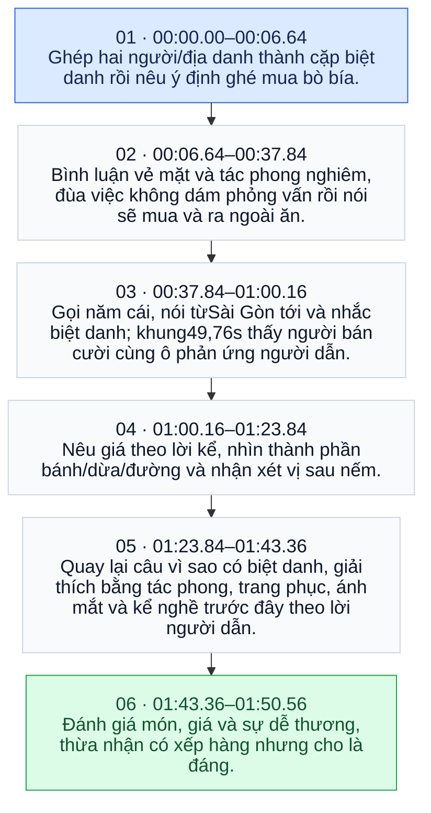

# Bò bía của “đại tá” Thành: từ vẻ nghiêm đến tương tác thân thiện

[Video gốc — @quankhonggo](https://www.tiktok.com/@quankhonggo/video/7691640756704005384) · ID `7691640756704005384`

**Tóm tắt cách kể:** Đặt biệt danh qua cặp ảnh → dựng ấn tượng nghiêm → người dẫn có phản ứng → tương tác cho thấy nụ cười → nếm món → giải thích biệt danh → đánh giá trải nghiệm. Mẫu dựa vào tương phản giữa ấn tượng và hành vi quan sát được, không chỉ dùng nhân vật nổi làm mồi.

[Sơ đồ diễn biến](#mindmap) · [Diễn biến](#dien-bien) · [Nhịp cảm xúc](#cam-xuc) · [Cách áp dụng](#ap-dung)

## Sơ đồ diễn biến

Đọc từ trên xuống: mỗi hộp là một nhịp theo mốc ASR hoặc khung hình được ghi trong phân tích. Xanh dương là mở đầu, xanh lá là nhịp cuối. Chi tiết và giới hạn nằm trong phân tích bên dưới.

[Mã Mermaid riêng](../mindmaps/7691640756704005384.mmd)

## Dữ liệu và nguồn

**Cách thể hiện:** Gặp gỡ và đối thoại tại chỗ

**Phạm vi học:** Học cách chia thông tin theo hình và ASR, giữ giới hạn từng ca.

**Ngữ cảnh thương mại:** Chưa xác nhận tài trợ; nhận diện thương hiệu/quảng bá quan sát được nằm trong phân tích.

- Đăng: 2026-10-01T10:14:35+00:00. Metadata lấy: 2026-11-15T04:34:24.248328+00:00.
- **4,400,000 view**; thích 327,300; bình luận 725; chia sẻ 20,800; lưu 12,924. Dấu phẩy tách hàng nghìn.
- Thời lượng media: 110.58s.
- **5.46× P50** 805,300 của 148 bài đủ 48h trong snapshot kênh. Clip có trong cửa sổ baseline. Không phải thống kê toàn bộ kênh.

## Phạm vi kiểm

Đã tải media, xem khung chọn lọc và đọc ASR có mốc lưu lúc 2026-11-15T04:36:24.010515+00:00. Đối chiếu cùng ID và thời lượng, lệch 0.015s. **Chưa nghe toàn âm hoặc xem chuyển động liên tục; chưa xác nhận toàn văn ASR hay mọi dữ kiện trong clip.**

Media SHA256: `7cccbf3efff777763cd074a475ea91c2862c0ce050045a4b009f3e0b844ba3a8`. [Metadata và các hash khác](../videos.json). Video/ASR đầy đủ giữ ở bộ nghiên cứu cục bộ; bản chia sẻ giữ link gốc, trích ngắn và phân tích riêng.

## Lời hứa và câu hỏi trung tâm

**Lời hứa:** Đi gặp người bán bò bía được gọi bằng biệt danh có vẻ nghiêm, rồi kể trải nghiệm mua và ăn.

**Câu hỏi:** Người bán thật sự khó gần như ấn tượng ban đầu hay không, và vì sao có biệt danh ấy?

## Mở đầu: lời và hình

ASR mở bằng đối chiếu An Giang có “đại tá” Minh với Hà Nội có “đại tá” Thành. Hình0–3 giây ghép lần lượt hai chân dung cùng nhãn địa danh/tên trên người dẫn đang đi phố. Tên gọi tạo một chân dung để đi gặp; lời3,12–6,64 giây nói sẽ ghé ăn. Trong nguồn, đây là biệt danh/so sánh của người kể, không phải xác nhận quân hàm của người bán.

## Nghiên cứu phần mở

Diễn giải từ bằng chứng đã lưu; lý do gây chú ý là giả thuyết biên tập, chưa đo retention.

**Cửa sổ quan sát:** 00:00.00–00:06.64

| Lớp | Quan sát/diễn giải |
|---|---|
| Lời | 0–3,12s đối chiếu hai biệt danh theo nơi;3,12–6,64s nói sẽ ghé ăn và xếp hàng,ASR có từ sai nên diễn ý. |
| Hình | Người dẫn tự quay đi phố;0–3s ghép lần lượt hai chân dung,5s thấy hàng người. |
| Chữ trên hình | Chữ địa danhAn Giang/Hà Nội vànhãnđại táMinh/Thành;5s chữ xácđịnh món bòbía. |

**Động tác gây chú ý:** Đối chiếu nhân vật qua biệt danh, sau đó hứa đi gặp trong một trải nghiệm ăn.

**Vì sao có thể muốn dừng lại:** Giả thuyết: sự lệch giữa danh xưng nghiêm và một người bán đồ ăn khiến khán giả muốn biết con người này ra sao; không phải quan sát retention.

**Điều còn muốn biết:** Vì sao người bán có biệt danh này và có thật khó gần như người dẫn đùa?

**Thông tin chưa cho biết:** Lý do biệt danh được để tới83,84s; nụ cười và tương tác thân thiện xuất hiện trước ở49,76s.

**Nhịp nối có gì mới:** Cảnh xếp hàng, phản ứng người dẫn, gọi mua và nếm món tạo chuỗi sự kiện, không chỉ lời mô tả kéo dài.

**Mốc trả/giới hạn giải đáp:** 01:23.84–01:43.36 — ASR giải thích biệt danh bằng tác phong/ánh mắt và kể nghề cũ; phần nghề cũ chưa kiểm. Hình49,76s đã trả một phần câu khó gần bằng nụ cười.

**Tóm cấu trúc bằng hai câu:** Dựng một ấn tượng rõ về nhân vật bằng phép đối chiếu, rồi đặt người kể vào cuộc gặp để thử ấn tượng ấy. Cho hành vi và kết quả trải nghiệm sửa hoặc bổ sung ấn tượng trước khi giải thích nhãn ban đầu.

**Chuyển sang ngách khác:** Chuyển được quan hệ ấn tượng → thử bằng hành vi/tài liệu → hiểu lại; ví dụ phân tích một cách doanh nghiệp kiếm tiền khác hình dung ban đầu. Sẽ hỏng nếu mang biệt danh, ngoại hình hoặc nghề cũ thành chứng cứ đánh giá năng lực/rủi ro tài chính.

**Điều không chuyển theo:**

- Không tạo danh xưng sai để nhử chúý.
- Không dùng cảm giác về con người thay dữ liệu khi nhận định doanh nghiệp.
- Không trìhoãn lời giải chỉ để bắtchước độdài.

**Phạm vi:** ToànASR mới và12khung; tênmón/tiểusử cóASR lỗi; chưa nghe toànâm/xem liên tục.

> Ở An Giang thì có Đại tá Minh nhưng mà ở Hà Nội là có Đại tá Thành nha mọi người

Trích ASR ngắn từ segment 00:00.00–00:03.12. Trích ASR ngắn chưa nghe so khớp toàn âm; không khẳng định cả segment là ba giây. Xem phạm vi/giới hạn từng ca. Dấu … nghĩa là bỏ bớt, không khẳng định toàn câu vừa ba giây.

| Mốc khung đã xem | Điều quan sát được |
|---|---|
| 00:00.00 | Người dẫn tự quay khi đi phố, trên đầu ghép chân dung khác với chữ An Giang. |
| 00:01.00 | Ảnh ghép vẫn ở trên, chữ vàng ghi đại tá Minh. |
| 00:02.00 | Nhãn Hà Nội xuất hiện trên cảnh người dẫn, đặt hai nơi thành cặp. |
| 00:03.00 | Chân dung người áo đỏ và nhãn đại tá Thành được ghép phía trên. |
| 00:05.00 | Thấy người xếp hàng ở mặt tiền; chữ vàng nêu ăn bò bía của người bán vừa giới thiệu. |
| 00:16.59 | Người bán áo đỏ đứng thao tác cạnh chậu, nét mặt nghiêm ở khung này. |
| 00:33.17 | Mặt người dẫn cười trong một ô hình đặt trên cảnh tối phía dưới, cho thấy cách chèn phản ứng. |
| 00:49.76 | Người bán cười cúi đầu; ô mặt người dẫn phía trên cũng cười, tạo đối chiếu với khung16,59s. |
| 01:06.35 | Người dẫn cầm bánh đang ăn ngoài cửa hàng, quay sang người cạnh mình. |
| 01:22.94 | Người dẫn tiếp tục cầm bánh nói với máy, đưa câu chuyện trở lại món ăn. |
| 01:39.52 | Người dẫn giơ tay gần mắt khi nói về dáng vẻ người bán theo ASR. |
| 01:49.58 | Dòng chữ xứng đáng để xếp hàng nằm trên người dẫn ở khung cuối. |

Không suy chuyển động giữa các khung từ ảnh tĩnh.

## Diễn biến và nhiệm vụ từng beat

| Mốc ASR | Diễn giải riêng | Vai trò |
|---|---|---|
| 00:00.00–00:06.64 | Ghép hai người/địa danh thành cặp biệt danh rồi nêu ý định ghé mua bò bía. | Dùng một chân dung khác thường để tạo lý do đi thử trải nghiệm. |
| 00:06.64–00:37.84 | Bình luận vẻ mặt và tác phong nghiêm, đùa việc không dám phỏng vấn rồi nói sẽ mua và ra ngoài ăn. | Dựng khoảng cách giữa hình dung người bán khó gần với người dẫn đang ngại mà cười. |
| 00:37.84–01:00.16 | Gọi năm cái, nói từSài Gòn tới và nhắc biệt danh; khung49,76s thấy người bán cười cùng ô phản ứng người dẫn. | Cho một cuộc gặp thật làm mềm chân dung được phóng đại ở đầu. |
| 01:00.16–01:23.84 | Nêu giá theo lời kể, nhìn thành phần bánh/dừa/đường và nhận xét vị sau nếm. | Trả nhu cầu review món ăn trong khi vẫn giữ nhân vật làm tâm điểm. |
| 01:23.84–01:43.36 | Quay lại câu vì sao có biệt danh, giải thích bằng tác phong, trang phục, ánh mắt và kể nghề trước đây theo lời người dẫn. | Trả câu hỏi nhận diện đã mở bằng ảnh ghép; một phần thôngtin tiểu sử chưa được kiểm. |
| 01:43.36–01:50.56 | Đánh giá món, giá và sự dễ thương, thừa nhận có xếp hàng nhưng cho là đáng. | Đóng bằng kết luận trải nghiệm của tác giả, không thêm bí mật mới. |

## Nhịp cảm xúc — giả thuyết biên tập

Các trạng thái dưới đây là cách đọc câu chuyện từ bằng chứng, không phải cảm xúc người xem đã đo hoặc biểu đồ retention.

| Mốc | Cảm xúc có thể gợi | Bằng chứng | Cách diễn giải |
|---|---|---|---|
| 00:00.00–00:06.64 | Tò mò vì cặp biệt danh | Hai chân dung và địa danh được dựng nối tiếp, món ăn chỉ nói sau. | Nhân vật đi trước sản phẩm tạo một đường vào khác review thông thường. |
| 00:06.64–00:37.84 | Ngại mà vui theo người kể | ASR đùa vẻ nghiêm và không dám nói; ô phản ứng ở33,17s là nụ cười. | Tạo khoảng cách hài giữa lời sợ và phản ứng, chưa đo khán giả. |
| 00:37.84–01:00.16 | Thân thiện hơn | Người bán cười ở49,76s khi người dẫn đang tương tác. | Cảnh cụ thể sửa ấn tượng nghiêm bằng quan hệ giữa hai người. |
| 01:00.16–01:23.84 | Muốn biết món ra sao | Nếm và nói về thành phần/giá. | Trả mục đích đồ ăn thay vì bỏ quên món sau hook nhân vật. |
| 01:23.84–01:50.56 | Có cách hiểu cho biệt danh | Tác phong được giải thích rồi nhận xét người bán dễ thương. | Kết luận bớt tuyệt đối so với chân dung phóng đại ban đầu. |

## Cách phân phối thông tin

| Mốc | Động tác viết | Vì sao đáng chú ý |
|---|---|---|
| 00:00.00–00:06.64 | Ghép hai chân dung và địa danh. | Gọi một liên tưởng có sẵn rồi đưa nhân vật mới vào cùng phép so. |
| 00:06.64–00:37.84 | Cho thấy cả người bán lẫn phản ứng người dẫn. | Nhân vật nghiêm được lọc qua người kể có tính cách, không chỉ quay tĩnh. |
| 00:37.84–01:00.16 | Tương tác trước khi giải thích tiểu sử. | Nụ cười là một sự kiện quan sát được làm đổi giọng câu chuyện. |
| 01:00.16–01:23.84 | Quay về thành phần/giá/trải nghiệm ăn. | Giữ lời hứa ghé ăn ở đầu. |
| 01:23.84–01:50.56 | Trả biệt danh rồi chốt trải nghiệm. | Khép cả hai tuyến người và món. |

## Giải đáp và cách kết

Kết vừa nhận xét món vừa khép khoảng cách với người bán: dễ thương, đáng xếp hàng. Trước đó hình49,76s đã cho thấy nụ cười, nên phần thưởng về con người đến sớm hơn lời giải biệt danh83,84s.

## Điểm mạnh có dẫn chứng

- **Hai lớp hình làm rõ phép so ngay đầu** — Khung0–3s có địa danh, chân dung và tên, không bắt hiểu chỉ bằng lời.

- **Có hành vi đối chiếu ấn tượng** — 16,59s người bán nét nghiêm;49,76s cười, cùng phản ứng người dẫn.

- **Không bỏ món sau hook nhân vật** — 60,16–83,84s nói thành phần, giá và nếm.

## Điểm yếu và điều không nên bắt chước

- **Mở đầu cần biết liên tưởng trước đó** — Cặp đại tá Minh/Thành có thể kém rõ với người chưa biết nhân vật được ghép.

- **Lời đùa dễ bị hiểu thành xác nhận chức vụ** — 0–3,12s dùng danh xưng ngay, còn giải thích tiểu sử ở98,24–103,36s mới tới và chưa kiểm.

- **Nhiều lời bình về vẻ nghiêm trước giao tiếp** — 6,64–37,84s kéo dài ấn tượng trước khi đặt mua, dễ thành trì hoãn nếu người xem chỉ cần biết món.

## Khả năng được chia sẻ — chưa kiểm chứng

Không có dữ liệu phân phối/retention để kết luận vì sao viral. Các ý sau chỉ là giả thuyết để thử:

- Tương phản vẻ nghiêm và nụ cười có thể khiến người xem gửi để cùng nhận ra một nhân vật, nhưng chưa có dữ liệu lý do chia sẻ.

- Cặp liên tưởng có thể khơi bình luận nhận diện giữa hai nhân vật, không phải bằng chứng về chất lượng món.

## Chuyển cơ chế sang bài mới

Có thể chuyển sangfinance theo quan hệ ấn tượng ban đầu → kiểm qua một hành vi/tài liệu cụ thể → sửa cách hiểu. Một tổ chức hoặc người thật không nên bị gắn biệt danh/cáo buộc để gây chú ý; phần kiểm phải thật sự có chứng cứ khác với ấn tượng.

- Đánh dấu biệt danh và lời đùa, tránh trình bày như chức vụ đã xác minh.

- Cho hành vi thật cơ hội sửa ấn tượng thay vì chỉ lặp nhãn nhân vật.

- Khi mượn hình đối chiếu cần bảo đảm khán giả vẫn hiểu nếu chưa biết người thứnhất.

- Giữ tuyến kết quả thực tế của trải nghiệm sau phần hook về con người.

- Không nhập định kiến về ngoại hình/tác phong vào nhận định tài chính.

Không dùng bài chuyển thể chưa được người dùng duyệt làm mẫu giọng lâu dài.

## Giới hạn còn lại

- Đã đọc toàn bộ ASR có timestamp và xem 12 khung trích của bản tải mới; chưa nghe toàn âm hoặc xem video liên tục.

- Mốc nhịp dựa trên ASR; không dùng bản chép tự động làm trích dẫn nguyên văn.

- Không có retention hay thử nghiệm nhân quả; số lượt xem không chứng minh hook tạo ra kết quả.

- Biệt danh đại tá/công an ngầm là cách đùa trong video, không xác nhận quân hàm hay vai trò hiện tại.

- ASR có nhiều từ sai ở tên món, tên người và câu đùa; không dùng làm trích dẫn chuẩn.

- Việc người bán từng làm công an xã, số năm bán và giá là lời người dẫn, chưa xác minh độc lập.

- Nhận xét món và đáng xếp hàng là trải nghiệm tác giả, không phải khuyến nghị mua hay đi ăn của phân tích.
