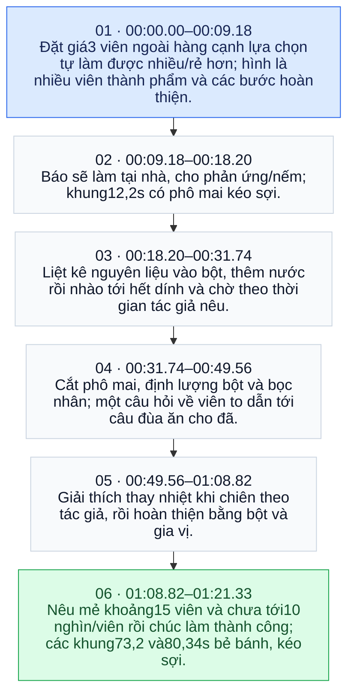

# Cheese Ball tại nhà: giá bên ngoài đối chiếu với một mẻ tự làm

[Video gốc — @genjadao](https://www.tiktok.com/@genjadao/video/7691642587522010388) · ID `7691642587522010388`

**Tóm tắt cách kể:** Giá/số lượng bên ngoài → nhiều thành phẩm nhìn được → lời tự làm → cho trước kéo sợi → quay về quy trình → tiểu tiết kích cỡ → chi phí/viên và kéo sợi cuối. Cảnh vật thể liên tục trả lợi ích cảm quan, trong khi số đầu/cuối làm phần logic của câu chuyện.

[Sơ đồ diễn biến](#mindmap) · [Diễn biến](#dien-bien) · [Nhịp cảm xúc](#cam-xuc) · [Cách áp dụng](#ap-dung)

## Sơ đồ diễn biến

Đọc từ trên xuống: mỗi hộp là một nhịp theo mốc ASR hoặc khung hình được ghi trong phân tích. Xanh dương là mở đầu, xanh lá là nhịp cuối. Chi tiết và giới hạn nằm trong phân tích bên dưới.

[Mã Mermaid riêng](../mindmaps/7691642587522010388.mmd)

## Dữ liệu và nguồn

**Cách thể hiện:** Thao tác nấu ăn và thuyết minh

**Phạm vi học:** Học cách chia thông tin theo hình và ASR, giữ giới hạn từng ca.

**Ngữ cảnh thương mại:** Chưa xác nhận tài trợ; nhận diện thương hiệu/quảng bá quan sát được nằm trong phân tích.

- Đăng: 2026-10-01T10:21:41+00:00. Metadata lấy: 2026-11-15T04:38:26.225698+00:00.
- **2,000,000 view**; thích 126,600; bình luận 189; chia sẻ 19,300; lưu 26,396. Dấu phẩy tách hàng nghìn.
- Thời lượng media: 81.34s.
- **4.77× P50** 419,400 của 150 bài đủ 48h trong snapshot kênh. Clip có trong cửa sổ baseline. Không phải thống kê toàn bộ kênh.

## Phạm vi kiểm

Đã tải media, xem khung chọn lọc và đọc ASR có mốc lưu lúc 2026-11-15T04:39:45.814438+00:00. Đối chiếu cùng ID và thời lượng, lệch 0.003s. **Chưa nghe toàn âm hoặc xem chuyển động liên tục; chưa xác nhận toàn văn ASR hay mọi dữ kiện trong clip.**

Media SHA256: `bb61a29710f547079d7965e147710460c7aed02aaf45c4739a587181c1348812`. [Metadata và các hash khác](../videos.json). Video/ASR đầy đủ giữ ở bộ nghiên cứu cục bộ; bản chia sẻ giữ link gốc, trích ngắn và phân tích riêng.

## Lời hứa và câu hỏi trung tâm

**Lời hứa:** Cho thấy cách tự làm một mẻCheese Ball và đối chiếu chi phí/viên theo tác giả.

**Câu hỏi:** Làm ở nhà tạo ra nhiều viên với chi phí được kể khác bên ngoài bằng quy trình nào?

## Mở đầu: lời và hình

0–3,64 giây lời dẫn hỏi vì sao bỏ79 nghìn cho3 viên, trong khi hình đã cho thấy một bát nhiều viên và thao tác phủ/lắc bột.3,64–7,66 giây chuyển sang có thể tự làm rẻ hơn, được nhiều hơn;5 giây cận một viên được nâng lên. Mở bài không chỉ hứa tiết kiệm bằng lời: số lượng và bề mặt món hiện trước khi giải thích quy trình. Giá79 nghìn là đối chiếu do tác giả nêu, chưa có hóa đơn hoặc định lượng tương đương để kiểm.

## Nghiên cứu phần mở

Diễn giải từ bằng chứng đã lưu; lý do gây chú ý là giả thuyết biên tập, chưa đo retention.

**Cửa sổ quan sát:** 00:00.00–00:09.18

| Lớp | Quan sát/diễn giải |
|---|---|
| Lời | 0–3,64s nêu79 nghìn/3 viên;3,64–7,66s đối chiếu tự làm rẻ/nhiều hơn;7,66–9,18s là câu đối đáp ngắn, không gán tất cả vào0–3s. |
| Hình | 0–3s đổ bánh, phủ bột, lắc một bát nhiều viên;5s nâng một viên cận. |
| Chữ trên hình | Không thấy bảng giá/tiêu đề lớn trong khung0–5s; giá nằm ở lời dẫn. |

**Động tác gây chú ý:** Phép so chi phí/số lượng được đặt cạnh thành phẩm đã có, rồi mở câu hỏi cách làm.

**Vì sao có thể muốn dừng lại:** Giả thuyết: khán giả muốn kiểm liệu một mẻ nhìn hấp dẫn có thực sự thay được phần mua ngoài với chi phí đã nêu.

**Điều còn muốn biết:** Tác giả làm một mẻ như vậy bằng các bước nào và chi phí được kể ra sao?

**Thông tin chưa cho biết:** Các bước, số viên toàn mẻ và mức chi phí/viên chưa nêu ở mở; diện mạo món đã cho xem.

**Nhịp nối có gì mới:** Kéo phô mai sớm ở12,2s làm đích nhìn được, sau đó biến đổi bột→nhân→viên→chiên và câu đùa kích cỡ dẫn tới kết.

**Mốc trả/giới hạn giải đáp:** 01:08.82–01:21.33 — ASR nêu khoảng15 viên và chưa10 nghìn/viên; khung80,34s kéo phô mai. Đây là payoff lời kể về mẻ tự làm, chưa phải kiểm chứng đầy đủ mức tiết kiệm.

**Tóm cấu trúc bằng hai câu:** Đặt chi phí của một phần quen thuộc cạnh một mẻ thành phẩm tự làm đã nhìn thấy. Quay về quy trình tạo mẻ đó rồi khép bằng cùng đơn vị chi phí và hình kết quả.

**Chuyển sang ngách khác:** Chuyển được quan hệ chi phí cùng đầu ra → cho thấy quy trình → quay lại chi phí/đơn vị. Sangfinance phải tính đủ công, thời gian, phí và rủi ro; thành phẩm đẹp hoặc phép tính một lần không tự chứng minh lựa chọn hiệu quả hơn.

**Điều không chuyển theo:**

- Không sao giá và số lượng nếu không có nguồn ngang điều kiện.
- Không coi hình thành phẩm là bằng chứng kinh tế đầy đủ.
- Không tách câu hỏi giá khỏi quy trình trả lời thật.

**Phạm vi:** ToànASR mới và12khung; không nghe toàn âm/xem liên tục; phần cuối không có lời được mô tả bằng khung.

Không trích nguyên văn segment mở vì ASR nhận sai đơn vị tiền; xem diễn giải và đối chiếu khung hình.

| Mốc khung đã xem | Điều quan sát được |
|---|---|
| 00:00.00 | Các viên vàng được đổ từ khay vào bát kim loại, nhìn thấy nhiều hơn một phần3 viên được lời dẫn nhắc. |
| 00:01.00 | Bột màu cam được rắc từ rây lên bát bánh. |
| 00:02.00 | Tay lắc bát chứa nhiều viên để phủ bột. |
| 00:03.00 | Cận những viên đã phủ bột khi bát tiếp tục được cầm; không thấy bảng giá trong khung. |
| 00:05.00 | Tay nâng một viên bánh gần máy, làm rõ lớp vỏ trước khi quay lại cách làm. |
| 00:12.20 | Người nấu cười, kéo hai nửa bánh có sợi phô mai, cho thấy đầu ra sớm. |
| 00:24.40 | Cận bát bột và trứng đang được trộn bằng đũa, nằm trong phần quy trình. |
| 00:36.60 | Người nấu đang nặn; trên bàn có các phần bột và khối phô mai xếp hàng. |
| 00:48.80 | Cận tay bọc bột; chữ bự em ăn cho biết nhịp đùa về kích thước. |
| 01:01.00 | Một viên vàng được gắp phía trên nồi dầu, cho thấy kết quả chiên. |
| 01:13.20 | Tay bắt đầu bẻ viên trên đĩa ở phần chốt chi phí theo lời dẫn. |
| 01:20.34 | Hai nửa bánh được tách ra, phô mai kéo thành sợi dài; phần cuối được trích không có lờiASR tương ứng. |

Không suy chuyển động giữa các khung từ ảnh tĩnh.

## Diễn biến và nhiệm vụ từng beat

| Mốc ASR | Diễn giải riêng | Vai trò |
|---|---|---|
| 00:00.00–00:09.18 | Đặt giá3 viên ngoài hàng cạnh lựa chọn tự làm được nhiều/rẻ hơn; hình là nhiều viên thành phẩm và các bước hoàn thiện. | Tạo phép đối chiếu chi phí gắn với số lượng nhìn được. |
| 00:09.18–00:18.20 | Báo sẽ làm tại nhà, cho phản ứng/nếm; khung12,2s có phô mai kéo sợi. | Trả một phần thưởng trước quy trình, chứng minh hình thức món đã làm được. |
| 00:18.20–00:31.74 | Liệt kê nguyên liệu vào bột, thêm nước rồi nhào tới hết dính và chờ theo thời gian tác giả nêu. | Bắt đầu giải đáp làm bằng cách nào, cho tiêu chí thao tác. |
| 00:31.74–00:49.56 | Cắt phô mai, định lượng bột và bọc nhân; một câu hỏi về viên to dẫn tới câu đùa ăn cho đã. | Cụ thể hóa số lượng/kích cỡ trong một nhịp thao tác có tính cách. |
| 00:49.56–01:08.82 | Giải thích thay nhiệt khi chiên theo tác giả, rồi hoàn thiện bằng bột và gia vị. | Nêu điểm cần lưu ý trước khi đưa thành phẩm cuối; đây là lời trong nguồn, không hướng dẫn an toàn của phân tích. |
| 01:08.82–01:21.33 | Nêu mẻ khoảng15 viên và chưa tới10 nghìn/viên rồi chúc làm thành công; các khung73,2 và80,34s bẻ bánh, kéo sợi. | Quay lại đơn vị chi phí đầu bài và cho phần thưởng vật thể ở cuối; chi phí vẫn chưa có bảng tính kiểm. |

## Nhịp cảm xúc — giả thuyết biên tập

Các trạng thái dưới đây là cách đọc câu chuyện từ bằng chứng, không phải cảm xúc người xem đã đo hoặc biểu đồ retention.

| Mốc | Cảm xúc có thể gợi | Bằng chứng | Cách diễn giải |
|---|---|---|---|
| 00:00.00–00:09.18 | Muốn đối chiếu giá và lượng | Lời79 nghìn/3 viên đi cùng bát nhiều viên. | Giả thuyết: sự chênh đầu vào/đầu ra tạo câu hỏi thực tế, không đo hành vi dừng. |
| 00:09.18–00:18.20 | Thấy đích của quy trình | Khung12,2s cho kéo phô mai trước phần pha bột. | Kết quả nhìn được làm lời hứa cụ thể hơn. |
| 00:31.74–00:49.56 | Theo việc và có chút vui | Nặn kích thước được nêu rồi có câu hỏi viên to cùng chữ bự em ăn. | Tiểu tiết thao tác làm cầu nối có tính cách. |
| 01:08.82–01:21.33 | Khép phép so bằng kết quả | Nêu số viên/giá mỗi viên, cuối lại kéo phô mai. | Kết gồm cả phần logic và cảm quan; chưa chứng minh phép so đầy đủ. |

## Cách phân phối thông tin

| Mốc | Động tác viết | Vì sao đáng chú ý |
|---|---|---|
| 00:00.00–00:09.18 | Đưa cùng đơn vị viên nhưng hai cách có món. | Số tiền là lý do xem quy trình, không phải một con số sốc rời rạc. |
| 00:09.18–00:18.20 | Cho kết quả trước nguyên liệu. | Xác định mục tiêu nhìn được cho phần hướng dẫn. |
| 00:18.20–00:49.56 | Đi từ bột sang nhân rồi tạo viên. | Tổ chức theo biến đổi vật thể, dễ theo dõi hơn danh sách mẹo. |
| 00:49.56–01:08.82 | Nêu lưu ý ở bước tương ứng. | Giải thích gắn với lúc có thể phát sinh vấn đề trong thao tác. |
| 01:08.82–01:21.33 | Quay về giá/viên và hình bẻ bánh. | Gọi lại hai lời hứa chi phí và thành phẩm. |

## Giải đáp và cách kết

ASR khép ở74,6 giây bằng lời chúc; hình cuối80,34 giây tiếp tục cho phô mai kéo sợi. Khoảng15 viên/chưa10 nghìn mỗi viên gọi lại phép so đầu, nhưng không có bảng chi phí đủ để xác nhận mức tiết kiệm tương đương.

## Điểm mạnh có dẫn chứng

- **Giá gắn với số lượng và vật thể** — 0–7,66s lời so3 viên với tự làm; hình0–3s đã có bát nhiều viên.

- **Trả kết quả sớm rồi mới hướng dẫn** — 12,2s kéo sợi,18,2s mới pha bột.

- **Kết gọi lại đơn vị so sánh** — 68,82–73,3s nêu số viên và chi phí mỗi viên.

## Điểm yếu và điều không nên bắt chước

- **Chưa đủ cơ sở khẳng định rẻ hơn tương đương** — Không có bảng nguyên liệu/công/thời gian; viên tự làm được nói là to hơn ở37,78s.

- **Một mẻ thành phẩm chưa chứng minh mức dễ với mọi người** — 18,2s nói dễ nhưng đoạn nhào/chờ/chiên vẫn có nhiều điều kiện thao tác.

- **Không thể dựa vào lờiASR để tái tạo món chuẩn** — Một số tên nguyên liệu bị nhận sai, hình mẫu không bao trùm tất cả bước.

## Khả năng được chia sẻ — chưa kiểm chứng

Không có dữ liệu phân phối/retention để kết luận vì sao viral. Các ý sau chỉ là giả thuyết để thử:

- Phép so một phần bên ngoài với cả mẻ có thể khiến người xem gửi cho người hay ăn món này; đây là giả thuyết.

- Kéo phô mai ở12,2 và80,34s có thể khiến kết quả dễ nhớ dù người xem không định làm, chưa có dữ liệu lưu/chia sẻ để kiểm.

## Chuyển cơ chế sang bài mới

Finance có thể học việc giữ cùng đơn vị đầu ra cho một phép so chi phí rồi cho thấy quy trình tạo chênh lệch. Cần thay mệnh đề rẻ hơn bằng bảng đầy đủ vốn, thời gian, công và rủi ro; không dùng một thành phẩm đẹp để chứng minh toàn bộ hiệu quả kinh tế.

- Giữ đơn vị đầu ra nhất quán khi so chi phí.

- Cho kết quả minh họa trước, nhưng tách nó khỏi chứng minh tiết kiệm.

- Đưa lưu ý đúng lúc bước tương ứng xuất hiện.

- Khi chuyển ngách, tính đủ chi phí và điều kiện thay vì chỉ so giá mặt ngoài.

- Không biến câu rẻ/dễ trong nguồn thành bảo đảm cho người dùng.

Không dùng bài chuyển thể chưa được người dùng duyệt làm mẫu giọng lâu dài.

## Giới hạn còn lại

- Đã đọc toàn bộ ASR có timestamp và xem 12 khung trích của bản tải mới; chưa nghe toàn âm hoặc xem video liên tục.

- Mốc nhịp dựa trên ASR; không dùng bản chép tự động làm trích dẫn nguyên văn.

- Không có retention hay thử nghiệm nhân quả; số lượt xem không chứng minh hook tạo ra kết quả.

- Giá79 nghìn/3 viên và dưới10 nghìn/viên là lời tác giả; chưa xác nhận nguồn giá, khối lượng ngang nhau hoặc các chi phí ngoài nguyên liệu.

- ASR có lỗi từ ở nguyên liệu và vài câu ngắn; không biến bản chép thành hướng dẫn nấu chính xác.

- Phần74,6–81,33s không có lờiASR; quan sát cuối dựa trên khung80,34s.

- Kết cấu nhìn được không chứng minh vị hoặc độ an toàn; phân tích không cung cấp hướng dẫn thực phẩm.
