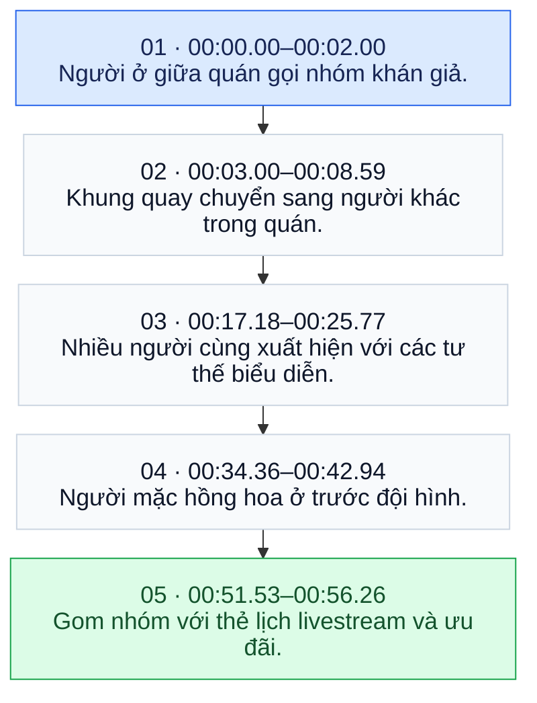

# Gọi nhóm khán giả rồi gom dàn người vào lịch livestream

[Video gốc — @halinhofficial](https://www.tiktok.com/@halinhofficial/video/7692026934426979602) · ID `7692026934426979602`

**Tóm tắt cách kể:** Lời gọi có đối tượng → camera và đội hình mở rộng qua nhiều người → gom nhóm → thẻ lịch sự kiện. Nhân vật và thay đổi không gian gánh phần giải trí trước khi mục đích thương mại hiển thị rõ; không có cơ sở suy ra phần lớn reach là hữu cơ.

[Sơ đồ diễn biến](#mindmap) · [Diễn biến](#dien-bien) · [Nhịp cảm xúc](#cam-xuc) · [Cách áp dụng](#ap-dung)

## Sơ đồ diễn biến

Đọc từ trên xuống: mỗi hộp là một nhịp theo mốc ASR hoặc khung hình được ghi trong phân tích. Xanh dương là mở đầu, xanh lá là nhịp cuối. Chi tiết và giới hạn nằm trong phân tích bên dưới.

[Mã Mermaid riêng](../mindmaps/7692026934426979602.mmd)

## Dữ liệu và nguồn

**Cách thể hiện:** Nói trực diện/tiểu phẩm bán hàng

**Phạm vi học:** Học cách chia thông tin theo hình và ASR, giữ giới hạn từng ca.

**Ngữ cảnh thương mại:** Tiểu phẩm quảng bá SuperLive 10.10; có mục đích bán hàng, không coi là đánh giá độc lập.

- Đăng: 2026-10-02T11:13:10+00:00. Metadata lấy: 2026-11-15T04:34:24.178186+00:00.
- **11,700,000 view**; thích 27,000; bình luận 270; chia sẻ 2,771; lưu 869. Dấu phẩy tách hàng nghìn.
- Thời lượng media: 57.26s.
- **4.11× P50** 2,850,000 của 150 bài đủ 48h trong snapshot kênh. Clip có trong cửa sổ baseline. Không phải thống kê toàn bộ kênh.

## Phạm vi kiểm

Đã tải media, xem khung chọn lọc và đọc ASR có mốc lưu lúc 2026-11-15T04:36:06.882190+00:00. Đối chiếu cùng ID và thời lượng, lệch 0.026s. **Chưa nghe toàn âm hoặc xem chuyển động liên tục; chưa xác nhận toàn văn ASR hay mọi dữ kiện trong clip.**

Media SHA256: `6775840acd800af2b6b258f78f40a8ac443f56585cd0ce9f5b052af6cc12600a`. [Metadata và các hash khác](../videos.json). Video/ASR đầy đủ giữ ở bộ nghiên cứu cục bộ; bản chia sẻ giữ link gốc, trích ngắn và phân tích riêng.

## Lời hứa và câu hỏi trung tâm

**Lời hứa:** Cho thấy màn biểu diễn tập thể dẫn tới một lời nhắc lịch livestream.

**Câu hỏi:** Lời gọi đầu clip dẫn tới tập hợp nào và nhằm mục đích gì?

## Mở đầu: lời và hình

Khung 0–2 giây người mặc vàng ở giữa quán đưa tay gọi; ASR 0–2 giây nhận lời gọi một nhóm nữ khán giả. Đến 3–5 giây camera đã hướng sang phần khác của quán. Cuối clip có dàn người và thẻ SuperLive20h10.10 cùng ưu đãi. Vì thế đây là nội dung quảng bá lịch sự kiện bằng biểu diễn, không được gắn là viral thuần hữu cơ.

## Nghiên cứu phần mở

Diễn giải từ bằng chứng đã lưu; lý do gây chú ý là giả thuyết biên tập, chưa đo retention.

**Cửa sổ quan sát:** 00:00.00–00:03.00

| Lớp | Quan sát/diễn giải |
|---|---|
| Lời | ASR0–2 giây nhận lời gọi nhóm nữ khán giả; không kéo thành một câu giải thích dài. |
| Hình | Người ở giữa quán đưa tay bên miệng, rồi khung3 giây đổi hướng. |
| Chữ trên hình | Chữ nhỏ ghi tính giải trí và cảm hứng trend; không thấy lịch lớn ở mở. |

**Động tác gây chú ý:** Gọi trực tiếp rồi mở hướng nhìn sang người đáp.

**Vì sao có thể muốn dừng lại:** Giả thuyết: người xem muốn xem lời gọi sẽ kéo ai vào màn diễn.

**Điều còn muốn biết:** Ai sẽ xuất hiện và nhóm được gọi để làm gì?

**Thông tin chưa cho biết:** Lịch sự kiện chưa có trong các khung mở.

**Nhịp nối có gì mới:** Đổi người trung tâm và mở dàn người trước khi gom lại.

**Mốc trả/giới hạn giải đáp:** 00:51.53–00:56.26 — Đội hình tập thể và thẻ lịch SuperLive20h10.10 trả lời mục đích quảng bá; không xác minh ưu đãi.

**Tóm cấu trúc bằng hai câu:** Cho một người gọi và mở khung tới các nhân vật đáp lại. Gom nhóm vào cuối để hé mục đích chung bằng thông tin rõ.

**Chuyển sang ngách khác:** Chuyển được quan hệ một tín hiệu → nhiều phản hồi → thông tin hội tụ; sang finance phải dùng bằng chứng độc lập cho kết luận, không coi đám đông là bằng chứng hiệu quả hay an toàn.

**Điều không chuyển theo:**

- Lời ưu đãi chưa kiểm chứng
- Giả định reach hữu cơ
- Đám đông như bảo chứng mua hàng

**Phạm vi:** 12 khung + toàn ASR có lỗi; lịch ưu tiên chữ nhìn thấy ở51,53/56,26 giây.

> Các nàng ơi!

Trích ASR ngắn từ segment 00:00.00–00:02.00. Trích ASR ngắn chưa nghe so khớp toàn âm; không khẳng định cả segment là ba giây. Xem phạm vi/giới hạn từng ca. Dấu … nghĩa là bỏ bớt, không khẳng định toàn câu vừa ba giây.

| Mốc khung đã xem | Điều quan sát được |
|---|---|
| 00:00.00 | Người mặc vàng đứng giữa quán ăn, tay ở eo; có dòng chữ nhỏ chú thích giải trí ở dưới. |
| 00:01.00 | Người mặc vàng đặt tay cạnh miệng như gọi. |
| 00:03.00 | Khung chuyển hướng qua khu bàn ăn, người ở xa và hình bị nhòe chuyển động. |
| 00:08.59 | Một người mặc hồng hoa ở quán trở thành trung tâm khung. |
| 00:17.18 | Có nhiều người gập/nghiêng người cùng trong một khung rộng. |
| 00:34.36 | Người mặc hồng hoa phía trước, nhiều người phía sau cùng hướng camera. |
| 00:51.53 | Dàn người đứng cùng người mặc vàng ở trước; thẻ SuperLive20h10.10 ở phía trên và chữ ưu đãi phía dưới. |
| 00:56.26 | Thẻ lịch sự kiện và đội hình nhóm vẫn hiện ở khung cuối. |

Không suy chuyển động giữa các khung từ ảnh tĩnh.

## Diễn biến và nhiệm vụ từng beat

| Mốc ASR | Diễn giải riêng | Vai trò |
|---|---|---|
| 00:00.00–00:02.00 | Người ở giữa quán gọi nhóm khán giả. | Mở bằng lời triệu tập và cử chỉ gọi. |
| 00:03.00–00:08.59 | Khung quay chuyển sang người khác trong quán. | Gợi hành động có người đáp lại; chỉ thấy các mốc lấy mẫu. |
| 00:17.18–00:25.77 | Nhiều người cùng xuất hiện với các tư thế biểu diễn. | Mở quy mô từ một người sang nhóm. |
| 00:34.36–00:42.94 | Người mặc hồng hoa ở trước đội hình. | Giữ sự thay đổi vai trung tâm. |
| 00:51.53–00:56.26 | Gom nhóm với thẻ lịch livestream và ưu đãi. | Payoff thương mại: từ màn gọi sang thông báo sự kiện. |

## Nhịp cảm xúc — giả thuyết biên tập

Các trạng thái dưới đây là cách đọc câu chuyện từ bằng chứng, không phải cảm xúc người xem đã đo hoặc biểu đồ retention.

| Mốc | Cảm xúc có thể gợi | Bằng chứng | Cách diễn giải |
|---|---|---|---|
| 00:00.00–00:02.00 | Mở bằng lời triệu tập và cử chỉ gọi. | Người ở giữa quán gọi nhóm khán giả. | Đây là diễn giải tác dụng của trình tự, không xác nhận cảm xúc thực tế của khán giả. |
| 00:03.00–00:08.59 | Gợi hành động có người đáp lại; chỉ thấy các mốc lấy mẫu. | Khung quay chuyển sang người khác trong quán. | Đây là diễn giải tác dụng của trình tự, không xác nhận cảm xúc thực tế của khán giả. |
| 00:17.18–00:25.77 | Mở quy mô từ một người sang nhóm. | Nhiều người cùng xuất hiện với các tư thế biểu diễn. | Đây là diễn giải tác dụng của trình tự, không xác nhận cảm xúc thực tế của khán giả. |
| 00:34.36–00:42.94 | Giữ sự thay đổi vai trung tâm. | Người mặc hồng hoa ở trước đội hình. | Đây là diễn giải tác dụng của trình tự, không xác nhận cảm xúc thực tế của khán giả. |
| 00:51.53–00:56.26 | Payoff thương mại: từ màn gọi sang thông báo sự kiện. | Gom nhóm với thẻ lịch livestream và ưu đãi. | Đây là diễn giải tác dụng của trình tự, không xác nhận cảm xúc thực tế của khán giả. |

## Cách phân phối thông tin

| Mốc | Động tác viết | Vì sao đáng chú ý |
|---|---|---|
| 00:00.00–00:02.00 | Mở bằng lời triệu tập và cử chỉ gọi. | Người ở giữa quán gọi nhóm khán giả. |
| 00:03.00–00:08.59 | Gợi hành động có người đáp lại; chỉ thấy các mốc lấy mẫu. | Khung quay chuyển sang người khác trong quán. |
| 00:17.18–00:25.77 | Mở quy mô từ một người sang nhóm. | Nhiều người cùng xuất hiện với các tư thế biểu diễn. |
| 00:34.36–00:42.94 | Giữ sự thay đổi vai trung tâm. | Người mặc hồng hoa ở trước đội hình. |
| 00:51.53–00:56.26 | Payoff thương mại: từ màn gọi sang thông báo sự kiện. | Gom nhóm với thẻ lịch livestream và ưu đãi. |

## Giải đáp và cách kết

Khung cuối công khai lịch SuperLive và ưu đãi; ASR đoạn cuối cũng có lời nhắc lịch nhưng có nhiều từ lỗi nên ưu tiên chữ nhìn thấy. Payoff là nhận ra sự kiện đang được quảng bá, không phải kiểm chứng ưu đãi.

## Điểm mạnh có dẫn chứng

- **Lời gọi được cử chỉ hỗ trợ** — ASR0–2 giây và khung1 giây tay bên miệng cùng biểu thị gọi.

- **Kết có thông tin hành động rõ** — Khung51,53 và56,26 giây có lịch sự kiện dễ nhìn hơn chữ ưu đãi nhỏ.

## Điểm yếu và điều không nên bắt chước

- **Mục đích quảng bá rõ chủ yếu ở cuối trong các khung quan sát** — Thẻ sự kiện lớn chỉ thấy ở51,53–56,26 giây.

- **Chữ ưu đãi dày và nhỏ** — Khung cuối nhiều dòng dưới đội hình; cần ảnh gốc lớn để đọc điều kiện, không xác nhận nội dung.

## Khả năng được chia sẻ — chưa kiểm chứng

Không có dữ liệu phân phối/retention để kết luận vì sao viral. Các ý sau chỉ là giả thuyết để thử:

- Tình huống có thể được gửi vì người xem nhận ra hành vi quen thuộc; chưa đọc dữ liệu chia sẻ hay bình luận để xác nhận.

## Chuyển cơ chế sang bài mới

Học cách một lời gọi mở ra chuỗi đáp lại rồi hội tụ vào một thông tin kết. Với nội dung finance, sự hội tụ cần làm rõ vấn đề/dữ kiện chung; không dùng số người tham gia như bảo chứng lợi ích sản phẩm hay quyết định tài chính.

- Gắn rõ bối cảnh thương mại khi dùng làm nguồn nghiên cứu.

- Chuyển quan hệ gọi → đáp lại → hội tụ, không chép tên sự kiện hay ưu đãi.

- Để thông tin quan trọng đọc được, không dùng chữ nhỏ thay điều kiện.

- Không coi đội hình đông là bằng chứng sản phẩm đáng mua.

Không dùng bài chuyển thể chưa được người dùng duyệt làm mẫu giọng lâu dài.

## Giới hạn còn lại

- Đã xem 12 khung trích có timestamp từ bản tải mới và đọc ASR khi có; chưa nghe âm hoặc xem video liên tục.

- Cách gây chú ý và giữ chân là giả thuyết biên tập, không phải số đo retention hay quan hệ nhân quả.

- Nội dung thương mại quảng bá lịch livestream và ưu đãi; không biết tỷ lệ reach trả phí/hữu cơ hay hình thức hợp tác.

- ASR đoạn30–56,44 giây có lỗi tên sự kiện và thông điệp; không trích nguyên văn.

- Không đánh giá tính đúng, giá trị hay điều kiện của ưu đãi và không đưa hướng dẫn mua.
