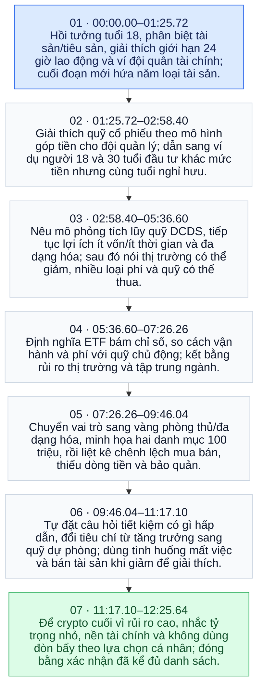

# Năm tài sản người trẻ: từ lời nhắn tuổi 18 đến các vai trò và rủi ro

[Video gốc — @quocthichkinhte](https://www.tiktok.com/@quocthichkinhte/video/7692042220106468660) · ID `7692042220106468660`

**Tóm tắt cách kể:** Hồi tưởng tuổi 18 → sửa kỳ vọng tài sản phải là nhà/xe → giới hạn thời gian lao động → danh sách năm nhóm → mỗi nhóm có vai trò, ví dụ, nhược điểm → tài sản rủi ro cao ở cuối. Giá trị mẫu nằm ở cách phân vai tài sản và đặt phản đối trong bài giảng; độ dài mở đầu không thể mặc định phù hợp video ngắn.

[Sơ đồ diễn biến](#mindmap) · [Diễn biến](#dien-bien) · [Nhịp cảm xúc](#cam-xuc) · [Cách áp dụng](#ap-dung)

## Sơ đồ diễn biến

Đọc từ trên xuống: mỗi hộp là một nhịp theo mốc ASR hoặc khung hình được ghi trong phân tích. Xanh dương là mở đầu, xanh lá là nhịp cuối. Chi tiết và giới hạn nằm trong phân tích bên dưới.

[Mã Mermaid riêng](../mindmaps/7692042220106468660.mmd)

## Dữ liệu và nguồn

**Cách thể hiện:** Người dẫn và hình minh họa

**Ngữ cảnh thương mại:** Chưa xác nhận hợp tác thương mại; xem các đoạn tự quảng bá/giới hạn được ghi riêng.

- Đăng: 2026-10-02T12:47:13+00:00. Metadata lấy: 2026-11-15T04:08:48.336695+00:00.
- **342,100 view**; thích 21,800; bình luận 122; chia sẻ 1,373; lưu 5,532. Dấu phẩy tách hàng nghìn.
- Thời lượng media: 745.77s.
- **22.14× P50** 15,450 của 148 bài đủ 48h trong snapshot kênh. Clip có trong cửa sổ baseline. Không phải thống kê toàn bộ kênh.

## Phạm vi kiểm

Đã tải media, xem khung chọn lọc và đọc ASR có mốc lưu lúc 2026-11-15T04:10:30.198488+00:00. Đối chiếu cùng ID và thời lượng, lệch 0.01s. **Chưa nghe toàn âm hoặc xem chuyển động liên tục; chưa xác nhận toàn văn ASR hay mọi dữ kiện kinh tế trong clip.**

Media SHA256: `2c6cdab4dd7ef2d3eb6d431b4e8d969ab86e54b35c9c6a1eed800289667cf68c`. [Metadata và các hash khác](../videos.json). Video/ASR đầy đủ giữ ở bộ nghiên cứu cục bộ; bản chia sẻ giữ link gốc, trích ngắn và phân tích riêng.

## Lời hứa và câu hỏi trung tâm

**Lời hứa:** Kể năm nhóm tài sản theo lời tác giả muốn tích lũy, lý do mỗi nhóm có vai trò và điểm cần thận trọng.

**Câu hỏi:** Nếu bắt đầu từ thu nhập nhỏ, tác giả sắp xếp mục tiêu tăng trưởng và phòng thủ ra sao?

## Mở đầu: lời và hình

ASR mở bằng giả định được trở lại tuổi 18 và điều tác giả muốn làm sớm hơn; sau 3,68 giây mới nói tới mua tài sản thay tiêu sản. Khung 0 giây đã có tiêu đề năm loại tài sản cho người trẻ năm 2026; khung 1–3 giây thêm ảnh người dẫn khi trẻ và chữ nhấn tuổi 18. Đây là hook hồi tưởng cá nhân bên trong một video dài hơn 12 phút, không phải mẫu nhịp Shorts nhanh. Danh sách được hứa bằng lời ở 77,32 giây và mục đầu bắt đầu ở 85,72 giây.

> Nếu bây giờ cho mình quay lại năm 18 tuổi thì có một điều mình chắc chắn sẽ làm sớm hơn

Trích ASR ngắn từ segment 00:00.00–00:03.68. Trích ASR chưa nghe đối chiếu; dữ kiện thuộc lời người đăng, chưa xác thực. Xem giới hạn từng ca. Dấu … nghĩa là bỏ bớt, không khẳng định toàn câu vừa ba giây.

| Mốc khung đã xem | Điều quan sát được |
|---|---|
| 00:00.00 | Tiêu đề trắng nêu năm tài sản người trẻ nên có năm 2026, nằm phía trên đoạn hình ngang của người dẫn; nền đen dọc chiếm nhiều diện tích. |
| 00:01.00 | Ảnh thời trẻ của người dẫn được ghép bên phải; chữ nhấn ý quay lại 18 tuổi. |
| 00:03.00 | Chữ đỏ nhá một điều muốn làm sớm hơn cạnh ảnh cũ; đầu vào cảm xúc là quá khứ cá nhân. |
| 00:05.00 | Thẻ nền ô lưới thay người dẫn, chữ tô xanh tài sản và đỏ tiêu sản đặt hai khái niệm đối nhau. |
| 01:51.87 | Người dẫn quay lại trong khung ngang với nền phòng quen thuộc; không có tiêu đề danh sách lớn trong khung này. |
| 03:43.73 | Footage tiền đô la thay cảnh người dẫn, nằm trong cùng dải hình ngang. |
| 05:35.60 | Người dẫn ở cảnh nền phòng, gần mốc chuyển từ mục quỹ cổ phiếu sang ETF theo ASR. |
| 07:27.46 | Cùng cảnh người dẫn tại mốc mở mục vàng theo ASR. |
| 11:11.19 | Chữ xanh bảo vệ an toàn số tiền trên người dẫn, ứng với phần quỹ dự phòng. |
| 12:24.77 | Người dẫn chắp tay trước người ở khung cuối; không thấy màn CTA trong mẫu cuối. |

Không suy chuyển động giữa các khung từ ảnh tĩnh.

## Diễn biến và nhiệm vụ từng beat

| Mốc ASR | Diễn giải riêng | Vai trò |
|---|---|---|
| 00:00.00–01:25.72 | Hồi tưởng tuổi 18, phân biệt tài sản/tiêu sản, giải thích giới hạn 24 giờ lao động và ví đội quân tài chính; cuối đoạn mới hứa năm loại tài sản. | Dựng động cơ và quan hệ cá nhân trước danh sách; phần dẫn dài theo định dạng bài giảng. |
| 01:25.72–02:58.40 | Giải thích quỹ cổ phiếu theo mô hình góp tiền cho đội quản lý; dẫn sang ví dụ người 18 và 30 tuổi đầu tư khác mức tiền nhưng cùng tuổi nghỉ hưu. | Dùng so sánh hai nhân vật để làm rõ lợi thế bắt đầu sớm dưới giả định lợi suất. |
| 02:58.40–05:36.60 | Nêu mô phỏng tích lũy quỹ DCDS, tiếp tục lợi ích ít vốn/ít thời gian và đa dạng hóa; sau đó nói thị trường có thể giảm, nhiều loại phí và quỹ có thể thua. | Đặt con số minh họa cạnh điều kiện và rủi ro; đây vẫn là một mục kéo dài. |
| 05:36.60–07:26.26 | Định nghĩa ETF bám chỉ số, so cách vận hành và phí với quỹ chủ động; kết bằng rủi ro thị trường và tập trung ngành. | Tạo tiểu bài phân biệt hai công cụ hay bị gộp chung. |
| 07:26.26–09:46.04 | Chuyển vai trò sang vàng phòng thủ/đa dạng hóa, minh họa hai danh mục 100 triệu, rồi liệt kê chênh lệch mua bán, thiếu dòng tiền và bảo quản. | Lặp cấu trúc công dụng → ví dụ → hạn chế để tránh danh sách chỉ có tên. |
| 09:46.04–11:17.10 | Tự đặt câu hỏi tiết kiệm có gì hấp dẫn, đổi tiêu chí từ tăng trưởng sang quỹ dự phòng; dùng tình huống mất việc và bán tài sản khi giảm để giải thích. | Đưa một phản đối vào lời dẫn rồi sửa tiêu chí đánh giá. |
| 11:17.10–12:25.64 | Để crypto cuối vì rủi ro cao, nhắc tỷ trọng nhỏ, nền tài chính và không dùng đòn bẩy theo lựa chọn cá nhân; đóng bằng xác nhận đã kể đủ danh sách. | Kết theo thứ tự điều kiện nền tảng rồi mới đến rủi ro cao; không có CTA bán hàng trong ASR. |

## Nhịp cảm xúc — giả thuyết biên tập

Các trạng thái dưới đây là cách đọc câu chuyện từ bằng chứng, không phải cảm xúc người xem đã đo hoặc biểu đồ retention.

| Mốc | Cảm xúc có thể gợi | Bằng chứng | Cách diễn giải |
|---|---|---|---|
| 00:00.00–00:29.82 | Nhìn lại và bớt áp lực | Tưởng tượng tuổi 18 rồi bác kỳ vọng người trẻ đã phải có nhà xe vài tỷ. | Có thể đưa khán giả trẻ vào câu chuyện mà không đặt chuẩn quá cao; phản ứng chưa đo. |
| 00:29.82–01:25.72 | Muốn có lối thoát khỏi giới hạn thời gian | Giới hạn 24 giờ và hình dung đội quân tài chính dẫn tới danh sách. | Đổi động cơ từ sở hữu sang giảm phụ thuộc công sức. |
| 02:05.98–02:58.40 | Ngạc nhiên với lợi thế thời gian | Hai người đầu tư khác tiền nhưng bắt đầu lệch 12 năm được so theo một giả định lợi suất. | Mâu thuẫn giữa số tiền và kết quả làm ví dụ nổi bật; tính toán chưa được kiểm lại. |
| 04:49.28–05:36.60 | Thận trọng sau phần lợi ích | Tác giả nói quỹ vẫn có thể lỗ, có phí và hiệu quả khác nhau. | Dời sắc thái từ kỳ vọng sang điều kiện lựa chọn. |
| 09:46.04–11:17.10 | Muốn có lớp đệm | Tiết kiệm được ví tấm khiên; tình huống mất việc giải thích quỹ dự phòng. | Đổi cảm giác tăng trưởng sang an tâm. |
| 11:17.10–12:25.64 | Tò mò có giới hạn | Crypto đi cùng tỷ trọng nhỏ và nền tảng tài chính. | Đặt điều kiện trước phần kết rủi ro cao, không xem là xác nhận an toàn. |

## Cách phân phối thông tin

| Mốc | Động tác viết | Vì sao đáng chú ý |
|---|---|---|
| 00:00.00–01:25.72 | Dùng trải nghiệm giả định để dựng động cơ rồi công bố danh sách. | Quan hệ cá nhân đi trước phân loại, nhưng tạo độ trễ lớn tới mục đầu. |
| 02:05.98–02:58.40 | Giữ cùng tuổi đích, thay tuổi bắt đầu và mức góp. | Cho lợi thế thời gian xuất hiện qua phép so hai nhân vật. |
| 04:49.28–05:36.60 | Bổ sung hạn chế trong cùng mục. | Ngăn người mới hiểu việc giao tiền cho chuyên gia là hết rủi ro. |
| 05:36.60–07:26.26 | So hai cách đầu tư vào cổ phiếu theo vận hành/phí/rủi ro. | Tách những công cụ gần nhau bằng tiêu chí. |
| 07:26.26–11:17.10 | Chuyển từ công cụ tăng trưởng sang phòng thủ và dự phòng. | Cho mỗi mục một công việc, không đánh giá tất cả bằng lợi suất. |
| 11:17.10–12:25.64 | Đặt công cụ rủi ro cao sau phần nền tảng. | Thứ tự tạo quan hệ điều kiện thay vì năm lựa chọn ngang nhau. |

## Giải đáp và cách kết

ASR chốt danh sách sau phần crypto, cùng cảnh người dẫn ở khung cuối. Không có lời bảo đảm lợi suất hay CTA mua cụ thể ở kết; tuy vậy những lời khuyên trong từng mục vẫn cần được tách khỏi phân tích thủ pháp kể.

## Điểm mạnh có dẫn chứng

- **Hook có vật chứng cá nhân nhìn thấy** — Khung 1–3 giây ghép ảnh thời trẻ cạnh lời giả định quay lại 18 tuổi.

- **Danh sách có công dụng chứ không chỉ tên** — Vàng được nói như lớp phòng thủ ở 446,26 giây; tiết kiệm thành tấm khiên ở 611,3 giây.

- **Có phản đối làm câu chuyển** — 588,8–607,1 giây tự hỏi tiết kiệm có hấp dẫn với người trẻ rồi sửa tiêu chí.

- **Nhiều mục có nhược điểm ngay trong bài** — Quỹ có rủi ro/phí ở 289,28–336,6 giây; vàng có ba nhóm hạn chế ở 512,22–586,04 giây.

## Điểm yếu và điều không nên bắt chước

- **Danh sách tới chậm nếu dùng làm mẫu Shorts** — Lời hứa danh sách ở 77,32 giây, mục đầu 85,72 giây.

- **Thời lượng phân bổ rất lệch** — Mục quỹ cổ phiếu kéo từ 85,72 đến 336,6 giây, trong khi crypto chỉ khoảng 68,5 giây cuối.

- **Con số dài hạn dễ thành kỳ vọng nếu thiếu nguồn** — 125,98–226,48 giây có giả định 12% và mô phỏng 20 năm; cần giải thích cách tính và giới hạn.

- **Bản ngang trong nền dọc làm hình nhỏ** — Khung 0 và 447,46 giây đều có nhiều khoảng đen trên/dưới, giảm diện tích người dẫn và chữ.

## Khả năng được chia sẻ — chưa kiểm chứng

Không có dữ liệu phân phối/retention để kết luận vì sao viral. Các ý sau chỉ là giả thuyết để thử:

- Ảnh tuổi 18 và lời nhắn người trẻ có thể tạo nhu cầu gửi cho bạn bè cùng lứa; chưa có dữ liệu chia sẻ để kiểm.

- Phân vai tăng trưởng/phòng thủ/dự phòng có thể khiến người xem lưu để tra lại, nhưng không thể suy điều đó từ lượt xem.

## Chuyển cơ chế sang bài mới

Học việc dùng quá khứ cá nhân có thật để mở một quyết định, rồi tổ chức danh sách theo vai trò thay vì chỉ đọc tên. Với video ngắn, chọn một câu hỏi và một mô hình; không bê nguyên mở bài 85 giây hoặc mọi ví dụ lợi suất vào clip 60 giây.

- Chỉ dùng hồi tưởng cá nhân thật hoặc giả định được nói rõ; không bịa thành tích tuổi trẻ.

- Giữ cấu trúc vai trò → ví dụ → giới hạn khi làm danh sách.

- Khi làm clip ngắn chỉ chọn một xung đột và trả lời nó trong clip.

- Đánh dấu giả định, nguồn lịch sử và kỳ tính cho mọi số tăng trưởng.

- Không biến lời tác giả thành danh mục nên mua cho mọi người.

- Tách ETF,quỹ chủ động và crypto theo rủi ro thực, tránh phép so khiến chúng bị coi tương đương.

Không dùng bài chuyển thể chưa được người dùng duyệt làm mẫu giọng lâu dài.

## Giới hạn còn lại

- Đã đọc toàn bộ ASR có timestamp và xem 12 khung trích của bản tải mới; chưa nghe toàn âm hoặc xem video liên tục.

- Mốc nhịp dựa trên ASR; không dùng bản chép tự động làm trích dẫn nguyên văn.

- Không có retention hay thử nghiệm nhân quả; số lượt xem không chứng minh hook tạo ra kết quả.

- Đây là video dài khoảng 745,77 giây;12 khung chọn mẫu không đủ để mô tả nhịp cắt, chữ và hình của mọi mục.

- Lợi suất giả định 12%, phép mô phỏng DCDS, phí quỹ và quan hệ giá tài sản chưa được kiểm chứng độc lập; không phải cam kết hoặc khuyến nghị đầu tư.

- ASR nhận sai nhiều thuật ngữ như chứng chỉ quỹ,VN 30,thanh khoản,lãi kép; cần nghe lại trước trích lời chính xác.

- ASR có khoảng trống 657,14–663,9 giây; không khẳng định nội dung đã được chép ở đoạn này.

- Các nhận định thanh khoản tiền gửi, khả năng thắng lạm phát và mô tả rủi ro crypto được ghi như quan điểm tác giả, không xác nhận cho mọi sản phẩm hay hoàn cảnh.
