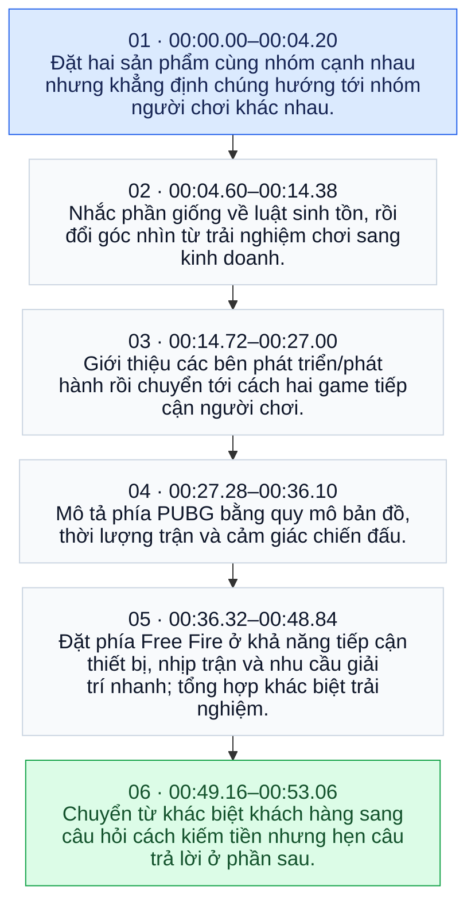

# Hai game cùng thể loại nhưng phục vụ hai nhu cầu khác nhau

[Video gốc — @longvasocbc1](https://www.tiktok.com/@longvasocbc1/video/7692502679943187719) · ID `7692502679943187719`

**Tóm tắt cách kể:** Cặp sản phẩm rất quen → xác nhận điểm giống dễ nhận ra → đổi góc nhìn sang đối tượng phục vụ → đối chiếu thuộc tính trải nghiệm → mở sang bài toán doanh thu. Cơ chế học được là đổi trục so sánh, không phải gắn một câu gây tò mò độc lập vào đầu.

[Sơ đồ diễn biến](#mindmap) · [Diễn biến](#dien-bien) · [Nhịp cảm xúc](#cam-xuc) · [Cách áp dụng](#ap-dung)

## Sơ đồ diễn biến

Đọc từ trên xuống: mỗi hộp là một nhịp theo mốc ASR hoặc khung hình được ghi trong phân tích. Xanh dương là mở đầu, xanh lá là nhịp cuối. Chi tiết và giới hạn nằm trong phân tích bên dưới.

[Mã Mermaid riêng](../mindmaps/7692502679943187719.mmd)

## Dữ liệu và nguồn

**Cách thể hiện:** Hoạt hình giải thích

**Ngữ cảnh thương mại:** Chưa xác nhận hợp tác thương mại; xem các đoạn tự quảng bá/giới hạn được ghi riêng.

- Đăng: 2026-10-03T17:59:20+00:00. Metadata lấy: 2026-11-15T03:29:27.152103+00:00.
- **417,900 view**; thích 14,300; bình luận 219; chia sẻ 1,633; lưu 505. Dấu phẩy tách hàng nghìn.
- Thời lượng media: 53.31s.
- **33.17× P50** 12,600 của 75 bài đủ 48h trong snapshot kênh. Clip có trong cửa sổ baseline. Không phải thống kê toàn bộ kênh.

## Phạm vi kiểm

Đã tải media, xem khung chọn lọc và đọc ASR có mốc lưu lúc 2026-10-22T00:30:59.252587+00:00. Đối chiếu cùng ID và thời lượng, lệch 0.0s. **Chưa nghe toàn âm hoặc xem chuyển động liên tục; chưa xác nhận toàn văn ASR hay mọi dữ kiện kinh tế trong clip.**

Media SHA256: `087aecc377c6d91fad9c845427377b90dfa93bbb6de0ce93a0637da35b7d6de0`. [Metadata và các hash khác](../videos.json). Video/ASR đầy đủ giữ ở bộ nghiên cứu cục bộ; bản chia sẻ giữ link gốc, trích ngắn và phân tích riêng.

## Lời hứa và câu hỏi trung tâm

**Lời hứa:** Cho thấy hai game nhìn tương tự nhưng hướng tới nhu cầu/người chơi khác, còn tiêu đề gợi thêm câu chuyện kiếm tiền.

**Câu hỏi:** Điểm giống về thể loại che khuất khác biệt gì về định vị kinh doanh?

## Mở đầu: lời và hình

Khung 0–3 giây đặt hình PUBG và Free Fire cạnh nhau, bên dưới là nhân vật dẫn. ASR và phụ đề cùng cho thấy câu mở nhấn mạnh bề ngoài cùng thể loại nhưng khác tệp người chơi. Phụ đề khung 2 giây dùng chữ viết tắt, trong khi ASR nhận sai một cụm; nên diễn giải cơ chế thay vì coi ASR là nguyên văn đã xác nhận.

Không dùng câu ASR mở làm nguyên văn vì nhận dạng lỗi; xem diễn giải và đối chiếu nguồn.

| Mốc khung đã xem | Điều quan sát được |
|---|---|
| 00:00.00 | Ảnh PUBG xuất hiện phía trên nhân vật Long; ở khung 1 giây có thêm ảnh Free Fire đặt cạnh để tạo cặp so sánh. |
| 00:03.00 | Hai ảnh game vẫn ở cùng vị trí; phụ đề nêu khác biệt về tệp người chơi. |
| 00:05.00 | Hai bong bóng đặt người chơi máy tính cạnh người dùng điện thoại, cụ thể hóa điểm chung/khác về cách trải nghiệm. |
| 00:08.00 | Hai linh vật với khẩu súng và một bản đồ chiến đấu nằm dưới hai bong bóng chiến thắng, nhấn điểm giống về thể loại. |
| 00:31.99 | Bản đồ, vũ khí, thiết bị bảo hộ và xe được bày quanh nhân vật, hỗ trợ phần mô tả trải nghiệm chiến đấu nhiều thành phần. |
| 00:39.98 | Nhân vật cầm một thiết bị dạng máy chơi game, nhiều biểu tượng giải trí/camera/âm nhạc đi kèm; hình chuyển sang tập hợp nhu cầu giải trí. |
| 00:52.31 | Hai nhân vật đứng trước túi tiền và biểu đồ tăng; phụ đề báo rằng câu chuyện kiếm tiền nằm ở phần tiếp theo. |

Không suy chuyển động giữa các khung từ ảnh tĩnh.

## Diễn biến và nhiệm vụ từng beat

| Mốc ASR | Diễn giải riêng | Vai trò |
|---|---|---|
| 00:00.00–00:04.20 | Đặt hai sản phẩm cùng nhóm cạnh nhau nhưng khẳng định chúng hướng tới nhóm người chơi khác nhau. | Mở bằng mâu thuẫn giữa sự giống bên ngoài và mục tiêu kinh doanh khác. |
| 00:04.60–00:14.38 | Nhắc phần giống về luật sinh tồn, rồi đổi góc nhìn từ trải nghiệm chơi sang kinh doanh. | Xác nhận trực giác ban đầu trước khi chuyển trục đánh giá. |
| 00:14.72–00:27.00 | Giới thiệu các bên phát triển/phát hành rồi chuyển tới cách hai game tiếp cận người chơi. | Thêm bối cảnh doanh nghiệp; nhịp này dài và nhiều tên riêng hơn phần hook. |
| 00:27.28–00:36.10 | Mô tả phía PUBG bằng quy mô bản đồ, thời lượng trận và cảm giác chiến đấu. | Cho vế so sánh thứ nhất một tập thuộc tính cụ thể. |
| 00:36.32–00:48.84 | Đặt phía Free Fire ở khả năng tiếp cận thiết bị, nhịp trận và nhu cầu giải trí nhanh; tổng hợp khác biệt trải nghiệm. | Hoàn thành phép so định vị sản phẩm với một vế đối ứng. |
| 00:49.16–00:53.06 | Chuyển từ khác biệt khách hàng sang câu hỏi cách kiếm tiền nhưng hẹn câu trả lời ở phần sau. | Nối tập bằng việc mở một vấn đề thương mại mới. |

## Nhịp cảm xúc — giả thuyết biên tập

Các trạng thái dưới đây là cách đọc câu chuyện từ bằng chứng, không phải cảm xúc người xem đã đo hoặc biểu đồ retention.

| Mốc | Cảm xúc có thể gợi | Bằng chứng | Cách diễn giải |
|---|---|---|---|
| 00:00.00–00:14.38 | Quen rồi thấy có lớp khác | Hai sản phẩm quen được xác nhận cùng thể loại trước khi đổi góc nhìn. | Dùng nền biết sẵn để mở kiến thức mới. |
| 00:14.72–00:27.00 | Tiếp nhận bối cảnh doanh nghiệp | Các bên phát triển/phát hành được liệt kê. | Có thể thêm độ cụ thể, cũng có thể tăng tải tên riêng; không có retention để kết luận. |
| 00:27.28–00:36.10 | Thấy vế thứ nhất | PUBG được mô tả theo trải nghiệm chiến đấu. | Thuộc tính cụ thể làm tiêu chí so rõ hơn. |
| 00:36.32–00:48.84 | Nhận ra khác biệt | Free Fire được đặt theo khả năng tiếp cận và nhịp giải trí. | Đáp án về định vị xuất hiện qua phép so đối ứng. |
| 00:49.16–00:53.06 | Còn thiếu lời giải thương mại | Câu kiếm tiền được chuyển sang phần hai. | Phần này mở vòng hỏi, chưa trả lời hứa doanh thu nếu người xem vào từ tiêu đề. |

## Cách phân phối thông tin

| Mốc | Động tác viết | Vì sao đáng chú ý |
|---|---|---|
| 00:00.00–00:14.38 | Xác nhận rồi đổi trục | Không phản bác toàn bộ điều khán giả biết, chỉ thêm một tiêu chí kinh doanh. |
| 00:14.72–00:27.00 | Bối cảnh pháp nhân | Cần cân nhắc tên nào thực sự phục vụ phân biệt. |
| 00:27.28–00:48.84 | Hai tập thuộc tính đối ứng | Trải nghiệm và khả năng tiếp cận là nền để nói khách hàng. |
| 00:49.16–00:53.06 | Mở bước kế doanh thu | Nối tập nhưng dễ lệch lời hứa tiêu đề. |

## Giải đáp và cách kết

Clip giải thích chủ yếu sự khác biệt định vị/tệp người chơi. Câu hỏi cách kiếm tiền xuất hiện ở cuối và bị chuyển sang phần hai. Nếu lấy cả tiêu đề nguồn làm lời hứa của clip, phần kiếm tiền chưa được trả trong ca này; cần ghi rõ điểm yếu thay vì xem mọi đoạn hẹn tiếp là kỹ thuật nên sao chép.

## Điểm mạnh có dẫn chứng

- **Tận dụng vật liệu người xem biết** — 0–14,38 giây hai game và luật chơi tạo nền chung.

- **Giải thích khác biệt bằng các thuộc tính cụ thể** — 27,28–48,84 giây nói bản đồ, nhịp trận và thiết bị thay cho chỉ nói tệp khác nhau.

## Điểm yếu và điều không nên bắt chước

- **Chưa trả câu hỏi kiếm tiền trong tiêu đề** — 49,16–53,06 giây hoãn phần đó.

- **Đoạn tên riêng có thể không cần đủ cho mục tiêu hook** — 14,72–27 giây nhiều tổ chức trước khi tới thuộc tính người chơi.

- **ASR mở có lỗi từ** — Không nên dùng câu chép máy làm nguyên văn xác nhận.

## Khả năng được chia sẻ — chưa kiểm chứng

Không có dữ liệu phân phối/retention để kết luận vì sao viral. Các ý sau chỉ là giả thuyết để thử:

- So hai game quen có thể mở câu chuyện kinh doanh cho người vốn chỉ quan tâm chơi game.

- Hai phe sản phẩm có thể tạo bàn luận, nhưng corpus không đo nguyên nhân bình luận hoặc view.

## Chuyển cơ chế sang bài mới

Có thể học cách đi từ hai thứ khán giả đã biết sang một tiêu chí kinh doanh họ chưa để ý. Khi áp dụng, nên giảm đoạn tên riêng nếu không giúp giải thích khác biệt, và bảo đảm câu hỏi trên tiêu đề được trả trong cùng video hoặc ghi rõ đây là phần về định vị.

- Dùng cặp quen nhưng phải chỉ ra một trục khác biệt có ích.

- Tránh tải tên riêng nếu không giúp trả câu hỏi.

- Giới hạn lời hứa vào định vị nếu chưa giải thích doanh thu trong cùng clip.

Không dùng bài chuyển thể chưa được người dùng duyệt làm mẫu giọng lâu dài.

## Giới hạn còn lại

- Đã xem khung đầu/giữa/cuối từ bản tải mới và đọc ASR; chưa nghe âm hoặc xem liên tục.

- Cụm đầu trong ASR có lỗi nhận dạng; phụ đề ảnh chỉ cho thấy cách viết tắt, chưa đủ xác nhận từng từ nói.

- Các chi tiết pháp nhân/phát hành game trong nguồn chưa được kiểm độc lập.

- Không có dữ liệu retention, không thể kết luận đoạn nhiều tên riêng làm người xem rời đi; đó chỉ là nhận xét biên tập cần thử.
