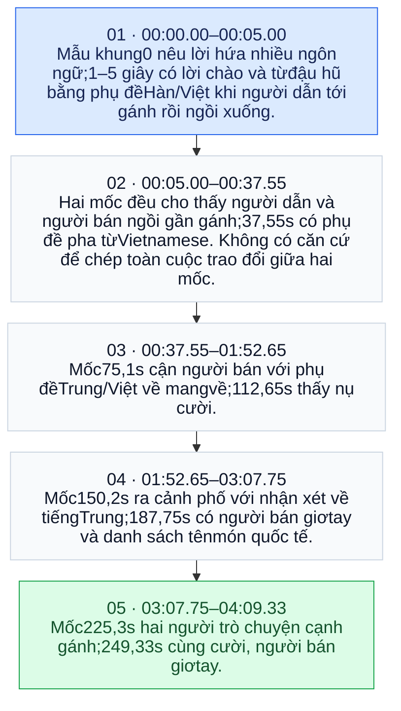

# Gánh đậu hũ Hội An: lời hứa nhiều ngôn ngữ được đưa thẳng vào cuộc gặp

[Video gốc — @quankhonggo](https://www.tiktok.com/@quankhonggo/video/7694998594134281480) · ID `7694998594134281480`

**Tóm tắt cách kể:** Lời hứa về người bán quen thuộc có một năng lực bất ngờ → ví dụ nhỏ ngaykhi chào → các đoạn tương tác có phụ đề đốichiếu → chân dung thân thiện. Với chứngcứ hiện tại chỉ học được cách để lời hứa đi cùng ví dụ hiển thị; không học lời nói, nhịp thoại hoặc độ thành thạo.

[Sơ đồ diễn biến](#mindmap) · [Diễn biến](#dien-bien) · [Nhịp cảm xúc](#cam-xuc) · [Cách áp dụng](#ap-dung)

## Sơ đồ diễn biến

Đọc từ trên xuống: mỗi hộp là một nhịp theo mốc ASR hoặc khung hình được ghi trong phân tích. Xanh dương là mở đầu, xanh lá là nhịp cuối. Chi tiết và giới hạn nằm trong phân tích bên dưới.

[Mã Mermaid riêng](../mindmaps/7694998594134281480.mmd)

## Dữ liệu và nguồn

**Cách thể hiện:** Gặp gỡ và đối thoại tại chỗ

**Phạm vi học:** Học bố cục/hành động/chữ thấy được; không dùng làm bằng chứng lời thoại.

**Ngữ cảnh thương mại:** Chưa xác nhận tài trợ; nhận diện thương hiệu/quảng bá quan sát được nằm trong phân tích.

- Đăng: 2026-10-10T11:24:42+00:00. Metadata lấy: 2026-11-15T04:34:26.925583+00:00.
- **4,000,000 view**; thích 325,100; bình luận 2,621; chia sẻ 89,500; lưu 14,177. Dấu phẩy tách hàng nghìn.
- Thời lượng media: 250.33s.
- **4.97× P50** 805,300 của 148 bài đủ 48h trong snapshot kênh. Clip có trong cửa sổ baseline. Không phải thống kê toàn bộ kênh.

## Phạm vi kiểm

Đã tải media, xem khung chọn lọc và đọc ASR có mốc lưu lúc 2026-11-15T04:37:03.253726+00:00. Đối chiếu cùng ID và thời lượng, lệch 0.002s. **Chưa nghe toàn âm hoặc xem chuyển động liên tục; chưa xác nhận toàn văn ASR hay mọi dữ kiện trong clip.**

Media SHA256: `1ca489170ee7fbed08745ff6181dc80e0509eba044a0042fd59a254ecdf1a660`. [Metadata và các hash khác](../videos.json). Video/ASR đầy đủ giữ ở bộ nghiên cứu cục bộ; bản chia sẻ giữ link gốc, trích ngắn và phân tích riêng.

## Lời hứa và câu hỏi trung tâm

**Lời hứa:** Theo chữ mởvideo, gặp người bán đậu hũ được giới thiệu nói nhiều ngôn ngữ; bằngchứng hiện đủ quan sát vài ví dụ phụ đề.

**Câu hỏi:** Một người bán hàng quen thuộc sẽ tạo bấtngờ gì khi giao tiếp với khách?

## Mở đầu: lời và hình

Khung0 giây đã có dòngPOV nói người bán đậu hũ biết hơn5 thứ tiếng ởHội An, cùng người dẫn đi tới gánh.1–2 giây hiện lời chào bằng chữ Hàn kèm bản dịch tiếngViệt;3–5 giây phụ đề đổi sang từđậu hũ và người dẫn ngồi xuống cạnh người bán. Như vậy lời hứa năng lực khác thường được theo ngay bằng một tương tác có chữ đối chiếu. ASR của clip lặp lời mời theo dõi một kênh không liên quan, bị loại hoàn toàn khỏi căn cứ lời thoại.

## Nghiên cứu phần mở

Diễn giải từ bằng chứng đã lưu; lý do gây chú ý là giả thuyết biên tập, chưa đo retention.

**Cửa sổ quan sát:** 00:00.00–00:05.00

| Lớp | Quan sát/diễn giải |
|---|---|
| Lời | Không đủ bằngchứng phiênâm: ASR lặp nội dungkhông liênquan,không đưa nhậnđịnh lời nóimở. |
| Hình | Người dẫn tiến tới gánh rồi ngồi cạnh người bán;ví dụ giao tiếp diễnra ngay bối cảnh chào hỏi. |
| Chữ trên hình | 0–5s lời hứaPOV người bán nói hơn5 ngôn ngữ;1–2s phụđềHàn/Việt xin chào,3–5s từ đậu hũ. |

**Động tác gây chú ý:** Tươngphản người bán hàng đời thường với nănglực được nêu, kèm một vídụ bằng phụđề ngay.

**Vì sao có thể muốn dừng lại:** Giảthuyết: người xem muốn xem nănglực bấtngờ được thểhiện trong tươngtác hàngngày;không có bằngchứng retention.

**Điều còn muốn biết:** Người bán sẽ giao tiếp bằng những ngôn ngữ nào trong cuộc gặp?

**Thông tin chưa cho biết:** Những vídụ tiếp theo vànguồn gốc nănglực chưa có ởmở;không biết clip có giải thích nguồn gốc haykhông.

**Nhịp nối có gì mới:** Các mẫu phụđề ngôn ngữ, cận người bán vàphảnứng cười/cửchỉ;không khẳngđịnh trìnhtự lời thoại ởkhoảngtrống.

**Mốc trả/giới hạn giải đáp:** 00:01.00–01:15.10 — Payoff mộtphần: có phụđềHàn/Việt ở1s vàTrung/Việt ở75,1s. Chưa đủ để xácnhận hơn5 ngôn ngữ hayđộ thànhthạo;không tạo một đápán cuối giả.

**Tóm cấu trúc bằng hai câu:** Đặt một nănglực không thường được chờđợi vào bối cảnh đời thường vàcho ví dụ ngay trong lần tiếp xúc đầu. Mở rộng bằng những tươngtác cóthể quan sát,để chân dung conngười làm phầnthưởng cùng nănglực.

**Chuyển sang ngách khác:** Chuyển được quan hệ vật/người quen → chức năng ít biết → thử vídụ ngay. Sangfinance cần tài liệu/đầu ra kiểm được tươngứng; lời gắn nhãn vàphụđề tựxácnhận không đủ chứngminh lợiích haynănglực.

**Điều không chuyển theo:**

- Không sao lời tuyênbố hơn5 nếu chưa đếm/kiểm.
- Không dựng phiênâm từASR hỏng.
- Không coi tháiđộ thânthiện làbằngchứng đángtin cậy về sảnphẩm tài chính.

**Phạm vi:** Visual-only:12khung vàchữ đọc được;ASR bịloại dohallucination;không nghe toànâm/xem liên tục.

Không trích ASR mở vì là nhạc hoặc nhận dạng không đáng tin; phân tích hình/chữ theo mốc khung.

| Mốc khung đã xem | Điều quan sát được |
|---|---|
| 00:00.00 | Người dẫn tiến tới gánh hàng dưới hiên nhà; chữPOV hứa chị chủ nói hơn5 thứ tiếng. |
| 00:01.00 | Người bán ngồi cạnh thùng và bảng món; dòng chữ Hàn cùng bản dịch xin chào hiện phía dưới. |
| 00:02.00 | Chữ chào tiếngHàn/Việt tiếp tục khi hai người đối diện ở gánh. |
| 00:03.00 | Phụ đề chữHàn kèm đậu hũ hiện dưới tiêu đề; người dẫn sát gánh hơn. |
| 00:05.00 | Người dẫn ngồi cạnh người bán, có bát/ly trong tay và phụ đề đậu hũ. |
| 00:37.55 | Hai người ngồi cạnh bảng món và các hũ; chữ ngườiVietnamese đó xuất hiện ở dưới. |
| 01:15.10 | Cận người bán, phụ đề chữTrung kèm mua1 phần mangvề. |
| 01:52.65 | Người bán cười trong cận cảnh, chưa có chữ nêu thêm ngôn ngữ trong khung này. |
| 02:30.20 | Khung rộng ngoài phố có người đi qua; phụ đề ghi chỉ bán tiếngTrung nhưgió. Đây là chữ trong video, không xác minh năng lực phát âm. |
| 03:07.75 | Người dẫn ở tiềncảnh, người bán phía sau giơ tay; chữ liệt kê sushi,sashimi,kimpap. |
| 03:45.30 | Hai người ngồi lại cạnh các thùng, người bán đang chỉ tay về người dẫn. |
| 04:09.33 | Người bán giơ tay cao, cả hai cười trong cảnh cuối được trích. |

Không suy chuyển động giữa các khung từ ảnh tĩnh.

## Diễn biến và nhiệm vụ từng beat

| Mốc ASR | Diễn giải riêng | Vai trò |
|---|---|---|
| 00:00.00–00:05.00 | Mẫu khung0 nêu lời hứa nhiều ngôn ngữ;1–5 giây có lời chào và từđậu hũ bằng phụ đềHàn/Việt khi người dẫn tới gánh rồi ngồi xuống. | Đưa một ví dụ bám lời hứa ngay trong cửa sổ mở; không dựa vàoASR lỗi. |
| 00:05.00–00:37.55 | Hai mốc đều cho thấy người dẫn và người bán ngồi gần gánh;37,55s có phụ đề pha từVietnamese. Không có căn cứ để chép toàn cuộc trao đổi giữa hai mốc. | Định vị lời hứa trong một cuộc mua bán/trò chuyện gần gũi qua các mẫu hình. |
| 00:37.55–01:52.65 | Mốc75,1s cận người bán với phụ đềTrung/Việt về mangvề;112,65s thấy nụ cười. | Bổ sung một hệ chữ khác làm ví dụ tiếp theo; chưa đủ đếm hơn5 ngôn ngữ. |
| 01:52.65–03:07.75 | Mốc150,2s ra cảnh phố với nhận xét về tiếngTrung;187,75s có người bán giơtay và danh sách tênmón quốc tế. | Các khung cho thấy mở rộng ngữ cảnh quanh lời hứa; không suy nội dung hay thứtự lời nói ở khoảng trống. |
| 03:07.75–04:09.33 | Mốc225,3s hai người trò chuyện cạnh gánh;249,33s cùng cười, người bán giơtay. | Khép ở quan hệ vui vẻ trong hình, không dựng kết luận ngôn ngữ từASR bỏ đi. |

## Nhịp cảm xúc — giả thuyết biên tập

Các trạng thái dưới đây là cách đọc câu chuyện từ bằng chứng, không phải cảm xúc người xem đã đo hoặc biểu đồ retention.

| Mốc | Cảm xúc có thể gợi | Bằng chứng | Cách diễn giải |
|---|---|---|---|
| 00:00.00–00:05.00 | Tò mò vì tươngphản | Gánh hàng đời thường nằm dưới lời hứa hơn5 ngôn ngữ và phụ đềHàn. | Giảthuyết: năng lực không thường được gắn với bối cảnh khiến muốn xem ví dụ. |
| 00:37.55–01:52.65 | Thích thú từ giao tiếp | Có phụ đềTrung ở75,1s và nụ cười112,65s. | Cảnh cho thấy một cuộc gặp thânthiện,không đo cảmxúc người xem. |
| 03:07.75–04:09.33 | Vui cùng nhânvật | Các khung có cử chỉ tay và cảhai cười. | Biểu cảm làm lớp phầnthưởng về conngười,không chứngminh toàn lời hứa ngôn ngữ. |

## Cách phân phối thông tin

| Mốc | Động tác viết | Vì sao đáng chú ý |
|---|---|---|
| 00:00.00–00:05.00 | Nêu lời hứa rồi đặt phụ đề vídụ sát mở. | Giảm chờ đợi giữa tuyênbố và biểuhiện cóthể quan sát. |
| 00:37.55–01:15.10 | Hai mẫu chữ cho thấy cách trìnhbày đổi ngôn ngữ. | Cho căn cứ thịgiác về loại tươngtác,mà chưa thể kiểmâm. |
| 01:52.65–04:09.33 | Giữ chân dung qua cậnmặt và cửchỉ. | Nội dung không chỉ là danh sách từ; có mối quan hệ nhìnthấy. |

## Giải đáp và cách kết

Khung cuối249,33 giây cho thấy hai người cười và người bán giơtay. Không đủ căn cứ về câu nói kết hoặc việc đã biểu diễn đủ hơn5 ngôn ngữ. Lời hứa có ví dụ phụ đềHàn vàTrung quan sát được, nhưng kết luận đếm và năng lực nói vẫn để chưa xác minh.

## Điểm mạnh có dẫn chứng

- **Lời hứa có vídụ ngay** — 0s tiêuđề;1–2s phụđềHàn/Việt khi chào.

- **Bối cảnh làm nănglực thành bấtngờ** — Gánh đậu hũ,thùng hàng và hiênphố nằm cùng khung với chữ nhiều ngôn ngữ.

- **Có phảnứng conngười** — 112,65s người bán cười;249,33s cảhai cười,có cửchỉ giơtay.

## Điểm yếu và điều không nên bắt chước

- **Lời hứa địnhlượng chưa đủ kiểm** — Hơn5 thứtiếng ở0s nhưng contact chỉ đủ đọc vài mẫu;ASR lỗi không bổsung được.

- **Phụđề không thay xácminh giọng nói** — ChữHàn/Trung có dịchViệt ở1s và75,1s,nhưng không có phiênâm tin cậy để kếtluận thànhthạo.

- **Nhịp thoại chưa đánhgiá được** — Khoảng5–37,55s và75,1–112,65s rộng,không suy cách đổi ngôn ngữ hoặc độ nhanh từkhung.

## Khả năng được chia sẻ — chưa kiểm chứng

Không có dữ liệu phân phối/retention để kết luận vì sao viral. Các ý sau chỉ là giả thuyết để thử:

- Nănglực bấtngờ trong một gánh hàng cóthể khiến người xem gửi để giới thiệu một conngười đángnhớ;đây là giảthuyết.

- Biểu cảm cười/cửchỉ cóthể là phần chia sẻ được ngoài yếu tố ngôn ngữ,chưa có dữliệu chứngminh.

## Chuyển cơ chế sang bài mới

Finance có thể dùng quan hệ một người/vật quen nhưng có chức năng ít biết → trìnhdiễn một ví dụ ngay → thêm ví dụ có kiểm. Phải thay phụ đề xác nhận bằng tài liệu hoặc phép thử đúng; không đưa nhãn biết nhiều/giỏi rồi coi chính nhãn là bằngchứng.

- Đặt vídụ kiểm được sát câu hứa nănglực.

- Không dùng số ngôn ngữ nếu chưa có bằngchứng đếm đủ.

- Phân biệt phụđề của tácgiả với xácminh độc lập.

- Không học lời thoại từASR lặp/hallucination.

- Giữ bối cảnh và hànhvi khiến nhânvật cụthể,không chỉ gắn nhãn người tài.

Không dùng bài chuyển thể chưa được người dùng duyệt làm mẫu giọng lâu dài.

## Giới hạn còn lại

- Đã xem12 khung trích và đọc ASR để kiểm chất lượng; ASR lỗi bị loại, chưa nghe toàn âm hoặc xem liên tục.

- Mốc nhịp dựa trên ASR; không dùng bản chép tự động làm trích dẫn nguyên văn.

- Không có retention hay thử nghiệm nhân quả; số lượt xem không chứng minh hook tạo ra kết quả.

- ASR gần toàn clip lặp lalaschool/subscribe không liênquan; đã loại khỏi phân tích và không có căn cứ phiênâm đángtin.

- Beats là khoảng gom các khung mẫu có timestamp,không phải phâncảnh/cắt hay timeline thoại xác định.

- Phụ đềHàn/Trung được đọc như chữ biên tập của video; chưa nghe, chưa kiểm dịch hoặc nănglực phát âm.

- Lời hứa hơn5 ngôn ngữ chưa được chứngminh từ12 khung; không nhận đã đếm đủ.

- Tênmón và nhậnxét trên phụ đề không phải khuyến nghị mua/ăn hoặc khẳngđịnh chuyênmôn của người bán.
