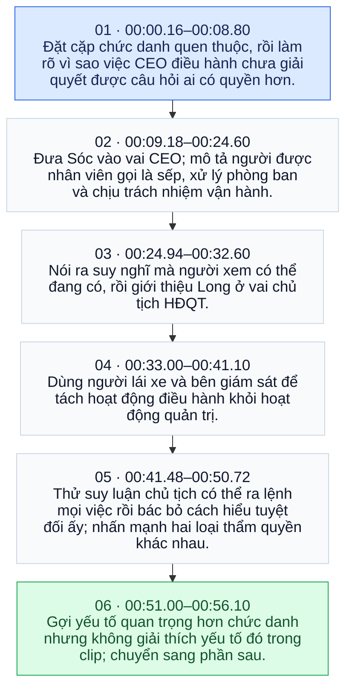

# Hai tầng quyền lực: điều hành và quản trị doanh nghiệp

[Video gốc — @longvasocbc1](https://www.tiktok.com/@longvasocbc1/video/7697361245959114000) · ID `7697361245959114000`

**Tóm tắt cách kể:** Cặp quen thuộc nhưng khó xếp hạng → dựng đáp án trực giác qua một nhân vật → thêm tầng bị bỏ sót → thay thứ bậc đơn tuyến bằng hai loại quyền. Phần đầu có cơ sở quan sát để gọi là hook so quyền lực; không có dữ liệu chứng minh cơ chế ấy gây tăng view.

[Sơ đồ diễn biến](#mindmap) · [Diễn biến](#dien-bien) · [Nhịp cảm xúc](#cam-xuc) · [Cách áp dụng](#ap-dung)

## Sơ đồ diễn biến

Đọc từ trên xuống: mỗi hộp là một nhịp theo mốc ASR hoặc khung hình được ghi trong phân tích. Xanh dương là mở đầu, xanh lá là nhịp cuối. Chi tiết và giới hạn nằm trong phân tích bên dưới.

[Mã Mermaid riêng](../mindmaps/7697361245959114000.mmd)

## Dữ liệu và nguồn

**Cách thể hiện:** Hoạt hình giải thích

**Ngữ cảnh thương mại:** Chưa xác nhận hợp tác thương mại; xem các đoạn tự quảng bá/giới hạn được ghi riêng.

- Đăng: 2026-10-16T20:13:07+00:00. Metadata lấy: 2026-11-15T03:28:11.271463+00:00.
- **896,500 view**; thích 42,900; bình luận 263; chia sẻ 2,970; lưu 2,996. Dấu phẩy tách hàng nghìn.
- Thời lượng media: 56.40s.
- **71.15× P50** 12,600 của 75 bài đủ 48h trong snapshot kênh. Clip có trong cửa sổ baseline. Không phải thống kê toàn bộ kênh.

## Phạm vi kiểm

Đã tải media, xem khung chọn lọc và đọc ASR có mốc lưu lúc 2026-10-22T00:30:08.479398+00:00. Đối chiếu cùng ID và thời lượng, lệch 0.0s. **Chưa nghe toàn âm hoặc xem chuyển động liên tục; chưa xác nhận toàn văn ASR hay mọi dữ kiện kinh tế trong clip.**

Media SHA256: `1e8fd5fd14ded66ee9ee8b0a04f0316d4ed3184b25814473d14e5103fa43c251`. [Metadata và các hash khác](../videos.json). Video/ASR đầy đủ giữ ở bộ nghiên cứu cục bộ; bản chia sẻ giữ link gốc, trích ngắn và phân tích riêng.

## Lời hứa và câu hỏi trung tâm

**Lời hứa:** Giải thích quan hệ giữa CEO và chủ tịch, ban đầu được đóng như câu hỏi ai có quyền hơn.

**Câu hỏi:** Điều hành và quản trị khác nhau ra sao, và chức danh có đủ để xếp quyền lực không?

## Mở đầu: lời và hình

ASR đặt CEO cạnh chủ tịch rồi hỏi ai là người đứng đầu. Ba nhịp đầu tiếp tục cùng một nghi vấn: CEO điều hành nhưng vẫn còn tầng quản trị phía trên. Khung 0–3 giây đặt hai biểu tượng người có nhãn chức danh ngang hàng, rồi thêm dấu hỏi và chữ; câu hỏi quyền lực trở thành phép so nhìn được ngay.

> CEO và chủ tịch, ai mới là sếp của công ty?

Trích ASR ngắn từ segment 00:00.16–00:02.66. Đoạn ASR ngắn, chưa đối chiếu toàn bộ âm; xem giới hạn từng ca. Dấu … nghĩa là bỏ bớt, không khẳng định toàn câu vừa ba giây.

| Mốc khung đã xem | Điều quan sát được |
|---|---|
| 00:00.00 | Hai biểu tượng người trên hai biển chức danh CEO và chủ tịch HĐQT ở cùng hàng, chưa có sơ đồ phân cấp. |
| 00:02.00 | Dấu hỏi màu vàng ở phía trên hai chức danh; chữ trên hình hỏi ai là người đứng đầu công ty. |
| 00:16.92 | Nhân vật Sóc mặc vest đứng trong một văn phòng có nhân viên và bảng làm việc, hỗ trợ phần mô tả vai trò điều hành. |
| 00:33.84 | Một xe đỏ do nhân vật Sóc cầm lái trên đường, tương ứng đoạn ASR dùng hình dung lái doanh nghiệp. |
| 00:42.30 | Khung Sóc kèm thẻ hỏi về cấp trên của CEO, đưa phép so chức danh trở lại hình. |
| 00:55.40 | Hai nhân vật Long và Sóc đứng cạnh nhau, phía trên có nhãn phần tiếp theo; không có sơ đồ sở hữu hay kết luận về người quyền lực nhất. |

Không suy chuyển động giữa các khung từ ảnh tĩnh.

## Diễn biến và nhiệm vụ từng beat

| Mốc ASR | Diễn giải riêng | Vai trò |
|---|---|---|
| 00:00.16–00:08.80 | Đặt cặp chức danh quen thuộc, rồi làm rõ vì sao việc CEO điều hành chưa giải quyết được câu hỏi ai có quyền hơn. | Mở bằng lựa chọn hai vế và kéo dài khoảng trống thông tin. |
| 00:09.18–00:24.60 | Đưa Sóc vào vai CEO; mô tả người được nhân viên gọi là sếp, xử lý phòng ban và chịu trách nhiệm vận hành. | Tạo một đáp án tạm có vẻ hợp lý: người cầm việc hằng ngày là người cao nhất. |
| 00:24.94–00:32.60 | Nói ra suy nghĩ mà người xem có thể đang có, rồi giới thiệu Long ở vai chủ tịch HĐQT. | Lật đáp án tạm bằng một vai trò còn thiếu. |
| 00:33.00–00:41.10 | Dùng người lái xe và bên giám sát để tách hoạt động điều hành khỏi hoạt động quản trị. | Đổi khái niệm chức danh thành một phép phân công dễ hình dung. |
| 00:41.48–00:50.72 | Thử suy luận chủ tịch có thể ra lệnh mọi việc rồi bác bỏ cách hiểu tuyệt đối ấy; nhấn mạnh hai loại thẩm quyền khác nhau. | Sửa thêm một suy luận đơn giản hóa, trả lời một phần khác biệt giữa hai chức danh. |
| 00:51.00–00:56.10 | Gợi yếu tố quan trọng hơn chức danh nhưng không giải thích yếu tố đó trong clip; chuyển sang phần sau. | Mở vòng hỏi mới để nối tập; câu hỏi ai thực sự mạnh hơn chưa được giải trọn. |

## Nhịp cảm xúc — giả thuyết biên tập

Các trạng thái dưới đây là cách đọc câu chuyện từ bằng chứng, không phải cảm xúc người xem đã đo hoặc biểu đồ retention.

| Mốc | Cảm xúc có thể gợi | Bằng chứng | Cách diễn giải |
|---|---|---|---|
| 00:00.16–00:08.80 | Tò mò về thứ bậc | Cặp chức danh được hỏi lặp qua hai cách diễn đạt. | Kéo khán giả vào một quan hệ họ thấy quen nhưng khó xếp. |
| 00:09.18–00:24.60 | Tạm có đáp án | Sóc quản mọi việc vận hành và được nhân viên gọi là sếp. | Người xem được dựng một trực giác để nhịp sau có thứ cần sửa. |
| 00:24.94–00:32.60 | Đáp án bị thiếu một tầng | Long/chủ tịch xuất hiện sau phần củng cố CEO. | Một vai còn thiếu làm phép xếp hạng ban đầu chưa đủ. |
| 00:33.00–00:50.72 | Rõ phân vai | Ẩn dụ lái xe rồi tách hai loại thẩm quyền. | Đây là phần giải tỏa nhầm lẫn, không trả hoàn toàn câu quyền lực tối hậu. |
| 00:51.00–00:56.10 | Tò mò còn treo | Yếu tố hơn chức danh được gợi nhưng hẹn phần sau. | Có thể tạo nhu cầu xem tiếp, cũng có thể khiến bài độc lập thiếu đáp án; chưa có dữ liệu phân xử. |

## Cách phân phối thông tin

| Mốc | Động tác viết | Vì sao đáng chú ý |
|---|---|---|
| 00:00.16–00:08.80 | Đặt câu hỏi hai vế | Cho đối tượng so sánh rõ ngay mở. |
| 00:09.18–00:32.60 | Dựng rồi sửa đáp án trực giác | Người xem không bị đưa ngay một định nghĩa trừu tượng. |
| 00:33.00–00:50.72 | Ẩn dụ chức năng thay cho bậc thang | Giải thích khác loại quyền thay vì chỉ cao-thấp. |
| 00:51.00–00:56.10 | Mở vòng hỏi tiếp | Cần phân biệt kết nối tập với việc trả lời clip độc lập. |

## Giải đáp và cách kết

Kết thúc bằng lời hẹn phần sau, sau khi đã phân biệt điều hành với quản trị. Đoạn này đóng bài học phân vai nhưng để mở câu hỏi quyền lực tối hậu đã gợi ngay đầu.

## Điểm mạnh có dẫn chứng

- **Vai và hành động thống nhất** — 9,18–24,6 giây Sóc theo vai CEO, rồi Long đi vào đúng tầng quản trị.

- **Có hai lần sửa trực giác** — 24,94–32,6 giây thêm chủ tịch; 41,48–50,72 giây bác suy luận ra lệnh tuyệt đối.

## Điểm yếu và điều không nên bắt chước

- **Câu hỏi mạnh nhất chưa được trả** — 51–56,1 giây hẹn yếu tố quyết định quyền lực ở phần hai.

- **Mở nhiều câu cùng một nghi vấn** — 0,16–8,8 giây có thể rút khi bài ngắn; chưa có retention để coi là lỗi đã đo.

## Khả năng được chia sẻ — chưa kiểm chứng

Không có dữ liệu phân phối/retention để kết luận vì sao viral. Các ý sau chỉ là giả thuyết để thử:

- Cặp chức danh thường gặp trong tin doanh nghiệp có thể khiến clip trở thành giải thích dễ gửi lại.

- Lối hai linh vật giữ vai có thể hỗ trợ nhớ phân công; chưa có kiểm nghiệm ghi nhớ.

## Chuyển cơ chế sang bài mới

Có thể học việc đặt hai vai hay bị nhầm cạnh nhau và cho người xem thử một đáp án tạm trước khi thêm điều kiện. Khi chuyển thành video độc lập, cần trả câu hỏi cốt lõi trong chính clip hoặc thu hẹp lời hứa ngay từ đầu. Không mặc định sao chép lối hẹn phần hai.

- Chốt lời hứa là phân vai nếu chưa trả được xếp quyền lực.

- Cho một đáp án tạm có lý rồi thêm điều kiện, không cố tạo phản bác rỗng.

- Video độc lập cần trả câu cốt lõi, không học máy móc lời hẹn tiếp.

Không dùng bài chuyển thể chưa được người dùng duyệt làm mẫu giọng lâu dài.

## Giới hạn còn lại

- Đã xem 12 khung trích từ bản tải mới và đọc ASR có timestamp; chưa nghe âm hoặc xem video liên tục.

- Mốc beats lấy từ ASR đã lưu của cùng video ID; cần nghe lại khi trích nguyên văn.

- Đây là phân tích cách trình bày, không kiểm chứng độc lập toàn bộ nội dung quản trị doanh nghiệp.

- Chỉ một ca tham khảo; không có retention hoặc thử nghiệm nhân quả.
