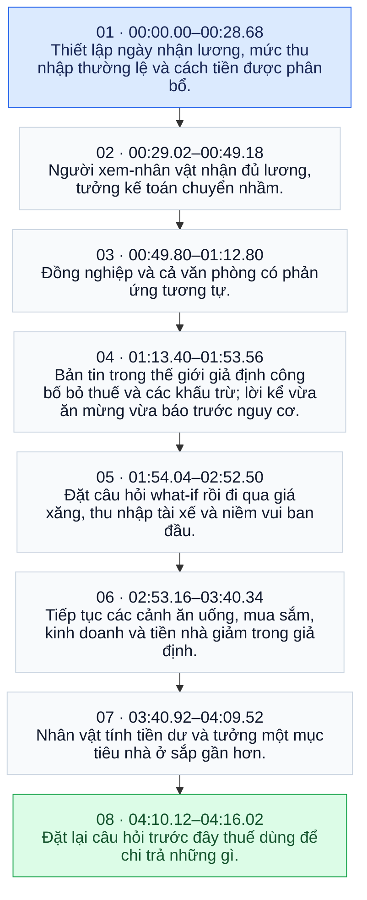

# Một tin nhắn lương mở ra thế giới giả định không có thuế

[Video gốc — @iftactix](https://www.tiktok.com/@iftactix/video/7702669503209016594) · ID `7702669503209016594`

**Tóm tắt cách kể:** Một cảnh có thời gian cụ thể → dấu hiệu lệch thói quen → cả tập thể cùng gặp → công bố tiền đề giả định → cộng dồn lợi ích → hỏi cái giá bị giấu.

[Sơ đồ diễn biến](#mindmap) · [Diễn biến](#dien-bien) · [Nhịp cảm xúc](#cam-xuc) · [Cách áp dụng](#ap-dung)

## Sơ đồ diễn biến

Đọc từ trên xuống: mỗi hộp là một nhịp theo mốc ASR hoặc khung hình được ghi trong phân tích. Xanh dương là mở đầu, xanh lá là nhịp cuối. Chi tiết và giới hạn nằm trong phân tích bên dưới.

[Mã Mermaid riêng](../mindmaps/7702669503209016594.mmd)

## Dữ liệu và nguồn

**Cách thể hiện:** Kể tình huống giả định

**Phạm vi học:** Xem phạm vi kiểm và giới hạn từng ca.

**Ngữ cảnh thương mại:** Chưa xác nhận hợp tác thương mại; xem các đoạn tự quảng bá/giới hạn được ghi riêng.

- Đăng: 2026-10-31T03:31:54+00:00. Metadata lấy: 2026-11-15T03:45:41.503247+00:00.
- **1,100,000 view**; thích 79,100; bình luận 153; chia sẻ 9,873; lưu 3,495. Dấu phẩy tách hàng nghìn.
- Thời lượng media: 258.04s.
- **353.47× P50** 3,112 của 67 bài đủ 48h trong snapshot kênh. Clip có trong cửa sổ baseline. Không phải thống kê toàn bộ kênh.

## Phạm vi kiểm

Đã tải media, xem khung chọn lọc và đọc ASR có mốc lưu lúc 2026-11-05T15:00:20.012940+00:00. Đối chiếu cùng ID và thời lượng, lệch 0.033s. **Chưa nghe toàn âm hoặc xem chuyển động liên tục; chưa xác nhận toàn văn ASR hay mọi dữ kiện trong clip.**

Media SHA256: `1d61d84049fa6c81840e4067c3d096c27323867f3591b3124c411c5ca240051a`. [Metadata và các hash khác](../videos.json). Video/ASR đầy đủ giữ ở bộ nghiên cứu cục bộ; bản chia sẻ giữ link gốc, trích ngắn và phân tích riêng.

## Lời hứa và câu hỏi trung tâm

**Lời hứa:** Cho người xem sống qua một thay đổi tưởng đem lại lợi ích tài chính lớn, rồi đặt câu hỏi về phần chi phí chưa nhìn thấy.

**Câu hỏi:** Nếu các khoản thu biến mất, ai chi trả những dịch vụ mà tiền ấy từng tài trợ?

## Mở đầu: lời và hình

Mở bằng thời gian, ngày nhận lương, điện thoại và một thói quen văn phòng. Bất thường chỉ thật rõ sau gần nửa phút, khi số thực nhận không còn khoản khấu trừ. Khung 1–5 giây dựng hai nhân vật tại bàn làm việc và báo biến động số dư; đây là mở bằng cảnh sống, không phải lời định nghĩa thuế.

> 9 giờ 5 phút sáng, ngày mùng năm đầu tháng …

Trích ASR ngắn từ segment 00:00.00–00:06.58. Đoạn ASR ngắn, chưa đối chiếu toàn bộ âm; xem giới hạn từng ca. Dấu … nghĩa là bỏ bớt, không khẳng định toàn câu vừa ba giây.

| Mốc khung đã xem | Điều quan sát được |
|---|---|
| 00:01.00 | Hai nhân vật mèo trong văn phòng, góc trên có thời gian 9:05 ngày mùng năm. |
| 00:05.00 | Một bong bóng báo biến động số dư đặt cạnh nhân vật ở bàn. |
| 00:38.71 | Cận hình điện thoại nhận 35 triệu, nhãn thuế bằng không và phần cộng tiền tiết kiệm xuất hiện. |
| 01:17.41 | TV trong văn phòng hiện người dẫn bản tin, nhân vật khác đứng cạnh; phạm vi sự kiện được mở từ một người sang tập thể. |
| 01:56.12 | Một thẻ hỏi về thế giới không còn thuế, kèm các biểu tượng công cộng. |
| 03:52.23 | Nhân vật nằm trên giường dưới phép cộng lợi ích tài chính; góc có số dư. |
| 04:17.04 | Khung tối, câu hỏi thuế trả cho việc gì và phễu dẫn xuống một thành phố. |

Không suy chuyển động giữa các khung từ ảnh tĩnh.

## Diễn biến và nhiệm vụ từng beat

| Mốc ASR | Diễn giải riêng | Vai trò |
|---|---|---|
| 00:00.00–00:28.68 | Thiết lập ngày nhận lương, mức thu nhập thường lệ và cách tiền được phân bổ. | Tạo đời sống bình thường đủ cụ thể để người xem thấy bất thường sau đó. |
| 00:29.02–00:49.18 | Người xem-nhân vật nhận đủ lương, tưởng kế toán chuyển nhầm. | Tạo bí ẩn nhỏ trong cùng cảnh quen thuộc. |
| 00:49.80–01:12.80 | Đồng nghiệp và cả văn phòng có phản ứng tương tự. | Mở quy mô từ sự cố cá nhân sang hiện tượng tập thể. |
| 01:13.40–01:53.56 | Bản tin trong thế giới giả định công bố bỏ thuế và các khấu trừ; lời kể vừa ăn mừng vừa báo trước nguy cơ. | Đặt tiền đề thế giới và gieo cái giá chưa lộ. |
| 01:54.04–02:52.50 | Đặt câu hỏi what-if rồi đi qua giá xăng, thu nhập tài xế và niềm vui ban đầu. | Cho lợi ích có người chịu tác động cụ thể, chưa trả chi phí công cộng. |
| 02:53.16–03:40.34 | Tiếp tục các cảnh ăn uống, mua sắm, kinh doanh và tiền nhà giảm trong giả định. | Tích lũy lợi ích theo nhiều khoản để làm sức hấp dẫn lớn dần. |
| 03:40.92–04:09.52 | Nhân vật tính tiền dư và tưởng một mục tiêu nhà ở sắp gần hơn. | Đưa tổng lợi ích về mục tiêu cá nhân đã có trong đời sống. |
| 04:10.12–04:16.02 | Đặt lại câu hỏi trước đây thuế dùng để chi trả những gì. | Đảo khung nhìn ở cuối và hoãn phần hệ quả sang nội dung kế tiếp. |

## Nhịp cảm xúc — giả thuyết biên tập

Các trạng thái dưới đây là cách đọc câu chuyện từ bằng chứng, không phải cảm xúc người xem đã đo hoặc biểu đồ retention.

| Mốc | Cảm xúc có thể gợi | Bằng chứng | Cách diễn giải |
|---|---|---|---|
| 00:00.00–00:28.68 | Quen thuộc | Ngày nhận lương và các khoản chi được mô tả chi tiết. | Cảnh bình thường tạo nền để mức tiền khác thường có trọng lượng. |
| 00:29.02–00:49.18 | Bất ngờ xen lo trả lại | Tiền về đủ mức lương và nhân vật nghĩ bị chuyển nhầm. | Một lợi ích đi kèm nghi vấn giữ cảnh khỏi chỉ là lời khoe. |
| 00:49.80–01:53.56 | Ngạc nhiên tập thể và ăn mừng | Đồng nghiệp đều phản ứng, sau đó có bản tin trong thế giới giả định. | Cách mở rộng phạm vi có thể kéo người xem đi từ bí ẩn cá nhân tới câu chuyện hệ thống. |
| 01:54.04–03:40.34 | Hào hứng tích lũy | Giá xăng, ăn uống, hàng nhập, kinh doanh và tiền nhà cùng được kể có lợi. | Nhiều điểm chạm làm giả định dễ liên hệ, nhưng cũng kéo dài trước câu trả lời chính sách. |
| 03:40.92–04:09.52 | Hy vọng riêng tư | Nhân vật tính tiền dư để tiến gần mục tiêu căn hộ. | Biến ích lợi tổng quát thành một đích cá nhân. |
| 04:10.12–04:16.02 | Bất an quay lại | Câu hỏi về việc thuế từng dùng chi trả điều gì. | Nhịp này lật cách nhìn mà chưa giải quyết vòng hệ quả. |

## Cách phân phối thông tin

| Mốc | Động tác viết | Vì sao đáng chú ý |
|---|---|---|
| 00:00.00–00:49.18 | Neo thời gian và vật thể trước khái niệm | Điện thoại/bảng lương giúp quan sát bất thường thay vì mở bằng chính sách. |
| 00:49.80–01:53.56 | Tăng quy mô thông tin | Một giao dịch → văn phòng → thông báo toàn quốc trong thế giới giả định. |
| 01:54.04–03:40.34 | Montage đời sống theo khoản chi | Đưa hiệu ứng giả định qua từng bối cảnh quen. |
| 03:40.92–04:16.02 | Cộng sổ rồi đảo câu hỏi | Bảng tính lợi ích mở đường cho câu hỏi về nguồn chi công bị bỏ sót. |

## Giải đáp và cách kết

Kết chưa giải thích tác dụng chi công của thuế; nó dùng câu hỏi ấy làm bản lề cho phần sau. Clip đã dựng rất kỹ cảm giác được lợi trong thế giới giả định, nhưng toàn bộ phép thử chính sách chưa khép ở đoạn media này.

## Điểm mạnh có dẫn chứng

- **Cảnh mở có nhiều chi tiết cảm giác và hành vi** — 0–49,18 giây không chỉ nêu ý tưởng không thuế mà cho thấy nhắn tin, thói quen và phản ứng.

- **Tăng quy mô theo một chuỗi nhận biết** — 49,8–113,56 giây đi từ đồng nghiệp tới bản tin.

- **Câu cuối đổi thước đo của toàn phần lợi ích** — 250,12–256,02 giây chuyển từ tiền giữ được sang dịch vụ phải chi.

## Điểm yếu và điều không nên bắt chước

- **Tiền đề được nêu tường minh khá muộn** — Câu hỏi what-if xuất hiện ở 114,04 giây, quá dài nếu chuyển sang video 60 giây.

- **Phép thử mới trả vế được lợi** — Phần tác dụng chi công chỉ thành câu hỏi cuối, chưa giải.

- **Lặp nhiều khoản có lợi có thể trở thành dàn trải** — 173,16–220,34 giây tích lũy ví dụ cùng một hướng; chưa có retention để biết điểm nào hữu ích nhất.

## Khả năng được chia sẻ — chưa kiểm chứng

Không có dữ liệu phân phối/retention để kết luận vì sao viral. Các ý sau chỉ là giả thuyết để thử:

- Có thể gợi tranh luận vì biến một chủ đề thuế trừu tượng thành tiền lương, xăng và tiền nhà cá nhân.

- Thế giới giả định và câu lật cuối có thể khuyến khích chờ phần sau; chưa có dữ liệu xác nhận hành vi này.

## Chuyển cơ chế sang bài mới

Học nhịp phát hiện bất thường từ nhỏ đến lớn và cách đặt lợi ích vào các cảnh đời sống. Khi viết video độc lập ngắn, cần đưa câu hỏi chi phí và ít nhất một phần trả lời sớm hơn; ghi rõ giả định, không gán các mức giá/thuế hư cấu thành thực tế.

- Đánh dấu thế giới giả định ngay từ đầu, nhất là khi dùng hình bản tin.

- Giữ chuỗi phát hiện bất thường nhưng rút số cảnh nếu thời lượng ngắn.

- Đừng chỉ cộng lợi ích; cần trả ít nhất một phần hệ quả/chi phí trong clip độc lập.

- Kiểm riêng số thuế, bảo hiểm và giá trước khi dùng làm dữ kiện thật.

Không dùng bài chuyển thể chưa được người dùng duyệt làm mẫu giọng lâu dài.

## Giới hạn còn lại

- Đã đọc toàn segments ASR có mốc và xem 12 khung mới tải ở contact sheet; chưa nghe âm trực tiếp hoặc xem chuyển động liên tục.

- Mốc là mốc ASR/khung trích, không phải căn chỉnh bằng tai; đoạn không xuất hiện trong các khung không được suy thành một chuyển động cụ thể.

- Đây là phân tích kỹ thuật kể, không xác minh độc lập các khẳng định kinh tế, số liệu hoặc chính sách trong clip.

- Không có retention hay thử A/B; nhịp cảm xúc và khả năng lan truyền dưới đây là diễn giải/giả thuyết, không phải kết quả đo.

- ASR kết thúc khoảng 256 giây trong khi contact sheet có khung 257,04; không suy thêm lời sau đoạn ASR cuối.

- Giả định gộp thuế và các khoản bảo hiểm; đó là cách tác giả dựng thế giới, không phải phân loại pháp lý được xác minh.
