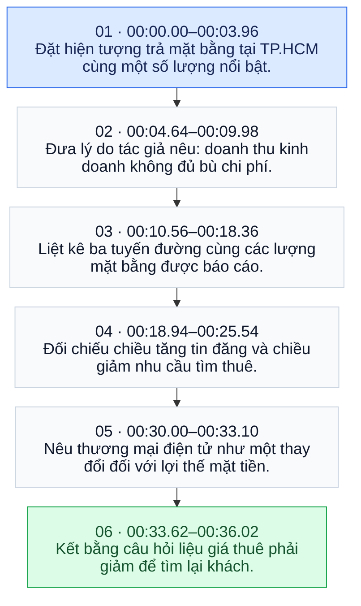

# Mặt bằng bỏ trống: từ một tuyến phố tới câu hỏi về giá thuê

[Video gốc — @d.trending](https://www.tiktok.com/@d.trending/video/7703767680964185350) · ID `7703767680964185350`

**Tóm tắt cách kể:** Headline địa phương + lượng cụ thể → vài địa chỉ làm bằng chứng kể → hai chiều cung cầu → câu hỏi hệ quả.

[Sơ đồ diễn biến](#mindmap) · [Diễn biến](#dien-bien) · [Nhịp cảm xúc](#cam-xuc) · [Cách áp dụng](#ap-dung)

## Sơ đồ diễn biến

Đọc từ trên xuống: mỗi hộp là một nhịp theo mốc ASR hoặc khung hình được ghi trong phân tích. Xanh dương là mở đầu, xanh lá là nhịp cuối. Chi tiết và giới hạn nằm trong phân tích bên dưới.

[Mã Mermaid riêng](../mindmaps/7703767680964185350.mmd)

## Dữ liệu và nguồn

**Cách thể hiện:** Bản tin ngắn trên footage

**Phạm vi học:** Xem phạm vi kiểm và giới hạn từng ca.

**Ngữ cảnh thương mại:** Chưa xác nhận hợp tác thương mại; xem các đoạn tự quảng bá/giới hạn được ghi riêng.

- Đăng: 2026-11-03T02:35:40+00:00. Metadata lấy: 2026-11-15T04:04:04.317146+00:00.
- **209,100 view**; thích 4,944; bình luận 549; chia sẻ 1,109; lưu 348. Dấu phẩy tách hàng nghìn.
- Thời lượng media: 36.50s.
- **88.79× P50** 2,355 của 124 bài đủ 48h trong snapshot kênh. Clip có trong cửa sổ baseline. Không phải thống kê toàn bộ kênh.

## Phạm vi kiểm

Đã tải media, xem khung chọn lọc và đọc ASR có mốc lưu lúc 2026-11-15T04:06:19.730037+00:00. Đối chiếu cùng ID và thời lượng, lệch 0.02s. **Chưa nghe toàn âm hoặc xem chuyển động liên tục; chưa xác nhận toàn văn ASR hay mọi dữ kiện trong clip.**

Media SHA256: `0566990972c0c38a0dd3174f941082c271108d64120bf66364b15e2ada38b712`. [Metadata và các hash khác](../videos.json). Video/ASR đầy đủ giữ ở bộ nghiên cứu cục bộ; bản chia sẻ giữ link gốc, trích ngắn và phân tích riêng.

## Lời hứa và câu hỏi trung tâm

**Lời hứa:** Một thị trường cho thuê đang khó tìm khách sẽ được nhìn qua các dấu hiệu cụ thể.

**Câu hỏi:** Điều gì làm mặt tiền không còn dễ đổi thành doanh thu, và giá thuê có chịu sức ép không?

## Mở đầu: lời và hình

Câu đầu đưa địa điểm, hiện tượng và số lượng vào cùng một headline. Khung mở là mặt tiền có biển cho thuê; tiêu đề vàng giữ nguyên qua nhiều khung nên người lướt có thể nhận ra vấn đề bằng hình/chữ trước khi theo hết lời.

> Nhà phố TP.HCM ồ ạt trả mặt bằng hơn 30 căn trên một tuyến đường tìm khách thuê.

Trích ASR ngắn từ segment 00:00.00–00:03.96. Trích ASR chưa nghe đối chiếu; dữ kiện thuộc lời người đăng, chưa xác thực. Xem giới hạn từng ca. Dấu … nghĩa là bỏ bớt, không khẳng định toàn câu vừa ba giây.

| Mốc khung đã xem | Điều quan sát được |
|---|---|
| 00:00.00 | Mặt tiền có biển cho thuê, phía dưới là headline vàng trên nền xanh và ngày 03/11/2026. |
| 00:10.95 | Chuyển sang một mặt bằng đóng cửa khác; khối headline vẫn giữ nguyên. |
| 00:21.90 | Ảnh biển cho thuê bằng tiếng Anh minh họa trạng thái tìm khách. |
| 00:32.85 | Một cửa hàng đóng cửa với biển cho thuê; tiêu đề cố định không đổi thành thông tin mới. |

Không suy chuyển động giữa các khung từ ảnh tĩnh.

## Diễn biến và nhiệm vụ từng beat

| Mốc ASR | Diễn giải riêng | Vai trò |
|---|---|---|
| 00:00.00–00:03.96 | Đặt hiện tượng trả mặt bằng tại TP.HCM cùng một số lượng nổi bật. | Headline định lượng và địa phương. |
| 00:04.64–00:09.98 | Đưa lý do tác giả nêu: doanh thu kinh doanh không đủ bù chi phí. | Từ hiện tượng sang áp lực chi phí. |
| 00:10.56–00:18.36 | Liệt kê ba tuyến đường cùng các lượng mặt bằng được báo cáo. | Cụ thể hóa thay vì chỉ nói toàn thị trường. |
| 00:18.94–00:25.54 | Đối chiếu chiều tăng tin đăng và chiều giảm nhu cầu tìm thuê. | Đưa hai phía cung cầu vào một phép so. |
| 00:30.00–00:33.10 | Nêu thương mại điện tử như một thay đổi đối với lợi thế mặt tiền. | Thêm yếu tố khiến kỳ vọng cũ không còn chắc. |
| 00:33.62–00:36.02 | Kết bằng câu hỏi liệu giá thuê phải giảm để tìm lại khách. | Mở thảo luận, chưa tính mức giá cân bằng. |

## Nhịp cảm xúc — giả thuyết biên tập

Các trạng thái dưới đây là cách đọc câu chuyện từ bằng chứng, không phải cảm xúc người xem đã đo hoặc biểu đồ retention.

| Mốc | Cảm xúc có thể gợi | Bằng chứng | Cách diễn giải |
|---|---|---|---|
| 00:00.00–00:03.96 | Chú ý vì gần nơi mình biết | Nêu ngay TP.HCM và một lượng mặt bằng trên một tuyến đường. | Địa điểm làm phạm vi rõ; con số có thể khiến người xem muốn biết có rộng hơn không. |
| 00:04.64–00:18.36 | Nhận diện áp lực | Nói đến chi phí rồi bổ sung ba tuyến đường. | Cảm giác hiện tượng có nhiều điểm xuất hiện, nhưng đó chưa là kiểm chứng thống kê. |
| 00:18.94–00:25.54 | Thấy một nghịch chiều | Tin đăng và nhu cầu được mô tả đi hai hướng. | Hai chiều tạo câu hỏi điều chỉnh thay cho danh sách đơn thuần. |
| 00:30.00–00:36.02 | Chờ một hệ quả | Nêu TMĐT rồi hỏi giá thuê có giảm. | Kết chuyển mô tả thành câu hỏi người xem có thể thảo luận. |

## Cách phân phối thông tin

| Mốc | Động tác viết | Vì sao đáng chú ý |
|---|---|---|
| 00:00.00–00:03.96 | Đóng phạm vi vào địa phương và một số lượng. | Người xem biết ngay tin nói ở đâu, chuyện gì. |
| 00:10.56–00:18.36 | Chuyển từ phát biểu chung sang ba địa chỉ. | Tăng chi tiết có thể đối chiếu sau khi xem. |
| 00:18.94–00:25.54 | Đặt cung và cầu cạnh nhau. | Giúp giải thích sức ép thay vì chỉ nêu hình vắng khách. |
| 00:30.00–00:36.02 | Đổi từ mặt bằng sang mô hình mua bán và giá. | Mở hệ quả, nhưng không giải được mọi yếu tố trong một câu. |

## Giải đáp và cách kết

Bài kết bằng câu hỏi về khả năng điều chỉnh giá thuê, không đưa đáp án định lượng. Phần nội dung đã giải thích hiện tượng theo lập luận của tác giả nhưng chưa chứng minh quan hệ nhân quả bằng dữ liệu gốc.

## Điểm mạnh có dẫn chứng

- **Vào chuyện rất nhanh** — 0–3,96s đủ địa phương, hiện tượng và số lượng.

- **Có tuyến giải thích cho headline** — 4,64–25,54s nối chi phí, địa chỉ rồi hai phía thị trường.

## Điểm yếu và điều không nên bắt chước

- **Ảnh và chữ ít thêm thông tin sau mở** — Các khung 0,10,95,21,9,32,85s vẫn cùng headline; cần lời để biết số liệu mới.

- **Câu trả lời cuối còn treo** — 33,62–36,02s hỏi về giá mà không đưa dữ liệu giá thuê cụ thể.

## Khả năng được chia sẻ — chưa kiểm chứng

Không có dữ liệu phân phối/retention để kết luận vì sao viral. Các ý sau chỉ là giả thuyết để thử:

- Tin địa phương có thể được gửi cho người đang thuê/cho thuê; chưa có dữ liệu người chia sẻ.

- Một câu hỏi cuối liên quan giá có thể gợi ý kiến, nhưng không chứng minh tương tác hay giữ chân tăng.

## Chuyển cơ chế sang bài mới

Có thể học cách dùng một địa điểm người xem nhận ra và một chỉ dấu cụ thể để mở tin ngắn; khi áp dụng cần kiểm số, nguồn và thời điểm, không lấy sự lặp của ảnh làm bằng chứng thị trường.

- Dùng địa điểm và chỉ dấu được kiểm, giữ ngày và nguồn gần số.

- Không suy từ vài ảnh đóng cửa ra tình trạng toàn thị trường.

- Nếu hứa giải đáp giá, thêm dữ liệu/điều kiện hoặc hạ mức hứa.

Không dùng bài chuyển thể chưa được người dùng duyệt làm mẫu giọng lâu dài.

## Giới hạn còn lại

- Chỉ xem khung chọn lọc và đọc ASR vừa tạo, chưa nghe toàn âm hoặc xem liên tục.

- Số lượng địa chỉ và tỷ lệ cung/cầu là dữ liệu tác giả nêu, chưa đối chiếu nguồn bất động sản gốc.

- ASR có khoảng trống 25,54–30s; không tự viết thêm nội dung vào khoảng đó.

- Không có retention, ảnh minh họa không tự chứng minh quy mô hiện tượng.
