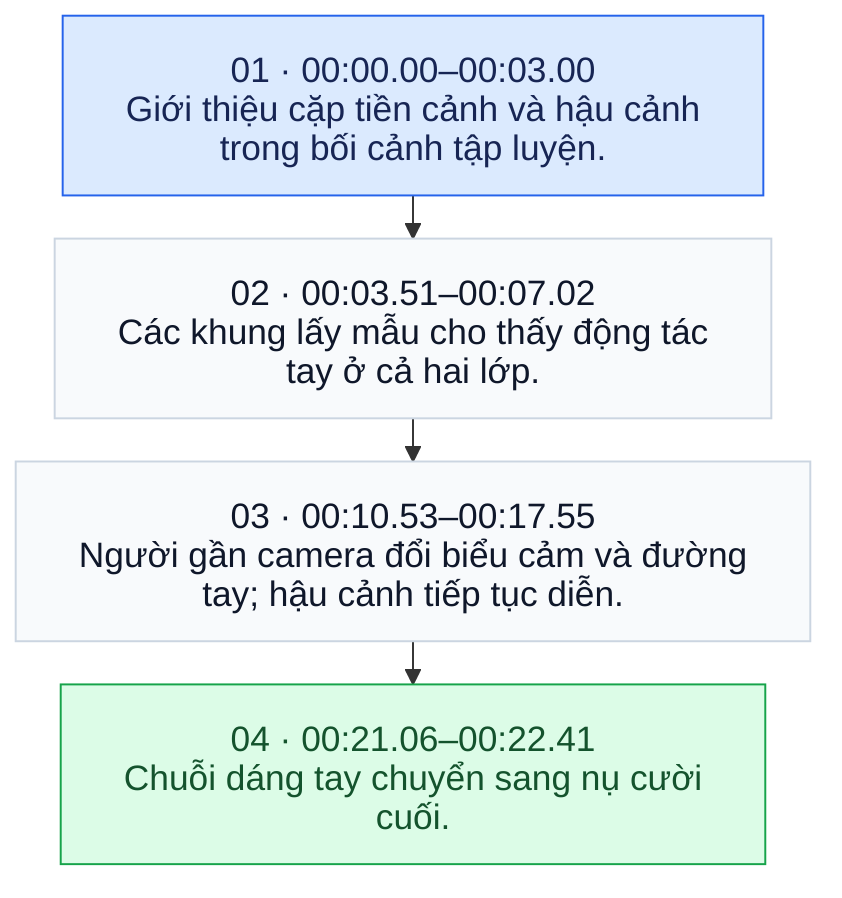

# Hai lớp biểu diễn: tiền cảnh dẫn, hậu cảnh biến tấu

[Video gốc — @thunglongfamily](https://www.tiktok.com/@thunglongfamily/video/7704655257149705473) · ID `7704655257149705473`

**Tóm tắt cách kể:** Đặt người diễn chính sát camera và người thứ hai phía sau cho phép mắt so hai cách biểu diễn trong một cái nhìn. Mỗi biến thể tay/biểu cảm làm khung cố định bớt lặp; phần thưởng là màn diễn đôi, không phải một khái niệm được giải mã.

[Sơ đồ diễn biến](#mindmap) · [Diễn biến](#dien-bien) · [Nhịp cảm xúc](#cam-xuc) · [Cách áp dụng](#ap-dung)

## Sơ đồ diễn biến

Đọc từ trên xuống: mỗi hộp là một nhịp theo mốc ASR hoặc khung hình được ghi trong phân tích. Xanh dương là mở đầu, xanh lá là nhịp cuối. Chi tiết và giới hạn nằm trong phân tích bên dưới.

[Mã Mermaid riêng](../mindmaps/7704655257149705473.mmd)

## Dữ liệu và nguồn

**Cách thể hiện:** Biểu diễn hình thể

**Phạm vi học:** Học bố cục/hành động/chữ thấy được; không dùng làm bằng chứng lời thoại.

**Ngữ cảnh thương mại:** Chưa xác nhận tài trợ; nhận diện thương hiệu/quảng bá quan sát được nằm trong phân tích.

- Đăng: 2026-11-05T11:57:27+00:00. Metadata lấy: 2026-11-15T04:34:16.839491+00:00.
- **2,100,000 view**; thích 112,000; bình luận 362; chia sẻ 3,325; lưu 2,478. Dấu phẩy tách hàng nghìn.
- Thời lượng media: 23.41s.
- **7.83× P50** 268,250 của 150 bài đủ 48h trong snapshot kênh. Clip có trong cửa sổ baseline. Không phải thống kê toàn bộ kênh.

## Phạm vi kiểm

Đã tải media, xem khung chọn lọc và đọc ASR có mốc lưu lúc 2026-11-15T04:35:50.541203+00:00. Đối chiếu cùng ID và thời lượng, lệch 0.025s. **Chưa nghe toàn âm hoặc xem chuyển động liên tục; chưa xác nhận toàn văn ASR hay mọi dữ kiện trong clip.**

Media SHA256: `5ec6c89902c1f61c3b25afedfbe6d93d58f5b5d5c33f766e754f7ddaff633a7a`. [Metadata và các hash khác](../videos.json). Video/ASR đầy đủ giữ ở bộ nghiên cứu cục bộ; bản chia sẻ giữ link gốc, trích ngắn và phân tích riêng.

## Lời hứa và câu hỏi trung tâm

**Lời hứa:** Một màn diễn đôi có biến thể tại phòng gym.

**Câu hỏi:** Hai người sẽ phối/đối chiếu động tác thế nào trong cùng một khung?

## Mở đầu: lời và hình

Khung 0–2 giây đã đặt hai người trên hai lớp không gian. Từ khung 3 giây người nữ giơ hai tay, phía sau người nam cũng có cử chỉ rộng; không cần lời giải mới thấy đây là màn diễn thay buổi tập. ASR một câu CTA kéo dài toàn clip không khớp kênh/cảnh, bị loại hoàn toàn.

## Nghiên cứu phần mở

Diễn giải từ bằng chứng đã lưu; lý do gây chú ý là giả thuyết biên tập, chưa đo retention.

**Cửa sổ quan sát:** 00:00.00–00:03.00

| Lớp | Quan sát/diễn giải |
|---|---|
| Lời | Không đủ bằng chứng ngữ âm; ASR CTA không khớp bị loại. |
| Hình | Hai người ở hai lớp, bối cảnh gym, động tác tay bắt đầu rõ tại 3 giây. |
| Chữ trên hình | Không có chữ giải thích đáng tin ở khung mở. |

**Động tác gây chú ý:** Cho mắt hai hành động để so trong cùng cảnh.

**Vì sao có thể muốn dừng lại:** Giả thuyết: cặp diễn lệch bối cảnh tập luyện và người ở sau tạo lý do nhìn thêm.

**Điều còn muốn biết:** Hậu cảnh sẽ làm gì so với người gần máy?

**Thông tin chưa cho biết:** Không thấy thông tin thực tế bị giấu.

**Nhịp nối có gì mới:** Biến thể cử chỉ của cả hai người trong khung giữ nguyên.

**Mốc trả/giới hạn giải đáp:** 00:21.06–00:22.41 — Hồi đáp là biến thể cuối và nụ cười; không có đáp án bằng lời.

**Tóm cấu trúc bằng hai câu:** Đặt hai nhân vật trong một khung có thứ bậc nhìn rõ. Để hành động của lớp sau tiếp tục đối chiếu với lớp trước.

**Chuyển sang ngách khác:** Chuyển được quan hệ hai hành động nhìn cùng lúc; sang finance cần cặp điều kiện/kết quả kiểm chứng được, không dựa vào tính vui của điệu nhảy.

**Điều không chuyển theo:**

- CTA do ASR ảo
- Kết luận về độ đồng bộ nhạc
- Cử chỉ không liên quan chủ đề

**Phạm vi:** 12 khung; ASR bị loại vì một segment không khớp; chỉ phân tích hình.

Không trích ASR mở vì là nhạc hoặc nhận dạng không đáng tin; phân tích hình/chữ theo mốc khung.

| Mốc khung đã xem | Điều quan sát được |
|---|---|
| 00:00.00 | Người nữ đội mũ ở gần máy quay, phía sau là người nam trên máy chạy. |
| 00:02.00 | Người gần camera đặt tay quanh eo, hậu cảnh vẫn có người thứ hai. |
| 00:03.00 | Người nữ giơ hai tay gần ngực; người nam phía sau cũng giơ tay. |
| 00:07.02 | Hai lớp cùng có động tác tay hướng ra trước trong khung mẫu. |
| 00:17.55 | Người tiền cảnh bắt chéo tay phía trước thân, người phía sau đổi tư thế. |
| 00:22.41 | Khung cuối người nữ cười, hai người vẫn trong phòng gym. |

Không suy chuyển động giữa các khung từ ảnh tĩnh.

## Diễn biến và nhiệm vụ từng beat

| Mốc ASR | Diễn giải riêng | Vai trò |
|---|---|---|
| 00:00.00–00:03.00 | Giới thiệu cặp tiền cảnh và hậu cảnh trong bối cảnh tập luyện. | Tạo hai điểm để theo dõi. |
| 00:03.51–00:07.02 | Các khung lấy mẫu cho thấy động tác tay ở cả hai lớp. | Tạo đối chiếu biểu diễn đôi. |
| 00:10.53–00:17.55 | Người gần camera đổi biểu cảm và đường tay; hậu cảnh tiếp tục diễn. | Duy trì biến thể trong bố cục cố định. |
| 00:21.06–00:22.41 | Chuỗi dáng tay chuyển sang nụ cười cuối. | Đóng vui bằng biểu cảm; không có lời giải riêng. |

## Nhịp cảm xúc — giả thuyết biên tập

Các trạng thái dưới đây là cách đọc câu chuyện từ bằng chứng, không phải cảm xúc người xem đã đo hoặc biểu đồ retention.

| Mốc | Cảm xúc có thể gợi | Bằng chứng | Cách diễn giải |
|---|---|---|---|
| 00:00.00–00:03.00 | Tạo hai điểm để theo dõi. | Giới thiệu cặp tiền cảnh và hậu cảnh trong bối cảnh tập luyện. | Đây là diễn giải tác dụng của trình tự, không xác nhận cảm xúc thực tế của khán giả. |
| 00:03.51–00:07.02 | Tạo đối chiếu biểu diễn đôi. | Các khung lấy mẫu cho thấy động tác tay ở cả hai lớp. | Đây là diễn giải tác dụng của trình tự, không xác nhận cảm xúc thực tế của khán giả. |
| 00:10.53–00:17.55 | Duy trì biến thể trong bố cục cố định. | Người gần camera đổi biểu cảm và đường tay; hậu cảnh tiếp tục diễn. | Đây là diễn giải tác dụng của trình tự, không xác nhận cảm xúc thực tế của khán giả. |
| 00:21.06–00:22.41 | Đóng vui bằng biểu cảm; không có lời giải riêng. | Chuỗi dáng tay chuyển sang nụ cười cuối. | Đây là diễn giải tác dụng của trình tự, không xác nhận cảm xúc thực tế của khán giả. |

## Cách phân phối thông tin

| Mốc | Động tác viết | Vì sao đáng chú ý |
|---|---|---|
| 00:00.00–00:03.00 | Tạo hai điểm để theo dõi. | Giới thiệu cặp tiền cảnh và hậu cảnh trong bối cảnh tập luyện. |
| 00:03.51–00:07.02 | Tạo đối chiếu biểu diễn đôi. | Các khung lấy mẫu cho thấy động tác tay ở cả hai lớp. |
| 00:10.53–00:17.55 | Duy trì biến thể trong bố cục cố định. | Người gần camera đổi biểu cảm và đường tay; hậu cảnh tiếp tục diễn. |
| 00:21.06–00:22.41 | Đóng vui bằng biểu cảm; không có lời giải riêng. | Chuỗi dáng tay chuyển sang nụ cười cuối. |

## Giải đáp và cách kết

Khung cuối 22,41 giây có nụ cười và chuyển động tay; không có thẻ kết hay thông tin mới. Không đủ khung để khẳng định vòng lặp khớp đầu.

## Điểm mạnh có dẫn chứng

- **Có hai điểm quan sát ngay mở** — Khung 0 giây thấy tiền cảnh và hậu cảnh rõ.

- **Cùng bối cảnh nhưng dáng đổi** — Khung 3;7,02;17,55 giây cho các đường tay khác nhau.

## Điểm yếu và điều không nên bắt chước

- **Không xác định quan hệ chính xác của các động tác bằng khung thưa** — Giữa các mốc lấy mẫu không có bằng chứng về mức đồng bộ liên tục.

- **Giá trị phụ thuộc biểu diễn và ngữ cảnh trend** — Không có câu chuyện hoặc giải thích độc lập trong hình để chuyển nguyên sang kiến thức.

## Khả năng được chia sẻ — chưa kiểm chứng

Không có dữ liệu phân phối/retention để kết luận vì sao viral. Các ý sau chỉ là giả thuyết để thử:

- Tình huống có thể được gửi vì người xem nhận ra hành vi quen thuộc; chưa đọc dữ liệu chia sẻ hay bình luận để xác nhận.

## Chuyển cơ chế sang bài mới

Học bố trí hai lớp có quan hệ để người xem tự so. Với bài finance, hai lớp cần đại diện hai hành động hay hai kết quả có dữ kiện rõ; nền có người nhảy chỉ là trang trí nếu không giúp giải thích.

- Cho hai lớp quan hệ dễ nhận; đừng để người phía sau chỉ gây nhiễu.

- Chuyển bố cục so sánh, không chép điệu nhảy làm công thức hook.

- Không suy ra nhịp nhạc hay mức đồng bộ khi chưa xem liên tục.

Không dùng bài chuyển thể chưa được người dùng duyệt làm mẫu giọng lâu dài.

## Giới hạn còn lại

- Đã xem 12 khung trích có timestamp từ bản tải mới và đọc ASR khi có; chưa nghe âm hoặc xem video liên tục.

- Cách gây chú ý và giữ chân là giả thuyết biên tập, không phải số đo retention hay quan hệ nhân quả.

- ASR 0–23,3 giây là CTA về kênh khác, không khớp nguồn; không dùng bất cứ speech claim nào.

- Mốc beats là các cửa sổ quan sát ảnh, không phải kết quả đo cắt cảnh.
